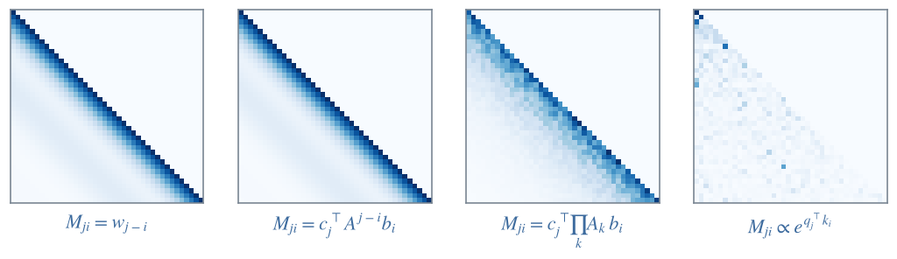

# 第 1 章 序列建模的三难困境

序列模型到今天仍然是个未解决的问题。RNN、CNN、Transformer 这三种方案看起来都很自然，各自却都有致命伤。

这一章不涉及 SSM，只把"序列建模到底难在哪"讲清楚，并立一个贯穿全书的框架：状态压缩视角。第 17 章会用它给出 Mamba 的核心论点，一个序列模型的全部差别，在于它用什么方式、用多大的代价，把历史压缩进一个状态。

有四件事需要交代：

- 一个序列模型的"能力"和"成本"分别由什么决定？
- 为什么注意力机制既是最强的，又是最贵的？
- 为什么"线性复杂度"本身并不稀奇，稀奇的是"线性复杂度且效果好"？
- Long Range Arena 到底在考什么？

最后一个问题更基本：

- 为什么"用固定大小的状态压缩整段历史"是一条值得走的路？

---

## 1.1 序列模型的形式化

先把术语固定下来。序列到序列映射（sequence-to-sequence map）是一个参数化的函数

$$
f_\theta : \mathbb{R}^{L \times D} \to \mathbb{R}^{L \times D},
$$

其中 $L$ 是序列长度（sequence length），$D$ 是每个位置的特征维度（feature dimension / model dimension）。输入写成 $X \in \mathbb{R}^{L\times D}$，第 $t$ 个位置的行向量记为 $X_t \in \mathbb{R}^D$（也有论文用列向量表示，约定不同而已）。

本书讨论的几乎所有模型都是因果的（causal）、自回归的（autoregressive）：第 $t$ 个位置的输出只允许依赖 $X_0, X_1, \dots, X_t$，不允许看到未来。这是语言建模的硬性要求，也是本系列所有 SSM 的默认设定。

在这个框架下，一个序列模型可以分解为两个正交的问题，两者可以各自换方案：

1. 沿序列轴（时间轴）的信息混合：位置 $t$ 该如何从位置 $0,\dots,t$ 取信息？
2. 沿特征轴（通道轴）的信息混合：$D$ 个通道之间该如何交互？这是普通 MLP / 线性层就够用的部分。

本书的主题几乎全部集中在第 1 个问题上。Mamba 的架构里，绝大多数参数其实花在第 2 个问题（线性投影）上，"序列混合"那部分只占很小一部分参数，但决定模型能否处理长依赖的正是它。

要讲清第 1 个问题，把序列混合直接看成一次矩阵乘法就够了，后面所有的复杂度分析都从这里出。

### 矩阵混合器视角

考虑一个因果的序列变换。它可以用一个下三角矩阵 $M \in \mathbb{R}^{L\times L}$ 来精确表示：

$$
Y = M X, \qquad M_{ji} = 0 \ \text{当} \ i > j.
$$

$M_{ji}$ 的含义是输出位置 $j$ 从输入位置 $i$ 取了多少信息。第 1 节的三种模型家族，本质上是对 $M$ 的三种参数化：

| 模型家族 | $M$ 的形式 | 参数个数 | 特殊性质 |
|---|---|---|---|
| 因果卷积 | $M_{ji} = w_{j-i}$（Toeplitz 矩阵） | $L$ | 只依赖时间差 |
| 线性递推（含 SSM） | $M_{ji} = c_j^\top \prod_{k=i+1}^{j} A_k \, b_i$ | $O(N L)$ | 由低维状态递推生成 |
| 自注意力 | $M_{ji} \propto \exp(q_j^\top k_i)$，再行归一 | $O(L^2)$ 计算，$O(LD)$ 参数 | 依赖内容相似度 |

表里三行参数化值得逐条读：

- 卷积的 $M$ 是时不变的：权重只依赖距离 $j-i$，不依赖内容，也不依赖绝对位置。
- 线性递推的 $M$ 由一组低维状态（维数 $N$）递推产生。$M$ 本身是个 $L\times L$ 矩阵，却只需要 $O(NL)$ 个参数就能生成，**所有 SSM 的高效计算都建立在这一点上**。
- 注意力的 $M$ 是内容相关的：权重由 $q_j^\top k_i$ 决定，因此要显式计算 $L^2$ 个权重。

第 22 章会证明，Mamba-2 的矩阵 $M$ 属于"半可分矩阵（semiseparable matrix）"这个经典结构，注意力的 $M$ 是它的一个极端特例。三种方案各自的物理直觉先建立起来。

---

## 1.2 第一种方案：循环神经网络（RNN）

### 基本形式

RNN 用隐状态（hidden state）$h_t \in \mathbb{R}^N$ 携带历史：

$$
h_t = f_\theta(h_{t-1}, x_t), \qquad y_t = g_\theta(h_t).
$$

最朴素的版本（Elman RNN）是

$$
h_t = \tanh(W_h h_{t-1} + W_x x_t).
$$

它的成本很低：

- 训练时间：$O(L \cdot N^2)$（每步一次 $N\times N$ 乘向量）
- 推理时间：每步 $O(N^2)$，与已生成的长度无关
- 推理内存：$O(N)$，与上下文长度无关

最后一条是 RNN 最大的卖点，今天所有线性模型都想保住它：生成第 100 万个 token 时，只需要存一个 $N$ 维的状态，不需要存前 100 万个 token。

### RNN 的致命伤：梯度消失与并行性

RNN 有两个独立的致命问题，后面的模型是分别解决它们的，所以要分开讨论。

问题一：优化困难，尤其是长依赖。

反向传播穿过 $L$ 步递推时，梯度里会出现连乘项 $\prod_{t} \partial h_t / \partial h_{t-1}$。若雅可比矩阵的谱半径小于 1，梯度指数衰减；大于 1，指数爆炸。这就是经典的梯度消失/爆炸问题。

LSTM（Hochreiter & Schmidhuber, 1997）和 GRU（Cho 等, 2014）用门控（gating）缓解了这个问题：遗忘门 $f_t = \sigma(\cdot)$ 让状态可以"记住"而不衰减，输入门 $i_t$ 控制写入：

$$
c_t = f_t \odot c_{t-1} + i_t \odot \tilde{c}_t .
$$

门控本质上是在动态调整时间尺度（timescale）。遗忘门接近 1 时状态几乎不衰减（长记忆），接近 0 时立刻丢掉（短记忆）。第 2 章会重新发现这一点：**门控就是可学习的离散化步长 $\Delta$**，这个等价关系正是 Mamba 选择性机制的数学基础（第 18 章）。

问题二：训练无法并行。

RNN 被 Transformer 取代，原因不在效果，而在 GPU 上跑不起来。$h_t$ 依赖 $h_{t-1}$，$L$ 步必须串行执行。GPU 有几千个并行核心，RNN 的训练只能用到其中极少一部分，而且每一步都要把 $N$ 维状态从显存搬进搬出，是典型的访存受限（memory-bound）操作。

如果只是梯度问题，LSTM 早就够用了。让 Transformer 一统天下的是"训练时可以并行"这个工程属性。因此任何挑战 Transformer 的架构，第一道门槛不是效果，而是能否用矩阵乘法（从而用 Tensor Core）做训练。这道门槛反复出现：S5 用并行扫描跨过，S4 用 FFT 卷积跨过，Mamba-1 用硬件感知扫描跨过，Mamba-2 用块分解 + 矩阵乘法跨过，Mamba-3 用 MIMO 矩阵乘跨过。

### 状态压缩视角

Mamba 论文（Gu & Dao, 2023）给了一个我认为是理解这一切最好用的框架：

> 序列建模的本质是压缩。你要把一段任意长的上下文压进一个有固定容量的状态，然后用这个状态做预测。

按这个视角：

- RNN/SSM：状态大小 $N$ 固定，与序列长度无关 → 推理成本 $O(1)$/步，代价是压缩率极高，必然丢信息。
- 注意力：状态就是"全部历史"（即 KV cache），大小 $O(L)$ → 完全不压缩，因此效果最好，代价是推理每步 $O(L)$、训练 $O(L^2)$。
- 卷积：状态是最近 $k$ 个输入 → 压缩率由 kernel 大小决定，但压缩方式固定（不依赖内容）。

模型设计的核心问题于是变成一个工程问题：

> 如何在给定状态预算 $N$ 下，把最有用的信息压进去？

所有 SSM 的演进都是对这个问题不同侧面的回答，全书会反复出现这句话。

---

## 1.3 第二种方案：卷积网络（CNN）

因果卷积（causal convolution）用固定核 $w_0,\dots,w_{k-1}$：

$$
y_t = \sum_{i=0}^{k-1} w_i x_{t-i}.
$$

优点是训练可以完全并行：这是标准卷积，可以用 im2col 或 FFT 实现，完全是矩阵乘法友好的。

缺点是感受野（receptive field）只有 $k$。要覆盖长度 $L$，需要 $k \ge L$，参数量就变成 $O(L)$；或者堆叠 $\log L$ 层并逐层加倍膨胀率（dilated convolution，如 WaveNet、TCN），但这样的感受野是人工设计出来的，不能自适应。

更根本的问题是卷积的权重不依赖内容。输入是一段"中间夹了大量无关填充词"的文本时，卷积没有任何机制把它跳过去，只能固定地按距离加权。第 17 章会用"选择性复制任务（Selective Copying）"精确暴露这个缺陷，Mamba 正是由此而来。

卷积还有一个别的好处：它天然时不变，而时不变恰好等价于"可以用 FFT 加速"、"可以用一个固定的卷积核"。S4 能用 FFT 训练，靠的就是把 SSM 强行约束成时不变。

---

## 1.4 第三种方案：注意力（Transformer）

### 基本形式

自注意力（self-attention）为每一对位置计算一个权重：

$$
y_t = \sum_{i \le t} \frac{\exp(q_t^\top k_i)}{\sum_{j\le t}\exp(q_t^\top k_j)} v_i,
$$

其中 $q_t = W_Q x_t$、$k_i = W_K x_i$、$v_i = W_V x_i$ 都是由输入线性投影得到。

用第 1.1 节的矩阵视角，注意力写成一个下三角矩阵：

$$
M_{ji} = \frac{\exp(q_j^\top k_i)}{\sum_{i'\le j}\exp(q_j^\top k_{i'})}, \qquad Y = MX .
$$

### 为什么它强

- 内容相关：权重由 $q^\top k$ 决定，可以"按需"从历史里取出相关信息。Mamba 论文把这种能力叫作基于内容的路由（content-based routing），在语言上表现为 in-context learning、归纳头（induction heads）、联想回忆（associative recall）等能力。
- 梯度路径短：任意两个位置之间的梯度只穿过一层，不受长度影响。
- 训练并行：$QK^\top$ 是一次矩阵乘法，Tensor Core 最擅长的形状。

### 为什么它贵

- 训练时间与显存：$O(L^2)$。序列长度 $L$ 翻倍，成本变 4 倍。
- 推理：每生成一个 token 都要读取全部历史的 KV cache，即 $O(L)$ 访存。上下文 1M token 时，这个开销无法承受。
- 注意力没有状态，它用的是"记住所有东西"的策略。

注意力的昂贵来自定义，跟实现无关。KV cache 随上下文线性增长，这是"不压缩"的直接后果，多强的 kernel 优化都改不了（FlashAttention 解决的是显存占用与访存效率，但它依然要读 $O(L)$ 的 KV）。要在 1M 上下文下保持 $O(1)$ 的每步推理成本，**只有压缩一条路**。

### 一个自然的追问

卷积的 $M_{ji}=w_{j-i}$ 只看距离，注意力的 $M_{ji}=\exp(q_j^\top k_i)$ 只看内容，两者之间能不能有一种结构？

- 它应该有卷积那样的线性复杂度和并行性；
- 权重不应该固定于时间差，而要依内容变化；
- 同时只用一个固定大小的状态递推地生成这些权重，从而在推理时保持 $O(1)$/步。

这个"中间结构"就是 SSM 家族的全部内容。这条路上的第一块基石是 2020 年的 HiPPO（第 4~6 章）。讲 HiPPO 之前，得先把连续的、连续的、连续的（重要的事情说三遍）连续时间系统的数学基础补上（第 2 章）。

---

## 1.5 为什么"长程依赖"是一个独立的难题：LRA 基准

这场竞赛的计分板定义了后面所有模型的目标函数，所以在往下走之前先看一眼。

Long Range Arena（LRA；Tay 等, 2021）专门测试长序列建模能力，包含 6 个任务，序列长度从 1K 到 16K：

| 任务 | 输入长度 | 考什么 |
|---|---|---|
| ListOps | 2,048 | 层次化符号推理（括号嵌套的算术表达式求值） |
| Text | 4,096 | 字符级文本分类（IMDB 情感） |
| Retrieval | 4,000 | 双文档匹配（判断两段文本是否相似） |
| Image | 1,024 | 把 CIFAR-10 图像按像素展平成序列做分类 |
| Pathfinder | 1,024 | 判断两个点是否被一条虚线段连接（需长程视觉推理） |
| Path-X | 16,384 | 上者的难版，长度 16 倍 |

这些任务的共同点是答案依赖于相隔很远的位置之间的关系。

在 LRA 出现之前，Path-X（长度 16384）是所有模型的滑铁卢，包括各种高效 Transformer，它们在 Path-X 上只能拿到随机猜测（50%）的准确率。训练长度 16384 的注意力需要 $16384^2 \approx 2.7\times 10^8$ 个权重，显存直接爆掉；截断到局部窗口又丢掉了任务所需的长程信息。

S4 是第一个解出 Path-X 的模型（96.35%，第 13 章），S5 把它推到 98.58%（第 15 章）。这两个结果说明"线性复杂度"和"能解长程依赖"并不矛盾，只要能找到一个结构合适的 $M$。

LRA 侧重的是"感知类"的长依赖（图像、噪声信号），不是"信息检索类"的长依赖（在长文里精确找到某个事实）。后者对固定状态容量的模型更困难，第 21 章（DNA 与缩放定律）、第 24 章（MQAR 任务）和第 32 章（Mamba-3 的 NIAH 实验）会反复碰到。这个区分决定了 SSM 的适用边界：需要长期聚合统计量的任务它极强，需要精确回忆某个细节的任务它天生吃亏，前者靠压缩，后者要的恰恰是不压缩。

---

## 1.6 本章小结

- 序列模型的核心操作是用某种权重结构 $M$ 沿序列轴做信息混合。三种主流家族对应三种 $M$：Toeplitz（卷积）、低维递推生成（RNN/SSM）、内容相关的 $\exp(q^\top k)$（注意力）。
- RNN 便宜（$O(N)$ 状态、$O(1)$/步推理），但训练不可并行、梯度难传；门控（LSTM/GRU）缓解了梯度问题，本质上是在学时间尺度。
- 卷积完全可并行，但感受野受限、权重与内容无关。
- 注意力在效果与并行性上最强，训练 $O(L^2)$、推理每步 $O(L)$，代价来自它根本不压缩历史。
- 状态压缩视角把三者统一起来：成本由状态大小决定，能力由状态里存了什么决定。注意力的状态大小是 $O(L)$，RNN 是 $O(N)$。
- LRA 把"长程依赖"变成了可量化的目标，Path-X（16K）是标志性难关。
- 目标模型要同时具备线性复杂度（可并行训练）、常量内存推理、内容相关的权重，以及一个固定大小的状态。

## 下一章

下一章从零建立连续时间线性系统的基本语言：什么是状态空间模型，为什么线性常微分方程的解是矩阵指数，连续系统怎么变成离散递推，以及"离散化"这个看似技术性的步骤为什么会在后面反复成为故事的主角（从 S4 的双线性变换，到 Mamba 的 ZOH 与指数-欧拉，再到 Mamba-3 的指数-梯形）。

这一章不要跳。后面所有论文的一半难度，都来自对"连续 → 离散"这一步的理解。
