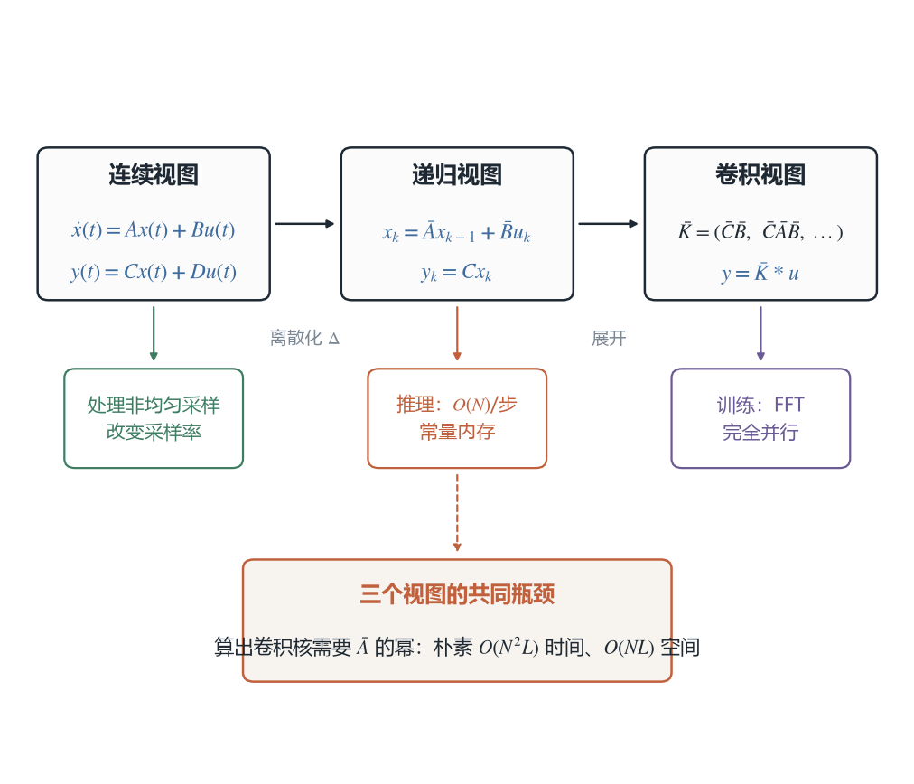

# 第 2 章 连续时间线性系统与状态空间模型

上一章结尾我们提出，目标模型应该"用一个固定大小的状态压缩历史"。这句话可以写成数学。

我们要建立的最小工具箱是：

1. 状态空间模型（state space model, SSM）到底是什么？它不是深度学习的发明，而是诞生于 1960 年代控制论的经典工具（Kalman, 1960）。
2. 线性常微分方程 $x'(t) = Ax(t) + Bu(t)$ 的解为什么是矩阵指数 $e^{\Delta A}$？
3. 连续系统怎么变成离散递推？为什么会有 Euler、双线性（Tustin）、零阶保持（ZOH）等多种"离散化"方法，它们各自的物理含义与数值性质是什么？
4. 一个线性时不变系统为什么等价于一个卷积？
5. $\Delta$（步长 / 时间尺度）为什么如此重要，以至于后面每一个模型都在它身上做文章？

这一章是纯数学，但后面每一章都要用到。本书所有的技术冲突都发生在"离散化"这一步：S4 用双线性；Mamba 声称用 ZOH 但实现上用了别的东西；Mamba-3 花了整整一节来"形式化"前面几篇论文里含糊的离散化，并提出了新的方法。这一章理解得够深，第 29 章（指数-梯形离散化）就没多少新东西了。

---

## 2.1 状态空间模型：一个控制论的老朋友

### 定义

一个（单输入单输出、线性、连续时间）状态空间模型由一对方程定义：

$$
\begin{aligned}
x'(t) &= A x(t) + B u(t), & x(t)\in\mathbb{R}^N,\ u(t)\in\mathbb{R},\ A\in\mathbb{R}^{N\times N},\ B\in\mathbb{R}^{N\times 1},\\
y(t) &= C x(t) + D u(t), & y(t)\in\mathbb{R},\ C\in\mathbb{R}^{1\times N},\ D\in\mathbb{R}.
\end{aligned}
\tag{2.1}
$$

逐项解释：

- $u(t)$：输入信号（input）。在我们的语境里就是序列的第 $t$ 个元素（标量；如果是 $D$ 维特征，就复制 $D$ 份、每份独立处理）。
- $x(t) \in \mathbb{R}^N$：状态（state）。它是对过去输入的一个 $N$ 维摘要。$N$ 称为状态维度（state size）或状态扩张因子（state expansion factor），因为它把"1 维的输入"扩张成了 "$N$ 维的内部表示"。这个 $N$ 就是第 1 章那个"压缩预算"。
- $y(t)$：输出（output）。
- $A$：状态转移矩阵（state transition / 系统矩阵）。它决定状态自身如何演化（"记忆怎么衰减或振荡"）。
- $B$：输入矩阵。它决定新输入如何被写进状态。
- $C$：输出矩阵。它决定如何从状态读出结果。
- $D$：直通项（feedthrough / skip connection）。它让输入直接影响输出。由于 $Du(t)$ 就是一个残差连接，本书后面几乎总是省略它（取 $D=0$），需要时再补上。

### 直觉：水槽模型

给一个物理直觉。把 $x(t)$ 想成一排 $N$ 个水槽的水位，$u(t)$ 是一个可以往里倒水的水龙头：

- $B$ 决定倒进来的水如何分配到各个槽（哪些槽进水多）。
- $A$ 决定槽与槽之间怎么互相渗漏、以及每个槽自己漏水的速率。
- $C$ 决定你从哪些槽读取刻度作为最终观测。
- 关键的约束是：槽的个数 $N$ 是固定的。不管你倒了多久的水，你只能看到 $N$ 个数字。这就是"压缩"。

这个比喻的代价是：它把你对"记忆"的理解从"存下所有东西"变成了"维护一个固定维度的动态系统"。HiPPO 要回答的正是：$A$ 应该长什么样，才能让这 $N$ 个数字尽量保留历史的信息？（第 4 章）

### 与 RNN 的关系

表面上看，(2.1) 和 RNN 很像：都有状态、都有输入输出映射。两点区别是本质的：

1. 线性：$x$ 对 $(x, u)$ 是线性的。没有 $\tanh$、没有门控、没有乘性交互（至少在连续形式里）。
2. 连续时间：$x$ 是时间 $t$ 的函数，而不是位置的函数。

第 1 点带来的直接好处是：线性系统有闭式解，因而有高效的计算方式（这占了后面一半的篇幅）。第 2 点带来的好处是：可以处理非均匀采样、可以在训练后改变采样率（resolution invariance）。

付出的代价是表达力：一个线性层本身当然不如 LSTM 表达力强。LSSL 论文（Gu 等, 2021）用了整整一节来证明"这不构成问题"（第 8 章）：深度方向上的非线性加上逐位置的非线性，就足以恢复表达力，而序列轴上的线性化换来效率上的收益。这有点像 CNN：卷积层是线性的，但没人会说 CNN 表达力不够。

---

## 2.2 求解：矩阵指数从哪来

### 先看无输入的情形

设 $u \equiv 0$，方程退化为

$$
x'(t) = A x(t).
$$

当 $N=1$（$A$ 是一个标量 $a$）时，答案你早就知道：$x(t) = e^{at}x(0)$。

当 $N>1$ 时，我们猜答案也长得类似，只是把 $e^{at}$ 换成矩阵指数（matrix exponential）：

$$
e^{M} := \sum_{k=0}^{\infty} \frac{M^k}{k!}, \qquad M \in \mathbb{R}^{N\times N}.
$$

这个级数对任何 $M$ 都绝对收敛（因为 $\|M^k\| \le \|M\|^k$，与标量情形同理），所以定义是良好的。验证它就是解：对 $t$ 求导

$$
\frac{d}{dt}e^{tA} = \frac{d}{dt}\sum_{k\ge0}\frac{t^kA^k}{k!} = \sum_{k\ge1}\frac{t^{k-1}A^k}{(k-1)!} = A\sum_{k\ge0}\frac{t^kA^k}{k!} = A\,e^{tA} .
$$

（这里 $A$ 与 $e^{tA}$ 可交换，因为 $e^{tA}$ 是 $A$ 的幂级数。）因此

$$
\boxed{\,x(t) = e^{tA}x(0)\,}
$$

是满足初值条件的唯一解（由 ODE 解的存在唯一性定理）。

另一个容易错的地方：$e^{A+B} = e^Ae^B$ 只在 $A,B$ 可交换（$AB=BA$）时成立。（反例：$A=\begin{pmatrix}0&1\\0&0\end{pmatrix}$，$B=\begin{pmatrix}0&0\\1&0\end{pmatrix}$ 时 $e^{A+B} \ne e^Ae^B$。）这个细节在推导 ZOH 时会被用到。

### 有输入的情形：积分因子法

现在回到完整方程 $x' = Ax + Bu$。用"积分因子" $e^{-tA}$：

$$
\frac{d}{dt}\left(e^{-tA}x(t)\right) = e^{-tA}x'(t) - Ae^{-tA}x(t) = e^{-tA}\big(x'(t) - Ax(t)\big) = e^{-tA}B\,u(t).
$$

两边从 $t_0$ 到 $t$ 积分：

$$
e^{-tA}x(t) - e^{-t_0A}x(t_0) = \int_{t_0}^{t} e^{-sA}B\,u(s)\,ds,
$$

于是

$$
\boxed{\,x(t) = e^{(t-t_0)A}x(t_0) + \int_{t_0}^{t} e^{(t-s)A}B\,u(s)\,ds\,}
\tag{2.2}
$$

这个公式把状态分成了两部分，后面每一章都要用到它：

- 零输入响应（zero-input response） $e^{(t-t_0)A}x(t_0)$：没有新输入时，旧状态自己怎么衰减/振荡。
- 零状态响应（zero-state response） $\int_{t_0}^t e^{(t-s)A}B u(s)\,ds$：新输入如何被"卷积"进状态。

积分核 $e^{(t-s)A}$ 只依赖时间差 $t-s$。这个自卷积结构是后面一切高效算法的来源。

### 再看输出：这是不是一个卷积？

把 $x(0)=0$（零初始状态）代入，输出为

$$
y(t) = C x(t) = \int_0^t \underbrace{C e^{(t-s)A} B}_{=:\,h(t-s)}\, u(s)\,ds = (h \ast u)(t).
$$

其中 $h(t) := C e^{tA}B$ 被称为系统的脉冲响应（impulse response），也叫连续卷积核。也就是说：

> 一个线性时不变状态空间模型，从输入到输出就是一个带核 $h(t) = Ce^{tA}B$ 的连续卷积。

这一句话是 S4 / LSSL 全部高效算法的出发点：既然等价于卷积，那就可以用卷积的计算方式（FFT）来做。

---

## 2.3 从连续到离散：离散化的艺术

### 为什么必须离散化

真实数据是离散的：文本是 token 序列，音频是采样点。但我们的模型是连续 ODE。要把二者连起来，必须做两件事：

1. 假设：假设离散序列 $u_0,u_1,\dots$ 是从某个连续的 $u(t)$ 每隔 $\Delta$ 采样得到的，即 $u_k = u(k\Delta)$。$\Delta$ 称为步长（step size），也叫时间尺度（timescale）。
2. 离散化：用数值方法把 (2.2) 变成一个关于 $k$ 的递推。

正式地，我们希望得到

$$
x_k = \bar A x_{k-1} + \bar B u_k, \qquad y_k = \bar C x_k + \bar D u_k,
\tag{2.3}
$$

其中 $\bar A, \bar B$ 是"离散化后的参数"，它们只是 $(\Delta, A, B)$ 的确定性函数。$\bar C = C$、$\bar D = D$ 保持不变。记号约定：带横线的符号表示离散参数。因为不同论文的记号不统一（Mamba-2 起就直接省掉横线了），这个约定得先说清楚。

下面给出四种最常见的离散化方法。它们都是对 (2.2) 中积分的不同近似，区别只在于把积分区间内的 $u$ 和 $e^{(t-s)A}$ 看作什么。

### 方法一：前向欧拉（forward Euler）

区间 $[t_{k-1}, t_k]$ 上假设 $x$ 变化缓慢，直接用 $x'(t)\approx (x_k - x_{k-1})/\Delta$：

$$
x_k = x_{k-1} + \Delta\left(Ax_{k-1} + Bu_{k-1}\right) = (I + \Delta A)x_{k-1} + \Delta B u_{k-1}.
$$

于是

$$
\bar A = I + \Delta A, \qquad \bar B = \Delta B .
$$

这是最简单的一阶方法，局部截断误差 $O(\Delta^2)$。它的稳定性很差：如果 $A$ 的特征值在左半平面，连续系统是稳定的；但 $I+\Delta A$ 的特征值可能跑出单位圆（当 $|\lambda|\Delta > 2$ 时），导致离散系统发散。所以在实践中很少用它。

### 方法二：后向欧拉（backward Euler）

改为在 $t_k$ 处评估导数：

$$
x_k = x_{k-1} + \Delta(Ax_k + Bu_k)
\quad\Longrightarrow\quad
x_k = (I - \Delta A)^{-1}x_{k-1} + \Delta(I-\Delta A)^{-1}B u_k .
$$

$$
\bar A = (I - \Delta A)^{-1}, \qquad \bar B = \Delta (I-\Delta A)^{-1} B .
$$

需要一个 $N\times N$ 矩阵求逆，换来的好处是**无条件稳定**（只要连续系统稳定，离散系统必稳定）。第 8 章会看到，这一形式与 RNN 的门控有直接对应。

### 方法三：双线性变换 / Tustin（bilinear / trapezoidal）

在区间上取两端点导数的平均，等价于对积分用梯形法则。结果是

$$
\bar A = \left(I - \frac{\Delta}{2}A\right)^{-1}\left(I + \frac{\Delta}{2}A\right), \qquad
\bar B = \left(I - \frac{\Delta}{2}A\right)^{-1}\Delta B, \qquad \bar C = C .
\tag{2.4}
$$

双线性的关键性质是：**它把左半平面映射到单位圆盘内部**（这正是"保持稳定性"的含义），而且它是二阶精度的。用 $\lambda$ 表示 $A$ 的特征值，映射为

$$
\bar\lambda = \frac{1 + \Delta\lambda/2}{1 - \Delta\lambda/2}.
$$

当 $\mathrm{Re}(\lambda)<0$ 时恒有 $|\bar\lambda|<1$。S4 用的就是双线性。原因在本书第 12 章会说明：S4 的参数化里 $A$ 是"对角加低秩"（DPLR）的，而 DPLR 矩阵在双线性变换下仍然是 DPLR，于是可以用 Woodbury 恒等式加速求逆。

更一般地，LSSL 论文定义了一族广义双线性变换（generalized bilinear transform, GBT）：

$$
x(t+\Delta) = (I-\alpha\Delta A)^{-1}\left(I+(1-\alpha)\Delta A\right)x(t) + \Delta(I-\alpha\Delta A)^{-1}B\,u(t).
\tag{2.5}
$$

$\alpha=0$ 是前向欧拉，$\alpha=1$ 是后向欧拉，$\alpha=1/2$ 是双线性。把这三者放进同一个公式里很实用：第 8 章会用 $\alpha=1$ 把 RNN 的门控解释成离散化步长，而用 $\alpha=1/2$ 来做实际计算。

### 方法四：零阶保持（zero-order hold, ZOH）

ZOH 的假设最物理：输入在区间内保持常数，即 $u(s) = u_k$ 对 $s\in[t_{k-1},t_k]$。把 $u$ 提出积分号，向 (2.2) 代入：

$$
x_k = e^{\Delta A}x_{k-1} + \left(\int_{t_{k-1}}^{t_k} e^{(t_k-s)A}\,ds\right)B u_k .
$$

做变量替换 $\tau = t_k - s$，

$$
\int_0^{\Delta} e^{\tau A}d\tau = A^{-1}\left(e^{\Delta A} - I\right)
$$

（这一步用到 $\int_0^\Delta e^{\tau A}d\tau = \sum_k A^k\Delta^{k+1}/(k+1)! = A^{-1}(e^{\Delta A}-I)$，$A$ 可逆时成立；$A$ 奇异时用级数定义即可）。因此

$$
\boxed{\ \bar A = e^{\Delta A},\qquad \bar B = A^{-1}\left(e^{\Delta A} - I\right)B\ }
\tag{2.6}
$$

ZOH 是一阶精度的（对输入而言），但它的状态转移部分 $\bar A = e^{\Delta A}$ 是精确的，这正是它名字的由来：在一个采样周期内，如果没有新信息进来，系统的演化被精确地模拟出来。

小细节：Mamba-1 论文正文写的是 ZOH，但它的开源实现在 $\bar B$ 上取了近似（把 $e^{\Delta A}$ 的一阶展开近似为 $\Delta$，即 $\bar B \approx \Delta B$，$\bar A = e^{\Delta A}$）。

Mamba-3 论文（2026）专门指出了这一点，并把这种实际使用的形式命名为指数-欧拉（exponential-Euler），还给出了理论依据（第 29 章）。真实工程里论文公式和代码往往不一致，而两者都可能是有意为之。

### 四种方法对比

| 方法 | $\bar A$ | $\bar B$ | 精度 | 稳定性 | 出现在 |
|---|---|---|---|---|---|
| 前向欧拉 | $I+\Delta A$ | $\Delta B$ | 1 阶 | 条件稳定 | 教科书 |
| 后向欧拉 | $(I-\Delta A)^{-1}$ | $\Delta(I-\Delta A)^{-1}B$ | 1 阶 | 无条件稳定 | 与 RNN 门控对应 |
| 双线性 | $(I-\tfrac{\Delta}{2}A)^{-1}(I+\tfrac{\Delta}{2}A)$ | $(I-\tfrac{\Delta}{2}A)^{-1}\Delta B$ | 2 阶 | 无条件稳定 | **S4**、S4D |
| ZOH | $e^{\Delta A}$ | $A^{-1}(e^{\Delta A}-I)B$ | 1 阶 | 无条件稳定 | **S5**、LMU |
| 指数-欧拉 | $e^{\Delta A}$ | $\Delta B$ | 1 阶 | 无条件稳定 | **Mamba-1/2 实现** |
| 指数-梯形 | $e^{\Delta A}$ | $(1-\lambda)\Delta e^{\Delta A}B_{t-1}$ 与 $\lambda\Delta B_t$ 两项 | 2 阶 | 无条件稳定 | **Mamba-3** |

最后两行先混个眼熟，第 29 章会详讲。

以上推导都假设 $A,B,\Delta$ 是常数（线性时不变，LTI）。当它们是时间的函数（线性时变，LTV，Mamba 的情形）时，"把参数换成时变的"这一步并不自动成立，需要重新推导。Mamba-3 论文强调的贡献之一就在这里：Mamba-1/2 的时变离散化在理论上没有严格依据（是"heuristic"），他们给出了一个统一的推导框架。

---

## 2.4 Δ 到底是什么：时间尺度

$\Delta$ 看起来只是个数值方法的技术参数，但它在 SSM 里承担的角色远远超出这个：

(1) 它决定了记忆的长度。从 $\bar A = e^{\Delta A}$ 可以看出，$\Delta$ 越大，离散状态的衰减越快（因为 $\mathrm{Re}(\lambda_A)<0$ 时 $|e^{\Delta\lambda_A}| = e^{\Delta\mathrm{Re}(\lambda_A)}$ 随 $\Delta$ 减小）。直觉上：

- $\Delta \to 0$：系统"几乎不演化"，状态几乎不变，等于把历史一直记着（但对新输入不敏感）。
- $\Delta \to \infty$：状态被迅速清零，等于只关注当前输入。

LSSL 论文里有一句表述：模型能捕捉的依赖长度大致正比于 $1/\Delta$。

(2) 它等价于 RNN 的门。LSSL 论文的 Lemma 3.1 证明：一个一维门控递推

$$
x_t = (1-\sigma(z))x_{t-1} + \sigma(z)u_t
$$

正是 $\dot x = -x + u$ 在 $\Delta = \exp(z)$ 下的后向欧拉离散化。也就是说，RNN 的遗忘门就是在学 $\Delta$，只不过它被参数化成 sigmoid 形式而且逐位置变化。这个等价关系后来成了 Mamba 选择机制的出发点（第 17~18 章）：既然门控就是 $\Delta$，那让 $\Delta$ 依赖输入，就是把"学习时间尺度"变成一个内容相关的操作。

(3) 它在卷积视角下决定核的宽度。从 $h(t) = Ce^{tA}B$ 看，$\Delta$ 决定了离散化采样的疏密，等价于卷积核的"时间尺度"。改变 $\Delta$ 就改变核的宽度，SSM 之所以能做分辨率改变（sampling resolution change），靠的就是这一点：在 16kHz 训练的语音模型，测试时把 $\Delta$ 除以 2，就能直接处理 8kHz 的数据（第 13 章的实验里 S4 用这一招在 0.5× 采样率上拿到 96.3%）。

(4) 它必须被学习或调好。在 LSSL 的消融里，S4 的前身 LSSL-fixed 如果 $\Delta$ 设得不对，sequential CIFAR 的准确率从 84.65% 掉到 49.3%，比随机猜（10%）好，但远低于正常水平。后续模型都在 $\Delta$ 上花心思，因为它是模型的核心参数，不是超参数。

---

## 2.5 三个视图：一个模型的三种身份

把上面的内容汇总成一张图：

*图 2-1　同一个 SSM 的三种视图：连续、递归、卷积，以及各自擅长的场景*

三个视图的用途完全不同：

| 视图 | 用途 | 为什么 |
|---|---|---|
| 递归 | **推理** | 每步只用 $O(N^2)$ 计算、$O(N)$ 内存，与序列长度无关 |
| 卷积 | **训练** | 可以并行（FFT 或直接卷积），因为整个序列一次算完 |
| 连续 | **插值/变采样率/非规则采样** | 可以按任意 $\Delta$ 离散化，不依赖训练时的采样率 |

LSSL 论文的核心卖点就是"同时拥有这三种身份"（第 7 章）。而 S4 之前的所有工作之所以做不到，是因为从递归视图到卷积视图的转换在计算上不可行：要算 $\bar K$ 就得算 $\bar A$ 的 $L$ 次幂，而 $\bar A^{k}$ 需要 $O(N^2)$ 的矩阵乘法，一共 $O(N^2L)$ 时间、$O(NL)$ 内存（需要存下所有中间状态）。

具体地，让我们把递归展开：

$$
x_0 = \bar B u_0,\quad
x_1 = \bar A\bar B u_0 + \bar B u_1,\quad
x_2 = \bar A^2 \bar B u_0 + \bar A \bar B u_1 + \bar B u_2,\ \dots
$$

$$
y_k = \bar C \bar A^k \bar B u_0 + \bar C\bar A^{k-1}\bar B u_1 + \dots + \bar C \bar A \bar B u_{k-1} + \bar C\bar B u_k .
$$

所以

$$
y = \bar K \ast u, \qquad \bar K = \left(\bar C\bar B,\ \bar C\bar A\bar B,\ \bar C\bar A^2\bar B,\ \dots,\ \bar C\bar A^{L-1}\bar B\right)\in\mathbb{R}^{L}.
\tag{2.7}
$$

一旦 $\bar K$ 算出来了，用它做一次长度为 $L$ 的因果卷积就是 $O(L\log L)$（用 FFT）。整个问题只剩下一个：怎么快速算出 $\bar K$？

这就是 S4 论文摘要里那句 "computing K in (5) is non-trivial and is the focus of our technical contributions" 的含义，也是第 10~12 章的全部内容。

---

## 2.6 一个必须提的坑：稳定性

在跑通公式之前，还有一个实践性的问题：训练会发散。

从 $\bar A = e^{\Delta A}$ 看，如果 $A$ 有特征值落在右半平面（$\mathrm{Re}(\lambda_A)>0$），那么 $|\bar A|$ 的谱半径大于 1，递推 $x_k = \bar A x_{k-1} + \dots$ 会指数放大，几万步之后必然溢出成 `inf`。

标准做法是把 $A$ 的实部参数化在一个指数函数里，强制为负：

$$
A = -\exp(A_{\text{real}}) + i\,A_{\text{imag}},
$$

或者（Mamba 的做法）直接用

$$
A = -\exp(A_{\log}),
$$

其中 $A_{\log}$ 是可学习参数。$\exp$ 的值域是正实数，加负号之后值域就是负实数，因此 $\mathrm{Re}(A)<0$ 恒成立。这就是控制论里的"左半平面条件"（left-half plane condition），也是为什么你会在所有 SSM 代码里看到 `-torch.exp(A_log)` 这种写法。

这个技巧也解释了 S4D-Real 的初始化为什么写成 $A_n = -(n+1)$ 而不是 $A_n = n+1$：负实部是硬约束，写成负数就是把约束烤进初始化里。

---

## 2.7 本章小结

- SSM 由 $x' = Ax + Bu,\ y = Cx + Du$ 定义。$N$（状态维度）是"压缩预算"，$A$ 决定记忆如何演化，$B$ 决定输入如何写入，$C$ 决定如何读出。
- 无输入时 $x(t) = e^{tA}x(0)$；有输入时 $x(t) = e^{(t-t_0)A}x(t_0) + \int_{t_0}^t e^{(t-s)A}Bu(s)ds$（积分因子法）。
- 因此线性时不变 SSM 等价于卷积，核为 $h(t) = Ce^{tA}B$；离散化后核是 $\bar K = (\bar C\bar B, \bar C\bar A\bar B, \dots)$。
- 离散化方法：前向欧拉（不稳定）、后向欧拉（稳定，对应 RNN 门控）、双线性（二阶精度 + 保稳定，S4 用）、ZOH（$\bar A=e^{\Delta A}$，S5 用）、指数-欧拉（Mamba 实现实际用）、指数-梯形（Mamba-3 新增）。
- $\Delta$ 是时间尺度：它决定记忆长度（$\sim 1/\Delta$）、等价于 RNN 遗忘门、决定卷积核宽度、必须被学习。
- 三视图分工：递归做推理、卷积做训练、连续做变采样率。
- 核心计算瓶颈：算出卷积核 $\bar K$ 需要 $\bar A$ 的幂，朴素做法 $O(N^2L)$ 时间 + $O(NL)$ 空间，这是 LSSL 不可用的原因。

## 下一章

现在我们有了一套完整的语言，可以描述"一个用线性递推压缩历史的模型"了。但在 2020 年之前，没人知道 $A$ 该长什么样。

第 3 章先把"SSM 如何变成一个真正的神经网络层"的工程细节补齐（多通道怎么处理、参数化怎么做、梯度怎么流），然后进入第二篇：HiPPO，记忆问题的数学答案。
