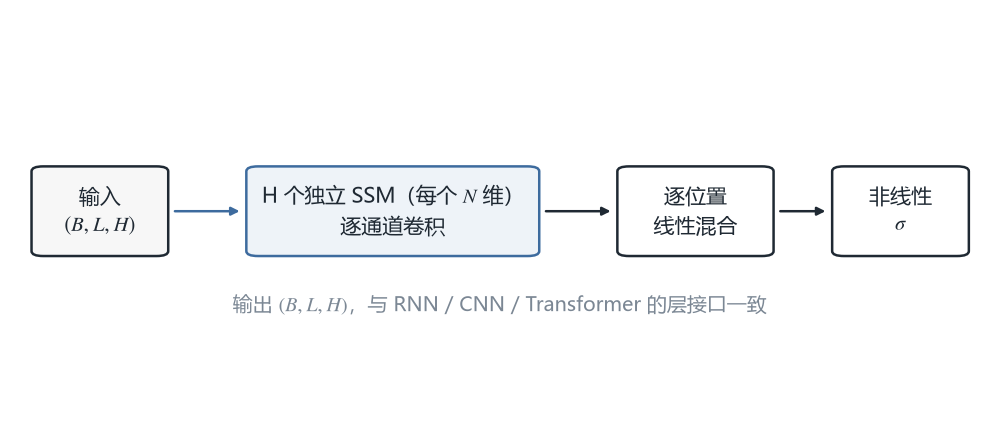

# 第 3 章 从连续到离散：SSM 如何成为一个神经网络层

前两章建立的数学对象还不能训练。要把它变成神经网络里的一个层，必须回答一堆工程问题：

1. 一个 SSM 处理的是标量序列 $u(t)\in\mathbb{R}$，但神经网络里的张量是 $(B, L, H)$ 的。多通道怎么办？
2. 参数 $A,B,C,\Delta$ 具体怎么参数化？初始化成什么？哪些可训、哪些冻结？
3. 训练时用卷积视图、推理时用递归视图，这两套参数怎么保证一致？
4. 计算量、显存、并行度到底是多少？和 Transformer、CNN 比差在哪？
5. 最后一个问题最关键：$A$ 应该取什么值？随便取一个（比如随机矩阵）会发生什么？

最后这个问题要到第 5 章才有答案，但必须先在这里提出来，因为整个 S4 系列的技术复杂度都是被它逼出来的。

---

## 3.1 把标量层拼成深度网络：SISO 广播

### 通道处理

一个 SSM 是标量到标量的映射。要处理 $H$ 维特征（隐藏维），最直接的做法是为每个通道配一份独立的 SSM：

$$
u \in \mathbb{R}^{B\times L\times H} \quad\Longrightarrow\quad
\text{对 } H \text{ 个通道各跑一个 } (A^{(h)}, B^{(h)}, C^{(h)}, \Delta^{(h)}).
$$

这被称为 SISO bank（bank of single-input single-output systems）。几个后果需要交代：

- 参数量：$A$ 是 $N\times N$ 的，$H$ 个通道就是 $H N^2$ 个参数。当 $N=64, H=512$ 时就是 200 万，太大了。所以实践中 $A$ 通常约束为对角矩阵，参数量降到 $HN$（S4D、Mamba 都是这样）。这是"必须给 $A$ 加结构"的第二个理由（第一个理由是计算速度，第 2 章已讲）。
- 通道间不交流：SISO bank 之后所有通道是独立的，所以必须加一个逐位置的线性层做通道混合（就像 Transformer 里的 $W_O$，或 depthwise separable convolution 之后的 $1\times1$ 卷积）。S4 的 `H` 通道混合矩阵是 $H\times H$，参数 $O(H^2)$。
- 有效状态维度：整个层的"状态"实际上是 $H\times N$ 那么大（S4 的论文说 $HN$）。这也是 S4 与 S5 的关键差别：S5 用单个 MIMO 系统（状态 $P$ 维，$P = O(H)$），而不是 $H$ 个 $N$ 维 SISO（第 15 章）。

### 层接口

一个 SSM 层的操作按顺序是这三步：

1. 逐通道 SSM：对第 $h$ 个通道，用 $(A^{(h)},B^{(h)},C^{(h)},\Delta^{(h)})$ 做一次长度为 $L$ 的序列变换，得到 $y^{(h)}$。$H$ 个通道互不干扰，可以并行。
2. 逐位置线性混合：$Y \leftarrow YW_{\text{mix}} + b$，其中 $W_{\text{mix}}\in\mathbb{R}^{H\times H}$，让通道之间交换信息。
3. 逐位置非线性：$Y\leftarrow\sigma(Y)$，通常是 GELU 或 SiLU。

输入输出都是 $(B,L,H)$，接口与 RNN、CNN、Transformer 的层完全一致。

整块的骨架和 Transformer 一样：线性混合 + 非线性 + 残差 + 归一化。SSM 层替换的只是"序列轴上的混合算子"（对应注意力或卷积），其余部分照旧。

这也意味着：一个"深度 SSM"模型和"深度 CNN"在结构上是同构的，只是一个用全局的隐式核，一个用局部核。S4 论文里的说法是：

> 整个深 S4 模型非常类似于一个 depthwise-separable CNN，只不过卷积核是全局的（global convolution kernels）。

---

*图 3-1　一个 SSM 层的接口：逐通道的 SSM、逐位置的通道混合、逐位置非线性*

## 3.2 参数化与初始化

### A：先按下不表

这是核心问题，第 4~12 章专门解决。这里只给结论：**随机矩阵 $A$ 不行**。LSSL 论文的消融实验显示，用随机（适当缩放的）$A$ 的 LSSL 在 permuted MNIST 上只有 62%，而用 HiPPO 矩阵的版本有 98.76%（第 7 章）。S4 论文的消融（CIFAR-10，100K 参数）也显示，所有初始化在训练集上都能到 100%，但验证集准确率相差超过 15 个点。

两组实验里所有初始化都把训练集拟合到 100%，差别全在泛化。这说明 $A$ 的作用不是"增加模型容量"，而是提供正确的归纳偏置（inductive bias）：什么样的历史压缩方式在真实序列上有用。HiPPO 提供的正是这个偏置。

### B, C：简单的初始化

- $B$：在 S4D 里初始化为全 1（论文里 HiPPO 有自己的 $B$ 公式，但消融显示差别不大）。
- $C$：用标准差为 1 的随机初始化。这个标准差不是神经网络里常见的 $1/\sqrt{N}$ 缩放。原因与 HiPPO 的理论有关：在 HiPPO 的基下，$\|C\|$ 的量级恰好要保持在 $O(1)$ 才能让核的能量不随 $N$ 爆炸（S4D 论文提到 "variance-preserving for S4's (A,B) as a consequence of the HiPPO theory"）。
- $C$ 也可以冻结在随机值上（有些变体这么做，效果略差但省参数）。

### Δ：几何均匀的初始化

$\Delta$ 被限制为正数。做法是参数化 $\log \Delta$，并初始化在一个对数均匀分布上：

$$
\log \Delta \sim \mathcal{U}\!\left(\log \Delta_{\min}, \log \Delta_{\max}\right),
\qquad \Delta_{\min} = 10^{-3},\ \Delta_{\max}=10^{-1}.
$$

这个区间是经验值，来源是"让核的时间尺度覆盖从很窄到很宽的一个范围"。不同的通道拿到不同的 $\Delta$，模型就同时拥有多个时间尺度的记忆，有点像多尺度小波分析。

Mamba 里 $\Delta$ 的初始化更明确：$\Delta = \mathrm{softplus}(\text{param} + \text{bias})$，其中 bias 用 $\mathrm{softplus}^{-1}(\mathcal{U}[0.001, 0.1])$ 初始化，也就是先算出想初始化的 $\Delta$ 值，再反推 softplus 之前的数值。写代码时这一点容易搞错。

### 稳定性

如第 2.6 节所述，必须保证 $\mathrm{Re}(\lambda(A)) < 0$。做法是把实部放进 `exp` 里再取负：

$$
A = -\exp(A_{\text{real}}) + i\,A_{\text{imag}}.
$$

或者（当 $A$ 是实数对角时）$A = -\exp(A_{\log})$。这个约束没有例外：不加它，长序列训练必然发散。

---

## 3.3 训练用卷积，推理用递归

### 训练：卷积视图

给定 $\bar A, \bar B, \bar C$，先算出核 $\bar K \in \mathbb{R}^L$（式 2.7），然后

$$
y = \bar K \ast u
$$

即一次长度为 $L$ 的因果（non-circular）卷积。实现细节：

1. FFT 卷积：补零到 $2L$，$Y = \mathrm{iFFT}(\mathrm{FFT}(u)\cdot \mathrm{FFT}(\bar K))[\,0{:}L\,]$。复杂度 $O(L\log L)$。
2. $H$ 个通道各自有独立的核 $\bar K^{(h)}$，所以这是 $H$ 个独立的 1D 卷积，即 depthwise convolution（深度可分离卷积）。批量维度上再加一层并行。

训练用卷积，是因为整个序列的输出可以一次算完，没有依赖顺序。这是 Transformer 能取代 RNN 的核心原因，也是 SSM 必须继承的。

### 推理：递归视图

生成第 $k$ 个 token 时，只需要

$$
x_k = \bar A x_{k-1} + \bar B u_k, \qquad y_k = \bar C x_k .
$$

成本：$O(N^2)$ 计算、$O(N)$ 内存，与已生成的序列长度无关。对比 Transformer：每步要读 $O(L\cdot D)$ 的 KV cache。

这就是 Mamba 论文里那张"推理吞吐 5×"图（第 21 章）的来源。这里有个前提：$\bar A,\bar B,\bar C$ 必须不随时间变化。如果它们依赖输入（Mamba 的选择性机制），递归就还在，但卷积视图失效了，这是第 17~19 章的核心冲突。

### 两种视图的一致性

它们必须给出相同的结果，这是数学上的恒等式（第 2.5 节的展开）。但在实现上有一个坑：

- 卷积视图里的 $\bar K$ 是离线算好并缓存的。如果参数更新了（训练中每步都更新），缓存必须失效重算。
- 如果训练时用卷积、推理时切递归，那么两个路径的数值误差必须控制住。S4 的早期版本在 A100 上做 FP32 训练、BF16 推理时偶尔出现不一致，就是这个问题。

---

## 3.4 成本核算：SSM 到底值不值

把 S4 论文 Table 1 的复杂度对照表完整抄录如下（$L$ 序列长、$B$ batch、$H$ 隐藏维、$N$ 状态维；波浪号表示忽略对数因子）：

| | 卷积 | 递归（RNN） | 注意力 | **S4** |
|---|---|---|---|---|
| 参数量 | $LH$ | $H^2$ | $H^2$ | $H^2$ |
| 训练计算 | $L\tilde H(B+H)$ | $BLH^2$ | $B(L^2H+LH^2)$ | $BH(\tilde H+\tilde L)+B\tilde LH$ |
| 训练空间 | $BLH$ | $BLH$ | $B(L^2+HL)$ | $BLH$ |
| 并行 | 是 | 否 | 是 | **是** |
| 推理（单样本单步） | $LH^2$ | $H^2$ | $L^2H+H^2L$ | **$H^2$** |

表里有几处需要对照着看：

1. S4 的参数量和 RNN 一样是 $H^2$（不含 SSM 本身那 $HN$ 个参数），比卷积的 $LH$ 少得多：卷积需要 $L$ 个核权重，SSM 只需要 $N$ 个。这就是"用低维状态生成 $L\times L$ 的矩阵"的红利。
2. S4 的训练计算量对 $L$ 是线性的（$\tilde L$ 表示带 log 因子），因为 FFT 是 $O(L\log L)$。
3. S4 的推理是 $H^2$（与 $L$ 无关），因为切到递归模式。
4. S4 同时是并行且推理高效的：这是它相对 RNN（不并行）和注意力（推理贵）的核心优势。

还有一点容易漏掉：S4 的参数量里 SSM 部分其实很少。当 $N=64$、$H=256$ 时，SSM 参数是 $HN = 16384$，而通道混合矩阵是 $H^2 = 65536$。到了 Mamba 时代，这个比例进一步极端化：Mamba 的 SSM 参数只占整个 block 的约 1%（第 20 章）。Mamba 系列里一个反直觉的事实是：决定性能的"序列混合"部分参数量少得可怜，绝大部分参数在普通的线性投影上。

这解释了 Mamba 的 block 设计（而不是 SSM 本身）为什么会成为 Mamba-2 论文的重点。

---

## 3.5 梯度怎么流

这一点理论课上常被一笔带过，工程上却绕不开。

训练时如果用卷积视图，反传就是标准卷积的反传，没有长链依赖问题（FFT 卷积的反传同样是 FFT）。如果用递归视图（Mamba 的情形），反传要穿过 $L$ 步递推，形式上与 BPTT 一样。

那么梯度消失的问题回来了吗？没有，因为 SSM 与 RNN 有一个本质区别：**SSM 的线性递推没有非线性压缩**。

考虑 $\bar A$ 是标量 $a$ 的退化情形：$x_k = a x_{k-1} + b u_k$，于是 $\partial x_L/\partial x_k = a^{L-k}$。如果 $|a|<1$ 且远离 1，梯度确实会消失；但如果 $a \to 1$（比如 $\Delta$ 很小），梯度几乎不衰减。

在 HiPPO-LegS 的矩阵情形下，论文（Prop. 5）证明了更强的结论：梯度范数下界是 $\Theta(1/t)$，也就是多项式衰减而非指数衰减。这是 HiPPO 优于普通 RNN 的一个理论保证：它从根本上不会指数级丢梯度。

更实际的一点：由于 $A$ 的初始化（HiPPO）本身就设计成"让状态记住长时间的历史"，训练一开始模型就处在"梯度能传到很久以前"的区域内，而不是像随机初始化的 RNN 那样一开始就处在病态区域。这也是为什么 $A$ 的初始化如此重要。

---

## 3.6 悬而未决的问题：A 究竟该是什么

现在把本章的悬念摆到桌面上。

三视图框架有了，$O(N+L)$ 级别的目标复杂度有了，参数化与初始化技巧也有了。但是 $A$ 该取什么，仍然不知道。

让我们把问题形式化一下。$A$ 的作用是决定"状态如何随时间演化"，而我们要它做的事是"记住过去的输入"。那么一个自然的追问是：

> 给定状态维度 $N$，如果我们的目标是"用这 $N$ 个数字尽可能好地重建整段历史 $u(s), s\le t$"，那么最优的 $A$（以及 $B$）是什么？

这个问题有精确的数学答案：把历史投影到正交多项式基上。这就是 HiPPO。

在讲 HiPPO 之前，先看一眼"没有 HiPPO"会发生什么：

| 初始化方式 | pMNIST 验证准确率（HiPPO 论文 Table 1） |
|---|---|
| 随机 $A,B$（适当归一化） | 69.93 |
| GRU | 93.04 |
| LSTM | ~95 |
| LMU（一个前身方法） | 97.08 |
| **HiPPO-LegS** | **98.34** |

同一套网络结构，只换了 $A$ 的定义，准确率从 69.93 跳到 98.34。提升不来自调参，来自把一个错误的归纳偏置换成了正确的。

下一章我们就去把这个正确的偏置推导出来。

---

## 3.7 本章小结

- 标量 SSM 通过 SISO 广播（$H$ 份独立副本）+ 逐位置线性混合（$H\times H$）变成处理 $(B,L,H)$ 张量的层；结构与 depthwise-separable CNN 同构。
- 参数化要点：$A$ 必须保证 $\mathrm{Re}(\lambda)<0$（用 $-\exp$ 技巧）；$B$ 初始化为 1；$C$ 用标准差 1 的随机初始化（不是 $1/\sqrt N$）；$\log\Delta$ 在对数均匀分布上初始化。
- 训练走卷积视图（FFT，$O(L\log L)$、完全并行），推理走递归视图（$O(N^2)$/步、常量内存）。
- 复杂度上的核心优势：参数量 $O(H^2)$ 而非卷积的 $O(LH)$；训练对 $L$ 线性；推理与 $L$ 无关；三视图同时具备。
- SSM 的梯度不会指数消失：HiPPO-LegS 的梯度范数下界是 $\Theta(1/t)$。
- 悬案：$A$ 不是任意可选的；随机 $A$ 与 HiPPO $A$ 的差距是 69.93% vs 98.34%。为什么？下一章回答。

## 下一章

现在正式进入第二篇。第 4 章把"记忆"这件事变成一个严格的数学优化问题：在线函数逼近。问题一旦问对，答案几乎自动浮现：正交多项式投影。
