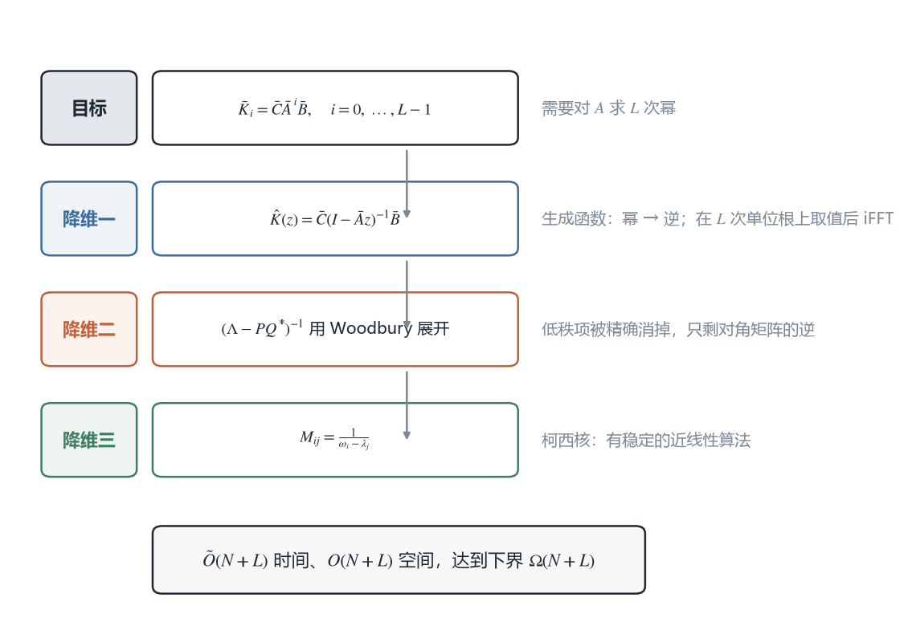

# 第 10 章 S4 的起点：为什么朴素对角化会失败

S4（Structured State Space，结构化状态空间；Gu、Goel、Ré, 2022, ICLR）解决的就是第 9 章那张病历表。

技术路线是：把 $A$ 写成"正规矩阵 + 低秩修正"，用 Woodbury 恒等式把低秩项处理掉，再借助柯西矩阵的快速算法把卷积核算出来。

这句话后面有大量细节，本章只讲动机与结构。

要回答三件事：为什么"换个基"（共轭变换）是合法的而且有用（Lemma 3.1）；为什么直接对角化不行（复习 Lemma 3.2，并给出更完整的数值论证）；S4 的三个技术性降维分别是什么，为什么它们能拼在一起。

具体算法留到第 12 章，这里先给骨架。

---

## 10.1 第一步：共轭等价（Conjugation）

### 引理

Lemma 3.1（S4）：共轭是 SSM 上的一个等价关系：

$$
(A, B, C) \sim (V^{-1}AV,\ V^{-1}B,\ CV), \qquad V \text{ 可逆}.
$$

两个等价的 SSM 计算完全相同的算子 $u \mapsto y$。

### 证明（很短，值得手推一遍）

左边（状态记为 $x$）：

$$
\dot x = Ax + Bu,\qquad y = Cx.
$$

右边（状态记为 $\tilde x$，参数为 $\tilde A=V^{-1}AV$、$\tilde B = V^{-1}B$、$\tilde C = CV$）：

$$
\dot{\tilde x} = V^{-1}AV\tilde x + V^{-1}Bu,\qquad \tilde y = CV\tilde x.
$$

在右边的第一个方程左边乘 $V$：

$$
V\dot{\tilde x} = AV\tilde x + Bu .
$$

令 $x := V\tilde x$（这就是基变换：同一个物理状态在两组基下的坐标），则 $\dot x = Ax+Bu$，与左边完全一致；输出也一致，$\tilde y = C(V\tilde x) = Cx = y$。∎

### 这个引理的含义

状态不是唯一的：对状态做任意可逆线性变换，模型的输入输出行为不变。这在控制论里叫"状态空间的坐标变换"。

实用价值在于：某个基下的 $A$ 更好处理（比如接近对角），就换到那个基去算。这正是对角化想做的事。

$A$ 的具体数值不重要，重要的是它的共轭类，我们可以在任何便利的基下表示 $A$。

### 一个技术提醒

引理里说的是"可逆矩阵 $V$"，不是"正交/酉矩阵"，而第 9 章说了只有酉（unitarily）变换才数值安全。$V$ 的条件数一大，$V^{-1}B$ 和 $CV$ 就会包含极大的数，浮点下就废了。

所以这条引理实际给出的是一个约束：只能在良态矩阵（最好是酉矩阵）张成的变换里找 $A$ 的简化形式。

---

## 10.2 第二步：为什么朴素对角化必然失败

### 诱惑

把 $A$ 变成对角矩阵 $\Lambda$ 的好处很直接：

- $\bar A^i$ 变成逐元素求幂，$O(N)$；
- 卷积核变成 Vandermonde 乘积，理论复杂度 $O((N+L)\log^2(N+L))$；
- 离散化和求逆全部简化。

### 现实

S4 论文给出了 HiPPO 矩阵的显式对角化（Lemma 3.2）：

$$
A = V\Lambda V^{-1},\qquad V_{ij} = \binom{i+j}{i-j},\qquad V_{3i,i} = \binom{4i}{2i}\approx 2^{4i} .
$$

论文的结论是 **$V$ 的元素量级可达 $2^{4N/3}$**，因此对角化在数值上不可行。

（$\binom{4i}{2i}$ 的渐近行为可以算一下。由中心二项式系数的斯特林近似 $\binom{2m}{m}\sim 4^m/\sqrt{\pi m}$，取 $m=2i$ 得 $\binom{4i}{2i}\sim 4^{2i}/\sqrt{2\pi i} = 16^i/\sqrt{2\pi i}$，这比 $2^{4i/3}$ 大得多：$16^i$ 对 $2^{4i/3}=2^{1.33i}$。论文给出的是保守下界，取哪个数结论都一样，指数级。）

### 用数字感受一下

| $N$ | $2^{4N/3}$ | 含义 |
|---|---|---|
| 16 | $1.4\times 10^{6}$ | 勉强能算，但已损失 6 位精度 |
| 32 | $2.0\times 10^{12}$ | FP32 有效数字（约 $10^7$）已完全不够 |
| 64 | $4.0\times 10^{25}$ | FP64（约 $10^{16}$ 精度）也不够 |
| 128 | $1.6\times 10^{51}$ | 直接溢出 |

SSM 里常用的状态维度是 $N=64\sim256$。

所以 $N\ge 32$ 时朴素对角化就已经不可用了。

### 问题的本质：非正规性

9.4 节给过定义，这里换个更直观的说法。

正规矩阵的特征向量互相正交，状态空间可以分解成一组互相垂直的独立振动模式，每个模式按自己的特征值衰减或振荡，互不干扰。

非正规矩阵的特征向量几乎平行，后果有三条：

- 特征值对扰动极其敏感（一个 1e-16 的扰动就能让特征值移动很多）；
- 状态可以在短时间内被放得很大再缩回来（伪谱现象），即使谱半径小于 1，中间过程也可能爆掉；
- 相似变换矩阵 $V$ 就是那个把几乎平行的向量拉开的映射，条件数极大。

HiPPO 矩阵恰好高度非正规（它的 $V$ 有指数级元素），这不是巧合。

结构上看，HiPPO 矩阵是"下三角 + 正对角"（回忆 (5.7)：$A_{nk}=0$ 当 $n<k$，$A_{nn}=n+1>0$），下三角矩阵的特征值就是对角线 $1,2,\dots,N$，特征向量是标准基的扰动，天然非正规。

### S4 的应对

S4 不能接受非正规，但也不愿意放弃 HiPPO 矩阵，于是换了一个简化目标：不追求变成对角，追求变成对角加低秩。

理由有三条。

- 对角矩阵是数值安全的（当然正规）；
- 低秩修正可以用矩阵恒等式精确处理（Woodbury），不需要真的做相似变换；
- HiPPO 矩阵恰好可以精确地写成这种形式（这是 Theorem 1，第 11 章）。

于是不去对角化那个病态矩阵，而是把它拆成一个良态部分（对角）加一个可精确处理的病态部分（低秩）。**NPLR 的全部意义就在这一句里。**

---

## 10.3 第三步：算法的三个降维（骨架）

有了 NPLR 参数化，剩下的问题还是如何快速算卷积核

$$
\bar K_i = \bar C \bar A^i \bar B,\qquad i = 0,\dots,L-1.
$$

S4 用了三个技巧把这个计算逐步化简。这里先给骨架，第 12 章给细节。

### 降维一：从"矩阵幂"到"矩阵求逆"

关键转换：不去直接算 $\bar A^i$，而是算生成函数（generating function）

$$
\hat K(z) := \sum_{i=0}^{L-1} K_i\, z^i .
$$

为什么？因为对无穷级数有

$$
\sum_{i\ge0} \bar C\bar A^i\bar B\, z^i = \bar C\left(\sum_{i\ge0}(\bar Az)^i\right)\bar B = \bar C\,(I-\bar A z)^{-1}\bar B .
$$

矩阵的幂变成了矩阵的逆，而逆比幂好处理，因为它可以套矩阵恒等式。

截断到长度 $L$ 要用一个技巧：把 $\bar C$ 换成 $\tilde C = (I-\bar A^L)^* C$，把 $i\ge L$ 的项扣掉（第 12 章详述）。

从 $\hat K$ 恢复 $\bar K$ 的办法是在 $L$ 次单位根 $\omega = e^{2\pi i k/L}$ 上取值，再做逆 FFT：

$$
K_i = \frac{1}{L}\sum_{k=0}^{L-1}\hat K(\omega_k)\,\omega_k^{-i} .
$$

于是"求 $L$ 个核值"变成了"求 $L$ 个点的函数值 + 一次 iFFT"，后者是 $O(L\log L)$ 且高度并行。

### 降维二：Woodbury 恒等式处理低秩项

接下来要算 $(I-\bar A z)^{-1}$，其中 $\bar A = \Lambda - PQ^*$ 是对角加低秩。这类矩阵的逆正好有 Woodbury 恒等式：

$$
(\Lambda - PQ^*)^{-1} = \Lambda^{-1} + \Lambda^{-1}P\left(I - Q^*\Lambda^{-1}P\right)^{-1}Q^*\Lambda^{-1}.
$$

（形式会随参数化略有不同，见第 12 章。）右边的关键是指：只需要对角矩阵 $\Lambda$ 的逆（$O(N)$）和一个 $r\times r$ 小矩阵的逆；$r$ 是低秩阶数，HiPPO 矩阵只需要 $r=1$ 或 $2$（见第 11 章）。

于是 $N\times N$ 求逆变成 $O(N)$ 的对角运算加一次 $2\times2$ 求逆。这是 S4 的第二个核心技术。

### 降维三：对角情形 = 柯西核

剩下的核心计算是"对角矩阵的预解式在若干点上的取值"，即形如

$$
\frac{1}{\omega_j - \zeta_k}
$$

的求和。这种形式的东西叫柯西矩阵（Cauchy matrix）：

$$
C_{jk} = \frac{1}{\omega_j - \zeta_k}.
$$

柯西矩阵的乘法是数值分析里的经典问题，算法成熟：快速多极子方法（Fast Multipole Method）可以做到 $O((N+L)\log^2(N+L))$ 时间，而且数值稳定，这与 LSSL 那个不稳的算法正好形成对比。

S4 论文的原话是，Cauchy 矩阵"与有理插值问题有关"，是"数值分析中研究得极为透彻的问题，既有快速算术算法也有快速的数值算法"。

这是 S4 的第三个核心技术，也是它"本质最优"的来源。

### 三个技巧的串接

*图 10-1　S4 的三次降维：把矩阵幂换成矩阵逆，再把低秩项消掉，最后落到柯西核*

这个串联就是 S4 论文 Algorithm 1 的内容（只有 5 行伪代码，但每一行背后都是一节数学）。

---

## 10.4 一个必要的补充：S4 为什么"必须"用 NPLR

有人会问：为什么不干脆放弃 HiPPO 矩阵，换成对角矩阵，那样计算最简单？

第 3 章和第 6 章已经给了实验答案：随机对角矩阵的效果很差（S4 消融：所有初始化的训练集都能到 100%，但验证集差 15 个点以上）。

HiPPO 提供的归纳偏置不可替代，而 HiPPO 矩阵恰好是 NPLR 的。所以 S4 的技术路线是被迫的：它必须在"保留 HiPPO"和"数值可用"之间找到一条路，NPLR 就是那条路。

一年后 S4D（第 14 章）发现了一个意外的事实：HiPPO 矩阵的"对角部分"（丢弃低秩项）单独使用效果也几乎一样好，而且理论上可以解释为什么（$N\to\infty$ 时两者动力学相同）。

这条捷径让 S4 的复杂算法在实践中的地位下降了，但对理论理解的价值不变。

这种"先有正确但复杂的方法，再被简化版取代"的模式在后来反复出现。

先有一个正确但复杂的方法（S4），然后社区找到它的简化版（S4D），简化版随后成为新基线（Mamba）。

---

## 10.5 本章小结

- Lemma 3.1（共轭等价）：$(A,B,C)\sim(V^{-1}AV, V^{-1}B, CV)$，两个 SSM 计算同一算子。因此可以自由换基，但只能用良态（最好酉）矩阵，否则数值上会毁掉一切。
- 朴素对角化失败：HiPPO 矩阵的对角化矩阵 $V_{ij}=\binom{i+j}{i-j}$ 元素量级达 $2^{4N/3}$（实际可达 $16^i$ 量级），$N\ge 32$ 时 FP32/FP64 都不够。
- 本质原因是非正规性：只有正规矩阵能被酉矩阵对角化；HiPPO 矩阵是"下三角 + 正对角"，高度非正规，特征向量几乎平行。
- S4 的策略：不追求"对角"，追求"对角 + 低秩"（NPLR/DPLR）。低秩部分用 Woodbury 恒等式精确处理，不需要做病态的相似变换。
- 算法三降维：(1) 用生成函数 $\hat K(z)=\bar C(I-\bar Az)^{-1}\bar B$ 把矩阵幂变成矩阵逆，在 $L$ 次单位根上取值后 iFFT；(2) Woodbury 把"对角加低秩求逆"化为对角情形（$O(N)$ + $r\times r$ 求逆）；(3) 对角情形归结为柯西核，有稳定的近似线性算法。
- 最终复杂度 $\tilde O(N+L)$ 时间、$O(N+L)$ 空间，达到理论下界 $\Omega(N+L)$。
- 事后看，S4D 发现"只用对角部分"也几乎一样好，说明 S4 的复杂算法在实践上可被简化，但在理论上 NPLR 是正确的第一步。

## 下一章

第 11 章给出 NPLR 参数化的精确陈述（Theorem 1）以及一个令人满意的结论：所有 HiPPO 矩阵（LegS、LegT、LagT）都是 NPLR 的，而且低秩阶数只有 $r=1$ 或 $r=2$。第 12 章把上面三个降维逐步算清楚。
