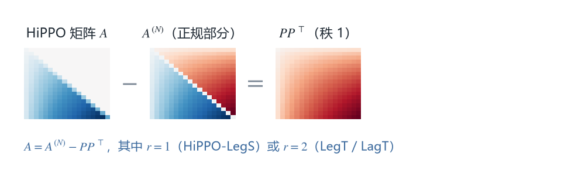

# 第 11 章 NPLR 与 DPLR：把病态矩阵拆开

第 10 章留了一个承诺：HiPPO 矩阵可以精确地写成"正规矩阵加低秩修正"（normal plus low-rank, NPLR），从而绕开非正规矩阵的数值灾难。

本章要把它做实：

1. 什么是正规矩阵，为什么它"数值安全"（一段必要的复习）
2. NPLR 的正式定义，以及 S4 的 Theorem 1：所有 HiPPO 矩阵都是 NPLR 的，低秩阶数只有 $r=1$ 或 $r=2$。
3. 对 HiPPO-LegS 具体给出这个分解（本章会给出可以用几行 NumPy 验证的显式公式）。
4. 这个分解带来什么好处：离散化变成 $O(N)$（S4 的 Theorem 2），卷积核变成可以用 Woodbury 处理（第 12 章）。

回到第 10 章末尾那个疑问：S4 明明可以只用对角矩阵，为什么要费这么大劲？因为 HiPPO 矩阵不是对角的，而我们又不敢对它做对角化。

---

## 11.1 复习：正规矩阵为什么安全

定义：矩阵 $M\in\mathbb{C}^{N\times N}$ 是正规的（normal），若

$$
M^*M = MM^* .
$$

谱定理：$M$ 正规 $\iff$ 存在酉矩阵 $U$（$U^*U = UU^* = I$）和对角矩阵 $\Lambda$ 使

$$
M = U\Lambda U^* .
$$

全部的分量都压在"酉"这个词上。

- 酉矩阵保持内积：$\|Ux\| = \|x\|$。因此它不会放大或缩小任何向量，也不会放大误差。$U$ 的条件数恒为 1。
- 对任意扰动 $E$，特征值的移动可以被 $\|E\|$ 控制住（Bauer–Fike 定理对正规矩阵给出最紧的界）。
- 用浮点算 $U\Lambda U^*$ 得到的矩阵与 $M$ 的相对误差是 $O(\epsilon_{\text{machine}})$。

对比之下，非正规矩阵的相似变换矩阵 $V$ 可能有巨大的条件数 $\kappa(V) = \|V\|\|V^{-1}\|$。第 10 章已经说了：HiPPO 矩阵的 $\kappa(V)$ 是指数级的。

正规矩阵可以在浮点下安全地"用对角矩阵表示"；非正规矩阵不行。

### 低秩修正的想法

现在假设 $A$ 不是正规的，但可以写成

$$
A = N - PQ^\top,
$$

其中 $N$ 正规、$PQ^\top$ 是秩 $r$ 的矩阵（$r \ll N$）。

这个形式之所以有用，是因为有一批矩阵恒等式专门处理"正规/对角 + 低秩"的逆与幂：

- 求逆：Woodbury 恒等式把 $(N - PQ^\top)^{-1}$ 化成 $N^{-1}$ 加一个小矩阵的逆；
- 离散化：$(I - \frac{\Delta}{2}A)^{-1}$ 依然是"对角 + 低秩"（因为 $I - \frac{\Delta}{2}A = (I - \frac{\Delta}{2}N) + \frac{\Delta}{2}PQ^\top$，第一项是正规的）；
- 矩阵-向量乘法：$O(N) + O(Nr)$。

我们不需要"消灭"$A$ 的非正规性，只需要把非正规的部分隔离到一个低秩项里，用恒等式精确处理那一项。这样既不损失精度，又不需要病态的相似变换。

---

## 11.2 S4 的 Theorem 1

**Theorem 1（S4）**：所有 HiPPO 矩阵（Gu 等, 2020 中的全部实例）都有 NPLR 表示

$$
A = V\Lambda V^* - PQ^\top = V\left(\Lambda - (V^*P)(V^*Q)^*\right)V^*,
\tag{11.1}
$$

其中 $V\in\mathbb{C}^{N\times N}$ 是酉矩阵，$\Lambda$ 是对角矩阵，$P,Q\in\mathbb{R}^{N\times r}$ 是低秩因子。

论文紧接着给出关键事实：

> **这些矩阵（HiPPO-LegS、LegT、LagT）满足 $r=1$ 或 $r=2$。特别地，S4 使用的那个矩阵（即 HiPPO-LegS，(5.7)）的 $r=1$。**

这句话的含义很具体：

HiPPO 矩阵的非正规部分只有秩 1。一个看起来极其复杂的、$N\times N$ 的、非正规得"病入膏肓"的矩阵，可以被写成一个正规矩阵减去一个"外积"。

原因是 HiPPO 矩阵的代数结构：它的非正规性只来自一个方向，也就是测度的时间缩放，因此一个秩为 1 的修正就能精确表达它。这不是数值上的凑合。

### 从 NPLR 到 DPLR

因为 $V$ 是酉的，我们可以放心地做共轭变换（Lemma 3.1 的合法应用）：

$$
A \sim V^*AV = \Lambda - (V^*P)(V^*Q)^* =: \Lambda - \tilde P\tilde Q^*
\tag{11.2}
$$

这就是复平面上的"对角 + 低秩"（diagonal plus low-rank, DPLR）形式。$V$ 是酉的，所以这一步数值上完全安全，与第 10 章那个灾难性的 $V_{ij}=\binom{i+j}{i-j}$ 形成鲜明对比。

S4 的核心把戏在这里：先不碰对角化，把 $A$ 拆成"正规 + 低秩"，再用酉变换对角化正规的那部分。

---

## 11.3 具体看看 HiPPO-LegS 的分解

理论陈述容易失去实感。下面给出 HiPPO-LegS 的显式 NPLR 分解，用几行 NumPy 就能验证。

采用 S4 的符号约定（和 (5.7) 差一个整体负号，方便后面写 $\dot x = Ax+Bu$）：

$$
A_{nk} = \begin{cases}
-(2n+1)^{1/2}(2k+1)^{1/2} & n>k\\
-(n+1) & n=k\\
0 & n<k
\end{cases}
$$

再定义向量 $P\in\mathbb{R}^N$：

$$
P_n = \left(n+\tfrac12\right)^{1/2} = \left(\frac{2n+1}{2}\right)^{1/2}.
$$

那么

$$
\boxed{\ A = A^{(N)} - PP^\top\ }
\tag{11.3}
$$

其中

$$
A^{(N)}_{nk} = \begin{cases}
-\tfrac12\sqrt{(2n+1)(2k+1)} & n>k\\[2pt]
-\tfrac12 & n=k\\[2pt]
+\tfrac12\sqrt{(2n+1)(2k+1)} & n<k
\end{cases}
$$

这个 $A^{(N)}$ 的构造很简单：它等于"反对称矩阵减 $\frac12 I$"。也就是说，若记 $S$ 为反对称矩阵（$S^\top = -S$）满足 $S_{nk} = -\frac{1}{2}\sqrt{(2n+1)(2k+1)}$（$n>k$），则

$$
A^{(N)} = -\tfrac12 I + S .
$$

验证一下各项：

- $n>k$ 时：$A_{nk} + (PP^\top)_{nk} = -\sqrt{(2n+1)(2k+1)} + \frac12\sqrt{(2n+1)(2k+1)} = -\frac12\sqrt{\cdot}$ ✓
- $n<k$ 时：$0 + \frac12\sqrt{\cdot} = +\frac12\sqrt{\cdot}$ ✓
- $n=k$ 时：$-(n+1) + \frac{2n+1}{2} = -(n+1)+n+\frac12 = -\frac12$ ✓

因为 $S$ 反对称，它的特征值是纯虚数；因此 $A^{(N)} = -\frac12 I + S$ 的特征值全部有实部 $-\frac12$，形成共轭对：

$$
\lambda_k(A^{(N)}) = -\frac12 \pm i\,\omega_k,\qquad \omega_k>0 .
$$

（这正是 S4D 论文的 Proposition 4："$\mathrm{Re}(\lambda(A)) = -\frac12$"。）

### 亲自算一遍（数值验证）

我用 NumPy 对 $N=16,64,256$ 算过 $A^{(N)}$ 的特征值（取正的虚部，降序）：

| $N$ | $\omega_0$ | $\omega_1$ | $\omega_2$ | 最小正虚部 |
|---|---|---|---|---|
| 16 | 80.97 | 25.63 | 13.83 | 5.09（第 8 个） |
| 64 | 1303.27 | 433.03 | 258.15 | — |
| 256 | 20860.2 | 6952.0 | 4169.5 | — |

这里有一个值得注意的事实：虚部（频率）的跨度极大，最大频率按 $\omega_0 \approx N^2/\pi$ 增长。这说明 HiPPO 的基函数覆盖了从很低的频率到很高的频率（$\sim N^2$ 量级），在小 $N$ 时就达到了很大的"频率带宽"。这也解释了为什么 HiPPO 用有限的 $N$ 就能记住很长的历史。

S4D 论文给出了这个规律的拟合公式（Conjecture 5 与式 (8)、(9)）：

$$
\textbf{S4D-Inv：}\quad A_n = -\frac12 + i\,\frac{N}{\pi}\left(\frac{N}{2n+1}-1\right),
\qquad
\textbf{S4D-Lin：}\quad A_n = -\frac12 + i\,\pi n .
\tag{11.4}
$$

其中 S4D-Inv 是对 $A^{(D)} = \mathrm{diag}(\lambda(A^{(N)}))$ 的"逆律"近似（我上面的数值验证显示：$N=256$ 时公式给 20779.3，真实值 20860.2，误差 0.4%），而 S4D-Lin 是更简单的一种选择（把频率取成等间距的 Fourier 频率）。这两个初始化在第 14 章会详细讨论。

$A^{(N)}$ 与 $A^{(D)}$ 的差别只在"是否保留低秩项"：$A^{(N)}$ 是正规矩阵，可对角化成 $A^{(D)}$，所以 $A^{(D)} = \mathrm{diag}(\lambda_k)$。S4D 用一个纯对角矩阵就能近似 S4，因为它丢掉的就是那个秩 1 项。

### 一个必须提的修正

S4 论文的最后一段（3.4 节末尾）加了一条重要的脚注：后续工作（Goel 等, 2022, "It's Raw!"）发现，当 $A$ 有特征值落在右半平面时，NPLR 形式 $\Lambda - PQ^*$ 会导致数值不稳定，并提出了一个微小的修改：

$$
\Lambda - PQ^* \quad\longrightarrow\quad \Lambda - PP^* .
$$

也就是说，把低秩项写成"同一个向量的外积"（半正定/半负定）而不是两个不同向量的外积。这个改动在实践中被采用（你会发现 S4 的代码里是 $\Lambda - PP^*$），代价是表达力略微降低（$P=Q$ 是一个约束），收益是永远稳定。这是一个典型的"用一点表达力换确定的安全性"的工程决策。

---

## 11.4 NPLR 带来的三个直接好处

### 好处一：离散化变成 O(N)（S4 的 Theorem 2）

**Theorem 2（S4 Recurrence）**：给定任意步长 $\Delta$，递推 (7.1) 的每一步可以在 $O(N)$ 次运算内完成。

为什么成立？因为 $\bar A = (I-\frac{\Delta}{2}A)^{-1}(I+\frac{\Delta}{2}A)$ 中的两个因子都保持 DPLR：

- $(I + \frac{\Delta}{2}A) = (I+\frac{\Delta}{2}\Lambda) - \frac{\Delta}{2}PQ^*$ —— 对角 + 秩 $r$；
- $(I-\frac{\Delta}{2}A)^{-1} = \left[(I-\frac{\Delta}{2}\Lambda) - \frac{\Delta}{2}PQ^*\right]^{-1}$ —— 用 Woodbury，仍是"对角 + 秩 $r$"；
- 两个 DPLR 矩阵相乘，跨项 $PQ^* \cdot PQ^*$ 的秩最多 $r^2$（极小），因此 $\bar A$ 仍是 DPLR。

于是 $\bar A x$ 的计算是"一次对角乘法 + 一次低秩修正"，即 $O(N)$（$r$ 是常数）。

这让推理变得便宜：$N=256$ 时每步只需几千次浮点运算，稠密矩阵则要 $N^2 = 65536$ 次。

### 好处二：卷积核可以用 Woodbury 处理

第 12 章的主体。核心是：生成函数 $\bar C(I-\bar Az)^{-1}\bar B$ 里有一个 DPLR 矩阵的逆，直接上 Woodbury。

### 好处三：参数量的直觉

如果直接在"$N\times N$ 的矩阵"上做梯度下降，参数量是 $O(N^2)$（$N=256$ 时 65536 个）。而 DPLR 形式只需要：

- 对角 $\Lambda$：$N$ 个（复）参数；
- 低秩因子 $\tilde P,\tilde Q$：$2Nr$ 个（$r=1$）；
- $B,C$：$2N$ 个。

S4 论文说"$(\Lambda, P, Q, B, C)$ 构成 S4 的 $5N$ 个可训练参数"（当 $r=1$ 时 $P,Q$ 各 $N$）。从 $O(N^2)$ 降到 $O(N)$，省了 $N$ 倍。

而且 $A$ 的结构约束在训练中一直保持（它是参数化的一部分，不是初始化），所以模型永远不会离开 NPLR 族。每一步训练、每一次推理都落在"安全区"里。

---

## 11.5 与 LSSL 的 Theorem 1 的关系

把 S4 的 Theorem 1 和 LSSL 的 Theorem 1 放在一起看，能看出两篇论文的关系：

| | LSSL（2021） | S4（2021/2022） |
|---|---|---|
| 结构刻画 | 低递推宽度（LRW）/ 准可分 | 对角 + 低秩（DPLR） |
| 参数压缩 | $O(N)$ | $O(N)$ |
| 快速乘法 | 有，但**数值不稳定** | 有，**数值稳定**（Woodbury + Cauchy） |
| 是否实现 | 没有 | 实现并开源 |
| 覆盖范围 | 任意测度的经典正交多项式 | 全部 HiPPO 矩阵（$r=1,2$） |

两者都在刻画"HiPPO 矩阵属于哪类结构化矩阵"。S4 的胜利在于它选的结构（DPLR）同时满足两个条件：能表示 HiPPO，有数值稳定的算法。LSSL 选的准可分结构满足前者，不满足后者。

这里有一条可复用的工程方法论：当有多个物理上等价的结构化表示可选时，选那个数值性质最好的。

---

## 11.6 本章小结

- 正规矩阵（$MM^*=M^*M$）可以被酉矩阵对角化，因此数值安全；非正规矩阵的相似变换矩阵条件数可能指数级大。
- NPLR：$A = V\Lambda V^* - PQ^\top$（$V$ 酉、$\Lambda$ 对角、$PQ^\top$ 秩 $r$）。好处是把非正规性隔离到一个低秩项里，用矩阵恒等式精确处理，不做病态变换。
- Theorem 1：所有 HiPPO 矩阵都是 NPLR 的，$r=1$ 或 $2$；S4 用的 HiPPO-LegS 是 $r=1$。
- HiPPO-LegS 的显式分解（可用 NumPy 验证）：$A = A^{(N)} - PP^\top$，其中 $P_n=\sqrt{n+1/2}$，$A^{(N)} = -\frac12 I + S$（$S$ 反对称），因此 $\lambda(A^{(N)}) = -\frac12 \pm i\omega_k$——实部恒为 $-1/2$。
- 频率谱很宽：最大虚部约 $N^2/\pi$。S4D-Inv 用 $A_n = -\frac12 + i\frac{N}{\pi}\left(\frac{N}{2n+1}-1\right)$ 拟合（数值验证误差 <1%）；S4D-Lin 用 $A_n=-\frac12+i\pi n$。
- 实践中的修正：$\Lambda - PQ^*$ 改为 $\Lambda - PP^*$，避免右半平面特征值带来的不稳定。
- 三个好处：离散化 $O(N)$（Theorem 2）、卷积核可用 Woodbury、参数量 $O(N)$ 而非 $O(N^2)$。
- 与 LSSL 的对比：两者都在刻画 HiPPO 矩阵的结构，S4 选的结构（DPLR）同时具备"能表示 HiPPO"和"数值稳定"两个性质。

## 下一章

第 12 章的技术密度最高：把那三个降维（生成函数 → Woodbury → 柯西核）逐步算清楚，并给出 S4 的 5 行算法。读完之后你会彻底明白"为什么 S4 能在 $\tilde O(N+L)$ 内算出卷积核"。
