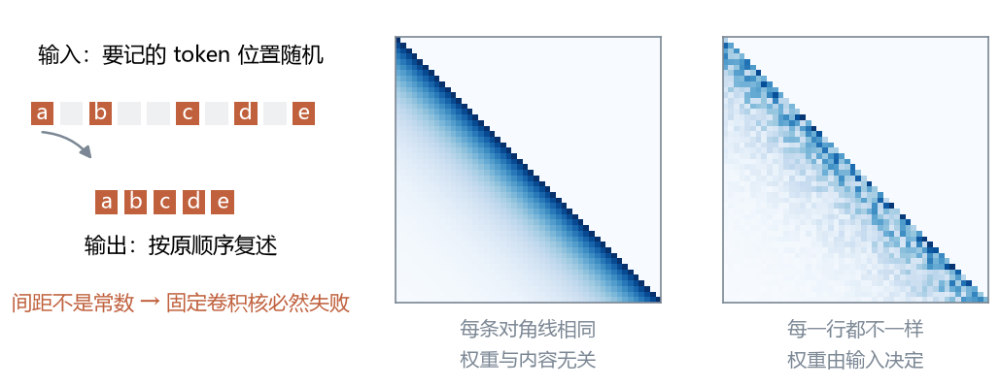

# 第 17 章 核心洞察：线性时不变是瓶颈

前三篇里，我们把 SSM 从数学理论（HiPPO）一路做到了工程可用（S4D）。但有一个事实被反复提到却从未正面处理：

**S4 在语言上还是打不过 Transformer。**

第 13 章的数字不好看：WikiText-103 上 20.95 vs 20.51 ppl，差 0.44。第 16 章讲了，H3、Hyena 这些工作试图用加门控来弥补，把差距缩到 0.4 个点，仍然没赢。

Mamba（Gu & Dao, 2023）的回答是：问题不在架构，在 SSM 本身。

诊断过程分四步：

1. Mamba 提出的统一分析框架：序列建模 = 压缩上下文，所有模型的差别都在"怎么压缩"。
2. 两个精心设计的合成任务（Selective Copying 与 Induction Heads），把线性时不变的缺陷暴露到极致。
3. 为什么加门控救不了。这个论证很精确，也很容易混淆。
4. 结论：必须让 $\Delta, B, C$ 依赖输入。这个改动叫"选择性"（selection）。

---

## 17.1 统一框架：序列建模就是压缩

Mamba 论文开篇给了一个分析框架，我认为是全书最有价值的。原话大意是：

> 一个序列模型的效率与效果，由它把上下文压缩进状态的能力决定。

把这个框架套到三大范式上：

| 模型 | 状态大小 | 压缩率 | 训练成本 | 推理成本（每步） |
|---|---|---|---|---|
| 注意力 | $O(L)$（KV cache，**不压缩**） | 1（不压缩） | $O(L^2)$ | $O(L)$ |
| RNN / SSM | $O(N)$，$N$ 固定 | $L/N$ | $O(L)$ | $O(N)$ |
| 卷积 | $O(k)$（核宽） | 固定 | $O(L\log L)$ | $O(L)$ |

注意力的"效果"来自它不压缩：整个上下文原样保存，不会丢信息，代价是成本随 $L$ 增长。

RNN/SSM 的"效率"来自它压缩，代价是可能丢掉关键信息。

压缩本身是必须的，问题在于给定状态预算下怎么把最有用的信息压进去。

Mamba 的诊断是：LTI（线性时不变）SSM 的压缩策略固定，不依赖内容。

因此它必然把"重要信息"和"无关信息"一视同仁地压。

这句话需要具体化，下面两个任务做的就是这件事。

### 一个必要的回顾：LTI 意味着什么

S4 的参数 $(\Delta, A, B, C)$ 在所有时间步上是同一组数，这就是"线性时不变"。

它的直接后果是（第 2.5 节）：

$$
y = \bar K * u,\qquad \bar K_i = \bar C\bar A^i\bar B .
$$

核 $\bar K$ 是一个固定的向量。位置 $j$ 从位置 $i$ 取多少信息，只由距离 $j-i$ 决定，与内容无关。

用第 1 章的矩阵语言：$M_{ji} = \bar C\bar A^{j-i-1}\bar B$ 只依赖 $j-i$。这是一个 Toeplitz 矩阵。

LTI 的好处是可以 FFT、可以并行、可以用柯西核或范德蒙德；坏处是 $M$ 与内容无关，而这正是下面两个任务要惩罚的性质。

---

## 17.2 任务一：Selective Copying（选择性复制）

### 先看简单的 Copying

经典的 Copying 任务（Arjovsky、Shah、Bengio, 2016）：给模型看一串 token，隔一段空白，然后让它按原顺序复述出来。

经典 Copying 任务中，输入与输出之间的间距是固定常数。

间距固定意味着 LTI 模型可以作弊：它只要学一个恰好那么长的卷积核，就能把输入原样"搬"到输出位置。

这个作弊合法而且有效。Romero 等人（2021, CKConv）验证过：全局卷积（也就是 LTI SSM）能轻松解决 Copying。

它需要的只是"时间感知"（time-awareness，知道该延迟多少步），不需要"内容感知"（content-awareness）。

### 再看 Selective Copying

Mamba 把任务改成：token 的位置随机，中间夹杂随机数量的空白。

固定的卷积核在这里必然失败，因为间距不是常数。模型必须根据内容判断哪些 token 要记、哪些要丢。

> 这就是"选择性"的字面含义：在序列维度上，按内容决定信息的去留。

论文的表述很精确：从递归视图看，LTI 的 "$(A,B)$ 转移"不随时间变化，因此无法以输入相关的方式影响传递给后续的状态。

从卷积视图看，全局卷积无法处理"间距可变"的问题，因为静态卷积核表达不了可变的间距。

### 实验结果（Mamba 论文 Table 1）

组合不同的架构（外层 block）与不同的内层序列混合层：

| 架构 | 内层 | 准确率 |
|---|---|---|
| —（无门控） | S4（LTI） | 18.3 |
| —（无门控） | **S6（选择性）** | **97.0** |
| H3 | S4 | 57.0 |
| Hyena | Hyena（LTI 长卷积） | 30.1 |
| H3 | **S6** | **99.7** |
| Mamba | S4 | 56.4 |
| Mamba | Hyena | 28.4 |
| Mamba | **S6** | **99.8** |

表的读法有两个方向。

- 换架构（S4 → H3 → Mamba）能带来一些提升（18.3 → 56.4），但离解决还很远；
- 换内层 SSM（S4 → S6）直接把准确率从 18.3 拉到 97.0；
- 两者结合最好（99.8）。

结论：在这个任务上，架构不是主要矛盾，序列混合层是不是选择性的才是。这也是第 16 章那句"门控不够"的实验证据。

---

## 17.3 任务二：Induction Heads（归纳头）

### 任务定义

Induction head 是机制可解释性（mechanistic interpretability）研究里一个有名的结构（Olsson 等, 2022），被认为是 LLM 上下文学习（in-context learning）能力的主要来源之一。

任务形式很简单：

序列里先出现 `Harry Potter` 这样的二元组，之后再次遇到 `Harry` 时，模型应当补出 `Potter`。

也就是说：如果序列里曾经出现过二元组 "Harry Potter"，那么当 "Harry" 再次出现时，模型应该输出 "Potter"。

这是联想回忆（associative recall）：给定一个键，从历史中找回对应的值。

### 为什么 LTI 模型做不好

联想回忆要求模型在正确的位置、根据内容取回特定的历史信息，LTI 的固定核做不到这种"根据内容定位"。

但这里有个区分：H3 论文认为"递归/卷积架构 + 门控"能做一定程度的联想回忆，因为门控允许输入调制输出的通路。

Mamba 论文的反驳是：门控能做"内容相关的加权"，做不了"内容相关的定位"，因为门控不沿序列轴交互（见 17.4 节）。

### 实验结果

Mamba 论文的 Induction Heads 实验设计得很能说明问题：

- 模型：2 层（注意力机制在理论上解决这个任务所需的最小结构）；
- 训练序列长度 256（$2^8$）；
- 测试长度从 64（$2^6$）一直到 1,048,576（$2^{20}$）。

结果：

> Mamba（S6 层）完美解决，并且能外推到长度为 100 万（比训练时长了 4000 倍）的序列；其他方法都无法超过训练长度的 2 倍。

4000 倍外推是个很强的主张，解释是：选择性 SSM 学到的是"算法"而不是"模式"。

它学到的是"当看到 ★→"X" 这个模式时，去历史里找上一次 ★ 后面是什么"，这个算法与序列长度无关。而 LTI 模型学到的是"一个长度约 256 的核"，换个长度就失效。

论文还提到一个细节：注意力模型（含各种位置编码，如 xPos）都没有超过 2 倍外推。原因也是它们依赖固定的位置编码模式。

另外，Mamba 论文（H3 论文同样）指出，注意力的 induction head 是 2 层机制，所以 2 层模型是公平的比较，这排除了"Mamba 只是深度更大所以更强"的解释。

---

## 17.4 关键论证：为什么"加门控"救不了

这一节的论证最容易混淆，值得放慢速度。

### 门控是什么

第 16 章讲过，H3 的结构是"SSM 夹在两个门控之间"：输入先被一个门控调制，过 SSM 之后又被另一个门控调制。

这两个门控都是 $u$ 的逐元素函数（如 $\sigma(Wu)$），作用在通道维度上，乘上去做调制。

这类门控确实带来了"数据依赖"，也是 H3、Hyena、RetNet、RWKV 等一堆模型变强的直接原因。

但它数据依赖的位置在通道维，不在长度维。

### 精确的区分

用第 1 章的矩阵语言：

- 架构门控：$y = g \odot (\mathrm{SSM}(u))$，其中 $g$ 是一个逐位置的向量。它可以写成 $M' = \mathrm{diag}(g)\cdot M$。这里 $\mathrm{diag}(g)$ 是对角矩阵，只改变每一行的整体尺度，不改变 $M$ 里"哪个位置看哪个位置"的结构。
- 选择性 SSM：$M_{ji}$ 本身变成依赖输入的量，改变的是信息的连通性结构。

区别可以压成一句话：

> 门控能做的是"这个位置的信息要不要放大/缩小"；选择性 SSM 能做的是"这个位置要不要看那个位置"。

前者是逐行的缩放，后者是改变了矩阵的结构。

### 为什么这个区分是决定性的

回到 Selective Copying。考虑输入

$$
[\_, a, \_, \_, b, \_, c, \_, \dots]
$$

- 想跳过空白：需要"当 $x_t$ 是空白时，不要把它写进状态"。这需要 $B_t$ 依赖 $x_t$。
- 想记住彩色 token：需要"当 $x_t$ 是彩色时，把它写进状态并保持"。这需要 $\Delta_t$（进而 $\bar A_t$）依赖 $x_t$。

这两种操作都直接作用在递推方程上，也就是作用在 $M$ 的生成过程上。

而架构门控只能作用于 SSM 的输出（或输入）。

如果 SSM 内部已经把 $a,b,c$ 和空白混在一起压进同一个状态，再乘一个门控也分不开，信息已经丢了。

Mamba 论文的原话（Appendix A）大意是：

> 架构门控不是选择机制的一个实例。它不沿序列轴交互，因此无法影响 token 之间的间距。

### 一个类比

想象一个会议室：

- 门控 = 每个人说话的音量旋钮。你可以让某人小声、某人大声。
- 选择性 = 决定"谁听谁说话"的会议规则。你可以让 A 忽略 B 的发言，只关注 C。

如果会议记录员的记录方式（SSM 的压缩方式）本身固定，事后调音量没用，需要改的是"谁听谁"。

---

## 17.5 诊断结论：让参数依赖输入

诊断清楚了，药方就明确了：

$$
\boxed{\ \text{把 } \Delta,\ B,\ C\ \text{都变成输入 }x_t\text{ 的函数。}\ }
$$

这样：

- $\Delta_t$ 控制"要不要把当前输入写进状态、写多少"（因为离散化后的 $\bar A_t = \exp(\Delta_tA)$、$\bar B_t \approx \Delta_tB_t$ 都由 $\Delta_t$ 决定）；
- $B_t$ 控制"输入的哪些分量进入状态"；
- $C_t$ 控制"从状态里读出什么"。

三者都是逐位置、逐通道的，于是 $M$ 变成了时变的：

$$
M_{ji} = C_j^\top\left(\prod_{k=i+1}^{j}A_k\right)B_i ,
$$

其中 $A_k, B_i, C_j$ 全部依赖输入。

### 为什么"Δ 就够了"（Mamba 的取舍）

一个自然的疑问：为什么不把 $A$ 也变成选择性的？

Mamba 论文给出了理由（§3.5）：

> $\bar A = \exp(\Delta A)$，所以 $A$ 只通过它与 $\Delta$ 的乘积起作用。既然 $\Delta$ 已经是选择性的，那么 $(\bar A, \bar B)$ 就已经是选择性的了。让 $A$ 也随输入变化"可能会有类似的效果"，论文为了简单起见没有做。

这个论证的实质是参数冗余：$\Delta$ 和 $A$ 在离散化之后只以乘积形式出现，两者中有一个是选择性的就够了。

（后来 Mamba-3 论文提到，他们做了实验验证："data-dependent $A_t$ has similar performance to data-independent $A_t$"，确实如此——这验证了 Mamba 当初的猜测。）

### 一个早期尝试的提示

Mamba 论文承认，让 $\Delta$ 随时间变化这个想法并不新，早在 HiPPO（Gu 等, 2020）里就有人试过让 $\Delta$ 逐时间步变化。

真正的问题不在"想不到"：

> 一旦模型变成时变，卷积视图就失效了，只能一步步串行递推，而串行的 SSM 在 GPU 上慢得离谱。

所以 Mamba 的贡献有两半：

- 一半是概念上的：选择机制（第 18 章）；
- 另一半是工程上的：如何在时变的前提下仍然快（第 19 章）。

这两半缺一不可。只有选择机制而没有高效实现，就会重演"想法正确但跑不起来"的 LSSL 悲剧。

---

## 17.6 本章小结

- 统一框架：序列建模 = 把上下文压缩进状态。注意力不压缩（状态 $O(L)$），RNN/SSM 压缩（状态 $O(N)$）。效率与效果的权衡就由"压缩得多好"决定。
- LTI 的致命缺陷：核 $\bar K$ 固定、$M_{ji}$ 只依赖距离，因此无法按内容决定信息的去留。
- Selective Copying 把这一点暴露出来：随机间距使固定卷积核必然失败，需要"内容感知"。实验上：S4 层 18.3% vs S6 层 97.0%，**换内层比换架构有效得多**（H3/S4 57.0，H3/S6 99.7）。
- Induction Heads 是另一类硬伤：联想回忆。Mamba 在长度 256 上训练，能外推到长度 1M（4000×），其他方法不超过 2×。
- "加门控"救不了：门控作用在通道维（对角缩放），不改变 $M$ 的连通结构；选择性作用在长度维，改变的是 $M$ 本身的生成。这是 H3/Hyena/Gated Linear Attention 等工作的共同天花板。
- 药方：让 $\Delta, B, C$ 依赖输入 $x_t$，使 $M_{ji} = C_j^\top\left(\prod A_k\right)B_i$ 成为时变的。因为 $\bar A = \exp(\Delta A)$，让 $\Delta$ 选择性就足够，$A$ 可以保持不变。
- Mamba 有两半贡献：概念上的选择机制（第 18 章）加工程上的硬件感知并行扫描（第 19 章），缺一不可。

## 下一章

第 18 章把"选择性"写成精确的算法：S6 与 S4 在伪代码上只差几行，但这几行改变了模型的性质。还会给出 Mamba 的 Theorem 1：它把 LSSL 的"门控 $=\Delta$"升级到"输入相关的 $\Delta$"，从而证明 S6 在 $N=1$ 时就是一个门控 RNN。
