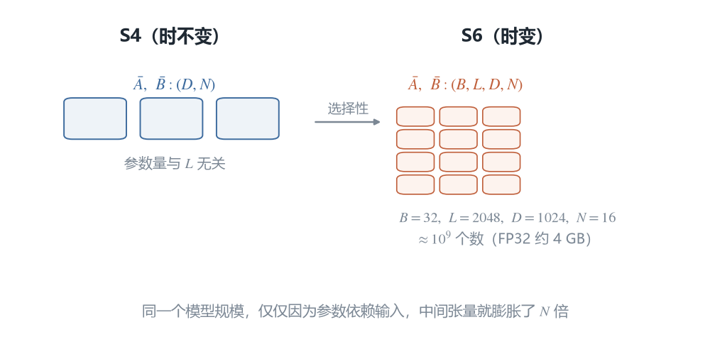

# 第 18 章 S6：选择机制的数学


第 17 章给出了诊断：LTI 是瓶颈，药方是让 $\Delta, B, C$ 依赖输入。

这一章把药方写成精确的算法。

从 S4 到 S6，伪代码上只改了几行，但这几行改变了模型的根本性质，也毁掉了卷积视图。

要讲清的是五件事：

1. 记号切换。从这里开始，改用 Mamba 论文的记号。
2. Algorithm 2：选择性 SSM（S6）的完整伪代码，与 S4 逐行对照。
3. 参数化的具体形式：$s_B, s_C, s_\Delta, \tau_\Delta$ 各是什么，为什么这样选。
4. Theorem 1：$N=1$ 时 S6 退化为一个门控 RNN。这是 LSSL 引理 3.1 的输入相关版，也是 Mamba 与 RNN 理论接轨的地方。
5. $\Delta, A, B, C$ 各自的语义：每个参数在"选择什么"这个问题上扮演什么角色。

---

## 18.1 记号切换（重要）

从本章开始，本书改用 Mamba 论文的记号，因为后面所有代码和论文都用这套。对照表：

| 本书第 1~16 章 | 第 17 章起（Mamba 记号） | 含义 |
|---|---|---|
| 输入 $u_t$ | $x_t$ | 输入（每个通道是标量） |
| 状态 $x_t$ | $h_t$ | 潜状态（每个通道 $N$ 维） |
| 输出 $y_t$ | $y_t$ | 输出 |
| 连续参数 $A,B,C$ | $A,B,C$（也写 $\mathring A$ 等） | 连续参数 |
| 离散参数 $\bar A,\bar B$ | $\bar A,\bar B$（Mamba-2 起常省略横线） | 离散参数 |
| 状态维度 $N$ | $N$ | 不变 |
| 通道数 $H$ | $D$ | 模型维度 |
| 序列长度 $L$ | $L$（Mamba-2/3 里常写 $T$） | 长度 |

换记号的理由：在 SSM 的语境里，"$x$"历史上指状态（HiPPO/LSSL/S4 都这么用），而 Mamba 论文改用它指输入。

这个不一致几乎每个读者都会踩一次，本书在这里明确划一条线。

（一个细节：Mamba-2 论文进一步把连续参数写成 $\mathring A$，并把离散参数直接写成 $A$，取消横线。本书在 Mamba-2 章节会说明。）

---

## 18.2 逐行对照：S4 与 S6

这是 Mamba 论文的核心伪代码，两栏的差别只有三处：

```text
Algorithm 1  SSM (S4)                        Algorithm 2  SSM + Selection (S6)
输入: x : (B, L, D)                          输入: x : (B, L, D)
输出: y : (B, L, D)                          输出: y : (B, L, D)

1: A : (D, N) ← Parameter                    1: A : (D, N) ← Parameter
   ⊲ 结构化 N×N 矩阵                             ⊲ 结构化 N×N 矩阵
2: B : (D, N) ← Parameter                    2: B : (B, L, N) ← s_B(x)
3: C : (D, N) ← Parameter                    3: C : (B, L, N) ← s_C(x)
4: Δ : (D)    ← τ_Δ(Parameter)               4: Δ : (B, L, D) ← τ_Δ(Parameter + s_Δ(x))
5: Ā, B̄ : (D, N) ← discretize(Δ, A, B)       5: Ā, B̄ : (B, L, D, N) ← discretize(Δ, A, B)
6: y ← SSM(Ā, B̄, C)(x)                       6: y ← SSM(Ā, B̄, C)(x)
   ⊲ 时不变: 递归或卷积                            ⊲ 时变: 只能递归（扫描）
7: return y                                  7: return y
```

三处差别：

1. $B$ 和 $C$ 变成了 $(B,L,N)$，由输入 $x$ 经函数 $s_B, s_C$ 生成（原来是与时间无关的参数 $(D,N)$）。
2. $\Delta$ 变成了 $(B,L,D)$，由输入经 $s_\Delta$ 生成（原来是长度为 $D$ 的参数向量）。
3. $\bar A, \bar B$ 变成了 $(B,L,D,N)$，因为这俩是 $(\Delta, A, B)$ 的函数，而它们现在都带时间维。

第 4 行的 `Parameter + s_Δ(x)` 里，`Parameter` 是一个偏置项（bias）。

最后一行注释是全章最关键的一句：

> 时不变时可以走"递归或卷积"；时变时只能走"递归（扫描）"。

这句话的代价就是第 19 章的全部内容。第 17 章说过：在 Mamba 之前，正是这个代价让所有工作都不敢做选择机制。



*图 18-1　S4 与 S6 的参数形状：多了时间维之后，中间张量膨胀 $N$ 倍*

### 一个必须理解的形状问题：(B,L,D,N) 有多大？

这是 S6 与 S4 在"内存"上的根本差别。

- S4：$\bar A\in\mathbb{R}^{D\times N}$，与 $L$ 无关，不需要为每个时间步存一份参数。
- S6：$\bar A\in\mathbb{R}^{B\times L\times D\times N}$，为每个时间步、每个通道都存一份。

代入数字：$B=32$、$L=2048$、$D=1024$、$N=16$，则 $BLDN = 32\times2048\times1024\times16 \approx 1.07\times10^9$，十亿个浮点数。

FP32 下是 4 GB，只为了存一个中间张量。

而输入 $x$ 本身只有 $32\times2048\times1024 = 6.7\times10^7$ 个数。

**这就是"必须做硬件感知实现"的根本原因。** 第 19 章会讲 Mamba 怎么用"不物化这个张量"的办法绕过去。

这个 $N$ 也解释了为什么 Mamba 的 $N$ 只取 16：后来 Mamba-2 才敢取 64 甚至 256，而 $N$ 每翻一倍，$\bar A$ 的隐含大小就翻一倍。

---

## 18.3 参数化：sB, sC, sΔ, τΔ 怎么选

Mamba 论文明确给出了这四个函数：

$$
\boxed{\
s_B(x) = \mathrm{Linear}_N(x),\qquad
s_C(x) = \mathrm{Linear}_N(x),\qquad
s_\Delta(x) = \mathrm{Broadcast}_D\big(\mathrm{Linear}_1(x)\big),\qquad
\tau_\Delta = \mathrm{softplus}
\ }
\tag{18.1}
$$

其中 $\mathrm{Linear}_d$ 表示一个到维度 $d$ 的可学习线性投影。

### 为什么 Δ 的投影维度是 1（而不是 D）

这是一个有意思的设计决策，论文给的理由很直接：

> 如果某个输入 $x_t$ 应该被完全忽略（这在合成任务里是必须的），那么所有 $D$ 个通道都应该忽略它。所以我们先把输入投影到 1 维，再广播/重复到维度 $D$。

也就是说，$\Delta$ 的选择是全局的：整条输入决定一个标量，不是逐通道的。

这样"忽略这个 token"这个决策才能一致地作用在所有通道上。

Mamba 论文进一步指出：这个广播操作等价于"一个初始化成特定 0/1 模式的线性投影"；如果让它可训练，就得到

$$
s_\Delta(x) = \mathrm{Linear}_D\big(\mathrm{Linear}_R(x)\big),
$$

即一个低秩投影（$R$ 是远小于 $D$ 的秩）。实践中 $R$ 取 $D/16$ 这样的值。

### 为什么是 softplus

$\Delta$ 必须为正数，它是离散化步长。softplus $\mathrm{softplus}(z) = \log(1+e^z)$ 的值域是 $(0,\infty)$，且处处光滑、梯度不为零，是一个理想的正数参数化。

$\tau_\Delta^{-1}$ 存在，因此可以用"想初始化的 $\Delta$ 值"反推偏置的初值（见 18.4 节）。

### A 的初始化

Mamba 论文 §3.6：

> 复数情形用 S4D-Lin（$A_n = -\frac12 + n i$），实数情形用 S4D-Real（$A_n = -(n+1)$）。实践中 Mamba 默认用实数。

这里出现了 Mamba 的一个特点：它默认用实数的 $A$。论文给的理由是：

> complex numbers are helpful for continuous modalities (e.g. audio, video) but not discrete (e.g. text, DNA).

也就是说，语言的 token 是离散的，"复频率振荡"没有意义；音频/视频是连续信号，频谱结构有用。

这个判断在 Mamba-3 里被部分修正（见第 30 章）。

### Δ 的初始化

$$
\Delta = \tau_\Delta^{-1}\Big(\mathrm{Uniform}\big([0.001,\ 0.1]\big)\Big),
$$

即先在对数尺度上抽一个 $\Delta$，再反推 softplus 之前的偏置值。这是从 S4D/S4 继承的做法。

---

## 18.4 Theorem 1：S6 在 N=1 时就是门控 RNN

这是 Mamba 论文里理论性最强的一节。

Theorem 1（Mamba）：当 $N=1$、$A=-1$、$B=1$、$s_\Delta(x)=\mathrm{Linear}(x)$、$\tau_\Delta=\mathrm{softplus}$ 时，选择性 SSM 的递推变成

$$
g_t = \sigma\big(\mathrm{Linear}(x_t)\big),\qquad
h_t = (1-g_t)\,h_{t-1} + g_t\,x_t .
$$

也就是说，它就是经典的一维门控递推。

### 证明（很短，值得看）

设 $N=1$、$A=-1$、$B=1$，用 ZOH 离散化（(2.6)）：

$$
\bar A = e^{\Delta A} = e^{-\Delta},\qquad
\bar B = A^{-1}\big(e^{\Delta A}-I\big)B = -\big(e^{-\Delta}-1\big) = 1-e^{-\Delta}.
$$

于是递推是

$$
h_t = e^{-\Delta_t}h_{t-1} + \big(1-e^{-\Delta_t}\big)x_t .
$$

令 $g_t := 1-e^{-\Delta_t}$，则 $h_t = (1-g_t)h_{t-1}+g_tx_t$，形式已是门控递推。

最后算 $g_t$ 与 $\mathrm{softplus}$ 的关系。设 $z_t = \mathrm{Linear}(x_t)$，$\Delta_t = \mathrm{softplus}(z_t) = \log(1+e^{z_t})$，则

$$
e^{-\Delta_t} = \frac{1}{1+e^{z_t}} = \sigma(-z_t)
\quad\Longrightarrow\quad
g_t = 1-\sigma(-z_t) = \sigma(z_t).
$$

（最后一步用了 $\sigma(-z) = 1-\sigma(z)$。）∎

### 这个定理的意义

三点：

(1) 它把 LSSL 的引理 3.1 升级了。LSSL 版说的是"门控 $=\Delta$"，$\Delta$ 可以是输入的函数，但没有明说。

Mamba 版说的是"输入相关的 $\Delta$ 就是输入相关的门控"。Mamba 论文自己的说法是 "improvement of Gu et al. (2021, Lemma 3.1) generalizing to the ZOH discretization and input-dependent gates"。

(2) 它把 S6 与 RNN 的传统智慧接上了。LSTM/GRU 的工程经验（门控的初始化、梯度流、长记忆）可以迁移过来。

反过来，S6 也给门控提供了一个新的解释框架。

(3) 它解释了为什么 Mamba 的默认设置是 $\Delta$ 选择性、$A$ 不选择性（第 17.5 节的论证）。

### 一个诚实的技术细节：ZOH 还是指数-欧拉

上面的证明用了 ZOH 的 $\bar B = 1-e^{-\Delta}$。而 Mamba 开源实现里用的是

$$
\bar A = e^{\Delta A},\qquad \bar B = \Delta\,B
$$

（即"指数-欧拉"）。这两者的差别在 $\bar B$ 上：ZOH 是 $1-e^{-\Delta}$，实现是 $\Delta$。在 $\Delta$ 很小时两者近似相等（$1-e^{-\Delta} = \Delta - \Delta^2/2+\cdots$），但不完全相同。

在实现版本下，$N=1$、$A=-1$、$B=1$ 时递推变成

$$
h_t = e^{-\Delta_t}h_{t-1} + \Delta_t x_t,
$$

门控形式仍然是 $(1-g)h + gx$，但 $g = \Delta_t = \mathrm{softplus}(z_t)$，是一个无上界的门，而不是 sigmoid（有上界 1）。

这个不一致在论文里没有澄清，直到 Mamba-3（2026）才被系统地梳理：Mamba-3 把这个实现形式命名为指数-欧拉（exponential-Euler），并给出了理论依据（第 29 章）。

读 Theorem 1 时，把它当成"ZOH 下的精确结果"，同时记住实现里有一个 $\bar B$ 的近似。

---

## 18.5 四个参数的语义

Mamba 论文 §3.5.2 逐项解释了选择机制的效果。这部分是"理解 Mamba 在做什么"的关键。

### Δ：焦点开关

> 一般地，$\Delta$ 控制"关注当前输入"与"忽略当前输入"之间的平衡。它推广了 RNN 的门（上面的 $g$）。机制上：大 $\Delta$ 重置状态并聚焦当前输入；小 $\Delta$ 保持状态并忽略当前输入。

从连续系统的角度理解更清楚：$\Delta \to \infty$ 表示"系统在当前输入上聚焦很久"（因此选择它、忘记之前的状态）；$\Delta \to 0$ 表示"当前输入是瞬态的，被忽略"。

关键是 $\Delta$ 的取值由 $x_t$ 决定，所以"要不要聚焦"这件事本身是内容相关的。

### A：为什么不必选择性

$\bar A = \exp(\Delta A)$，$A$ 只通过它与 $\Delta$ 的乘积起作用。既然 $\Delta$ 已经是选择性的，$(\bar A,\bar B)$ 就已经是选择性的了。

论文说"我猜想让 $A$ 选择性也会有类似效果，但为了简单起见没有做"，并留作未来工作。

（这个猜想后来被验证了：Mamba-3 论文 §2.2 Remark 1 说 "we empirically found that data-dependent $A_t$ has similar performance to data-independent $A_t$"。）

### B 与 C：入口与出口

- $B_t$ 选择性 = 控制"输入的哪些分量能进入状态"（入口闸门）；
- $C_t$ 选择性 = 控制"状态的哪些分量能进入输出"（出口闸门）。

论文的原话：这两个可以解释为"根据内容（输入）与上下文（隐状态）调制递归动力学"。

### 三种机制性的效果

论文列举了选择机制带来的三种具体能力，这三个词后面会反复出现：

(1) 可变间距（variable spacing）：过滤掉不相关的噪声 token。例如语言里的填充词（"嗯"、"那个"）。机制上：在门控案例里，当 $g_t\to0$ 时模型可以完全忽略 $x_t$。

(2) 过滤上下文（filtering context）：论文指出一个实证现象——很多序列模型在上下文变长时并不改善（尽管原则上更多上下文应该更好）。

原因是它们无法在必要时忽略无关上下文。选择模型可以在任何时刻重置状态，因此原则上性能随上下文长度单调改善。

第 21 章会用 DNA 与音频的实验数据检验这一点（Hyena 的困惑度随长度变差，Mamba 的随长度变好）。

(3) 边界重置（boundary resetting）：当多个独立序列被拼在一起时，Transformer 可以用注意力掩码把它们隔开，而 LTI 模型会让信息在序列之间"渗漏"。

选择性 SSM 可以在边界处重置状态（$\Delta_t\to\infty$，或门控案例里 $g_t\to1$）。这个能力在文档打包（把多个文档拼成一个长序列以提高硬件利用率）和强化学习的 episode 边界上都有用。

Mamba-2 里这个性质被形式化成"把 $A_t$ 设为 0 作为序列边界"（第 26 章），实现变长训练时很实用。

---

## 18.6 一个必须澄清的误解

最后澄清一个常见误解。

误解是"Mamba 就是在 S4 上加了门控"。门控作用在通道维，是乘性调制；选择性作用在长度维，调的是递推参数。

第 17.4 节已经详细区分过。具体到代码上：

- H3 的做法：`y = gate1 * SSM(gate2 * u)`，门控在 SSM 外面；
- Mamba/S6 的做法：`Ā, B̄ = discretize(Δ(x), A, B(x))`，依赖输入的量在 SSM 里面，且带时间维。

这个区别有可测的后果：Mamba 论文 Table 1 里，H3 架构配 S4 层只有 57.0%，配 S6 层是 99.7%。

架构相同，只有内层的序列混合方式不同。

---

## 18.7 本章小结

- 记号切换：从本章起，输入记 $x_t$、状态记 $h_t$（Mamba 惯例）。
- S6 与 S4 的伪代码差别只有三处：$B,C$ 变成 $(B,L,N)$ 由 $s_B,s_C$ 生成；$\Delta$ 变成 $(B,L,D)$ 由 $s_\Delta$ 生成；$\bar A,\bar B$ 变成 $(B,L,D,N)$。最后导致了"只能递归、不能卷积"。
- 形状的代价：$\bar A$ 的隐含大小是 $B\times L\times D\times N$。取 $B{=}32,L{=}2048,D{=}1024,N{=}16$ 时是十亿个数（4 GB），这就是必须做硬件感知实现的原因。
- 参数化：$s_B,s_C$ 是到 $N$ 维的线性投影；$s_\Delta$ 是"先投影到 1 维再广播"（因为"忽略某个 token"的决策应该对所有通道一致），可推广为低秩投影 $\mathrm{Linear}_D(\mathrm{Linear}_R(x))$；$\tau_\Delta = \mathrm{softplus}$ 保证 $\Delta>0$。
- 初始化：$A$ 用 S4D-Real（实数）或 S4D-Lin（复数，用于连续模态）；$\Delta$ 用 $\tau_\Delta^{-1}(\mathcal{U}[0.001,0.1])$。
- Theorem 1：$N=1,A=-1,B=1$、$\Delta=\mathrm{softplus}(\mathrm{Linear}(x))$ 时 S6 就是门控递推 $h_t=(1-g_t)h_{t-1}+g_tx_t$，$g_t=\sigma(\cdot)$，它是 LSSL 引理 3.1 的输入相关版。证明用的是 ZOH 的 $\bar B=1-e^{-\Delta}$，实现用 $\bar B=\Delta$（指数-欧拉），这是论文与代码的一处不一致。
- 参数语义：$\Delta$ 是焦点开关（大 $\Delta$ 重置状态并聚焦当前输入，小 $\Delta$ 保持状态并忽略输入）；$A$ 不必选择性（因为只与 $\Delta$ 以乘积出现）；$B,C$ 分别是状态的入口与出口闸门。
- 三种机制效果：可变间距、过滤上下文、边界重置。
- 区分：门控在通道维、在 SSM 外部；选择性在长度维、在 SSM 内部。

## 下一章

现在问题变成了工程问题：$\bar A,\bar B$ 是 $(B,L,D,N)$ 的张量，物化它需要几个 GB；而且时变意味着只能串行扫描。第 19 章讲 Mamba 怎么用核融合、并行扫描、重计算这三招，把这一切做得比 FlashAttention 还省内存。
