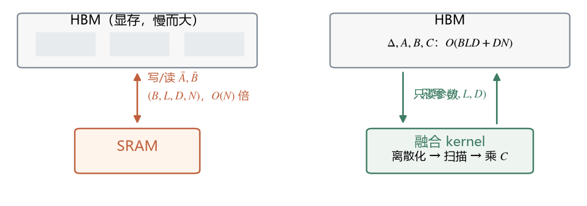

# 第 19 章 硬件感知的并行扫描

第 18 章留下了一个纯粹的工程难题。

选择机制让 $\bar A,\bar B$ 变成 $(B,L,D,N)$ 的张量。取 $B{=}32$、$L{=}2048$、$D{=}1024$、$N{=}16$：

$$
BLDN \approx 1.07\times10^{9}\ \text{个数} \approx 4\ \text{GB（FP32）}
$$

而这只是单个中间张量。更要命的是，时变意味着卷积视图失效，只能用递归，而递归是串行的。

于是 Mamba 面临的问题变成：

> 在"不能做卷积、只能做递归"的前提下，怎么把训练做得和 FlashAttention 一样快、一样省内存？

Mamba 用了三招：核融合（kernel fusion）、并行扫描（parallel scan）、重计算（recomputation）。三招都是经典技术，组合方式却很巧妙。

它的思路是不物化中间张量、把它留在快速内存里，后来被 Mamba-2 的 SSD 算法继承并推广（第 25 章）。

这一章是从数学到系统的转折点：前面都在讲为什么这样设计，这里讲凭什么跑得起来。

---

## 19.1 第一个观察：递归其实比卷积 FLOPs 更少

先破除一个直觉。通常认为卷积能用 FFT 所以更快，在选择性 SSM 的规模下恰好相反：

| 计算方式 | FLOPs |
|---|---|
| 朴素递归 | $O(BLDN)$ |
| 卷积（FFT） | $O(BLD\log L)$ |

递归的 FLOPs 更少，常数因子也更小。

原因在卷积里那个 $\log L$ 因子（FFT 的开销），递归没有。当 $N$ 不算太大、$L$ 又很长时，$N$ 和 $\log L$ 可比，递归更划算。

既然时变逼着走递归，那就把递归做好，Mamba 的选择就是这个。

### 但递归有两个麻烦

1. 串行性：$h_t$ 依赖 $h_{t-1}$，无法直接并行。
2. 内存：$\bar A,\bar B$ 是 $(B,L,D,N)$ 的大张量。

这两个麻烦分别用"并行扫描"和"核融合"解决。

---

## 19.2 第二个观察：GPUs 上除了矩阵乘法，其他都在等内存

这是理解整个 Mamba 系统的前提。

现代 GPU 有两级主要的存储：

| 层级 | 名字 | 容量 | 带宽（量级） |
|---|---|---|---|
| 慢而大 | HBM（high-bandwidth memory，就是通常说的"显存"） | 40–80 GB | 数 TB/s |
| 快而小 | SRAM（每个 SM 的片上共享内存/L1） | 每个 SM 几百 KB，整卡十几 MB | 高一个数量级 |

矩阵乘法是计算受限（compute-bound）的：算术强度高（每读一个字节做好多次乘加），能把计算单元喂饱，GPU 的 Tensor Core 就是为此设计的。

几乎所有其他操作都是访存受限（memory-bound）的：逐元素运算、归约、激活、扫描的算术强度都很低，计算单元大量空闲，时间全花在把数据从 HBM 搬到 SM 上。

Mamba 论文直接引用了这个观察（Dao 等, 2022；Ivanov 等, 2021；Williams 等, 2009）。

既然扫描注定访存受限，优化方向就是减少 HBM 上的读写量，而不是减少 FLOPs。

---

*图 19-1　两种实现的显存流量：朴素实现让 $(B,L,D,N)$ 的中间量往返显存，融合实现把它留在 SRAM*

## 19.3 招式一：核融合（kernel fusion）

### 标准做法有多浪费

如果按教科书方式实现 selective scan，会分三步：先在显存里准备 $(B,L,D,N)$ 的扫描输入，再调用扫描内核把同样大小的结果写回显存，最后乘 $C$ 得到 $(B,L,D)$。三次搬运都是 $O(BLDN)$ 量级。

总 HBM 读写量是 $O(BLDN)$。当 $BLDN$ 是 $10^9$ 量级时，这就是几 GB 的搬运量，而实际有用的输出只有 $(B,L,D)$，小了 $N$ 倍。

### Mamba 的做法

做法是把离散化、扫描、乘 $C$ 这几步融合进一个 kernel：从显存读入 $\Delta,A,B,C$（只有 $O(BLD+DN)$），在 SRAM 里做离散化得到 $(B,L,D,N)$，在 SRAM 里做扫描，最后只把 $(B,L,D)$ 写回显存。

关键差别在前两步：参数 $(\Delta, A, B, C)$ 的原始大小只有 $O(BLD + DN)$，可以在 SRAM 里现场把它们离散化成 $(B,L,D,N)$，不必先算好再写进 HBM。

于是 HBM 的读写量降低了一个 $O(N)$ 因子。

论文的实测结论：

> IO 减少 $O(N)$ 倍，实践上带来 20–40 倍加速。

### 序列太长怎么办

SRAM 只有十几 MB 量级，一整条长序列的中间状态放不下，于是分块（chunking）：把序列切成若干块，对每块做融合扫描，把块末的状态传给下一块继续。

这个"分块加传递状态"的思想就是 Mamba-2 的 SSD 算法以及张量并行/序列并行的雏形（第 25、26 章），Mamba-1 已经在用了。

---

## 19.4 招式二：并行扫描（parallel scan）

核融合解决了内存问题，但没解决串行问题。

### 线性递推是关联扫描

第 15 章已经详细讲了并行扫描（Blelloch 算法）。这里只复述结论并指出 Mamba 的用法：

线性递推

$$
h_t = \bar A_t h_{t-1} + \bar B_t x_t
$$

可以写成仿射映射的复合。定义二元算子

$$
(a_1, b_1)\bullet(a_2, b_2) = (a_2 a_1,\ a_2 b_1 + b_2),
$$

则它是结合的（associative），于是可以用 work-efficient 的并行扫描：深度 $O(\log L)$、总工作量 $O(L)$。

因为 $\bar A_t$ 是对角的（逐通道甚至逐元素的标量），算子的乘法是逐元素的，代价很低。

### 数值稳定的细节

朴素地算 $h_t = \bar A_t h_{t-1}+\dots$ 时，$\bar A$ 的连乘在长序列上会下溢到 0：每个 $\bar A_t\in(0,1)$，乘几千次就变成 0。

Mamba 的实现（以及 Mamba-2 的参考实现）用的技巧是在 log 域累加，最后取指数。

把 $\bar A_t = \exp(\Delta_t A)$ 取对数：$\log\bar A_t = \Delta_tA$（$A$ 是负的，所以这是负数）。于是连续若干步的乘积

$$
\bar A_t\bar A_{t-1}\cdots\bar A_{s+1} = \exp\left(\sum_{k=s+1}^{t}\Delta_kA\right),
$$

只要累加 $\Delta_kA$（一次 cumsum）再取指数，就不会中间下溢。

Mamba-2 的开源参考实现里这个函数叫 `segsum`（segment sum）：用 `cumsum` 相减得到区间和，再 `exp`。第 33 章会逐行讲这段代码。

这个细节是"论文里看不到、但写代码必须知道"的典型例子。不理解它，复现出来的 Mamba 会在长度 4096 上直接变成 0。

---

## 19.5 招式三：重计算（recomputation）

### 问题

反向传播需要中间状态（每一步的 $h_t$）。如果老老实实把它们都存下来，那就是 $O(BLDN)$ 的内存，核融合省下的内存又还回去了。

### 解法

办法是不存，反传时重算。

代价与收益的分析（论文附录 D 的论证）：

- 反传时需要从 HBM 读入的是输入 $\Delta, A, B, C$ 与输出梯度，大小都是 $O(BLN + DN)$；
- 反传需要写出的是输入梯度，大小也是 $O(BLN+DN)$；
- 如果存了中间状态，就需要额外读 $O(BLDN)$ 个元素。

由于 $N$ 通常是 16（相对于 $D$ 是千级），$O(BLDN)$ 比 $O(BLN)$ 大 $D$ 倍，存下来再读的成本远高于重算。所以重算不只省内存，还更快。

（结论反直觉，但在访存受限的世界里成立：多算少搬往往更优。这与 FlashAttention 的哲学完全一致。）

### 一次性重算整个 block

论文进一步把重算推广到整个 selective SSM block（输入投影、卷积、激活、扫描、输出投影）：

> 不保存那些"占内存大但重算很快"的中间激活（例如激活函数的输出、短卷积的输出）。

### 内存最终账目

论文给了一组很实用的数字（混合精度 FP16/BF16 训练）：

| 组件 | 每 token 的激活内存 |
|---|---|
| 注意力层（FlashAttention） | ~12 bytes |
| MLP 层 | ~20 bytes |
| **合计（Transformer 的一层 + 一个 MLP）** | **32 bytes** |
| 一个 selective SSM 层 | ~16 bytes |

结论：

> 两层 selective SSM 的激活内存 ≈ 一个注意力层 + 一个 MLP 层。

也就是说，Mamba 的 block 与 Transformer 的 block 在内存占用上可比。

注意 Mamba 的一个 block 相当于 Transformer 的 attention 加 MLP 两块，因为它把两者合并了（见第 20 章）。

论文因此说："the fused selective scan layer has the same memory requirements as an optimized transformer implementation with FlashAttention."

---

## 19.6 实测数据

### 训练速度

- 比标准 PyTorch 扫描实现快 40 倍，这是核融合加重计算的收益；
- 序列长度 32K 时，比最快版本的注意力实现（FlashAttention）快约 7 倍；
- 序列长度 2K 时超过 FlashAttention-2，之后越拉越开。

### 推理吞吐

- 比同规模的 Transformer 高 4–5 倍（论文摘要里说 5×）；
- 原因是没有 KV cache，可以用更大的 batch；
- 论文给了一个很直观的对比：一个未训练的 Mamba-6.9B 的推理吞吐，高于一个 5 倍小的 Transformer-1.3B。

### Induction Heads 的完整数据（论文 Table 11）

第 17 章提到"4000 倍外推"，完整表格更能说明问题：

| 模型 | 参数量 | $2^6$ | $2^7$ | $2^8$ | $2^9$ | $2^{10}$ | $2^{12}$ | $2^{16}$ | $2^{20}$ |
|---|---|---|---|---|---|---|---|---|---|
| MHA-Abs | 137K | ✓ | 99.6 | 100 | 58.6 | 26.6 | 9.8 | ✗ | ✗ |
| MHA-RoPE | 137K | ✓ | ✓ | 100 | 83.6 | 31.3 | 8.6 | ✗ | ✗ |
| MHA-xPos | 137K | ✓ | ✓ | 100 | 99.6 | 67.6 | 7.0 | ✗ | ✗ |
| H3 | 153K | ✓ | ✓ | 100 | 80.9 | 39.5 | 14.8 | 8.2 | 7.4 |
| Hyena | 69M | 97.7 | ✓ | 100 | ✓ | 44.1 | 6.6 | 6.6 | 9.8 |
| **Mamba** | **74K** | **✓** | **✓** | **100** | **✓** | **✓** | **✓** | **✓** | **✓** |

（✓ 表示完美泛化；✗ 表示显存不足。训练长度是 $2^8=256$。）

三点值得看：

1. Mamba 的参数最少（74K），却一路 ✓ 到 $2^{20}$（1,048,576），比训练长度长 4000 倍。
2. 注意力模型的失败模式很典型：训练长度附近 100%，稍长一点（$2^9$）就掉到 58.6%，然后就崩了。它学的是位置模式，不是算法。
3. Hyena 有 69M 参数（几乎全用在可学习位置编码上），仍然只在训练长度附近有效。这直接反驳了"参数量不够"的解释：**不是容量问题，是机制问题。**

---

## 19.7 一个诚实的评价：这套系统的代价

Mamba 的硬件感知实现很漂亮，代价也很明确，后续工作反复提起：

代价一，依赖自定义 CUDA kernel。核融合必须手写 CUDA（`selective_scan`），后果是：

- 研究门槛高（不能像 S4D 那样用几行 PyTorch 试想法）；
- 换硬件后端（TPU、各种加速器）需要重写；
- 改动 SSM 的内部结构就得改 kernel，这是 Mamba-3 要发布新 kernel 的原因。

代价二，不能并行化某些维度。扫描沿序列维度是串行或对数深度的，而序列维度恰好最长。Mamba-2 的 SSD 重要就重要在把扫描的负担从整个序列降到了每个块的边界（第 25 章）。

代价三，$N$ 不能太大。$\bar A$ 的隐含开销是 $O(BLDN)$，$N$ 直接决定 kernel 的工作量，所以 Mamba-1 的 $N=16$。

Mamba-2 用 SSD 算法把 $N$ 推到 64/128/256，这是量变引起质变：MQAR 任务上 $N=16$ 几乎失败，$N=256$ 表现良好（第 27 章）。

代价四，训练时不如 Transformer 的 MLP 高效。Mamba-2 论文指出：短序列（如 2K）上，$L$ 层的 Mamba-2 有 $L$ 个 SSD 层，同样参数量的 Transformer 有 $L/2$ 个注意力层加 $L/2$ 个 MLP 层，而 MLP 比 SSD 更硬件友好。

所以在短序列上纯 Mamba 可能不如混合架构，这是第 27 章混合模型的直接动机。

---

## 19.8 本章小结

- selective scan 的 FLOPs 是 $O(BLDN)$，比卷积的 $O(BLD\log L)$ 更少（少一个 log 因子），所以走递归是合理的。
- GPU 上除矩阵乘法外几乎都是访存受限，因此优化的关键是减少 HBM 读写量，而不是减少 FLOPs。
- 核融合：把离散化、扫描、乘 $C$ 融进一个 kernel；参数 $(\Delta,A,B,C)$ 从 HBM 读入 SRAM（$O(BLD+DN)$），在 SRAM 里现场展开成 $(B,L,D,N)$，最后只把 $(B,L,D)$ 写回。HBM 读写减少 $O(N)$ 倍，换来 20–40 倍加速。序列太长时分块并传递块末状态。
- 并行扫描：线性递推是仿射复合，算子是结合的，用 Blelloch 算法得到 $O(\log L)$ 深度、$O(L)$ 工作。数值上要在 log 域累加再取指数（Mamba-2 里的 `segsum` 就是干这个），否则长序列上 $\bar A$ 的连乘会下溢到 0。
- 重计算：中间状态 $O(BLDN)$ 不存，反传时重算。因为 $N \ll D$，多算少搬更优。最终激活内存：每个 selective SSM 层 ~16 bytes/token，两层 ≈ 一个注意力层加一个 MLP 层（12+20 bytes）。
- 实测：训练比标准 PyTorch 扫描快 40×，32K 长度下比注意力快 7×；推理吞吐 4–5×；Induction Heads 上 74K 参数的 Mamba 外推到 1M，而 69M 参数的 Hyena 只在训练长度附近有效，可见限制来自机制而非容量。
- 代价：依赖自定义 kernel（改架构就要改 kernel）、序列维的扫描仍有对数深度、$N$ 不能大（Mamba-1 用 16）、短序列上不如 MLP 硬件友好（因此有了混合架构）。

## 下一章

第 20 章讲 Mamba 的网络架构：它把 H3 block 和 Transformer 的 MLP 合并成了一个统一的 block（没有注意力、也没有独立的 MLP），并解释每个设计选择的来源。第 21 章讲完整的实验、消融与直觉。
