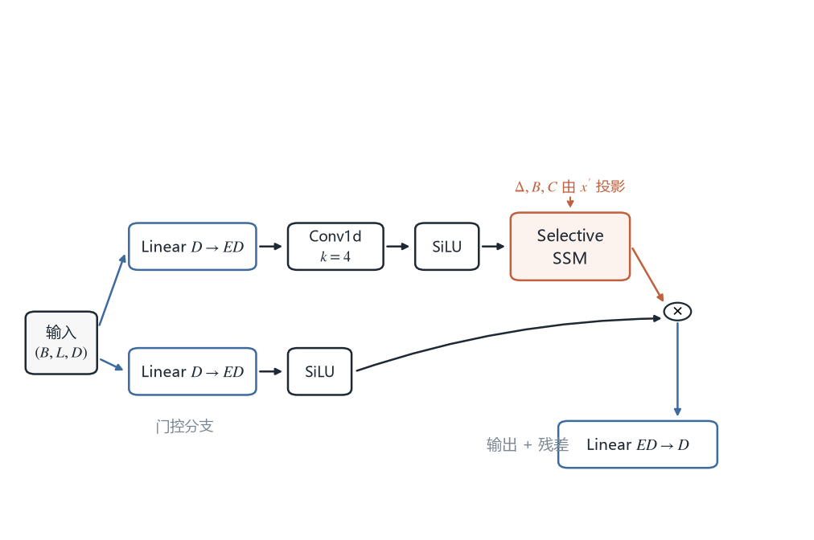

# 第 20 章 Mamba 架构：一个既没有注意力也没有 MLP 的块

前两章把选择机制和高效实现都讲完了，但这些还只是序列混合层。要把它们组成一个可用的语言模型，还需要一个 block 设计。

Mamba 的 block 设计围绕一个主张：

> 把 H3 block 和 Transformer 的 MLP block 合并成一个统一的 block，然后同质地重复它。

这个设计有三个特点：

- 没有独立的 MLP，因为门控线性单元本身就是 MLP 的变体；
- 没有注意力；
- 参数量分布极不均匀：99% 的参数在普通的线性投影上，序列混合那部分只占约 1%。

Mamba 的性能来源不只是那个 SSM，还有这个 block 的结构性简化。

第 21 章的消融会显示架构与内层都有贡献（H3+S6 = 8.95，Mamba+S6 = 8.69）。

---

## 20.1 出发点：H3 block

第 16 章讲过 H3，它的架构是 SSM 家族的标准骨架，大多数 SSM 架构都基于它：

$$
\text{H3 block}:\quad u \;\longrightarrow\; \big(\text{Linear} \to \text{SSM}\big) \otimes \big(\text{Linear} \to \text{门控}\big) \;\longrightarrow\; \text{输出投影}
$$

即两条并联的分支，一条做序列混合（SSM），一条做门控，逐元素相乘。

H3 的标准做法是把它与 MLP block 交替堆叠，就像 Transformer 里注意力层与 MLP 层交替。

这就是"SSM 版的 Transformer"：注意力换成 SSM，MLP 保留。

### 一个结构性观察

Mamba 论文认为 H3 的做法有些冗余：

- H3 block 里的门控线性分支本质上就是 gated MLP 的一半；
- 既然已经有逐位置的线性投影、乘法、激活，何必再单独放一个 MLP？

于是 Mamba 把两者合并。论文说这个想法受 Gated Attention Unit（GAU, Hua 等 2022）的启发，GAU 对注意力做了同样的事。

---

## 20.2 Mamba block 的结构

### 数据流

Mamba block 的完整数据流如下（对应论文 Figure 3 最右侧那栏）：

*图 20-1　Mamba block 的数据流：上支路做卷积与选择性扫描，下支路做门控，最后逐元素相乘*

其中 $E$ 是扩张因子（expansion factor），Mamba 固定 $E=2$。

### 与 H3 / Gated MLP 的三方对照

Figure 3 把三者的差别画得很清楚，用文字复述：

| | 主分支 | 门控分支 | 特点 |
|---|---|---|---|
| **Gated MLP** | Linear → SiLU | Linear | 无序列混合 |
| **H3 block** | Conv → SSM | Linear → 门控 | 序列混合在 SSM，但还要额外的 MLP 层 |
| **Mamba block** | Conv → SSM | Linear → SiLU（门控） | 序列混合与 MLP 合一 |

三个细节：

1. 相比 H3，Mamba 把第一个乘性门控换成了激活函数 SiLU，门控分支因此变成一个标准的 SwiGLU 一半。
2. 相比 Gated MLP，Mamba 在主分支里插入了 SSM 和短卷积。
3. 短卷积（Conv1d, kernel=4）：这个局部卷积来自 H3，作用是在 SSM 处理之前先做局部上下文的混合。它在 Mamba 里是逐通道（depthwise）的，宽度固定为 4。

第 3 点值得多说一句：Mamba-3 会证明这个短卷积可以被新的离散化方式取代（第 32 章），但在 Mamba-1/2 里它是必需组件。Mamba 论文把它当作既定设计（继承自 H3），没有专门消融。

### 为什么用 SiLU / Swish

论文给的理由很直接：

> 用 SiLU 之后，门控 MLP 就变成了广受欢迎的 SwiGLU 变体。

SwiGLU（Shazeer, 2020；被 PaLM、LLaMA 采用）的形式是

$$
\mathrm{SwiGLU}(x) = \mathrm{SiLU}(W_1x)\odot W_2x .
$$

Mamba 的门控分支 $y\odot\mathrm{SiLU}(z)$ 正是这个形式，只是主干从 $W_1x$ 换成了 SSM 的输出。

所以 Mamba 的 block 可以理解为"SwiGLU，但把其中一条分支换成选择性 SSM"。这也解释了它的参数分布：

- SwiGLU 的参数本来就几乎全在线性投影上；
- 把一条分支换成 SSM 只增加 $O(DN)$ 量级的参数。

### 额外的归一化层

论文还提到一个可选的归一化层（最终选 LayerNorm），位置在门控之后、输出投影之前：

> 这个设计的动机来自 RetNet 在类似位置使用归一化层。

（Mamba-2 保留并强化了这个设计，因为它对大模型训练稳定性很关键，见第 26、27 章。）

---

## 20.3 参数量的分布：一个决定性的数字

论文给出了 block 级的参数分解：

> 每个 block 的绝大多数参数（$3ED^2$）在线性投影上（$2ED^2$ 用于输入投影，$ED^2$ 用于输出投影），内部 SSM 贡献的参数少得多。SSM 的参数（$\Delta, B, C$ 的投影以及矩阵 $A$）相比之下微不足道。

代入 $E=2$：线性投影是 $6D^2$ 个参数。

论文接着说一个设计上的匹配关系：

> 我们固定 $E=2$，并使用两层这样的 block 来匹配 Transformer 中"一个 MHA + 一个 MLP"的 $12D^2$ 个参数。

验算一下，Transformer 一层是：

- MHA：$4D^2$（$Q,K,V,O$ 四个 $D\times D$ 投影）；
- MLP：$8D^2$（两个 $D\times4D$ 投影，标准 4 倍扩张）。

合计 $12D^2$，两个 Mamba block 是 $2\times6D^2 = 12D^2$，刚好对上。这是精心设计的参数量匹配，让同样参数下的 Mamba 与 Transformer 比较变得公平。

### 这意味着什么

数字对比值得记一下：

$$
\text{SSM 相关参数} \approx O(DN),\qquad \text{其余线性投影参数} \approx 6D^2 .
$$

以 $D=1024$、$N=16$ 为例：SSM 相关约 $1.6\times10^4$，而线性投影是 $6.3\times10^6$，SSM 只占 0.26%。

这个数字带来几个推论：

1. 换 SSM 层对模型总参数量的影响很小，所以 Mamba-2 才能很方便地把 Mamba-1 换成 SSD（参数量几乎不变，性能提高）。
2. 大多数模型能力来自普通线性层。这与神经网络的普遍经验一致，但也提醒一句：不要指望 SSM 层能单独解决所有问题。
3. 增加 $N$ 几乎是免费的：$N$ 从 16 翻倍到 32，SSM 参数从 0.26% 变到 0.5%，几乎不影响 FLOPs 和参数量，但它对性能的影响很大（第 21 章的消融：$N$ 从 1 增到 16 使困惑度从 9.88 降到 8.71，只多 1% 参数）。

第 3 点是理解后面一切的关键：状态维度 $N$ 是个高性价比旋钮。Mamba-2 费那么大力气设计 SSD 算法，就是为了让这个旋钮能拧得更大。

---

## 20.4 完整网络

把 block 堆起来就是 Mamba 网络：

整个网络就是同一个 block 重复堆叠：每个 block 前接 RMSNorm，外接残差，最后接输出投影。

这种同质（homogeneous）结构没有注意力层与 MLP 层的交替，带来一个工程上的好处：整个模型只有一种层，便于并行化和 kernel 复用。

Transformer 有两种层（attention 和 MLP），混合架构甚至有三种。层类型越多，张量并行的切分越麻烦。第 26 章讲 Mamba-2 怎么把这件事做到和 Transformer 一样简单。

---

## 20.5 消融：架构 vs 内层

Mamba 论文的 Table 6 在 350M 规模的语言建模上同时消融了架构和内层 SSM：

| 架构 | 内层 | 困惑度 |
|---|---|---|
| Hyena | Hyena（LTI 长卷积） | 10.24 |
| H3 | S4（复数） | 10.30 |
| H3 | S4（实数） | 10.34 |
| **H3** | **S6（选择性）** | **8.95** |
| Mamba | Hyena | 10.75 |
| Mamba | S4（复数） | 10.54 |
| Mamba | S4（实数） | 10.56 |
| **Mamba** | **S6** | **8.69** |

表的读法有三个方向。

(1) 内层是主要矛盾。H3 + S6 = 8.95，H3 + S4 = 10.30，换内层降了 1.35，远大于换架构的差距。

(2) 架构也有贡献，但小得多。同样用 S6，H3 架构 8.95 到 Mamba 架构 8.69，改善 0.26。

(3) LTI 内层之间差别很小。Hyena 10.24、S4 复数 10.30、S4 实数 10.34，三者几乎一样。这印证了第 17 章的判断：所有 LTI 模型本质上是同一类东西（全局卷积），所以都在同一条水平线上。

S4（复数）与 S4（实数）在语言上几乎无差别（10.30 vs 10.34），这为 Mamba 默认用实数提供了依据。论文在别处也说，所有消融里替换内层为 S6 都带来大幅改善，而把复数 S4 换成实数 S4 对性能几乎没影响。

---

## 20.6 一个容易被忽略的点：为什么 Mamba 不需要位置编码

Transformer 需要位置编码（sinusoidal、RoPE、ALiBi……）。Mamba 不需要。

原因在 SSM 本身就是位置感知的：它的核 $\bar K_i$ 依赖距离 $i$，递推天然区分"第几个" token，位置信息被编码在 $\bar A^i$ 的衰减里。

Mamba-2 把这一点表述得更清楚：SSD 的掩码 $L$ 就是"数据相关的位置编码"的一个有原理支撑的版本（第 26 章）。传统位置编码是启发式的（固定的正弦、固定的衰减），SSM 的掩码则是算出来的。

这也解释了 Induction Heads 任务上的结果差异（第 19 章那张表）：注意力模型用固定位置编码，学到的位置模式无法外推到更长的序列；SSM 学到的算法不依赖固定位置。

（一个后续观察：Mamba-2/3 的混合模型里，注意力层必须去掉位置编码（NoPE），否则反而更差，见第 32 章。这从反面印证了位置信息可以由序列混合层自己提供。）

---

## 20.7 本章小结

- Mamba block 把 H3 block 与 Transformer 的 MLP block 合并成一个统一的、同质重复的块：没有独立 MLP，也没有注意力。
- 数据流：$u \to$ `Linear(D→ED)` → `depthwise Conv1d(k=4)` → `SiLU` → `SelectiveSSM`；同时另一条分支 $u \to \mathrm{Linear}(D\to ED) \to$（门控）；两者相乘（$y\odot\mathrm{SiLU}(z)$）再过输出投影。
- SiLU 的选择让门控 MLP 变成了 SwiGLU，因此可以理解为"SwiGLU 的一条分支换成选择性 SSM"。
- 参数量分布：线性投影 $3ED^2$（$E=2$ 时 $6D^2$），SSM 相关只有 $O(DN)$，占比约 0.26%（$D{=}1024,N{=}16$）。两层 Mamba block 恰好匹配 Transformer 的 MHA 加 MLP（$12D^2$），这是精心设计的公平比较基准。
- 推论：换内层 SSM 对总参数量几乎无影响（所以 Mamba-2 能无缝替换）；$N$ 是个高性价比旋钮（翻倍只增加 0.3% 参数，但收益显著）。
- 消融（350M，语言建模困惑度）：内层是主要矛盾（H3+S4 10.30 → H3+S6 8.95），架构是次要贡献（8.95 → 8.69）；LTI 内层之间几乎无差别（Hyena 10.24 / S4 复数 10.30 / S4 实数 10.34）。
- Mamba 不需要位置编码：位置信息编码在 $\bar A^i$ 的衰减里。这一点在 Mamba-2 里被形式化为"掩码即数据相关的位置编码"。

## 下一章

第 21 章讲 Mamba 的全部实验结果（缩放定律、下游评测、DNA、音频）与逐项消融，并把第 18 章讲的"$\Delta$ 是焦点开关"等直觉用数据串起来。这一章也是第六篇的收尾，会指出 Mamba-1 的三个遗憾，它们分别由 Mamba-2、Mamba-3 来解决。
