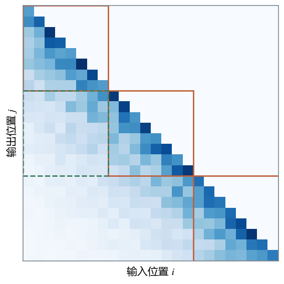

# 第 22 章 半可分矩阵：SSM 的矩阵真身

Mamba-2（Dao & Gu, 2024, ICML）的标题是 "Transformers are SSMs: Generalized Models and Efficient Algorithms Through Structured State Space Duality"，意思是"Transformer 就是 SSM"。这是对 2020 年那篇 "Transformers are RNNs"（Katharopoulos 等）的致敬，也是一个很强的主张。

支撑这个主张的路线有五步：

1. 把 SSM 写成一个矩阵乘法 $Y = MX$（本章）；
2. 证明这个矩阵属于一个经典的结构化矩阵族，也就是半可分矩阵（本章）；
3. 把线性注意力也用矩阵语言重写，发现它落在同一个族里（第 23 章）；
4. 得出对偶性：两者是同一个数学对象的两个计算视角（第 24 章）；
5. 设计一个同时利用两种视角的算法（第 25 章）。

本章走前两步。走完就能看清 SSM 和注意力共享的东西：一个矩阵秩条件。

---

## 22.1 把 SSM 写成矩阵乘法

### 递推 → 矩阵

Mamba-2 统一用离散形式，并把参数带上时间下标（选择性 SSM）：

$$
h_t = A_t h_{t-1} + B_t x_t,\qquad y_t = C_t^\top h_t,
\tag{22.1}
$$

其中 $h_t\in\mathbb{R}^{N}$、$x_t,y_t\in\mathbb{R}$（先考虑单通道）。

从 $h_0 = B_0x_0$ 出发，逐步展开：

$$
\begin{aligned}
h_0 &= B_0x_0,\\
h_1 &= A_1B_0x_0 + B_1x_1,\\
h_2 &= A_2A_1B_0x_0 + A_2B_1x_1 + B_2x_2,\\
&\ \vdots\\
h_t &= \sum_{s=0}^{t} \underbrace{A_tA_{t-1}\cdots A_{s+1}}_{=:\,A_{t:s}}B_sx_s .
\end{aligned}
$$

这里约定 $A_{t:s} := A_tA_{t-1}\cdots A_{s+1}$，即从 $s$ 到 $t$ 的乘积，但不含 $A_s$。这是 Mamba-2 的索引约定，与 Mamba-3 的 $\alpha_{t\cdots s}$ 写法一致。

于是输出

$$
y_t = C_t^\top h_t = \sum_{s=0}^{t}C_t^\top A_{t:s}B_s\,x_s .
$$

写成矩阵乘法：

$$
\boxed{\
y = M x,\qquad
M_{ji} = \begin{cases} C_j^\top A_{j:i} B_i & j\ge i\\ 0 & j<i\end{cases}
\ }
\tag{22.2}
$$

$M\in\mathbb{R}^{T\times T}$ 是下三角矩阵，下三角就是因果，$M_{ji}$ 的含义是"输出位置 $j$ 从输入位置 $i$ 取了多少信息"。

### 这个视角是本章的全部起点

第 1 章我们提过"矩阵混合器"，现在它变成了严格的工具：

- Transformer 的 $M$ 是注意力矩阵 $\mathrm{softmax}(QK^\top)$；
- SSM 的 $M$ 是 (22.2)。

接下来要问的是：这两个 $M$ 属于同一个矩阵族吗？

再看一眼参数：$A,B,C$ 一共是 $T$ 个 $A_t$（$N\times N$）、$T$ 个 $B_t$（$N$）、$T$ 个 $C_t$（$N$），加上 $M$ 里 $O(T^2)$ 个非零元。也就是说 $(A,B,C)$ 是 $M$ 的一个压缩表示，参数只要 $O(TN)$ 而不是 $O(T^2)$。所有 SSM 高效算法的立足点都在这里。

---

## 22.2 半可分矩阵

### 定义

定义 3.1（Mamba-2）：一个（下三角）矩阵 $M$ 是 **$N$-半可分的（$N$-semiseparable）**，如果它的下三角部分中的每个子矩阵秩不超过 $N$。$N$ 称为半可分的阶或秩。

"每个子矩阵"的精确含义：取任意 $j'\ge j\ge i\ge i'$（$j'$ 是行块下界、$i'$ 是列块上界），下面的块

$$
M_{j:j',\,i':i} \quad(\text{行区间 } [j,j'-1],\ \text{列区间 } [i',i-1])
$$

秩不超过 $N$。

用图来理解（Mamba-2 论文的 Figure 2）：

半可分矩阵是"全局低秩 + 局部自由"的矩阵：对角线上及其附近的元素可以任意取值，离对角线越远的大块，越必须有低秩结构。

为什么这对 SSM 是自然的？看 (22.2)：

$$
M_{ji} = C_j^\top \underbrace{A_{j:i}}_{\text{从 } i \text{ 到 } j}B_i .
$$

任取一个块，里面的每个元素都要穿过"从第 $i$ 列到第 $j$ 行"的转移——而那个转移的全部信息都压缩在一个 $N$ 维状态里。于是：

$$
M_{j:j',\,i':i} = \underbrace{\begin{pmatrix}C_{j}^\top A_{j:i'} \\ \vdots \\ C_{j'-1}^\top A_{j'-1:i'}\end{pmatrix}}_{\text{左因子，} \in\mathbb{R}^{q'\times N}}
\underbrace{A_{j:i-1}}_{\in\mathbb{R}^{N\times N}}
\underbrace{\begin{pmatrix}A_{i-1:i'}B_{i'} & \cdots & A_{i-1:i-1}B_{i-1}\end{pmatrix}}_{\text{右因子，}\in\mathbb{R}^{N\times q}}
$$

这个块显式地分解成了"左因子（$N$ 列）× 中间 × 右因子（$N$ 行）"，所以秩 ≤ $N$。SSM 是半可分矩阵的证明到此结束。

### SSS 表示

定义 3.2：下三角矩阵 $M$ 有 **$N$-顺序半可分（sequentially semiseparable, SSS）表示**，如果它可以写成

$$
M_{ji} = C_j^\top A_{j}A_{j-1}\cdots A_{i+1}B_i
$$

（即 (22.2) 的形式，其中 $C_j, B_i\in\mathbb{R}^N$，$A_i\in\mathbb{R}^{N\times N}$）。记作 $M = \mathrm{SSS}(A,B,C)$。

### 两个方向都是定理

引理 3.3（Mamba-2）：$N$-SSS 矩阵必然是 $N$-半可分的。

证明就是上面那个显式的秩分解（论文式 (5) 给出了完整写法）：

$$
\begin{pmatrix}
C_j^\top A_{j:i'}B_{i'} & \cdots & C_j^\top A_{j:i-1}B_{i-1}\\
\vdots & & \vdots\\
C_{j'-1}^\top A_{j'-1:i'}B_{i'} & \cdots & C_{j'-1}^\top A_{j'-1:i-1}B_{i-1}
\end{pmatrix}
=
\begin{pmatrix}
C_j^\top A_{j:i'}\\
\vdots\\
C_{j'-1}^\top A_{j'-1:i'}
\end{pmatrix}
A_{j:i-1}
\begin{pmatrix}
A_{i-1:i'}B_{i'} & \cdots & A_{i-1:i-1}B_{i-1}
\end{pmatrix}
$$

命题 3.4（Mamba-2）：每个 $N$-半可分矩阵都有 $N$-SSS 表示。（这是半可分矩阵文献里的经典结果。）

于是：

> **$N$-半可分 $\iff$ 有 $N$-SSS 表示。**

两边可以自由使用。代价是两种描述服务于不同场合："秩条件"（定义 3.1）是几何、结构层面的，"SSS 表示"（定义 3.2）是算法层面的。我们用一个来思考，用另一个来计算。

### 参数量的故事

定义 3.2 表面上需要 $O(N^2T)$ 个参数（因为要存 $T$ 个 $A_t$，每个 $N\times N$）。

但 Mamba-2 论文指出了一个更强的结果：$N$-半可分矩阵实际上可以压缩到 $O(NT)$ 个参数，而且这个界是渐进最优的（引 Pernet、Signargout、Villard, 2023）。

为什么？因为只需要保证子块低秩，就不需要保留完整的 $A_t$，可以只保留每个 $A_t$ 的"跨越区间"作用（例如用低秩分解表示）。对 SSM 的具体情形，如果 $A_t$ 是对角矩阵，那么 $A_t$ 只需 $N$ 个数而不是 $N^2$ 个，且 $\prod A_t$ 仍然是逐元素的连乘。

对角结构因此在 SSM 里流行（第 14 章已讲）：它让 $O(NT)$ 的参数化变得平凡。

---

## 22.3 1-SS 矩阵：标量递推的矩阵形式

Mamba-2 特别强调一个特例。

当 $N=1$ 时（状态是一维，没有 $B,C$ 投影），$M_{ji} = a_j a_{j-1}\cdots a_{i+1} =: a_{j:i}$（标量的连乘）。写成矩阵：

$$
M = \mathrm{1SS}(a_{0:T}) =
\begin{pmatrix}
1 & & & \\
a_1 & 1 & & \\
a_2a_1 & a_2 & 1 & \\
\vdots & & \ddots & \ddots\\
a_{T-1}\cdots a_1 & \cdots & a_{T-1} & 1
\end{pmatrix}
\tag{22.3}
$$

这个矩阵由 $T-1$ 个数 $a_1,\dots,a_{T-1}$ 完全决定，参数量 $O(T)$ 而非 $O(T^2)$。

### 关键等价：矩阵乘法 = 标量递推

$$
y = Mx \quad\Longleftrightarrow\quad y_t = a_t y_{t-1} + x_t
$$

验证：

$$
y_t = a_t y_{t-1} + x_t = a_t(a_{t-1}y_{t-2}+x_{t-1}) + x_t = \cdots = \sum_{s\le t}a_{t:s}x_s = (Mx)_t . ✓
$$

Mamba-2 把 $y = Mx$ 称为标量 SSM 递推（scalar SSM recurrence）或者 cumprodsum（cumulative product sum，累积求和乘积），因为它推广了 cumsum（累积和，$a_t\equiv1$）和 cumprod（累积乘积）。

### 为什么这个特例重要

Mamba-2 论文说得很明确：

> 这篇论文的核心主题之一是：很多序列模型上的算法都可以归约为结构化矩阵乘法算法。

1-SS 矩阵是这个连接最好的例证："计算一个标量递推"与"用一个 1-SS 矩阵做乘法"完全是一件事，因此所有已知的递推快速算法，都对应 1-SS 矩阵的某一种分解。Mamba-2 的附录 B 整理了一大类这样的算法（分块、并行扫描、基于 FFT、基于 Chebyshev 等）。

还有一个更实用的作用：任何 SSM 的核心递推都是"逐元素的标量递推"（当 $A$ 是对角矩阵时，$N$ 个独立通道，每个都是一维递推）。所以在实现里，SSM 的瓶颈永远是"怎么快速做 1-SS 乘法"。

---

## 22.4 主定理：SSM 就是半可分矩阵

定理 3.5（Mamba-2）：状态维度为 $N$ 的 SSM 变换 $y = \mathrm{SSM}(A,B,C)(x)$，等同于用一个 $N$-SS 矩阵（顺序半可分表示）做乘法：$y = \mathrm{SSS}(A,B,C)\cdot x$。

（论文还开了一个玩笑：structured state space model 和 sequentially semiseparable matrix 的缩写竟然都是 SSM/SSS，这"underscores their equivalence"。）

### 这个等价关系立刻给出一个很强的复杂度结论

命题 3.6（Mamba-2，引 Pernet 等 2023）：一个尺寸为 $T$ 的 $N$-SS 矩阵可以用 $O(NT)$ 个参数表示，且矩阵-向量乘法可在 $O(NT)$ 时间和空间内完成。

定理 3.7（Mamba-2）：任意状态维度为 $N$、序列长度为 $T$ 的 SSM 都可以在 $O(TN)$ 时间内算出（不计预处理）。

定理 3.7 在 SSM 文献里是一个新结果。分量在于：

- 对一般的、无结构的 $A_t$ 矩阵，表示本身就看起来要 $O(TN^2)$ 个参数；
- 但定理说，经过一次预处理之后，即使是无结构的 SSM 也能做到最优复杂度；
- 而且 $O(TN)$ 与下界匹配（下界来自 $B,C$ 本身的 $O(TN)$ 个元素）。

Mamba-2 论文还给了一个补充说明（Remark 4）：这个结论并不太意外，因为"几乎所有实矩阵在 $\mathbb{C}$ 上都可以对角化"（第 14 章的 Proposition 2），所以几乎所有的实 SSM 都等价于一个复对角 SSM。但定理 3.7 的结论更强：它对所有实 SSM 成立，包括那些不可对角化的；它对任意域（包括 $\mathbb{C}$ 本身）也成立。

实践层面要加一句：这个"最优算法"需要一个昂贵的预处理步骤（$O(N)$ 的额外 FLOPs，且涉及 SVD 这类硬件不友好的操作）。所以实践中仍然需要额外的结构（对角、标量）来避开预处理。这就引出了 Mamba-2 在 22.5 节和后面章节的算法。

---

## 22.5 两种计算模式

有了矩阵视角，SSM 的两种计算方式就变成了"对 $M$ 做乘法的两种方式"。

### 线性（递归）模式

算法如下（论文式 (8)，用张量缩约记号表示）：

$$
\begin{aligned}
Z &= \mathrm{contract}(SP,\,SN \to SPN)(X,\ B) &&(T,P,N)\\
H &= \mathrm{contract}(TSN,\,SPN \to TPN)(L,\ Z) &&(T,P,N)\\
Y &= \mathrm{contract}(TN,\,TPN\to TP)(C,\ H) &&(T,P)
\end{aligned}
\tag{22.4}
$$

其中 $L\in\mathbb{R}^{T\times T}$ 由 $\mathrm{1SS}(A)$ 给出（逐状态一份）。

三步的含义：

1. 扩张：把输入 $X$ 用 $B$ 扩张到 $N$ 维（把输入映射进状态空间）；
2. 递推：用 1-SS 矩阵 $L$ 做标量 SSM 递推（状态如何随时间传播）；
3. 收缩：用 $C$ 把状态收缩回输出（从状态读出输出）。

代价是 $O(T N P)$ 时间，但中间张量 $Z, H$ 的大小是 $(T,P,N)$。以 $T{=}2048,P{=}64,N{=}64$ 计，是 840 万个数，Mamba-1 必须做核融合，原因就在这里（第 19 章）。

Mamba-2 论文明确说："a naive implementation is slow because of the expanded tensors $Z$ and $H$ of size $(T,P,N)$; Gu and Dao (2023) introduced a hardware-aware implementation to avoid materializing these tensors."

### 二次（朴素）模式

直接物化矩阵 $M = \mathrm{SSS}(A,B,C)$（大小 $T\times T$），然后做一次矩阵-向量乘。

代价 $O(T^2N)$，对长序列是二次的。但当 $T$ 很小时（比如 $T=64$ 的一个块），它反而可能更快，因为：

- 它完全是矩阵乘法，硬件友好；
- 没有串行依赖（可以并行算所有 $M_{ji}$）。

Mamba-2 后面就是靠"在小块里用二次模式、在块之间用线性模式"来同时拿到两者的好处（第 25 章）。

### 截面图：两种模式的对偶性

Mamba-2 论文的 Figure 4 给出了这张"对偶关系表"，它把两侧的符号对齐：

| | SSM 侧 | 注意力侧 |
|---|---|---|
| 收缩矩阵 | $C$ | $Q$（queries） |
| 扩张矩阵 | $B$ | $K$（keys） |
| 输入序列 | $X$ | $V$（values） |
| 状态矩阵 | $A$ | 掩码 $L$ |
| 状态维度 | $N$ | 特征维度 $N$ |
| 中间量 | 隐状态 $H$（式 22.4 第 2 步） | Gram 矩阵 $G = QK^\top$ |
| 线性模式 | $H = L\cdot XB^\top$ 型 | —— |
| 二次模式 | $M = A \circ (CB^\top)$ 型 | $G = QK^\top$ |

右列要到第 23~24 章才能讲清楚，现在先放下。

---

## 22.6 一个重要的哲学转变

按 Mamba-2 论文的说法，这一章（以及下一篇）带来一个视角上的转变：

> 过去：RNN 和 SSM 不是"矩阵混合器"，只有注意力是。
> 现在：SSM 也是矩阵混合器，而且它的矩阵属于一个经典的结构化族。

这个转变的价值有三层：

1. 理论上：SSM 与注意力不再是两套隔绝的理论，而是同一个族的两个极端（一个"低秩但有结构"，一个"内容相关但不是半可分"）。
2. 算法上：半可分矩阵有几十年的数值线性代数积累（HSS、SSS、Bruhat 形式等等），可以借过来。
3. 系统上：既然 SSM 也是矩阵乘法，那么所有为矩阵乘法优化的东西（Tensor Core、cuBLAS、块算法）都能用上。

---

## 22.7 本章小结

- SSM 可以写成下三角矩阵乘法 $y = Mx$，$M_{ji} = C_j^\top A_{j:i}B_i$（$j\ge i$）。$M$ 是 $T\times T$ 的，但由 $O(TN)$ 个参数压缩生成。
- $N$-半可分：下三角部分中每个子块秩 ≤ $N$。SSM 天然如此，因为任何块都能分解成"左因子（$N$ 列）× 转移 × 右因子（$N$ 行）"。
- SSS 表示 $M_{ji}=C_j^\top A_j\cdots A_{i+1}B_i$；**$N$-半可分 $\iff$ 有 $N$-SSS 表示**（Lemma 3.3 + Proposition 3.4）。参数量可压缩到 $O(NT)$（最优）。
- 1-SS 矩阵：$M_{ji}=a_{j:i}$，与标量递推 $y_t = a_ty_{t-1}+x_t$ 严格等价，也叫 cumprodsum。它是所有 SSM 实现的性能瓶颈所在，也是"递推 $\leftrightarrow$ 矩阵分解"的枢纽。
- 定理 3.5：SSM 变换 = 半可分矩阵乘法（缩写巧合：SSM = structured state space model = semiseparable matrix）。
- 定理 3.7：任意 SSM 都能在 $O(TN)$ 时间内算出（经预处理），达到下界。但预处理成本高，所以实践中仍需要对角/标量等额外结构。
- 两种计算模式：线性（递归）$O(TNP)$，但中间张量 $(T,P,N)$ 巨大（这是 Mamba-1 核融合的动机）；二次（朴素）$O(T^2N)$，但全是矩阵乘法、无串行依赖。小块用二次、大范围用线性，这就是第 25 章 SSD 算法的思路。

## 下一章

第 23 章从注意力那一侧走进来：用张量缩约的语言重新推导线性注意力，并把它一般化为**结构化掩码注意力（SMA）**。这一步会看到，注意力的"因果掩码"其实就是一个 1-SS 矩阵。第 24 章把两侧合起来，就是"状态空间对偶"。
