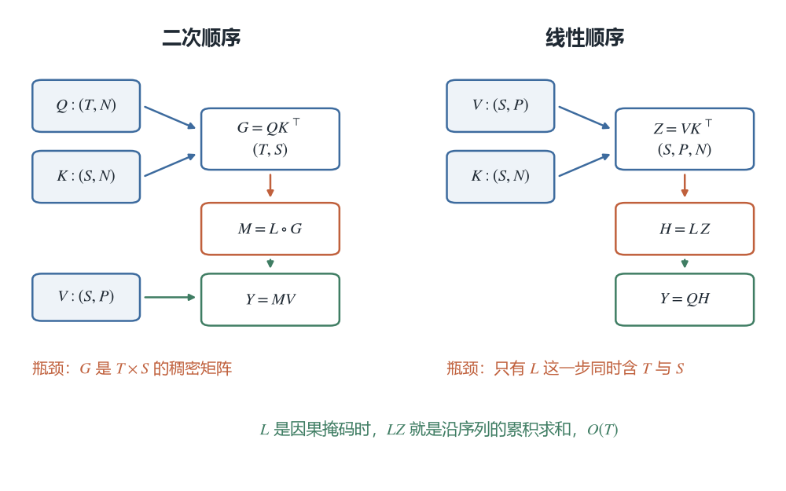

# 第 23 章 结构化掩码注意力：把线性注意力一般化

上一章从 SSM 那一侧走进来，发现 SSM = 半可分矩阵。本章换到注意力这一侧。

问题在于：标准注意力是二次复杂度，看上去和"线性"毫无关系。但线性注意力（Katharopoulos 等, 2020）早就指出，把 softmax 挪走之后，$Q(K^\top V)$ 与 $(QK^\top)V$ 只是乘法结合顺序不同，于是就有了线性复杂度的算法。

Mamba-2 认为这个推导虽然对，但"讲得不够清楚"（论文原话是 "somewhat less straightforward"，并指出原始论文和一些后续工作"陈述了公式但没有证明"）。它用**张量缩约（tensor contraction）**的语言重新推了一遍，顺手把它推广了：

> 任何"结构化的掩码"都能给出一个线性复杂度的注意力变体。这个推广叫**结构化掩码注意力（structured masked attention, SMA）**。

具体要讲的有五件事：

1. 用张量缩约怎么写注意力（以及为什么这个语言比矩阵记号清楚）；
2. 线性注意力的"两行证明"；
3. 因果掩码为什么就是"累积求和"（cumsum）；
4. SMA 的定义，以及它统摄了哪些已有工作（Linear Attention、RetNet、……）；
5. 一个问题：什么样的掩码才能有快速的自回归形式？（第 24 章的 Theorem 5.2 给出答案）

---

## 23.1 记法与形状注解

Mamba-2 用了一套"形状注解"（shape annotation）的记法：把张量的维度名字写在右上标，例如

$$
X \in \mathbb{R}^{(T,P)}
$$

表示 $X$ 的第一维长度是 $T$（序列轴）、第二维是 $P$（特征/head 轴）。这比 $\mathbb{R}^{T\times P}$ 更适合读张量缩约。

**张量缩约记号**：

$$
\mathrm{contract}(MN,\,NK \to MK)(X, Y) = X\cdot Y
$$

即 numpy 里的 `einsum('mn,nk->mk', X, Y)`。

本书会和常规矩阵记号并用。

### 注意力的基本形式

单头注意力的定义（输入三个矩阵 $Q,K,V$）：

$$
\begin{aligned}
Q &= \text{input} &&(T,N)\\
K &= \text{input} &&(S,N)\\
V &= \text{input} &&(S,P)\\
G &= QK^\top &&(T,S)\\
M &= f(G) &&(T,S)\\
Y &= GV &&(T,P)
\end{aligned}
$$

这里 $S$、$T$ 分别是源序列长度与目标序列长度（自注意力时 $S=T$），$N$ 是特征维（同时也是 $Q,K$ 的维），$P$ 是 head 维（$V$ 的维）。

$N$ 不出现在输出里，只在中间过程出现。Mamba-2 论文特别强调了这一点：在自注意力情形下，应该把 $V$ 看成"主要输入"，把整个注意力看成一个 $V\mapsto Y$ 的序列变换。

（为什么要在意这个细节？因为它决定了后面"SSM 对偶"里谁是 $X$。答案是：$V\leftrightarrow X$。）

### 核注意力与掩码注意力

核注意力（kernel attention）把 softmax 拆成两部分：指数化和按行归一化。归一化可以暂时忽略（相当于把 $V$ 增加一列全 1 然后相除）。指数化则可以用一个特征映射 $\varphi$ 表示：

$$
\exp(QK^\top) = \varphi(Q)\varphi(K)^\top .
$$

于是把 $\varphi$ 吸收进 $Q,K$ 的定义里，就得到"任意 $Q,K$"的核注意力。这一族包括：

- Linear Attention（原版）：$\varphi$ 是逐点激活函数（如 $x\mapsto 1+\mathrm{elu}(x)$）；
- Random Feature Attention：用随机傅里叶特征逼近 exp 核；
- Performer：用正随机特征（PRF）；
- cosFormer：加一个余弦重加权来强调局部性。

**掩码（核）注意力**：在 $QK^\top$ 上逐元素乘一个掩码矩阵 $L$：

$$
y = (L\circ(QK^\top))\cdot V .
$$

最常见的 $L$ 是因果掩码（下三角全 1 矩阵）。其他还有带状、稀疏、块对角等。

---

## 23.2 用张量缩约看：一次缩约，两种顺序

Mamba-2 的第一个"小技巧"是把掩码注意力写成一个四路缩约：

$$
\boxed{\
Y = \mathrm{contract}(TN,\,SN,\,SP,\,TS \to TP)(Q,\ K,\ V,\ L)
\ }
\tag{23.1}
$$

（注意力 = 四个张量的一次缩约。$Q$ 和 $K$ 缩掉了 $N$，$L$ 缩掉了一个 $S$，$V$ 缩掉了另一个 $S$。）

### 顺序一：标准（二次）算法

按"先算 $G$，再掩码，再乘 $V$"的顺序做两两缩约：

$$
\begin{aligned}
G &= \mathrm{contract}(TN,\,SN\to TS)(Q,K) &&(T,S)\\
M &= \mathrm{contract}(TS,\,TS\to TS)(G,L) &&(T,S)\\
Y &= \mathrm{contract}(TS,\,SP\to TP)(M,V) &&(T,P)
\end{aligned}
\tag{23.2}
$$

这就是标准注意力的计算方式。瓶颈在第 1 步：需要物化 $T\times S$ 的矩阵。自注意力时 $T=S$，所以是 $O(T^2)$。

### 顺序二：线性算法

换一个缩约顺序：

$$
\begin{aligned}
Z &= \mathrm{contract}(SP,\,SN \to SPN)(V,K) &&(S,P,N)\\
H &= \mathrm{contract}(TS,\,SPN \to TPN)(L,Z) &&(T,P,N)\\
Y &= \mathrm{contract}(TN,\,TPN \to TP)(Q,H) &&(T,P)
\end{aligned}
\tag{23.3}
$$

三步的含义：

- 第 1 步（扩张）：把 $V$ 和 $K$ 先乘起来，得到 $(S,P,N)$。这是一个"扩张"操作，把特征维度从 $P$ 扩张到 $P\times N$。
- 第 2 步（沿序列轴传播）：用掩码 $L$ 在这个扩张后的张量上做沿序列轴的混合。这是唯一同时涉及 $T$ 和 $S$ 两个轴的步骤，因此按定义是 $\Omega(TS)$ 复杂度，除非 $L$ 有特殊结构。
- 第 3 步（收缩）：用 $Q$ 把扩张的 $N$ 维收缩掉，得到 $(T,P)$。

对比 (23.2) 和 (23.3)：同一个函数，两种缩约顺序，复杂度一个二次、一个线性。这就是"线性注意力"的全部内容。

Mamba-2 用这个视角给出的解释很简洁：

> 如果把 $K$ 看作输入（对应 SSM 的 $B$），那么 $V$ 和 $Q$ 分别扮演扩张和收缩的角色。

（这正是第 22.5 节 SSM 线性算法里的 $B$、$C$ 的分工：$B$ 扩张输入进状态、$C$ 收缩状态到输出。对应关系已经呼之欲出了。）

---

## 23.3 因果掩码就是累积求和

现在关键问题：第 2 步"用 $L$ 做沿序列轴的混合"什么时候能快？

### 答案：L 是因果掩码时，"乘 L"就是 cumsum

设 $L$ 是下三角全 1 矩阵：

$$
L = \begin{pmatrix}
1 & & & \\
1 & 1 & & \\
1 & 1 & 1 & \\
\vdots & & & \ddots
\end{pmatrix}
$$

则对任意 $x$，

$$
(Lx)_t = \sum_{s\le t}x_s
$$

这就是前缀和（cumulative sum, cumsum）。而 cumsum 可以在 $O(T)$ 时间内算完（一次串行扫描或对数深度并行扫描）。于是 (23.3) 的第 2 步从 $O(T^2)$ 降到 $O(T)$，整个注意力变成线性。

线性注意力的证明就这两行。论文的 Figure 3 把这件事画成一张表：

不同的掩码对应不同的线性模式：

| 掩码 $L$ | 对应的模型 |
|---|---|
| 因果掩码（全 1 下三角） | Linear Attention |
| 衰减掩码 $\gamma^{i-j}$ | RetNet |
| 1-半可分掩码 | SSD（Mamba-2） |
| Toeplitz 掩码 | Toeplitz 结构化注意力 |
| 离散傅里叶矩阵 | Fourier 结构化注意力 |

### 一个"为什么之前要绕那么久"的解释

原始线性注意力论文说 $Y = Q\cdot\mathrm{cumsum}(K^\top V)$ 与 $Y=(L\circ QK^\top)V$ 等价，但没有给证明（Mamba-2 论文指出了这一点）。用张量缩约的语言，等价的理由一目了然：这只是同一个四路缩约的两种计算顺序，而"乘下三角全 1 矩阵"恰好等于 cumsum。

---

*图 23-1　同一个四路缩约的两种计算顺序：先算 $G$ 是二次的，先做扩张是线性的*

## 23.4 结构化掩码注意力（SMA）

### 定义

既然线性注意力的关键其实是"$L$ 是结构化的（有快速矩阵乘法）"，那把它推广就顺理成章了。

定义 4.2（Mamba-2）：**结构化掩码注意力（structured masked attention, SMA）** 是如下定义的函数：

$$
Y = \mathrm{contract}(TN,\,SN,\,SP,\,TS\to TP)(Q,K,V,L)
$$

其中 $L$ 是任意结构化矩阵（即有次二次矩阵乘法复杂度的矩阵）。

- SMA 的二次模式：按 (23.2) 的顺序算（标准掩码注意力）。
- SMA 的线性模式：按 (23.3) 的顺序算，其中第 2 步用 $L$ 的快速矩阵乘法加速。

### 重要的概念分离

Mamba-2 强调："注意力"是一个函数，"二次算法/线性算法"是两种算法。很多文献把这两者混为一谈，导致讨论混乱。区分之后：

- 掩码注意力函数 = (23.1) 这个四路缩约；
- 二次算法与线性算法 = 两种缩约顺序；
- 缩约顺序的不同导致了"二次 vs 线性"的分野。

这个分离也适用于 SSM（第 22.5 节的两种模式）。而"状态空间对偶"就是把两侧的这两种模式对齐（第 24 章）。

### 已有一批工作都是 SMA 的实例

| $L$ 的形式 | 对应的方法 | 备注 |
|---|---|---|
| 因果掩码 $L_{ij}=\mathbb{I}[j\ge i]$ | **Linear Attention** | 等价于 cumsum |
| 衰减掩码 $L_{ij}=\gamma^{i-j}\mathbb{I}[j\ge i]$ | **RetNet** | $\gamma\in[0,1]$ 是衰减因子 |
| Toeplitz $L_{ij}=\alpha_{i-j}$ | Toeplitz 结构化注意力 | 可看作"乘性而非加性的相对位置编码"（类比 ALiBi） |
| 离散傅里叶矩阵 $L_{ij}=\omega^{ij}/T$ | Fourier 结构化注意力 | 位置信息编码的另一种方式 |
| **1-半可分掩码** | **SSD（本文）** | 下一章的主角 |

注意 RetNet 那一行：它的掩码是与输入无关的固定衰减（$\gamma$ 是超参数），所以 RetNet 是"时不变的"。而 SSD 的掩码 $L_{ij}=a_i\times\cdots\times a_{j+1}$ 里的 $a_i$ 是输入相关的，因此是时变的。这一点在第 27 章会作为"为什么 RetNet 不如 Mamba-2 的 head 结构/掩码选择"的一部分讨论。

### 一个副产品：掩码 = 位置编码

这个框架还给出一个比较有意思的视角。

在标准注意力里，位置信息靠加性的位置编码（正弦、RoPE、ALiBi）注入。而在 SMA 里，位置信息由掩码 $L$ 提供：

- 因果掩码提供"只看过去"；
- 衰减掩码提供"越远越弱"；
- 1-SS 掩码提供"由数据决定的衰减"。

Mamba-2 论文的原话大意：

> $L$ 可以看作用数据相关的位置掩码替代了 Transformer 里启发式的位置编码，控制多少信息跨时间传递。

这个视角解释了几件事：

1. 为什么 SSM 不需要位置编码（第 20.6 节）；
2. 为什么 $a_t$ 的累积乘积 $a_{j:i}$ 控制"位置 $i$ 到位置 $j$ 之间允许多少交互"；
3. 为什么 Mamba-2/3 的混合模型里，注意力层要用 NoPE（去掉位置编码），因为序列混合层自己会提供位置信号。

（这个观点也被同期工作 GateLoop 独立提出。）

---

## 23.5 一个必要的形式化：什么掩码才能快速自回归

SMA 给了"任意结构化 $L$ 都可以有线性模式"的结论。但还有一个更尖锐的问题：

> 给定一个想要"自回归（因果）且高效"的注意力变体，它的掩码 $L$ 必须长什么样？

这不是"哪些 $L$ 可以加速"的问题，而是"哪些 $L$ 本质上必须有结构"的问题。

Mamba-2 的 Theorem 5.2 给出了答案，而且答案恰好落在上一章讲的那个族上：

> 任何有界阶的自回归结构化掩码注意力，其掩码 $L$ 必须是半可分矩阵。

也就是说：

> **"高效的自回归注意力" $=$ "半可分掩码的结构化注意力"。**

这个定理是第 24 章"对偶"的最后一块拼图：它说明半可分性不是 SSM 的特殊性质，而是"任何能高效自回归的线性序列模型"的共同性质。

（定理的证明在 Mamba-2 论文附录 C.2，思路是：自回归意味着 $y_t$ 只依赖 $x_{\le t}$；"有界阶"意味着状态大小有限；把状态递推展开就得到 $L$ 的一个 SSS 表示，于是 $L$ 半可分。）

---

## 23.6 本章小结

- 掩码核注意力可以写成一次四路张量缩约：(23.1)。$N$（特征维）不出现在输出里，因此自注意力下应把 $V$ 看作主输入。
- 两种缩约顺序：(23.2) 先算 $G=QK^\top$（$O(T^2)$，二次模式）；(23.3) 先做扩张（$VK^\top$）再沿序列轴混合再收缩（$O(T)$，线性模式）。
- 线性注意力的关键：唯一同时涉及 $T$ 和 $S$ 的第 2 步就是"乘掩码 $L$"；当 $L$ 是因果掩码（下三角全 1）时，这就是 cumsum，$O(T)$ 可算。
- SMA：把 $L$ 推广为任意结构化矩阵。实例包括 Linear Attention（因果掩码）、RetNet（衰减掩码）、Toeplitz/Fourier 掩码等。
- 概念分离：注意力是一个函数（四路缩约）；二次/线性是两种算法（缩约顺序）。SSM 也有同样的二分。
- 掩码即数据相关的位置编码：$L$ 替代了 Transformer 的启发式位置编码，解释了 SSM 为什么不需要位置编码，以及混合模型为什么要用 NoPE。
- 定理 5.2：任何有界阶的高效自回归注意力，其掩码必须半可分。"高效自回归注意力" = "半可分掩码注意力"。

## 下一章

第 24 章把两侧合起来。会看到一个很干净的结果：**当你把 SSM 的 $A$ 限制为"标量乘单位阵"，它就精确地等于一个 1-半可分掩码的线性注意力。** 于是"状态空间对偶"不是一个类比，而是一个恒等式。
