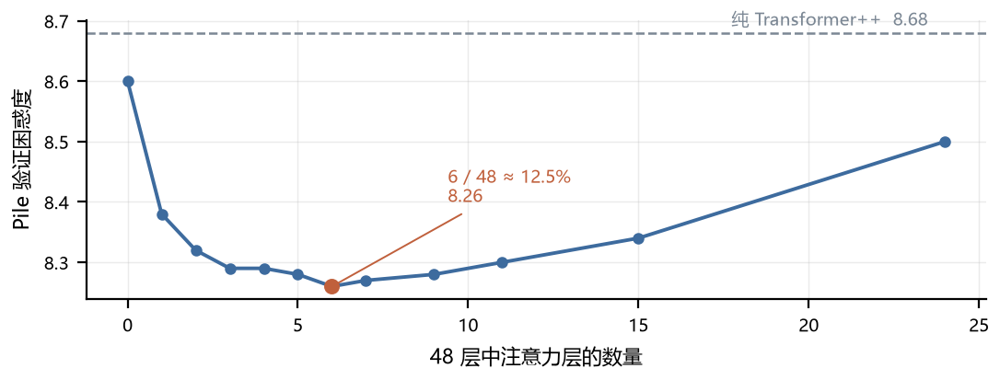

# 第 27 章 Mamba-2 的实验：混合架构与新能效前沿

Mamba-2 给了我们三样东西：一个理论（SSD）、一个算法（块分解）、一个架构（借来的设计语言）。下面看它到底做到了什么。

三个问题：

1. 状态大小真的那么重要吗？第 21 章的消融暗示"$N$ 越大越好"，Mamba-2 把 $N$ 做到 64/128/256。这在什么任务上看得出来？
2. 它比 Mamba-1 好多少？在语言建模上，困惑度、下游评测、速度。
3. 纯 SSM 够不够？还是必须和注意力混着用？这个问题的答案决定了当代模型的形态。

---

## 27.1 MQAR：状态大小的试金石

### 任务

Multi-Query Associative Recall（MQAR）是 Arora 等（2024）提出的合成任务。任务形式：先给模型看若干组「键-值」对，再依次给出键，要求它回忆对应的值。

一次要记住多个关联，所以叫 multi-query。

为什么这个任务对 SSM 是硬骨头？

因为它直接考验状态的存储容量：模型必须把 $k$ 个键值对全部编码进一个固定大小的状态里。如果状态只有 $N$ 维，那它能记住的关联数量受限于 $N$。

这与第 17 章讲的 Selective Copying / Induction Heads 是同一类能力（联想回忆），但 MQAR 更难：它要求同时记住多个关联。

Mamba-2 论文说这个任务"与 phonebook lookup 任务密切相关，已被证明对 SSM 这类循环模型很困难，因为它们的有限状态容量"。

### 结果（论文 Figure 8）

在"更难的 MQAR 设置"下（更长序列、更小模型），比较：

- 标准多头 softmax 注意力；
- Based（一个混合了卷积、局部注意力和线性注意力的架构）；
- Mamba-1；
- Mamba-2（$N=16, 64, 256$）。

结论：

1. Mamba-1 在这个任务上挣扎（在多数设置下接近随机）。
2. Mamba-2 在所有设置下都表现良好。
3. 即使控制状态大小（$N=16$），Mamba-2 也显著优于 Mamba-1。论文坦诚地说："我们不确定是架构的哪个方面起主要作用，这仍是未来工作需要探索的问题。"
4. 增大 $N$ 持续改善性能：$N=16 \to 64 \to 256$ 一致提升，因为"更大的状态允许记住更多信息（键值对）"。
5. 在较长序列/较大模型维度下，Mamba-2（$N=256$）甚至超过了普通注意力。

### 这一节的意义

这个实验是"Mamba-2 为什么值得存在"的最直接证据。它量化了两件事：

- 状态容量是联想回忆的瓶颈（$N$ 越大越好）；
- Mamba-2 的算法让大 $N$ 变得便宜（所以才能用 $N=256$）。

对比第 25 章的效率图（论文 Figure 10 右）：Mamba 的优化扫描实现随 $N$ 线性变慢，而 SSD 几乎不变。两张图合起来才是完整的论证：不是"SSD 更好"，而是"SSD 让大 $N$ 可行，而大 $N$ 是必要的"。

---

## 27.2 语言建模

### 缩放定律

在 Pile 上按 Chinchilla 协议训练 $\approx 125$M 到 $\approx 1.3$B。对比 Mamba 与 Transformer++。

结论（论文 Figure 9）：

> Mamba-2 **匹配或超过** Mamba 与强 Transformer++ 配方。相对 Transformer 基线，Mamba-2 在**性能（困惑度）、理论 FLOPs、实际墙钟时间**三个维度上都是 **Pareto 占优**的。

"三个维度都 Pareto 占优"意味着不存在"用更多算力换更好效果"的权衡点，它在所有维度上同时更好。

### 下游零样本评测（Table 1）

| 模型 | Pile ppl↓ | LAMBADA ppl↓ | 平均准确率↑ |
|---|---|---|---|
| Pythia-1B | 7.82 | 7.92 | 49.0 |
| Mamba-790M | 7.33 | 6.02 | 53.0 |
| **Mamba-2-780M** | **7.26** | **5.86** | **53.5** |
| Pythia-1.4B | 7.51 | 6.08 | 51.7 |
| Mamba-1.4B | 6.80 | 5.04 | 56.4 |
| **Mamba-2-1.3B** | **6.66** | **5.02** | **56.4** |
| Pythia-2.8B | 6.73 | 5.04 | 55.7 |
| RWKV4-3B | 7.00 | 5.24 | 56.4 |
| Mamba-2.8B | 6.22 | 4.23 | 59.9 |
| **Mamba-2-2.7B** | **6.09** | **4.10** | **60.2** |

> **一个容易误读的地方**：第 21 章说 Mamba-2.8B 的平均准确率是 63.3%，这里却写 59.9%。两个数都对——平均的任务集合不同。Mamba-1 论文 Table 3 平均了 6 个任务（LAMBADA、HellaSwag、PIQA、Arc-E、Arc-C、WinoGrande），Mamba-2 论文 Table 1 加上了 OpenbookQA（共 8 个任务）。跨论文比较平均准确率之前要先对齐任务集合，否则会得出错误的结论。本书在两个地方都保留了各自论文的原始口径。

几个观察：

- Mamba-2 在每个规模上都优于 Mamba-1（困惑度与平均准确率都是），而参数量略小。
- Mamba-2-2.7B（60.2%）超过 Mamba-2.8B（59.9%），也超过 RWKV4-3B（56.4%）与 Pythia-2.8B（55.7%）。
- 论文摘要的原话："Mamba-2 with 2.7B parameters trained on 300B tokens on the Pile outperforms Mamba-2.8B, Pythia-2.8B and even Pythia-6.9B trained on the same dataset."

"even Pythia-6.9B"的意思是，用 2.7B 参数打败了 6.9B 的 Transformer。

---

## 27.3 混合架构：本章最重要的部分

### 动机

Mamba-2 论文引用了一批同期工作（H3、De、Glorioso、Lieber 等）的观察：

> **SSM 层与注意力层混合的架构，可能比纯 Transformer 或纯 SSM 都有更好的模型质量**，尤其是在上下文学习（in-context learning）方面。

Mamba-2 系统地做了这个实验。

### 实验一：注意力层的比例（Table 2）

固定 350M 参数、48 层，训练 7B token，只改变"48 层里有几层是注意力"：

| 注意力层数 | 0（纯 Mamba-2） | 1 | 2 | 3 | 4 | 5 | 6 | 7 | 9 | 11 | 15 | 24 | Transformer++ |
|---|---|---|---|---|---|---|---|---|---|---|---|---|---|
| 困惑度↓ | 8.60 | 8.38 | 8.32 | 8.29 | 8.29 | 8.28 | **8.26** | 8.27 | 8.28 | 8.30 | 8.34 | 8.50 | 8.68 |

这张表的信息量很大：

- 纯 Mamba-2 是 8.60，纯 Transformer++ 是 8.68，两者几乎持平（Mamba-2 略好）。
- 只要加 1 层注意力就降到 8.38（改善 0.22）。
- 最优在 6 层左右（8.26），即 6/48 ≈ 12.5%。
- 继续增加注意力层反而变差（24 层时 8.50，比纯 Mamba-2 还差）。

论文的结论：

> **大约 10% 的层是注意力时表现最好。**

至于原因，论文给出的假设是：

> SSM 层作为通用的序列到序列映射工作得很好，而注意力层则充当**检索机制**，可以快速引用序列中之前的 token，而不是强迫模型把所有上下文都压缩进它的记忆（SSM 状态）。

这个假设值得记住，因为它精确地对应了我们从第 17 章一路走来的框架：

- SSM 擅长压缩（长期聚合统计量、平滑信息）；
- 注意力擅长检索（精确定位、逐字回忆）；
- 两者互补。

它也解释了为什么"太多注意力反而变差"：注意力不压缩，在长序列上会把大量算力和参数花在"不压缩"上；而 Mamba-2 的压缩已经足够处理大部分需求。

*图 27-1　注意力层数量与困惑度：纯 Mamba-2 为 8.60，6 层注意力时最好（8.26）*

### 实验二：SSD + MLP + 注意力的组合（Table 3）

在 2.7B 规模（64 层）、300B token 上比较五种配置：

| 配置 | 组成 | Pile ppl↓ | 平均准确率↑ |
|---|---|---|---|
| Transformer++ | 32 注意力 + 32 gated MLP（交替） | 6.13 | 60.2 |
| Mamba-2 | 64 SSD | 6.09 | 60.2 |
| Mamba-2-MLP | 32 SSD + 32 MLP（交替） | 6.13 | 59.6 |
| **Mamba-2-Attention** | **58 SSD + 6 注意力** | **5.95** | **61.0** |
| Mamba-2-MLP-Attention | 28 SSD + 4 注意力 + 32 MLP | 6.00 | 60.7 |

（注意力层放在第 9、18、27、36、45、56 层。）

结论：

1. Transformer++ 与纯 Mamba-2 质量相同（6.13 vs 6.09，60.2 vs 60.2）。
2. 加 6 层注意力明显改善（5.95，61.0），比纯 Mamba-2 好，也比 Transformer++ 好。
3. 加 MLP 会降低质量（6.13），但有两个好处：(i) 训练和推理更快（MLP 简单且硬件友好）；(ii) 更容易升级成 MoE（把 MLP 换成专家混合）。
4. 最复杂的组合（SSD + MLP + 注意力）质量介于中间（6.00），但兼顾了效率与可升级性。

### 这一节的深远影响

"约 10% 注意力层"这个结论，后来成了工业界线性模型部署的标准做法。2025–2026 年出现的各种"混合线性模型"（Kimi Linear、NVIDIA 的混合架构、腾讯混元的线性版本等）基本都遵循这个比例。Mamba-2 的这张表是它的实验依据。

这里还有一个微妙之处：纯 Mamba-2 与纯 Transformer++ 质量相同。这意味着：

> 选择混合架构不是因为纯 SSM 质量不够，而是因为"两种能力互补"这件事本身有价值。

如果纯 SSM 质量更好，那就没人会混；如果纯 SSM 质量更差，混也只是补救。质量持平加能力互补，才使得混合成为帕累托改进。

---

## 27.4 效率

### 与 Mamba-1 的对比（Figure 10 左）

- SSD 比 Mamba 的融合扫描快 2–8×（$N=64$ 时）；
- 序列长度 ≥ 2K 时比 FlashAttention-2 快，16K 时快 6×；
- 因为 SSD 是线性缩放，注意力是二次缩放，所以交叉点之后差距持续拉大。

### 状态维度的伸缩性（Figure 10 右）

在序列长度 4K 下：

- Mamba 的优化扫描实现随 $N$ 线性变慢（从 $N=16$ 到 $N=256$ 慢了十几倍）；
- SSD 几乎不变（从 $N=16$ 到 $N=256$ 只有很小变化）。

这张图是第 25 章"块分解"最直接的实证。

### 一个诚实的说明

Mamba-2 论文自己指出（§9.3）：

> Mamba-2 模型整体上在短序列（如 2K）上可能**不如** Transformer 训练高效，因为一个 $L$ 层的 Transformer 有 $L/2$ 个 MLP 层和 $L/2$ 个注意力层，而同样参数量的 Mamba-2 有 $L$ 个 SSD 层。**MLP 层通常非常硬件友好**（简单的矩阵乘 + 逐点线性）。

这正是实验二里"加 MLP 会降低质量但更快"的背景。所以在短序列场景下，"SSD + MLP"的混合可能比纯 SSD 更划算，这也是混合架构的另一个理由（不只是质量，还有速度）。

---

## 27.5 Mamba-2 的遗产

把 Mamba-2 的贡献按"对后世的影响"排序：

第一，SSD 算法（工程遗产）。一个几十行纯 PyTorch 的实现，比精心优化的 CUDA 扫描快 2–8 倍，而且 $N$ 可以大 8 倍。这把"研究 SSM"的门槛从"要会写 CUDA"降到"会写 einsum"。后续几乎所有线性模型工作（Gated DeltaNet、Kimi Linear、各种混合架构）都建立在 SSD 的形式上。

第二，对偶理论（理论遗产）。"SSM = 半可分矩阵 = 线性注意力"这个等价关系，让两个原本隔绝的领域可以互相借工具，也是"线性注意力"这条线在 2024 年之后重新活跃的直接原因。

第三，head 模式与系统优化（架构遗产）。MVA/MCS/MES/MHS 的词汇表、并行投影、GroupNorm 位置、$A_t=0$ 做序列边界，这些"小设计"让 SSM 真正能上大规模训练。

第四，混合架构的定量结论（实践遗产）。"约 10% 注意力层"成了行业标准。

遗憾则留给了 Mamba-3：

1. $A$ 退化为标量，表达力下降。第 24 章说过这是"用表达力换效率"。但表达力具体损失了什么能力？第 28 章会给出精确的答案：状态追踪（state tracking）。
2. 离散化仍是启发式的。Mamba-1/2 的实现用 $\bar B = \Delta B$，而论文写的是 ZOH。这个不一致在理论上没有依据（第 29 章解决）。
3. 推理时算术强度太低。SSD 的解码阶段仍然是访存受限（每步只做很少的 FLOPs，却要搬一整个状态），硬件利用率低（第 31 章解决）。

---

## 27.6 本章小结

- MQAR（多查询联想回忆）是状态容量的试金石：Mamba-1 挣扎，Mamba-2 良好（即使 $N=16$ 也更好）；$N$ 从 16 → 64 → 256 持续改善，$N=256$ 时甚至超过普通注意力。这证明了"大 $N$ 必要"+ "SSD 让大 $N$ 可行"。
- 语言建模：缩放定律上对 Transformer++ 在困惑度、理论 FLOPs、墙钟时间三维 Pareto 占优；2.7B（60.2%）超过 Mamba-2.8B（59.9%）、Pythia-2.8B（55.7%）、甚至 Pythia-6.9B。
- 混合架构：350M/48 层实验显示，纯 Mamba-2（8.60）与纯 Transformer++（8.68）几乎持平；加 1 层注意力就到 8.38，最优在 6 层（8.26，约 12.5%）；过多注意力反而变差（24 层 8.50）。解释：SSM 擅长压缩，注意力擅长检索，两者互补。
- 2.7B 组合实验：Transformer++ 6.13/60.2，纯 Mamba-2 6.09/60.2，58 SSD + 6 注意力 = 5.95/61.0（最好）；加 MLP 略降质量但更快且易于升级成 MoE。
- 效率：SSD 比 Mamba 扫描快 2–8×，16K 时比 FlashAttention-2 快 6×；Mamba 的扫描随 $N$ 线性变慢，SSD 几乎不变。但短序列上纯 SSD 可能不如 Transformer（MLP 更硬件友好）。
- 遗产：SSD 算法（工程）、对偶理论（理论）、head 模式与系统优化（架构）、10% 注意力配比（实践）。
- 三个遗憾（→ Mamba-3）：$A$ 退化为标量导致表达力损失（具体是状态追踪）、离散化仍是启发式、解码算术强度太低。

## 下一章

进入第八篇 Mamba-3。第 28 章先做诊断：Mamba-2 到底损失了什么能力？为什么"状态追踪"是一个根本性的缺陷？为什么"线性复杂度"在实践中并不等于"硬件高效"？这两个诊断分别对应 Mamba-3 的前两个创新，而第三个（MIMO）来自对解码阶段算术强度的分析。
