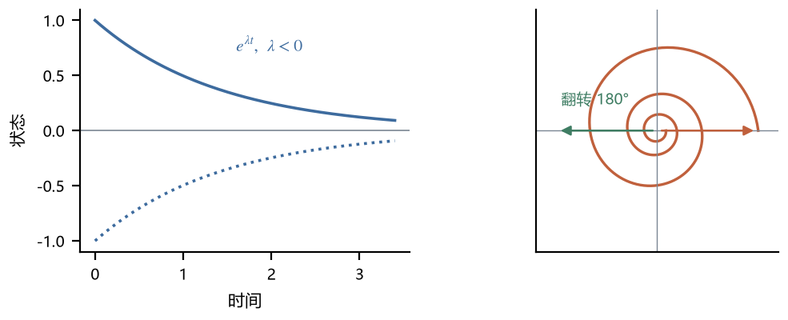

# 第 30 章 复值状态与数据依赖 RoPE

第 28 章讲了：Mamba-2 的标量实衰减 $a_t\in[0,1]$ 让它在数学上不可能解决 parity（Grazzi 等 2025, Theorem 1）。根因是实特征值只能缩放、不能旋转。

解法很简单：

> 把状态空间改成复值，但用"数据依赖的 RoPE"来实现，使计算成本几乎与实数相同。

本章要讲清五件事：

1. 复值 SSM 的定义，以及它为什么能表达"旋转"；
2. Proposition 2：复值 SSM 精确等价于一个实值 SSM，其转移矩阵是"标量衰减 $\times$ 块对角 2×2 旋转矩阵"；
3. Proposition 3：这个实值 SSM 等价于"在 $B,C$ 上施加数据依赖的旋转"，也就是数据依赖 RoPE；
4. 与普通 RoPE 的对照：为什么普通 RoPE 解决不了 parity，而数据依赖 RoPE 可以；
5. Proposition 4：指数-梯形 + 复值 + RoPE 的完整递推。

---

## 30.1 复值 SSM 与"旋转"

### 定义

Mamba-3 考虑的复值 SSM（论文式 (8)）：

$$
\begin{aligned}
\dot h(t) &= \mathrm{Diag}\big(A(t) + i\Theta(t)\big)\,h(t) + \big(B(t) + i\hat B(t)\big)x(t),\\
y(t) &= \mathrm{Re}\left(\big(C(t)+i\hat C(t)\big)^\top h(t)\right),
\end{aligned}
\tag{30.1}
$$

其中

$$
h(t)\in\mathbb{C}^{N/2},\qquad \Theta(t),B(t),\hat B(t),C(t),\hat C(t)\in\mathbb{R}^{N/2},\qquad x(t),A(t)\in\mathbb{R}.
$$

几个要点：

- 状态维度写成 $N/2$（复数），这样它等价于 $N$ 个实数，与 Mamba-2 的实数状态维度对齐，便于公平比较。
- $A(t)$ 是实部（负的，控制衰减），$\Theta(t)$ 是虚部（控制旋转频率）。
- $B, C$ 也有实部与虚部（$\hat B, \hat C$）。
- 输出取实部，因为最终要的是实数输出。

### 为什么"虚部"就是旋转

一个复数的乘法 $e^{i\theta}\cdot z$ 在复平面上就是"把 $z$ 旋转 $\theta$ 角度"。写成 $2\times2$ 实矩阵：

$$
e^{i\theta} \;\longleftrightarrow\; R(\theta) = \begin{pmatrix}\cos\theta & -\sin\theta\\ \sin\theta & \cos\theta\end{pmatrix}.
$$

所以：

- 实特征值 $\lambda<0$：$e^{\lambda t}$ 让状态沿一条直线衰减；
- 复特征值 $\lambda\pm i\theta$：$e^{(\lambda\pm i\theta)t}$ 让状态螺旋衰减，一边转一边缩。

这就是"旋转型动力学"。parity 需要的正是"在两个状态之间翻转"（旋转 $\pi$），模 3 计数需要"在三个状态之间循环"（旋转 $2\pi/3$）。

### 一个具体的构造（Mamba-3 论文的例子）

parity 可以用

$$
h_t = R(\pi x_t)\,h_{t-1}
$$

实现：当 $x_t=1$ 时旋转 $\pi$（翻转），$x_t=0$ 时不转。初值 $h_0 = (1,0)^\top$，则 $h_t$ 在 $(1,0)$ 与 $(-1,0)$ 之间交替，正好编码 parity。

这种动力学用实特征值表达不出来，这正是 Grazzi 等 Theorem 1 的直观内容。

---

## 30.2 Proposition 2：复值 → 实值块对角旋转

Proposition 2（Mamba-3，复值到实值等价）：考虑 (30.1) 的复值 SSM，在指数-欧拉离散化下，它等价于一个实值 SSM

$$
h_t = e^{\Delta_tA_t}R_t\,h_{t-1} + \Delta_tB_tx_t,\qquad y_t = C_t^\top h_t,
\tag{30.2}
$$

其中

- 状态 $h_t\in\mathbb{R}^N$（实数，维度翻倍）；
- 投影

$$
B_t := \begin{pmatrix}\hat B_t\\ B_t\end{pmatrix}\in\mathbb{R}^N,\qquad
C_t := \begin{pmatrix}\hat C_t\\ -C_t\end{pmatrix}\in\mathbb{R}^N;
$$

- 转移矩阵

$$
R_t := \mathrm{Block}\Big(\{R(\Delta_t\theta_t^{[i]})\}_{i=1}^{N/2}\Big)\in\mathbb{R}^{N\times N},
\qquad
R(\theta) = \begin{pmatrix}\cos\theta & -\sin\theta\\ \sin\theta & \cos\theta\end{pmatrix}.
$$

### 逐项解读

(1) 状态维度翻倍。$N/2$ 个复数 ↔ $N$ 个实数。每个复数对应一个 $2\times2$ 的块。

(2) 转移矩阵 = 标量衰减 × 块对角旋转。$e^{\Delta_tA_t}$ 是标量（所有状态共享同一个衰减），$R_t$ 是块对角的旋转矩阵（每个复数维度一对，旋转角 $\Delta_t\theta_t^{[i]}$）。

这个结构对硬件很友好：

- 标量 × 块对角 2×2 的矩阵-向量乘法，只需要 $O(N)$ 次运算；
- 不需要任何稠密矩阵乘法；
- 而且它是正交矩阵乘标量，范数恰好是 $|e^{\Delta A}|\le 1$，数值稳定（这与第 28 章"特征值在 $[-1,1]$ 内保证稳定"的论述一致）。

(3) $B, C$ 的实/虚部被"交叉排列"。$C_t = (\hat C_t, -C_t)$ 里有一个负号，这是因为取实部时虚部的贡献带负号。这个细节在实现时很容易写错。

### 证明思路（很短，值得看）

把复数拆成实部与虚部：$h = u + iv$。复值递推

$$
h_t = e^{\Delta(A+i\Theta)}h_{t-1} + \Delta(B+i\hat B)x_t
$$

中的 $e^{\Delta(A+i\Theta)} = e^{\Delta A}e^{i\Delta\Theta}$。而 $e^{i\Delta\Theta}$ 作用在 $u+iv$ 上就是旋转：

$$
e^{i\theta}(u+iv) = (u\cos\theta - v\sin\theta) + i(u\sin\theta + v\cos\theta).
$$

写成矩阵就是 $R(\theta)\begin{pmatrix}u\\v\end{pmatrix}$。对 $N/2$ 个复数维度分别做，就得到块对角的 $R_t$。

最后处理输出：$y = \mathrm{Re}(C^{*}h)$，把 $C = C_r + iC_i$、$h = u+iv$ 展开：

$$
\mathrm{Re}\big((C_r - iC_i)^\top(u+iv)\big) = C_r^\top u + C_i^\top v .
$$

这正是"把 $\begin{pmatrix}C_i\\C_r\end{pmatrix}$ 与 $\begin{pmatrix}u\\v\end{pmatrix}$ 做内积"（符号取决于排列约定）。∎

结论：复值 SSM 的计算成本与实值 SSM 相同，都是 $O(N)$ 的逐元素运算加一次旋转。这就是 Mamba-3 说"设计成对训练与推理都是轻量的"（designed to be lightweight）的意思。

---

## 30.3 Proposition 3：等价于数据依赖 RoPE

现在到了本章关键的一步。

### 陈述

Proposition 3（Mamba-3，复值 SSM ↔ 数据依赖 RoPE）：在 Proposition 2 的记号下，把 (30.2) 的实值 SSM 展开 $T$ 步，其输出等价于一个"普通标量转移 SSM"（(29.3) 的形式），但在 $B, C$ 上施加了数据依赖的旋转：

$$
h_t = e^{\Delta_tA_t}h_{t-1} + \left(\prod_{i=0}^{t}R_i\right)^{\!\top}\Delta_tB_tx_t,
\qquad
y_t = \left[\left(\prod_{i=0}^{t}R_i\right)^{\!\top}C_t\right]^{\!\top}h_t .
\tag{30.3}
$$

其中 $\prod_{i=0}^{t}R_i = R_0R_1\cdots R_t$，右乘的连乘。

### 这是什么意思

$R_i$ 是旋转矩阵，所以 $\prod R_i$ 也是一个旋转矩阵（旋转角的和）。

(30.3) 说的是：把累积的旋转作用在 $B$ 和 $C$ 上，然后做普通的 SSM 递推。

而在 SSD 框架里（第 24 章）：

$$
B \leftrightarrow K\ (\text{keys}),\qquad C\leftrightarrow Q\ (\text{queries}).
$$

所以这正是在 $Q$ 和 $K$ 上施加旋转，也就是 RoPE。

### 与普通 RoPE 的对照

RoPE（Su 等, 2023）在 Transformer 里做的事是：对 $Q,K$ 施加位置相关的旋转，旋转角按固定频率表 $\theta^{[i]} = 10000^{-2i/N}$ 随位置递增。

Mamba-3 的版本：

| | 普通 RoPE | Mamba-3 的 RoPE |
|---|---|---|
| 旋转角 | 固定频率表 $\times$ 位置 | $\Delta_t\theta_t^{[i]}$，**由数据决定** |
| 是否依赖输入 | 否（只依赖位置） | **是**（$\Delta_t$ 与 $\theta_t$ 都是输入的函数） |
| 作用位置 | $Q,K$ | $B,C$（在 SSD 对偶下就是 $K,Q$） |
| 累积方式 | 按位置线性累加 | 按 $\sum\Delta_i\theta_i$ 累加 |

Mamba-3 论文的说法：

> 注意在上述命题中，数据相关的旋转 $R_i$ 跨时间步被累积，并施加到 $C,B$ 上。而通过状态空间对偶框架，它们对应注意力的 query（$Q$）与 key（$K$）分量。类比地，普通 RoPE 施加的是数据无关的旋转矩阵，旋转角遵循固定的频率表。

### 为什么"数据依赖"是关键

这是本章最要紧的一点。

普通 RoPE 解决不了 parity，因为它的旋转角只依赖位置，不依赖内容。而 parity 要求"当 $x_t=1$ 时旋转 $\pi$，当 $x_t=0$ 时不转"，这个旋转必须由输入决定。

Mamba-3 的 $\theta_t$ 与 $\Delta_t$ 都是 $x_t$ 的函数，所以当模型看到 $x_t=1$ 时可以学出"$\Delta_t\theta_t = \pi$"，看到 $x_t=0$ 时学出"$\Delta_t\theta_t = 0$"。于是 parity 可以被精确实现。

这就是为什么 Mamba-3 的实验里，"Mamba-3 + 标准 RoPE" 完全无法解决 parity（1.56%），"Mamba-3 无 RoPE" 也不行（2.27%），只有数据依赖 RoPE 才做到了 100%（第 32 章的 Table 5b）。

### 为什么这个实现"轻量"

一个自然的疑问：每步都要算一个旋转矩阵并累积，不会很贵吗？

不会：

1. 旋转角只需要累加：$\sum_i\Delta_i\theta_i^{[j]}$ 是一次 cumsum（在 log 域或角度域累加，与第 25 章的 `segsum` 技巧同源）；
2. 旋转本身是 2×2 的，每个复数维度只需 4 次乘加；
3. 总开销与 Mamba-2 的逐元素衰减同阶：Mamba-2 每步是 $N$ 次标量乘，Mamba-3 是 $N/2$ 次 2×2 旋转（即 $2N$ 次乘加），常数因子约 2，但没有渐进的复杂度增加。

Mamba-3 论文称之为 "the RoPE trick"：用"变换后的实值 SSM"来计算复值 SSM，计算开销相对实值 SSM 最小。

---

## 30.4 Proposition 4：三项递推 + 复值 + RoPE

把第 29 章的指数-梯形与本章的复值结合起来：

Proposition 4（Mamba-3，指数-梯形下的旋转嵌入等价）：把复值 SSM 用指数-梯形规则离散化，得到递推

$$
\boxed{\
\begin{aligned}
h_t &= \alpha_t h_{t-1}
+ \beta_t\left(\prod_{i=0}^{t-1}R_i\right)^{\!\top}B_{t-1}x_{t-1}
+ \gamma_t\left(\prod_{i=0}^{t}R_i\right)^{\!\top}B_tx_t,\\
y_t &= \left[\left(\prod_{i=0}^{t}R_i\right)^{\!\top}C_t\right]^{\!\top}h_t .
\end{aligned}
\ }
\tag{30.4}
$$

其中 $R_t$ 是 Proposition 2 里的块对角旋转矩阵，$\alpha_t,\beta_t,\gamma_t$ 是第 29 章的三个系数。

### 读这个式子

- 第一项 $\alpha_t h_{t-1}$：状态衰减，不旋转，因为旋转已经被"提到" $B,C$ 上了；
- 第二项：上一步的输入，带累积到 $t-1$ 的旋转；
- 第三项：当前输入，带累积到 $t$ 的旋转；
- 输出：用带累积到 $t$ 的旋转的 $C$ 读出。

旋转是被"提出来"的：原始的复值递推里旋转作用在状态上，经过 Proposition 3 的变换，旋转被"搬到" $B,C$ 上，状态本身退化为纯标量衰减。轻量就来自这里：标量衰减的递推是 Mamba-2 已经在做的事，额外工作只是在 $B,C$ 上加一次旋转。

### 一个必要的提醒

严格说，(30.4) 里第二项的旋转是"累积到 $t-1$"而第三项是"累积到 $t$"，这个差别来自 $\beta_t$ 那一项对应的是上一步的状态输入。实现时要小心。

而且这个"提旋转"的操作在数学上是精确的，不是近似，因为旋转矩阵的乘积与标量可交换。但对指数-梯形（三项）的情形，"提出"的过程需要更小心，因为 $\beta_t$ 项与 $\gamma_t$ 项的旋转基准不同。Mamba-3 的附录 B.3 给了完整证明。

---

## 30.5 一个副作用：为什么 Mamba-2 用实数就够了

第 18 章引用过 Mamba 论文的说法：

> 复数对连续模态（音频、视频）有帮助，对离散模态（文本、DNA）没有。

而 Mamba-2 直接把 $A$ 退化成标量实数，语言建模性能并没有崩。这与"复值状态能带来状态追踪能力"的说法矛盾吗？

不矛盾，但需要精确区分：

- 语言建模的困惑度主要衡量"预测下一个 token 的能力"，它高度依赖局部统计规律和压缩能力，不太依赖状态追踪，所以纯实数模型可以做得很好。
- 状态追踪是一项能力（capability），它体现在特定任务上（parity、模运算、代码求值、括号匹配）。这些能力在标准困惑度上几乎看不出来。

这正是 Mamba-3 论文的核心论点之一：现有的评测（困惑度 + 常见下游任务）反映不出状态追踪能力的缺失。"实数就够了"是一个被评测方式误导的结论。

论文的实证支持（第 32 章 Table 3）：Mamba-3 SISO 在 1.5B 上比 Mamba-2 的平均准确率高 0.7 个点，困惑度从 10.47 降到 10.35，改善有限。但在形式语言任务上，Mamba-2 是 0.90%（parity），Mamba-3 是 100.00%。这里差的不是程度，是有和无。

这个对比的分量在于：只看困惑度，会认为"复值状态没什么用"；关心"模型能不能做代码求值"，它就是决定性的。

---

## 30.6 与 GDN 的对比

Mamba-3 论文还把 Mamba-3 与 GDN（Gated DeltaNet）的"状态追踪版本"做了对比（Table 5b）：

| 模型 | Parity↑ | 模运算（无括号）↑ | 模运算（有括号）↑ |
|---|---|---|---|
| Mamba-3 | 100.00 | 98.51 | 87.75 |
| Mamba-3（标准 RoPE） | 1.56 | 20.70 | 2.62 |
| Mamba-3（无 RoPE） | 2.27 | 1.49 | 0.72 |
| Mamba-2 | 0.90 | 47.81 | 0.88 |
| **GDN（特征值 $[-1,1]$）** | **100.00** | **99.25** | **93.50** |

几个观察：

1. Mamba-3 与 GDN 都能解决 parity（100%），说明"允许负/复特征值"这条路是有效的，与 Grazzi 等的理论一致。
2. GDN 在模运算上略好（93.50 vs 87.75）。原因是 GDN 用的是广义 Householder 矩阵（$I - \beta vv^\top$），它是非对角的，因此按 Theorem 2 能做"模非 2 幂"的计数。而 Mamba-3 的 $A$ 是复对角的：它有复特征值，但矩阵是（块）对角的。
3. Mamba-3 接近但没完全追平 GDN，论文自己也只说 "nearly closes the accuracy gap"。

这是一条诚实的边界：Mamba-3 的复对角结构比实对角强，比非对角（Householder）弱。选对角结构是因为对角结构是 SSD 算法与并行扫描的前提。换成一句话：Mamba-3 为了保住工程效率，在表达力上做了一次有意识的让步。

---

## 30.7 本章小结

- Mamba-2 的 $a_t\in[0,1]$ 无法表达"旋转"，因此数学上不可能解决 parity（Grazzi 等 2025, Theorem 1）。
- 复值 SSM：$\dot h = \mathrm{Diag}(A+i\Theta)h + (B+i\hat B)x$，$y=\mathrm{Re}((C+i\hat C)^\top h)$。虚部 $\Theta$ 控制旋转。
- Proposition 2：指数-欧拉下的复值 SSM 精确等价于实值 SSM $h_t = e^{\Delta_tA_t}R_th_{t-1}+\Delta_tB_tx_t$，其中 $R_t$ 是块对角 2×2 旋转矩阵。成本与实值相同（$O(N)$），且因为 $R$ 正交、衰减 $\le1$，数值稳定。
- Proposition 3：这个实值 SSM 等价于在 $B,C$ 上施加累积旋转；而在 SSD 对偶下 $B\leftrightarrow K$、$C\leftrightarrow Q$，这就是 RoPE。与普通 RoPE 的差别在旋转角 $\Delta_t\theta_t$ 由数据决定，而不是固定的频率表乘位置。
- 数据依赖为什么是关键：parity 要求"$x_t=1$ 时转 $\pi$、$x_t=0$ 时不转"，普通 RoPE 的固定频率做不到。实验：Mamba-3 100%，加标准 RoPE 1.56%，无 RoPE 2.27%，Mamba-2 0.90%。
- Proposition 4：指数-梯形 + 复值的完整三项递推，旋转被"提到" $B,C$ 上，状态本身是纯标量衰减，所以实现只需要在 Mamba-2 的框架上加一次旋转。
- 一个容易被评测掩盖的事实：语言困惑度反映不出状态追踪能力的缺失。Mamba-3 在困惑度上只比 Mamba-2 好 0.12，但在 parity 上是 100% 对 0.90%，差的是能力本身。
- 诚实边界：Mamba-3 的复对角结构弱于 GDN 的非对角（Householder）结构（模运算 87.75 vs 93.50）。选对角是为了保住 SSD 算法与并行扫描的前提，又一次拿表达力换工程效率。

## 下一章

第 31 章解决第 28 章的第二个问题：解码的算术强度。答案是 MIMO——把"外积式的状态更新"换成"矩阵乘法式的状态更新"，让同样的访存做 $R$ 倍的运算。这一章还会讲清楚 MIMO 如何在训练时只增加 $R$ 倍（而非 $R^2$ 倍）的成本。
