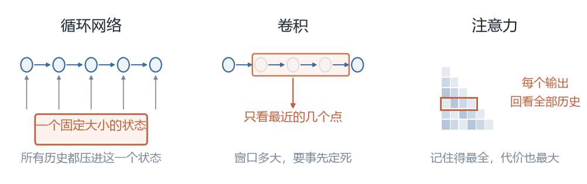

# 第 1 章 三种模型，三种记忆方式

读一本小说的时候，你不会把前面的每一页都背下来。你记住的是几个人物、他们之间的关系、刚刚发生了什么。读到第两百页，某个名字出现，你能立刻想起他第一次出场时的身份。这个过程里，大脑做的不是存储，而是有选择的保留。

序列模型要做的也是这件事。给它一段话、一段音频、一串基因序列，它必须在读到当前位置时，仍然"记得"前面发生过什么，否则无法判断下一个词、下一个采样点、下一个碱基应该是什么。

问题在于，"记得"的方式不止一种。过去十年里主流的三种模型，恰好代表了三种截然不同的记忆策略。

## 循环网络：把所有历史压进一个状态

最早也最自然的想法是维护一个状态。每读一个输入，就更新一次状态；状态里存着此前所有输入的摘要。

这像一个人边听边做笔记。笔记只有一页，每听到一句新的话，就用它改写这一页。写到最后，纸上留下的是整段话的浓缩版本，而不是原话。

好处是省地方。无论听多久，笔记永远只有一页。坏处也在这里：改写是不可逆的，早期写下的细节会被后来的内容覆盖。听得越长，越容易忘记开头。

工程上还有第二个麻烦：这一页笔记必须一句一句地改，不能跳着改。也就是说，处理第一万个词时，必须先处理完前九千九百九十九个。显卡上有几千个核心，却只能排队干活。

*图 1-1　三种模型的记忆方式：循环网络压成一个状态，卷积只看固定窗口，注意力保留全部历史*

## 卷积：只看最近的几行

第二种策略是只看局部。用一个固定大小的窗口在序列上滑动，每次只根据窗口里的几个输入算一个输出。

这像读书时只用手指着当前这一行。它对局部模式很敏感，比如识别"ing"这样的词尾、音频里的一个音节、图像里的一条边。而且窗口在每个位置上的计算彼此独立，可以同时进行，显卡能跑满。

代价是视野。窗口有多大，模型就只能看多远。想让视野覆盖整段文本，要么把窗口做得极大，要么一层层堆叠、让感受野逐层扩大。但无论怎么堆，看到的范围都是设计出来的，不是模型自己决定的。

更麻烦的是，窗口里的权重是固定的。不管窗口里是"非常重要的数字"还是"无关的空白"，模型都用同一组权重去处理。它没有"这里值得多看一眼"的能力。

## 注意力：把全文摊在桌上

第三种策略走向另一个极端：不压缩。每个位置都保留自己的表示，计算某个位置的输出时，直接和之前所有位置做比较，按相关程度加权求和。

这像把整本书摊在桌上，需要哪一页就直接翻到那一页。它没有"记不住"的问题，因为什么都没忘。这也是 Transformer 在语言上表现最好的原因：它可以直接找回前文里的某个事实、某个人名、某个定义。

代价是桌子要够大。每生成一个词，都要把之前所有位置的表示重新读一遍；训练时，任意两个位置都要建立联系，计算量随长度平方增长。上下文从两千词涨到两万词，成本涨一百倍。

## 三种策略的共同难题

把三者放在一起看，会发现它们其实是在同一条轴上的不同位置。

一端是"压得最狠"：状态只有固定大小，便宜，但记不住细节。另一端是"完全不压"：保留全部历史，记得最全，但贵得离谱。卷积夹在中间，用固定窗口做了一个折中。

那么，有没有第四种可能：**状态大小固定，但压缩方式随内容变化**？

具体地说，我们希望模型在读到"这里有一个关键数字"时，主动把它写进状态并长期保留；读到"这里是填充词"时，直接忽略，不占用状态。状态的总量不变，但里面装什么，由输入决定。

这听起来像是一个合理的工程愿望，但它触碰到了一个更基本的问题：一个固定大小的状态，到底能记住多少东西？压缩的方式能不能用数学描述？如果能，最优的压缩方式是什么？

这三个问题，就是接下来几章要回答的。
