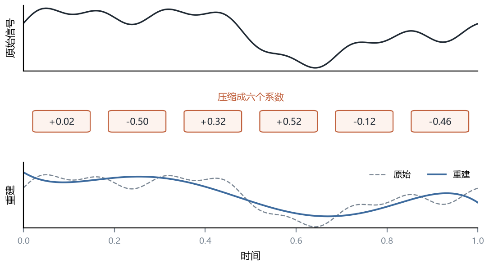

# 第 2 章 一个状态能记住多少

假设有人给你一段一分钟的钢琴曲，要求你用六个数字把它记下来。你会怎么做？

一种做法是记下六个采样点。它几乎必然失败：旋律的形状、和声的走向、节奏的变化，全都丢了。另一种做法是记下六个"特征"：整体响度、平均音高、节奏快慢、开头和结尾的强弱。后者未必能还原原曲，但它保住了真正重要的东西。

这就是压缩的核心：不是均匀地丢弃信息，而是选择一种表达方式，让重要的东西落在少数几个数上。

*图 2-1　把一段信号压成六个系数，再用这六个数重建。压缩不是平均采样，而是换一组基*

## 换一组基

数学上，"换一种表达方式"有一个精确的说法：换基。

一段信号可以看成很多个简单波形的叠加。用哪些波形作为基本的积木，决定了需要多少块积木才能搭出原来的形状。用直角坐标描述一个斜着的向量，需要两个分量；如果把坐标轴转到向量自己的方向上，只需要一个分量。信息没变，表达变短了。

信号也一样。傅里叶变换选的是正弦波，小波变换选的是局部的小波包，而 HiPPO 选的是多项式。选得合适，少数几项就能抓住主要形状；选得不合适，几百项也只是在拼凑噪声。

## 压缩的规则

换基只是第一步。真正的问题是：这组"积木"的系数，怎么随着新数据的到来而更新？

如果每来一个新输入，都要把整段历史重新展开一遍，那就没有省下任何东西。理想的做法是增量更新：当前有 N 个系数，来一个新的采样点，用某种规则把它们改一改，得到新的 N 个系数。整个过程只跟当前的 N 个数和新输入有关，跟历史有多长无关。

这正是循环网络在做的事。它的状态就是那 N 个数，它的更新规则就是"怎么改这 N 个数"。区别只在于，普通循环网络的规则是靠梯度下降学出来的，而 HiPPO 的规则是从一个优化问题里推导出来的。

## 十六个、六十四个、二百五十六个

先给三档具体的数。选择性 SSM 的状态默认取 $N=16$，Mamba 论文里扫内核速度和端到端推理的基准都按 $N=16$ 报。S4 在长程竞技场（Long-Range Arena, LRA）那一组实验里把状态固定成 $N=64$，六个任务共用一个值。同一篇论文在和小型 Transformer 对齐参数量时把状态开到 $N=256$，做法是参数共享（parameter tying），把层与层之间的冗余去掉，省下来的预算花在状态上。

$N=256$ 还有另一类用法。S4D 在 BIDMC 这个生理信号数据集上用 $N=256$，原文给的理由是猜这个任务需要抓更高频的成分。这条理由很说明问题：$N$ 更像采样率，不像"聪明程度"。次数不够，快变成分会被折叠掉，后面接多大的网络都补不回来。

三档之间到底差多少，可以从一次消融里读出来。Mamba 把状态维度从 1 拉到 16，参数量从 367.1M 涨到 371.5M，多出 1.2%，困惑度从 9.73 降到 8.71。同一张表里，把 $B$、$C$ 固定成与输入无关，$N$ 从 1 到 16 只让困惑度从 9.88 动到 9.81。

同样多的状态，一个降了 1.02，一个降了 0.07。状态便宜，但便宜的状态只有在写入口会挑内容时才值钱。这句话是第 9 章整章的起点。

## 六十四个数能装多少比特

$N=64$ 摊开算。一层里一个通道的状态是 64 个浮点数，fp32 每个 4 字节，共 256 字节；换 bf16 是 128 字节。

对照的那一头是输入。同一层同一通道，8192 个 token 的输入原样留着，fp32 下是 $8192\times4=32768$ 字节。32768 除以 256 得 128。状态把这段历史压成了原来的 128 分之一。

换个口径核对。信息量按比特算，64 个数每个 32 位，共 $64\times32=2048$ 位。一段 8192 token 的文本，词表按 5 万算，每个 token 携带 $\log_2 50000\approx15.6$ 位，整段约 $8192\times15.6=1.3\times10^{5}$ 位。两个数相除得 62。

128 和 62 差一倍，差别在每 token 占多少位：前一个算法默认 token 占满 32 位，实际它只占 15.6 位。压缩比不是固定数字，报之前要说清按什么口径算。

两个算法指向同一个结论，状态留住的信息不到原来的百分之二。这个上限和压缩规则聪明不聪明无关，只和"64 个数乘 32 位"有关。2048 位就是这层记忆的全部预算。

预算怎么花，问题就换了形状：在 2% 里留哪 2%。HiPPO 的答案是把这件事写成显式的最优逼近问题：选定一个测度和 $N$ 个正交多项式，系数由最小二乘唯一确定，逼近误差有上界。测度选哪种，决定了留下的是整段历史的形状还是最近窗口的形状。第 4 章从这件事开始。

## 把 312 号那个 200 压进 64 个数

回到第 1 章那段 8192 个 token 的日志。要判断 7000 号位置的 `pool exhausted` 是不是因为 312 号位置的 `pool_size=200` 配小了，模型在读到 7000 号时手里还得有那个 200。

用 64 个系数做这件事，具体是这样：把这条通道历史取值当成一条随时间变化的曲线，用前 64 个正交多项式拟合它，拟合出的系数就是状态。读到 7000 号时，状态里存的是"这段日志的曲线大致长什么样"，而不是任何一句原文。

200 落在哪里？它是一个孤立的尖峰，宽度只有几个 token。要拟合尖峰，得用到高阶项；而 64 项多项式摊在 8192 个点上，粗略地算就是每 128 个点才有一个自由度。几个 token 宽的凸起落在分辨率之外。

这不是实现细节的毛病，是 2048 位预算的直接后果。把 $N$ 提到 8192 等于不压缩，回到了注意力。想保留这一位，只剩两条路：写入时就把这个数挑出来单独存（第 9 章的选择机制），或者留少数几层注意力专门做精确取回（第 13 章的混合架构）。

那 7000 号位置的判断怎么做？模型手里有一个模糊的形状：这段时间连接池的占用在缓慢上升。这个形状足以支持"池子可能不够用"的判断，不足以支持"因为阈值设成了 200"。需要多精确，才是 $N$ 取值的真正依据。

## 误差怎么随 N 下降

HiPPO 论文里有一条款式可以直接拿来看收益曲线。收敛性命题说，被拟合的函数如果是 $L$-Lipschitz 的，用 $N$ 项多项式逼近整段历史，误差是 $O(L/\sqrt{N})$。

$\sqrt{N}$ 决定了加状态的回报。$N$ 翻四倍，误差减一半；翻十六倍，误差减到四分之一。

| $N$ | $1/\sqrt{N}$ | 相对 $N=16$ 的误差 |
|---|---|---|
| 16 | 0.25 | 1 |
| 64 | 0.125 | 0.5 |
| 256 | 0.0625 | 0.25 |
| 1024 | 0.031 | 0.125 |

这就是实际模型停在 64 附近的理由。$N$ 从 64 到 256 要付四倍算力和显存，换回来误差减半；再往上，每翻四倍还是只减半。对数坐标上这条线是直的，收益递减不快不慢。

数据比 Lipschitz 更平滑时下降更快。论文里的另一条界是 $O(t^{k}N^{-k+1/2})$，$k$ 是导数阶数。$k=1$ 时退回 $\sqrt{N}$，$k=2$ 时是 $N^{-1.5}$，翻四倍能减到八分之一。信号越平滑，同样的 $N$ 记得越准。这也解释了为什么 SSM 在音频、生理信号、轨迹这类连续信号上比在离散符号上更省状态。

## 状态变大，代价花在哪

$N$ 从 64 加到 256，账要分开算。

显存几乎不涨。状态常驻显存，大小是 $N$ 乘通道数，与序列长度无关。$N=64$、$H=1024$、24 层、bf16，全部状态加起来 $64\times1024\times24\times2=3.1\times10^{6}$ 字节，3 MB。$N$ 翻四倍是 12.6 MB。同一层里存 8192 个 token 的键值，按 $2\times1024\times8192\times2$ 字节算是 32 MB，一层就比全部状态大十倍。

算力要看 $A$ 的形状。稠密时每步每通道 $N^{2}$ 次乘加，$N$ 翻四倍算力翻十六倍；对角时是 $N$ 次，翻四倍就是四倍。这就是后面的简化工作一路往对角上靠的原因，也是 $N$ 能开到 64、256 而没被算力拦住的原因。

还有一项不写在复杂度里。$N$ 越大，状态里每个分量覆盖的时间尺度越细，长序列上的数值动态范围也越宽。fp32 存 64 个数还算稳；存 256 个数、跑几万步递推，就得盯着状态矩阵的谱，别让某个方向的模长慢慢越界。

## 三个绕不开的困难

一旦把记忆写成"用 N 个数表示历史"，三个困难就浮出水面。

**第一，N 个数装不下所有细节。** 这是原理性的，不是工程问题。无论规则多聪明，压缩一定丢信息。能做的是让丢掉的尽量是无关紧要的部分。

**第二，压缩的规则必须固定，才能并行。** 如果规则随位置变化，就不能把整段序列一次算完，只能一步步来。而一步步来意味着慢。这是循环网络在 2017 年之后输给 Transformer 的直接原因。

**第三，规则要能学。** 手工设计的规则（比如"最近的点权重大"）在特定数据上有效，换个领域就失灵。理想情况是规则本身可训练，而且训练之后仍然保持"固定大小、增量更新"这两个性质。

这三条互相牵制。想并行，就得固定规则；想适应数据，就得让规则可变；规则一变，并行就没了。后面所有的模型，本质上都在这个三角里找位置。

## 压缩坏在哪一步

$N$ 太小，先丢高频。状态相当于对历史做低通，$N$ 是滤波器的阶数。$N=16$ 时，音频里的齿音、日志里短促的抖动会被抹平；模型说得出"这一段整体偏吵"，说不出"第 4123 个采样点有个咔哒声"。S4D 在 BIDMC 把 $N$ 开到 256，动因就是这类高频线索。

精度不够，误差会自己长大。bf16 的尾数 8 位，能表示的最小相对间隔约 $2^{-8}$，也就是 0.4%。递推是串行的，这一步的舍入误差会乘上 $\bar A$ 传进下一步。按每步同向累加的最坏情况估，8192 步就是 $8192\times0.004\approx33$ 倍。真实情况远好于这个界，方向仍然对：状态用 fp32 存，权重和激活用 bf16。

第三处坏在基上。正弦波做基，一段有突变的信号要很多项才拼得出那个跳变；多项式做基，长周期振荡又拼不准。HiPPO 选多项式是因为它要解的那个优化问题，最优解正好落在多项式上，不是因为多项式普适。换一个加权方式，最优基跟着换。

## 梯度是指数掉还是多项式掉

第 1 章那个 $0.99^{7700}=2.6\times10^{-34}$ 的例子说的是普通循环网络。HiPPO 的情况不一样。

论文给了梯度的一个量级式：输出时刻 $t_1$ 对输入时刻 $t_0$ 的梯度，范数是 $\Theta(1/t_1)$。7000 步时大约是 $1.4\times10^{-4}$。

$1.4\times10^{-4}$ 很小，跟 $10^{-34}$ 隔着三十个数量级。前者掉了四个数量级，还能浮点表示，优化器还能拉回来；后者早就变成零了。指数衰减和多项式衰减的分水岭就在这里：一个衰减到零，一个衰减得慢。

用这个界回头读第 1 章那段日志：312 号的 `200` 在 7000 号位置时，梯度还有万分之一量级。模型不一定真会用它，但反向信号确实传到了。

这也是 HiPPO-LegS 把测度取成对整段历史均匀加权的原因。滑窗套滑窗的做法给最近一段加权、给久远的衰减，梯度就重新变成指数形式。均匀加权把"多久以前"从权重里拿掉，代价是状态必须同时记住整段历史的形状，同样 $N$ 的负担更重。

## 如果压缩规则是学出来的

另一条路是让网络自己学压缩：编码器把历史压成 $N$ 个数，解码器从这 $N$ 个数重建。这条路在自编码器里很成熟，搬到序列上就出问题。

编码器要看到整段历史才能压，所以每来一个新 token 都得把整段重算一遍，成本随长度线性增长。

就算改成增量式，学出来的 $A$ 也是稠密且无结构的。每步 $O(N^{2})$ 次乘加，只有递推一种算法，展不成卷积，也没有闭式核能一次算完。

HiPPO 的 $A$ 有特殊结构。论文里说每条递推只要 $O(N)$ 次运算，把离散化展开出来的实际速度比标准矩阵乘快十倍。

差别就在这里。学出来的压缩器可能更贴合数据，但它丢掉了"能一次算完"这个性质。固定的多项式基损失一些拟合自由度，换回来 $O(N)$ 的递推和一个可以展成卷积的闭式。S4 能跑在显卡上，靠的是后者。

## 提 N 之前先看三件事

实际动手时，$N$ 取多少由三件事定。

数据是连续信号还是离散符号。音频、传感器读数在时间上连续，多项式基压得住；文本是离散符号，相邻 token 之间没有平滑性，Lipschitz 假设不成立，同样的 $N$ 记不住同样多的东西。后来加选择机制的直接动因就在这里。

要不要逐字取回。$N$ 个数存的是形状，不是原文。需要复述人名、数字、代码片段的场景，靠状态做不到，得靠缓存或外部检索。

序列有多长。$N$ 与长度无关，所以长度越长，压缩比越夸张。8K 长度上 $N=64$ 是 128 比 1，128K 长度上就是 2048 比 1。长度翻十六倍，状态不涨，丢的东西按同样比例变多。

三条合起来解释了后面章节的顺序：先把固定压缩做到极致（第 4 章到第 8 章），再让写入口依赖输入（第 9 章），最后用混合架构把逐字取回这部分需求单独接走（第 13 章）。

## 一个被忽略的中间地带

注意力的做法是放弃第三条：规则不固定，每个位置都根据内容重新计算权重。它换来了效果，付出了平方级的代价。

卷积的做法是放弃第三条的另一个方向：规则固定成一个局部窗口，谁来说话都按同样的权重处理。它换来了效率，付出了"不会挑重点"的代价。

中间地带是：规则固定成一个**线性系统**，但系统的参数可以由数据决定。这样既有闭式的更新公式（可以并行、可以分析），又能根据内容调整记忆的强弱。

这个想法在 2020 年被系统地写成了数学。它的起点不是深度学习，而是一个更老的问题：给定一段函数，如何用有限个系数最好地逼近它。
