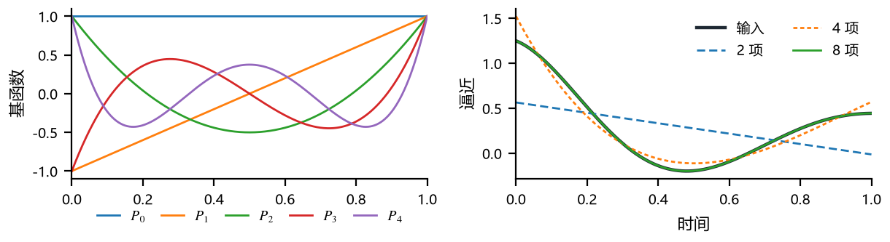

# 第 4 章 把记忆变成一个数学问题

2020 年，Albert Gu 和他在斯坦福的同事提出了一个框架，名字叫 HiPPO。它没有发明新的网络结构，也没有提出新的训练技巧，只做了一件事：把"记住历史"写成一个优化问题，然后解出来。

这个问题的形式是这样的：给定从开始到当前时刻的全部输入，要求用不超过 N 个系数来表示它，使得在某种意义下误差最小。解出来的结果不是一个网络，而是一个微分方程。这个方程恰好就是循环网络的状态更新规则。

换句话说，最优的记忆方式不是设计出来的，是推导出来的。

## 什么算"误差最小"

要说"误差最小"，先得定义什么叫误差。

最自然的定义是平方误差：把原始信号和重建信号逐点相减，平方，再相加。数学上这叫 L2 距离。

但还有一个关键的选择：**过去的每个时刻，重要性一样吗？**

直觉上不一样。一分钟前说的话，通常比一小时前更重要。于是引入一个权重函数，给不同时刻的历史不同的权重。这个权重函数，在数学上叫测度。

测度决定了记忆的"形状"。三种最常见的选法是：

- **固定窗口**：只看最近一段时间，更早的全部丢掉。窗口长度是一个需要事先设定的数。
- **指数衰减**：越久远的历史权重越低，按指数速度衰减。衰减快慢也是一个需要设定的数。
- **随时间缩放**：从开头到现在的所有历史同等重要，但窗口随着时间一起变长。

前两种都需要一个超参数，用错了就失灵。第三种没有任何参数：它自动把整段历史纳入考虑，只是随着时间推移，用越来越高阶的多项式去描述越来越长的区间。

HiPPO 采用的正是第三种。

## 为什么是多项式

因为多项式有一个别的基没有的性质：投影系数可以写成闭式。

给定一组正交多项式，把信号投影上去，第 n 个系数就是信号与第 n 个多项式的内积。不需要解方程组，不需要迭代，一次积分就得到答案。而且这组系数就是"在平方误差意义下最优"的表示。

正交多项式在数学里已经被研究了一百多年。勒让德、拉盖尔、切比雪夫、雅可比，这些名字背后是一整套现成的工具：递推关系、端点取值、导数公式。HiPPO 做的事情，本质上是把这套工具搬进了序列模型。

*图 4-1　左：勒让德基函数；右：用 2 项、4 项、8 项去逼近同一段信号，项数越多越接近*

## 从投影到微分方程

到这里还只是"给定一段信号，怎么压缩"。真正关键的一步是让它**在线**运行。

每来一个新的采样点，最优的系数都会变。如果每次都重新算一遍积分，代价和历史长度成正比，毫无意义。HiPPO 的做法是对系数求导：既然系数是积分，就对时间求导，看看它随新输入如何变化。

求导之后，会出现两项。一项来自基函数本身随时间变化，另一项来自测度随时间变化。把这两项整理合并，得到一个线性微分方程：

**系数的变化率，等于一个矩阵乘以当前系数，再加上一个向量乘以当前输入。**

这句描述里，矩阵和向量就是记忆的规则。它们只由测度和基函数决定，跟数据无关，因此可以离线算好、写进模型。而当前系数就是状态，当前输入就是新来的那个采样点。

于是"最优记忆"变成了一个标准的状态空间模型。后面所有的模型，都是在这个方程上做文章：有的改矩阵的结构，有的改离散化的方式，有的让矩阵依赖输入。

## 一个意料之外的统一

HiPPO 的论文里有一个很有意思的观察：把阶数降到最低，只用一个系数、一个常数基函数，这个框架退化成的东西，就是循环网络里的门控。

具体地说，一维的门控更新可以写成"旧状态乘以一个系数，加上新输入乘以另一个系数"，而 HiPPO 在最简单的情形下给出的正好是同一个形式，系数由步长决定。换句话说，LSTM 和 GRU 里那个被当作工程技巧的"遗忘门"，其实是在学一个离散化步长。

这个发现解释了门控为什么有效，也为后来的模型指了路：既然门控就是步长，那么让步长依赖输入，就等于让门控依赖输入。Mamba 的选择性机制，源头就在这里。

## 还差一步

HiPPO 给出了矩阵，但给出的是一族固定的矩阵。它可以告诉你"对于这种测度，最优的记忆规则是什么"，却没有回答"这个规则能不能训练"。

更重要的是，它只定义了记忆算子，没有定义一层网络。一个真正的层还需要处理多通道、堆叠、非线性、残差，以及在显卡上怎么算。

这两件事是下一篇的主题。
