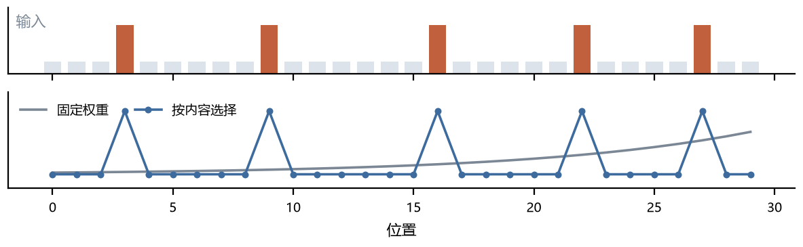

# 第 9 章 让参数学会看输入

Mamba 的改动，形式上只有一句话：让决定记忆的参数，变成当前输入的函数。

原来这些参数是固定的，训练完之后就定死了。现在每来一个输入，都先根据它算出这一组参数，再去更新状态。参数不多，只有三个：步长、输入矩阵、输出矩阵。

三个参数各管一件事。

## 步长：快门

步长决定"这一步的信息有多重要"。

把状态更新想象成拍照。步长小，快门快，画面几乎是上一张的延续，新输入只留下淡淡一层；步长大，快门慢，新输入直接覆盖旧画面，之前的记忆被冲掉。

于是步长同时控制了两件事：要不要记住新输入，以及要不要忘记旧状态。一个参数，两个作用，这正是它高效的原因。

Mamba 用一个简单的线性层从输入算出步长，再过一层保证它是正数。整个投影只有几个参数，却让模型可以根据内容决定"这里要停下来仔细看"还是"这里可以快速翻过去"。

## 步长在大和小时各意味着什么

把步长推到两个极端，意思最清楚。

$\Delta\to0$ 时，$\bar A=e^{\Delta A}\to I$，状态几乎原封不动，新输入被当成一个瞬态，写进去又立刻衰减掉。这一步等于跳过当前的 token。$\Delta\to\infty$ 时，$\bar A\to0$，状态被清空，模型只看当前这一个 token，之前的记忆全部丢弃。

写成门控形式能看得更细。取 $N=1$、$A=-1$、$B=1$，零阶保持给出 $\bar A=e^{-\Delta}$、$\bar B=1-e^{-\Delta}$，递推变成

$$h_t=(1-g_t)\,h_{t-1}+g_t\,x_t,\qquad g_t=1-e^{-\Delta_t}$$

$g_t$ 是经典的遗忘门。$\Delta_t$ 大，$g_t$ 接近 1，旧状态被当前输入覆盖；$\Delta_t$ 小，$g_t$ 接近 0，状态几乎保持。一个标量同时控制"写多深"和"忘多少"。

给两个数体会一下量级。$\Delta=0.01$ 时 $\bar A=e^{-0.01}=0.990$，一百步之后还剩 $e^{-1}=0.368$；$\Delta=5$ 时 $\bar A=e^{-5}=0.0067$，一步就衰减掉 99.3%。同一个 $A$，只因为 $\Delta$ 不同，记忆的长度差两个数量级。$\Delta$ 适合做开关，原因就在这里：它的取值跨越好几个量级，而 softplus 的输出正好能覆盖这个范围。

前沿应用里有一个直接的好处。多条无关序列拼成一条（文档拼包、强化学习的 episode 边界），只要在边界把 $\Delta$ 推大，状态就被重置，后一篇不会继承前一篇的尾巴。固定权重的模型没有这个开关，只能被动地混在一起。

## 输入矩阵：入口

第二个参数决定输入以什么方式写进状态。

状态有很多维，每一维代表一种"记忆模式"。输入矩阵决定当前这个 token 往哪些维度写、写多少。让它依赖输入，模型就能做到"这个词只影响某一类记忆，不污染其他部分"。

从形状上看更清楚。$B$ 从 $(D,N)$ 变成 $(B,L,N)$ 之后，同一个符号在不同上下文里可以往不同方向写。固定权重的模型只有一张入口表，同一个词每次出现都走同一条路径，两个不同的意思只能挤在同一组状态里；入口依赖输入之后，上下文不同就可以分别写。

## 输出矩阵：出口

第三个参数决定从状态的哪些维度读出结果。

它依赖输入，意味着同一个状态在不同位置可以读出不同的东西。比如同样是"主语是复数"这条记忆，在需要选动词时读出来，在需要选冠词时可以不读。

入口与出口不对称。写入只影响后面的位置，读出是每个位置都发生的。同一个状态，第 $t$ 步可以按一种方式读，第 $t+1$ 步换一种读法。把一份压缩后的记忆在不同任务阶段反复重新解释，这是它比固定输出层灵活的地方。

## 形状从哪里开始变

四个参数里到底谁还是"参数"，对照两张算法伪代码最清楚。固定权重的版本（S4）里，四个量都是权重表：$A$ 的 $D\times N$ 个元素、$B$ 的 $D\times N$、$C$ 的 $D\times N$、$\Delta$ 的 $D$ 个，全部可训练且与输入无关。选择性版本（S6）里，只剩 $A$ 还是表，其余三个变成输入的函数。顺带一个量级参考：固定权重模型的有效状态维度 $N$ 通常取 10 到 100，比传统 RNN 的隐藏维度大得多，这正是它靠卷积和递推两条路对冲掉开销的前提。

| 量 | 固定权重 | 随输入变 |
|---|---|---|
| $A$ | $(D,N)$，参数 | $(D,N)$，参数 |
| $B$ | $(D,N)$，参数 | $(B,L,N)=s_B(x)$ |
| $C$ | $(D,N)$，参数 | $(B,L,N)=s_C(x)$ |
| $\Delta$ | $(D)$，参数 | $(B,L,D)=\tau_\Delta(\text{Parameter}+s_\Delta(x))$ |
| 离散后的 $\bar A,\bar B$ | $(D,N)$ | $(B,L,D,N)$ |
| 计算方式 | 递推或卷积 | 只能递推 |

关键在最后两行。序列长度 $L$ 一旦进到参数的形状里，这些量就不再是权重，而是激活：每个位置、每个通道各有一套。离散后的 $\bar A$ 从 $D\times N$ 变成 $B\times L\times D\times N$，多出来的正是 $L$ 这一维。以 $B=1$、$L=4096$、$D=64$、$N=16$ 计，$D\times N=1024$ 变成 419 万个。

$A$ 没有被选择性化，这一条不是遗漏。$A$ 对模型的作用只通过 $\exp(\Delta A)$ 体现，$\Delta$ 会变，$\bar A$ 就跟着变。论文的判断是：只要 $\Delta$ 有选择性，$(\bar A,\bar B)$ 就已经有选择性，再把 $A$ 也做成输入的函数，收益大概差不多，代价却不小。

要注意的是，参数量几乎没变，变的是激活量。权重表还是那几张，只是每张现在要被 $L$ 个位置各查一次。模型大小不变，每层的中间结果大了 $L$ 倍。举个具体的数：$D=64$、$N=16$ 时一层 SSM 的权重是 1024 个数，同一层在 $L=4096$ 上的激活是 419 万个，差四千倍。所以"模型多大"和"跑起来占多少显存"是两个完全不同的问题。这也是为什么同一个层在训练和推理时的显存开销完全不是一个故事，后面的资源账会把这两笔分开算。

## 一个 token 进来之后

以一个通道为例，把 $t$ 时刻的四步写开（$N=16$，输入是标量 $x_t$）：

第一步，输入分别过两个小线性层，得到 $B_t\in\mathbb{R}^{N}$ 和 $C_t\in\mathbb{R}^{N}$；过第三个线性层再经 softplus，得到标量 $\Delta_t>0$。

第二步，离散化。$\bar A_t=\exp(\Delta_t A)$ 逐元素算，$A$ 是固定的 $N$ 维向量；$\bar B_t$ 由 $(\Delta_t,A,B_t)$ 算出，$\Delta_t$ 不大时近似为 $\Delta_t B_t$。

第三步，更新状态：$h_t=\bar A_t\odot h_{t-1}+\bar B_t\,x_t$，$h_t\in\mathbb{R}^{N}$，$\odot$ 是逐元素乘。

第四步，读出：$y_t=C_t^\top h_t$，一个 $N$ 维内积。

四步里三步是逐元素运算，只有最后一步是向量内积。选择性之所以便宜，就在这个分布上：变的是逐元素系数，不是 $N\times N$ 矩阵。如果 $A$ 是稠密的，第二步会变成矩阵指数，每一步都要乘一个十六乘十六的矩阵，整个设计的成本模型就崩了。

还有一个副作用值得指出。每一步只用当前 token 和当前状态，不需要回看历史，所以推理时用递推；训练时需要每步的系数，又必须按顺序算，所以需要扫描。两种模式共享同一套参数，这是后面并行算法的起点。

$D$ 个通道是并行跑的。每个通道有自己的 $A$、自己的 $N$ 维状态、自己的一套系数，通道之间不通信。把不同衰减率的记忆分散到 64 个通道里，相当于给模型 64 组独立的寄存器，每组 16 个单元。信息要在通道之间流动，只能靠块里的线性投影，这一层与 SSM 本身无关。

数值上有一处容易翻车。$\bar A=\exp(\Delta A)$ 的模长必须小于 1，否则状态每一步都被放大，几千步之后溢出成 inf，损失直接变 nan。初始化把 $A$ 取在负半轴（实数情形是 $-(n+1)$），加上 $\Delta>0$，才能保证这一点。$A$ 本身是可训参数，训练中如果漂到正半轴，长序列上就会出问题，这类溢出在短序列实验里看不到。监控 $\bar A$ 的最大模长，比监控损失曲线更早发现问题。

## 三个参数一起工作

*图 9-1　上：输入里只有少数位置值得记住；下：固定权重对每个位置一视同仁，选择性机制可以把权重集中到该记的位置*

三者配合，就得到了"按内容选择"的能力：入口决定写什么，步长决定写多深，出口决定读什么。

这也解释了为什么 Mamba 的论文里，消融实验显示步长是最重要的那个。只让步长依赖输入，困惑度就能降一大截；再加上输入输出矩阵，还能再降一些。步长管的是"记不记"，这是最根本的决定。

## 为什么只在步长上做选择

让步长变成输入的函数，历史上不是新事。Gu 等人 2020 年就让时间步长随时间变化，但那时的模型没有硬件感知的实现，规模与速度都上不去，所以选择机制只停留在小范畴里。真正的变化发生在 2023 年：同一件事加上核融合与并行扫描，才从"可以做"变成"跑得动"。

另一条路是把三个参数全部选择性化，包括 $A$。论文没这么做，理由写得很直接：$\bar A=e^{\Delta A}$，$A$ 只通过这个乘积起作用，$\Delta$ 一变，$\bar A$ 已经变了。让 $A$ 也随输入变，等于用 $D\times N$ 个数字去实现一个已经由 $\Delta$ 控制的效果，参数与计算都要涨，而消融里看不出收益。

选择性的开销则集中在两处。$B$ 和 $C$ 各有一套 $N$ 维投影，参数量是 $2DN$；$\Delta$ 只用一个小投影。三路里哪一路最重要，论文用消融回答：只让 $\Delta$ 变，收益最大。

$\Delta$ 的初值也有讲究。它被当作一个偏置项，初始化在 $\tau_\Delta^{-1}(\mathrm{Uniform}([0.001,0.1]))$，也就是训练开始时的 $\Delta$ 落在 0.001 到 0.1 之间。这个区间对应的时间尺度比一个 token 宽、比整段话窄，训练从这里出发比较安全。

这一套在后来被保留了。Mamba-2 把同样的选择性留着，换的是计算组织方式（第 11 章）；Mamba-3 让 $A$ 变成复值（第 12 章）。参数随输入变这个前提，没有被撤回过。

## 和门控的关系

这个设计和循环网络的门控有直接的血缘关系。

前面说过，一维的门控更新可以写成"旧状态乘一个系数，加上新输入乘另一个系数"，而 HiPPO 在最简单的情形下给出的正是同一个形式，系数由步长决定。也就是说，门控就是步长。

Mamba 做的事情，可以理解为把这个等价关系推到极致：既然门控就是步长，那就直接让步长依赖输入，而不是绕一圈用 sigmoid 去参数化它。这样一来，门控理论里的直觉（哪些该忘、哪些该记）和状态空间模型的理论（连续系统的离散化）合在了一起。

门控形式还解释了投影为什么要那样写。$\Delta$ 的选择性投影是先把输入压到 1 维，再广播到 $D$ 个通道：$s_\Delta(x)=\mathrm{Broadcast}_D(\mathrm{Linear}_1(x))$。理由是机制上的：如果一个 token 该被完全忽略，$D$ 个通道应该同时忽略它，压到 1 维正好强迫它们共用一个判断。论文又补了一句，这个广播可以推广成秩 $R$ 的低秩投影，$R$ 取 $D$ 的一小部分，参数量依然可以忽略。

参数账算一遍。$A$ 是 $D\times N=1024$，$B$ 和 $C$ 的投影各 $D\times N=1024$，$\Delta$ 的投影是 $O(D)$ 量级。SSM 内部的参数从 1024 涨到三千出头，仍然少于一个 $64\to64$ 的线性层（4096 个权重）。选择性把参数量翻了三倍，但没有把模型变大，这是它能直接替掉固定权重层的前提。

## 资源账：显存、FLOPs、并行度

形状里多出 $L$ 这一维，三笔账跟着变。

第一笔是中间状态。$B=1$、$L=4096$、$D=64$、$N=16$ 时，状态张量是 419 万个浮点数，fp16 存 8 MB，而输入只有 $1\times4096\times64=262144$ 个数，0.5 MB。倍数正好是 $N$。前向不算大，训练时反向传播要用到每一步的状态，这就成了一个真问题。论文给的口径是：每个 token、每层选择性 SSM 约 16 字节激活，一个注意力层约 12 字节、一个 MLP 层约 20 字节，合起来 32 字节。两层选择性 SSM 的激活量大约等于一个注意力层加一个 MLP。

第二笔是 FLOPs。递推要 $O(BLDN)$，在这个例子里是 419 万次乘加；卷积要 $O(BLD\log L)$，$L=4096$ 时 $\log_2L=12$，大约是 314 万次。两个数同一量级，而递推的常数更小。论文的原话是：序列够长、$N$ 不太大时，递推模式实际用的 FLOPs 反而更少。所以算力从来不是这次改动的障碍。

第三笔是并行度。$L$ 步递推必须一步接一步，每一步的计算量只有 $BDN=1024$ 次乘加，而一张显卡有几千个计算核心。核心在等，这就是真正的代价。

三笔账里只有一笔是算力，另外两笔是显存和并行度。最容易被低估的是第一笔：状态张量不是临时变量，反向传播里梯度得靠它算，所以它要么存下来、要么重算一遍。这个二选一就是下一章第三个技巧的全部内容。

推理的账完全不同。生成第 $t$ 个词时只需要一份状态 $(B,D,N)$，$B=1$ 时是 1024 个数、2 KB，与已经生成了多长的文本无关；长度涨到百万，状态还是这 2 KB。训练时是 419 万个数的张量，推理时是 2 KB 的状态，两者相差 4096 倍。线性模型推理便宜的全部秘密在这里：它不需要缓存历史，只需要一个固定大小的状态。代价也在这里：能存的信息就这么多，存不下就得忘。

## 代价立刻出现

改动只有一句话，后果却很重。

原来参数固定，整个序列可以写成一个卷积，一次算完。现在参数随位置变化，每一步的规则都不同，卷积核不再存在，只能逐步递推。

这就是第 8 章说的那条死路。Mamba 之所以能成立，是因为它在工程上把这条死路走通了。下一章讲它是怎么做到的。
