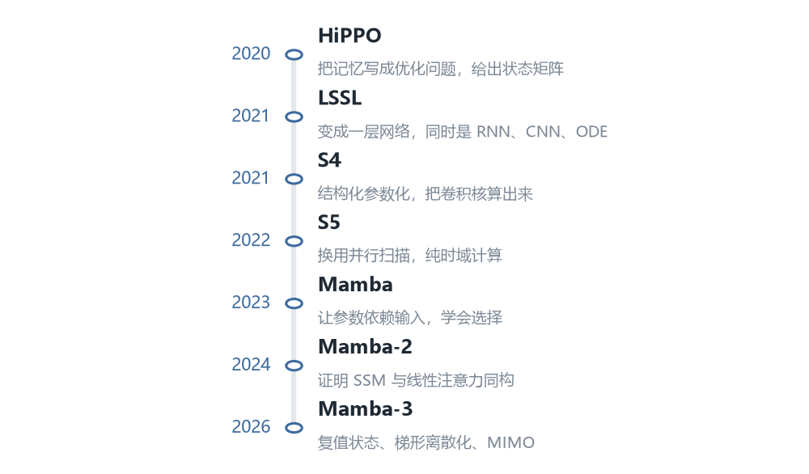

# 第 14 章 怎么选，往哪走

把这条线走完，可以回头看一遍它经过了哪些节点。

*图 14-1　从 2020 年到 2026 年，每一代解决的问题*

## 一条可以复述的线

2020 年，HiPPO 把记忆写成优化问题，给出状态矩阵的闭式解。它回答的是"压缩什么"。

2021 年，LSSL 把它做成一层的三种身份，S4 解决计算问题。它们回答的是"怎么压缩得动"。

2023 年，Mamba 让参数依赖输入，解决"压缩策略要不要看内容"。

2024 年，Mamba-2 用半可分矩阵把递推变成矩阵乘法，解决"能不能用上显卡的矩阵单元"。

2026 年，Mamba-3 补上状态追踪和推理效率，解决"压缩能不能更强、更省带宽"。

每一代的问题，都是上一代留下的具体缺陷。没有哪一代是"重新发明"，都是把旧问题换了一个问法，再借来另一个领域已有的工具。

## 选型时可以问的三件事

如果你要在实际项目里用这类模型，有三个问题比"哪个最强"更有用。

**第一，序列有多长。** 几千以内，注意力和线性模型的差距不大，选生态成熟的更省事。十万以上，线性模型的优势开始显现；百万级时，基本没有别的选择。

**第二，任务偏摘要还是偏检索。** 分类、情感、长文档理解、音频、基因序列，偏摘要，纯线性模型够用。需要精确引用、逐字复述、代码执行，偏检索，保留少量注意力层更稳。

**第三，部署环境是什么。** 显存紧、并发高、要长上下文，线性模型的常量内存是硬优势。追求生态、工具链、微调方案齐全，Transformer 仍然更成熟。

## 还没解决的问题

这条线并没有走完。几个明显的空白：

**状态容量有没有上限。** 状态越大记住的越多，但计算量也随之增长。多大的状态才算够，目前只有经验答案，没有理论答案。

**检索能力能不能补上。** 混合架构是权宜之计，不是根本解决。能不能让固定状态也具备精确检索的能力，仍然开放。

**能不能解释。** Transformer 有比较成熟的可解释性工具，线性模型的状态是一堆数字，很难说清它到底记住了什么。这在需要审计的场景里是障碍。

**非对角结构能不能高效实现。** 表达力更强的状态转移（比如 Householder 变换）能解决更难的群论任务，但目前还没有和分块算法结合得很好的实现。

## 最后

如果只记住一句话，可以记这个：

**序列模型的全部争论，都是关于"用多大的状态、以什么规则、记住哪些历史"。**

卷积的规则是距离，注意力的规则是相似度，状态空间模型的规则是一个可学习的线性系统，Mamba 的规则是让这个系统看输入。规则不同，能力与成本就不同。

理解规则，比记住模型名字有用。模型会过时，规则不会。
