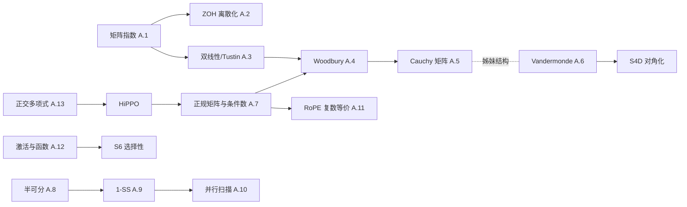

# 附录 A 数学工具箱

## 本附录怎么用

这份附录是给"读正文时被某个公式绊住"的读者准备的。它不假设你记得线性代数或数值分析，只假设你会训练网络、懂 Transformer 与 RNN。每一项工具都按同一个结构写：

1. 定义：它到底是什么，符号怎么写、形状多大。
2. 关键性质：能用来做什么、哪些性质容易记错。
3. 在 SSM 语境下的意义：为什么从 LSSL 到 Mamba-3 会反复用到它。
4. 在本书中的作用：一句话小结，并给出正文中用到它的章节链接。

全书统一的符号约定见[附录 C](appC.md)；本附录按需重复关键定义。

阅读建议：不必一次读完。遇到障碍时按正文里的链接跳进来即可。若你想提前建立整体地图，建议按 $1\to2\to3$（连续与离散）、$4\to5\to6$（S4 的三块基石）、$8\to9\to10$（Mamba-2 的三块基石）、$11$（Mamba-3 的核心）这个顺序读。

---

## A.1 矩阵指数 exp(M)

### 定义

对任意方阵 $M\in\mathbb{R}^{N\times N}$（或 $\mathbb{C}^{N\times N}$），矩阵指数定义为幂级数

$$
\exp(M) \;=\; e^{M} \;=\; \sum_{k=0}^{\infty}\frac{M^{k}}{k!} \;=\; I + M + \frac{M^{2}}{2!} + \frac{M^{3}}{3!} + \cdots
\tag{A.1}
$$

约定 $M^0=I$。这个级数对任意方阵都绝对收敛，因此 $\exp(M)$ 永远有定义，这一点比"对角化"可靠：哪怕 $M$ 不可对角化，$\exp(M)$ 依然好端端存在。

它也是初值问题 $x'(t)=Mx(t)$，$x(0)=x_0$ 的唯一解在 $t=1$ 处的值：$x(1)=e^{M}x_0$。更一般地，定义矩阵值函数 $t\mapsto e^{tM}$（把 (A.1) 中的 $M$ 换成 $tM$），它就是线性 ODE 的**基本解矩阵**：

$$
\frac{d}{dt}e^{tM} = M e^{tM} = e^{tM}M, \qquad e^{0\cdot M}=I.
$$

推导：逐项求导 $\frac{d}{dt}\sum_k \frac{t^kM^{k}}{k!}=\sum_{k\ge1}\frac{t^{k-1}M^{k}}{(k-1)!}=M\sum_{k\ge0}\frac{t^{k}M^{k}}{k!}$。左右两种乘法顺序都对，正是因为 $M$ 与自己的多项式可交换。这一步是 A.2 积分因子法的前提。

举一个能一眼看懂的例子：若 $M=\operatorname{diag}(a,b)$，则 $e^{M}=\operatorname{diag}(e^{a},e^{b})$；若 $M=\begin{bmatrix}0&-\theta\\ \theta&0\end{bmatrix}$（一个 $2\times2$ 旋转生成元），则 $e^{tM}=\begin{bmatrix}\cos t\theta&-\sin t\theta\\ \sin t\theta&\cos t\theta\end{bmatrix}$，即反对称矩阵的指数是旋转矩阵。这个例子后面在 A.11 会被反复用到：它解释了为什么复数/旋转动力学需要非实数的特征值，也是 Mamba-3 复值状态的数学根源。

### 关键性质

- $e^{0}=I$（把 $M=0$ 代入级数只剩第一项）。
- 可交换时才可加：若 $AB=BA$，则 $e^{A+B}=e^{A}e^{B}$。一般情况下
  $$
  e^{A+B}\neq e^{A}e^{B},
  $$
  差多少由 Baker–Campbell–Hausdorff 公式给出，最低阶误差是 $\tfrac12(AB-BA)$。这是最容易被记错的性质：标量指数随手可加，矩阵指数不行。
- 逆：$e^{M}$ 永远可逆，且 $(e^{M})^{-1}=e^{-M}$。
- 行列式与迹：
  $$
  \det\!\big(e^{M}\big) = e^{\operatorname{tr}(M)}.
  \tag{A.2}
  $$
  右边是标量的指数。这条性质在稳定性分析里很有用：$\det e^{M}>0$ 恒成立，说明矩阵指数永远把"体积"按 $e^{\operatorname{tr}M}$ 倍地缩放，绝不翻转方向。
- 相似不变：$e^{VMV^{-1}} = V e^{M} V^{-1}$。因此只要 $M$ 能对角化、$M=V\Lambda V^{-1}$，就有
  $$
  e^{M} = V e^{\Lambda} V^{-1}, \qquad e^{\Lambda}=\operatorname{diag}\big(e^{\lambda_1},\dots,e^{\lambda_N}\big).
  \tag{A.3}
  $$
  也就是说：对角矩阵的矩阵指数就是对每个对角元取标量指数。这是全套 SSM 算法里唯一"平凡可算"的情形，所以后面所有模型都在拼命把问题归约到它。对实数 $\lambda$，$e^{\lambda}>0$ 恒成立——这一点直接解释了为什么"只用实特征值的对角 SSM"学不出旋转动力学（见 A.7 与 A.11）。
- 若 $M$ 是分块对角 $\operatorname{Block}(\{M_i\})$，则 $e^{M}=\operatorname{Block}(\{e^{M_i}\})$。Mamba-3 的复值状态正是靠这条性质，把 $N/2$ 个复数坐标拆成 $N/2$ 个 $2\times2$ 旋转块（见 A.11）。

### 在 SSM 语境下的意义

线性 ODE $x'(t)=Ax(t)+Bu(t)$ 的齐次部分解就是 $x(t)=e^{tA}x(0)$：矩阵指数就是"系统自然演化 $t$ 时间的传播算子"。SSM 的一切都建立在它之上，离散化的核心就是把 $t$ 取成一个步长 $\Delta$，得到传播矩阵 $e^{\Delta A}$。整个 S4/Mamba 系列的工程史诗，本质上是在回答：

> $A$ 长成什么样子，才能让 $e^{\Delta A}$ 既算得快（$O(N)$ 而非 $O(N^2)$）、又有表达力（能表达长程记忆）？

### 在本书中的作用

矩阵指数是"从连续时间到离散时间"的桥梁，是 $\bar A=e^{\Delta A}$ 这一族公式的唯一来源。它是 [第 2 章](../chapters/ch02.md) 求解连续 SSM 的工具、[第 3 章](../chapters/ch03.md) 离散化的主角，并在 [第 29 章](../chapters/ch29.md) 被 Mamba-3 重新提起（指数-梯形离散化）。

---

## A.2 连续线性 ODE 的求解与 ZOH 离散化

### 定义

考虑单输入线性系统

$$
x'(t) = A x(t) + B u(t), \qquad x\in\mathbb{R}^{N},\ A\in\mathbb{R}^{N\times N},\ B\in\mathbb{R}^{N\times1},\ u\in\mathbb{R}.
\tag{A.4}
$$

**零阶保持（zero-order hold, ZOH）** 假设输入 $u$ 在每个采样区间 $[t_k,\ t_k+\Delta]$ 内恒定（取区间左端点的值 $u_k$）。我们要把它换成递推

$$
x_{k+1} = \bar A x_k + \bar B u_k.
\tag{A.5}
$$

### 推导（积分因子法）

从 (A.4) 出发，两边左乘 $e^{-tA}$（注意 $A$ 与 $e^{-tA}$ 可交换，因为它们是同一个 $A$ 的多项式级数）：

$$
e^{-tA}x'(t) - e^{-tA}A x(t) = e^{-tA}B u(t).
$$

左边恰好是一个乘积的导数：

$$
\frac{d}{dt}\Big(e^{-tA}x(t)\Big) = e^{-tA}B u(t).
$$

在区间 $[t_k,\ t_k+\Delta]$ 上积分，并用 ZOH 假设把 $u(t)$ 换成常数 $u_k$：

$$
e^{-(t_k+\Delta)A}x(t_k+\Delta) - e^{-t_kA}x(t_k) = \left(\int_{t_k}^{t_k+\Delta} e^{-tA}\,dt\right) B u_k.
$$

两边左乘 $e^{(t_k+\Delta)A}$，令 $\tau=t-t_k$：

$$
x_{k+1} = e^{\Delta A}x_k + \left(\int_{0}^{\Delta} e^{\tau A}\,d\tau\right) B\, u_k.
$$

于是得到

$$
\boxed{\ \bar A = e^{\Delta A}, \qquad \bar B = \left(\int_{0}^{\Delta} e^{\tau A}\,d\tau\right) B.\ }
\tag{A.6}
$$

### 为什么 bar B=A-1(eΔ A-I)B？以及 A 奇异时怎么办

当 $A$ 可逆时，可以对积分项做一次换元。

$$
A\int_{0}^{\Delta} e^{\tau A}\,d\tau = \int_{0}^{\Delta} A e^{\tau A}\,d\tau = \int_{0}^{\Delta}\frac{d}{d\tau}e^{\tau A}\,d\tau = e^{\Delta A}-I,
$$

两边左乘 $A^{-1}$ 得到

$$
\bar B = A^{-1}\big(e^{\Delta A}-I\big)B.
\tag{A.7}
$$

$A$ 奇异时（$A^{-1}$ 不存在）不能用 (A.7)。但 (A.6) 里的积分 $\int_0^{\Delta}e^{\tau A}\,d\tau$ 本身永远有定义（级数形式 $\sum_{k\ge0}\frac{\Delta^{k+1}A^{k}}{(k+1)!}$ 对任何 $A$ 都收敛），所以正确做法是直接算这个积分，或把它写成矩阵函数 $\varphi_1(\Delta A)\cdot\Delta$，其中 $\varphi_1(z)=(e^{z}-1)/z$ 在 $z=0$ 处解析地取极限 $1$。实践中，对角 SSM 只有一个标量 $a$，若 $a\approx0$ 就用级数或 $\varphi_1$ 展开，避免除零。

一个直观对照：HiPPO 论文 Appendix B.3 把 ZOH 记作

$$
c(t+\Delta t) = e^{\Delta t A}c(t) + \left(\int_{\tau=0}^{\Delta t}e^{\tau A}\,d\tau\right)B f(t),
$$

并明确写出"A 可逆时"才能化简成 $A^{-1}(e^{\Delta tA}-I)B$。

### 关键性质与取舍

- ZOH 对分段常数输入是精确的（零误差），但对光滑输入有一阶偏差，且缺少对区间右端点的信息。
- ZOH 的离散矩阵 $\bar A=e^{\Delta A}$ 永远可逆，谱在 $e^{\Delta\,(\text{左半平面})}$ 内，因此连续稳定必然带来离散稳定。
- 代价是 $e^{\Delta A}$ 一般无法解析计算：$A$ 是 DPLR 时，S4 只能通过"把 ZOH 换成双线性"来绕开（见 A.3），这也是 S4 与 Mamba 在实现细节上的一个著名分歧。

### 与 Euler 系列的对比

ZOH 不是唯一选择。HiPPO 论文 Appendix B.3 把"如何近似 $\int_t^{t+\Delta}f(s,c(s))\,ds$"列成一张表（式 (12)）：

- 前向 Euler：取左端点，$c_{k+1}=(I+\Delta A)c_k+\Delta B f_k$。一阶精确，显式，很可能不稳定。
- 后向 Euler：取右端点，$c_{k+1}=(I-\Delta A)^{-1}c_k+\Delta(I-\Delta A)^{-1}Bf_k$。隐式，比前向稳定。
- 双线性：两端平均，即 (A.8)。
- GBT（广义双线性）：以 $\alpha$ 加权，$\alpha=0,1/2,1$ 分别覆盖上述三者（HiPPO 论文式 (13)）。
- ZOH：把输入视为区间内常数，得 (A.6)。

HiPPO 论文还指出一个关键事实：HiPPO-LegS 对步长 $\Delta t$ 是不变的。因为它的连续 ODE 带有 $1/t$ 因子，把 GBT 代入后 $\Delta t$ 会被 $t$ 约掉，递推变成 $c(k+1)=(I-\frac{\alpha A}{k+1})^{-1}(I+\frac{(1-\alpha)A}{k})c(k)+\dots$，不含 $\Delta t$（HiPPO 论文 Appendix B.3）。这也是 LegS 被称为"时间尺度鲁棒"的技术依据（见 [第 6 章](../chapters/ch06.md)）。

LTV 还有一个陷阱：对线性时变（LTV）系统，把 ZOH 公式中的 $A,B,\Delta$ 直接换成 $A_t,B_t,\Delta_t$ 得到的递推只是形式上的类比，并非严格推导。Mamba-3 论文 Sec 3.1 原文用词是 "naively replacing"，并明说这才使得"经典 ZOH 公式适用于 LTV"。严格推导会在积分里遇到 $A_{t_1}$ 与 $A_{t_2}$ 不可交换的问题（参见 A.1 的不可加性）。

### 在 SSM 语境下的意义

(A.6) 是把"连续 SSM"变成"RNN / 卷积层"的标准工序。S4 论文正文里写的离散化其实是双线性（A.3），而 Mamba-1/Mamba-2 声称用 ZOH、实现上却用了指数-Euler；Mamba-3 在 [第 29 章](../chapters/ch29.md) 专门澄清了这一点，并指出"把 ZOH 公式里 $A,B,\Delta$ 换成时变版本"在 LTV 情形下也是一种近似（Mamba-3 论文 Sec 3.1 明确说这是"naively replacing"，仅形式上成立）。

### 在本书中的作用

ZOH 是"连续 ODE $\to$ 离散递推"的第一条主线，也是 $\bar B$ 只出现在 S5 与 S4D 的 ZOH 版本里的原因。见 [第 2 章](../chapters/ch02.md)、[第 3 章](../chapters/ch03.md)、[第 15 章](../chapters/ch15.md)（S5 用 ZOH）、[第 29 章](../chapters/ch29.md)。

---

## A.3 双线性变换（Tustin / 梯形法）

### 定义

双线性变换（bilinear transform），又称 Tustin 方法或梯形法则，用区间两端点的平均来近似积分。对 (A.4)，它以 $\Delta/2$ 的半步做一次前向、一次后向 Euler，得到

$$
\bar A = \left(I-\frac{\Delta}{2}A\right)^{-1}\left(I+\frac{\Delta}{2}A\right), \qquad
\bar B = \left(I-\frac{\Delta}{2}A\right)^{-1}\Delta B.
\tag{A.8}
$$

### 推导思路

回到精确积分式 $x(t+\Delta)-x(t)=\int_t^{t+\Delta}\big(Ax+Bu\big)\,ds$，用梯形法近似右端积分：

$$
x_{k+1}-x_k \approx \frac{\Delta}{2}\Big(A x_{k+1}+Bu_{k+1} + A x_k + B u_k\Big).
$$

把含 $x_{k+1}$ 的项挪到左边：

$$
\left(I-\frac{\Delta}{2}A\right)x_{k+1} = \left(I+\frac{\Delta}{2}A\right)x_k + \frac{\Delta}{2}B(u_{k+1}+u_k).
$$

左乘 $\left(I-\frac{\Delta}{2}A\right)^{-1}$ 即得 (A.8)（其中把输入合并成 $u_k$ 的半步形式即得 $\bar B$）。

### 关键性质

- 保稳定性：双线性变换把连续左半平面 $\operatorname{Re}\lambda<0$ 双射到单位圆盘 $|z|<1$（这是经典 Möbius 变换 $z=(1+\Delta\lambda/2)/(1-\Delta\lambda/2)$ 的结论）。因此连续系统稳定 $\Leftrightarrow$ 离散矩阵谱半径 $<1$，初值误差不会指数爆炸。
- 它是隐式方法：$\bar A$ 依赖 $\Delta$ 的逆矩阵，看起来更难算；但对对角 SSM 或 DPLR 情形，逆矩阵可以用 Woodbury 恒等式（A.4）化简为对角逆 + 低秩修正，因此实际仍是 $O(N)$。
- 与 ZOH 的差别：
  - ZOH 假设输入在区间内恒定，对分段常数输入精确；
  - 双线性假设端点信息可用，对光滑输入二阶精确（局部截断误差 $O(\Delta^3)$），且不需要算 $e^{\Delta A}$；
  - 当 $\Delta\to0$ 时两者都退化为 $I+\Delta A$（前向 Euler），差别随 $\Delta$ 增大而显现；
  - S4D 论文 Sec 5 报告"bilinear 与 ZOH 在实验中几乎没有差别"，但 bilinear 会把 DSS 的核"磨平"到与 S4 的核完全一致（S4D 论文 Fig. 2d）。
- 广义双线性变换（GBT）用参数 $\alpha\in[0,1]$ 加权端点：$\bar A=(I-\Delta\alpha A)^{-1}(I+\Delta(1-\alpha)A)$；$\alpha=0,1/2,1$ 分别对应前向 Euler、双线性、后向 Euler（HiPPO 论文 Appendix B.3, 式 (13)）。

### 在 SSM 语境下的意义

S4 的全部闭式算法都建立在双线性之上：只有 $I\pm\tfrac{\Delta}{2}A$ 这种形式，才能配合 Woodbury 恒等式把 DPLR 矩阵求逆化为对角情形（S4 论文 Appendix C.2 的核心）。若改用 ZOH，$e^{\Delta A}$ 对 DPLR 没有闭式，整个 S4 算法就散了。所以"为什么 S4 用双线性"不是审美选择，而是算法可行性的硬约束。

### 在本书中的作用

双线性变换是 S4 算法可计算性的前提。见 [第 3 章](../chapters/ch03.md)、[第 12 章](../chapters/ch12.md)、[第 14 章](../chapters/ch14.md)（S4D 对比 bilinear 与 ZOH）。

---

## A.4 Woodbury 矩阵恒等式

### 定义（声明）

设 $A\in\mathbb{R}^{N\times N}$ 可逆，$U,V\in\mathbb{R}^{N\times p}$ 是低秩因子（$p\ll N$）。则当 $A$ 与 $A+UV^{*}$ 均可逆时，$I_p+V^{*}A^{-1}U\in\mathbb{R}^{p\times p}$ 也可逆，且

$$
(A+UV^{*})^{-1} \;=\; A^{-1} - A^{-1}U\big(I_p+V^{*}A^{-1}U\big)^{-1}V^{*}A^{-1}.
\tag{A.9}
$$

在实数域把 $V^{*}$ 换成 $V^{\top}$ 即可。文献中也叫 Binomial Inverse Theorem（S4 论文 Proposition 4）。

> 记号提示：S4 论文里低秩项写成 $PQ^{*}$，其中 $P,Q\in\mathbb{C}^{N\times r}$；对照 (A.9) 取 $\bar U=P$、$\bar V=Q$ 即可。

### 证明

只需验证 $(A+UV^{*})\cdot\big[A^{-1}-A^{-1}U(I_p+V^{*}A^{-1}U)^{-1}V^{*}A^{-1}\big]=I$。记 $M=I_p+V^{*}A^{-1}U$，展开：

$$
\begin{aligned}
&(A+UV^{*})\Big[A^{-1}-A^{-1}UM^{-1}V^{*}A^{-1}\Big]\\
=\;& \underbrace{AA^{-1}}_{I} - \underbrace{AA^{-1}}_{I}UM^{-1}V^{*}A^{-1} + UV^{*}A^{-1} - UV^{*}A^{-1}UM^{-1}V^{*}A^{-1}\\
=\;& I - UM^{-1}V^{*}A^{-1} + UV^{*}A^{-1} - U\underbrace{(V^{*}A^{-1}U)}_{M-I}M^{-1}V^{*}A^{-1}\\
=\;& I - UM^{-1}V^{*}A^{-1} + UV^{*}A^{-1} - U\big(M-I\big)M^{-1}V^{*}A^{-1}\\
=\;& I - UM^{-1}V^{*}A^{-1} + UV^{*}A^{-1} - U\big(I-M^{-1}\big)V^{*}A^{-1}\\
=\;& I - UM^{-1}V^{*}A^{-1} + UV^{*}A^{-1} - UV^{*}A^{-1} + UI M^{-1}V^{*}A^{-1} = I.
\end{aligned}
$$

末两行相消，证毕。核心技巧只有一个：把 $V^{*}A^{-1}U$ 认成 $M-I$，从而让它与 $M^{-1}$ 组合成单位阵。

### 关键性质：为什么它能把低秩项"修正掉"

(A.9) 的意义在于把"对角 + 低秩"的求逆，换成"对角求逆 + 一个 $p\times p$ 小矩阵求逆"。

- 左边的 $(A+UV^{*})^{-1}$ 是一个 $N\times N$ 的稠密逆；
- 右边的 $A^{-1}$ 只需求对角阵（$O(N)$）；
- 唯一需要求逆的是 $M=I_p+V^{*}A^{-1}U$，只有 $p\times p$（SSM 里 $r=1$ 或 $2$，即标量或 $2\times2$，成本可忽略）。

这就是 S4 论文所说 "low-rank term can be corrected by the Woodbury identity" 的字面含义：低秩扰动被一个廉价的小修正"吸掉"了，问题真正归约到对角情形。

推论：若 $A=\Lambda-PQ^{*}$ 是对角加低秩（DPLR），则

$$
A^{-1}=\Lambda^{-1}+\Lambda^{-1}P\big(I_r-Q^{*}\Lambda^{-1}P\big)^{-1}Q^{*}\Lambda^{-1},
$$

即 $A^{-1}$ 仍是"对角（$\Lambda^{-1}$）加低秩"的形式。S4 论文正文明确用这一事实证明 Theorem 2（递归模式 $O(N)$）：既然离散矩阵是两个 DPLR 矩阵的乘积（$\bar A=A_1A_0$），而 DPLR 的矩阵-向量乘法是 $O(N)$（对角部分逐元素、低秩部分两次 $N\times r$ 乘），于是每一步递推就是 $O(N)$。

### 在 SSM 语境下的意义

S4 的 Theorem 1 说：所有 HiPPO 矩阵都可以写成 NPLR 形式 $A=V\Lambda V^{*}-PQ^{\top}$，其中 $V$ 是酉矩阵、$r=1$ 或 $2$。酉相似变换不改变数值条件数（见 A.7），于是可以把它共轭成 DPLR（对角加低秩，元素在 $\mathbb{C}$ 上）。

接下来的计算会遇到 $(\tfrac{2}{\Delta}\tfrac{1-z}{1+z}I-\Lambda+PQ^{*})^{-1}$ 这种带低秩项的逆。Woodbury 一步把它变成 "对角逆 + 标量修正"，这才有了 S4 论文 Algorithm 1 第 3 行的单个标量除法（$r=1$ 时 $1+k_{11}(\omega)$ 是标量）：

$$
\hat K(\omega) \leftarrow \frac{2}{1+\omega}\Big[\,k_{00}(\omega)-k_{01}(\omega)\big(1+k_{11}(\omega)\big)^{-1}k_{10}(\omega)\,\Big].
$$

### 一个具体的 DPLR 求逆例子

取 $N=2$、$\Lambda=\operatorname{diag}(\lambda_1,\lambda_2)$、$P,Q\in\mathbb{R}^{2\times1}$（$r=1$），则 $I_1+Q^{\top}\Lambda^{-1}P$ 只是一个标量，于是

$$
(\Lambda-PQ^{\top})^{-1}=\Lambda^{-1}+\frac{\Lambda^{-1}P\,Q^{\top}\Lambda^{-1}}{1+Q^{\top}\Lambda^{-1}P}.
$$

完全不需要 $2\times2$ 求逆，只需两次对角缩放与一个标量除法。这与 S4 论文 Algorithm 1 中出现的 $(1+k_{11}(\omega))^{-1}$ 是同一件事：$r=1$ 时低秩修正就是一个标量除法。这就是为什么 S4 选 $r=1,2$ 而不是一般的 $r$：修正的代价随 $r$ 只有 $O(r^{3})$，$r$ 小则全程几乎免费。

### 在本书中的作用

Woodbury 是"低秩修正"这件武器的全部威力所在：它让 S4 敢把病态矩阵拆成"好算的对角部分 + 可修正的低秩部分"。见 [第 11 章](../chapters/ch11.md)、[第 12 章](../chapters/ch12.md)；Mamba-2 的块分解也隐含使用同类"低秩即小矩阵"的思路（[第 25 章](../chapters/ch25.md)）。

---

## A.5 Cauchy 矩阵

### 定义

给定两组节点 $\Omega=(\omega_1,\dots,\omega_M)\in\mathbb{C}^{M}$ 与 $\Lambda=(\lambda_1,\dots,\lambda_N)\in\mathbb{C}^{N}$，柯西矩阵（Cauchy matrix）的元素为

$$
M_{ij} = \frac{1}{\omega_i-\lambda_j}, \qquad i\in[1,M],\ j\in[1,N].
\tag{A.10}
$$

这是 S4 论文 Appendix C 的 Definition 3。它与有理插值问题绑在一起：柯西矩阵求逆等价于求一个特定有理函数的插值系数。

### 关键性质：快速乘法

- 朴素算法：直接做 $y_i=\sum_j \frac{x_j}{\omega_i-\lambda_j}$，需要 $O(MN)$ 次乘除，空间 $O(M+N)$。
- 快速算法：S4 论文 Proposition 5 给出
  $$
  \mathcal{C}(M,N) = \begin{cases} O(MN) & \text{朴素}\\ O\big((M+N)\log^{2}(M+N)\big) & \text{精确算术}\\ O\big((M+N)\log(M+N)\log\tfrac{1}{\varepsilon}\big) & \text{数值精度}\ \varepsilon \end{cases}
  \tag{A.11}
  $$
  精确算法基于多项式求值/插值的快速算法（与 FFT 同源）；数值算法基于快速多极子方法（Fast Multipole Method, FMM），把远处的节点聚成"多极展开"，近处单独算，把 $O(MN)$ 降到近线性。
- 要点：柯西核的乘法是"结构和 FFT 一样好"的问题，它有稳定且近线性的数值算法。

### 在 SSM 语境下的意义：为什么 S4 归结为 4 次柯西乘法

把 A.4 的 Woodbury 修正展开后，S4 的卷积核计算只剩下对角矩阵情形，而对角情形下要算的正是

$$
\sum_j \frac{q_j^{*}p_j}{\omega_i-\lambda_j}
$$

这正是柯西矩阵-向量乘法（S4 论文 Corollary C.5）。Algorithm 1 中，$k_{00},k_{01},k_{10},k_{11}$ 四个量各是一次 $\mathcal{C}(L,N)$ 规模的柯西乘法（其中 $L$ 是序列长、$N$ 是状态维），合起来就是 S4 三大定理中的 Theorem 3：$K$ 可归约为 4 次柯西乘法，$\tilde O(N+L)$ 时间、$O(N+L)$ 空间。这就是 S4 论文反复强调 "the Cauchy kernel is our core technical contribution" 的含义。

### 实践提醒

S4 论文 Appendix A 明确说：

> "the naive $O(NL)$ method is numerically stable and simple to parallelize on GPUs"（朴素 $O(NL)$ 方法数值稳定、易于并行）。

也就是说，虽然理论上 $\tilde O(N+L)$ 的 FMM 算法存在，实际的 S4 实现用的是朴素 $O(NL)$ 柯西乘法（在 GPU 上把它当一次 $(M\times N)$ 的广播除法 + 归约来做），因为常数因子小、并行度极高。S4 论文 Appendix A 也指出，专用 CUDA 柯西核可能进一步加速，但当时未实现。理论复杂度与工程选择常常不一致，本书正文会反复提醒这一点。

### 在本书中的作用

柯西矩阵是 S4 卷积核计算的"最后一块拼图"，也是"为什么 S4 要用 DPLR"的直接答案。见 [第 12 章](../chapters/ch12.md)、[第 13 章](../chapters/ch13.md)。

---

## A.6 Vandermonde 矩阵

### 定义

给定节点 $\lambda_0,\dots,\lambda_{N-1}$，范德蒙德矩阵（Vandermonde matrix）的元素为

$$
V_L(\Lambda)_{n,\ell} = \lambda_n^{\,\ell}, \qquad n\in[0,N-1],\ \ell\in[0,L-1].
\tag{A.12}
$$

它是一个 $N\times L$ 矩阵，每一行是一个几何级数 $1,\lambda_n,\lambda_n^{2},\dots$。

### 关键性质

- 与多项式求值的关系：$V_L(\Lambda)\,c$ 的第 $n$ 个分量就是多项式 $p(x)=\sum_{\ell}c_{\ell}x^{\ell}$ 在 $x=\lambda_n$ 处的值。因此"Vandermonde-向量乘法"＝"在 $N$ 个点上求一个 $L$ 次多项式的值"。
- 与离散傅里叶的关系：取 $\lambda_n=\omega^{n}$（单位根）就得到 DFT 矩阵；FFT 正是 {"快速多点求值"} 的特例。因此 Vandermonde 乘法也有 $O((N+L)\log^{2}(N+L))$ 的快速算法。
- 位移秩（displacement rank）：Vandermonde 是典型的"结构化矩阵"——它本身稠密，但可以用 $O(N+L)$ 个参数表示（节点 $\lambda_n$ 加上 $c$）。原因很直接：整个 $N\times L$ 矩阵只由 $N$ 个节点和 $L$ 个系数决定。具体地，它对**位移算子** $\nabla(M)=M-ZMZ^{\top}$（$Z$ 为移位矩阵）具有低秩像，低秩位移方程正是快速乘法与快速求逆算法的来源。Vandermonde 与 Cauchy 是"姊妹结构"：两者可以互相转换，复杂度相同（S4D 论文 Sec 3.2）。
- 与 DFT 的对应：当节点取单位根 $\lambda_n=\omega^{n}$ 时，$V_L(\Lambda)$ 的每一行就是一个傅里叶基，此时的 Vandermonde 乘法就是 DFT，可用 FFT 在 $O((N+L)\log L)$ 内完成。这解释了 S4 Algorithm 1 为什么最后一步是 `iFFT`：在频域取节点以后，生成函数在单位根上的取值本身就构成一次 DFT。

### 在 SSM 语境下的意义：对角 SSM 的核就是 Vandermonde

对角 SSM 里 $\bar A=\operatorname{diag}(\lambda_0,\dots,\lambda_{N-1})$，于是卷积核的第 $\ell$ 项是

$$
K_{\ell} = C\bar A^{\ell}\bar B = \sum_{n=0}^{N-1} C_n \lambda_n^{\ell} B_n = \big((B\odot C)\,V_L(\bar A)\big)_{\ell},
\tag{A.13}
$$

其中 $\odot$ 是 Hadamard（逐元素）积。这正是 S4D 论文式 (7)：

$$
K = (B\odot C)\cdot V_L(\bar A), \qquad V_L(\bar A)_{n,\ell}=\bar A_n^{\ell}.
$$

逐项读：$B\odot C$ 是 $N$ 维向量（每个状态通道的"输入增益 $\times$ 输出增益"，HiPPO 初始化下它恰好是 1）；$V_L(\bar A)$ 是 $N\times L$ 的 Vandermonde 矩阵；$K$ 是 $L$ 维卷积核。对角化把 S4 那套 NPLR/Woodbury/柯西的复杂机器全部降级成一次 Vandermonde 乘法，这就是 S4D 论文的主结论（Proposition 1：对角 SSM 与 DPLR SSM 的核计算复杂度相同）。

### 实践提醒

S4D 论文明确指出：朴素实现要物化 $N\times L$ 的矩阵（$O(NL)$ 时间与空间）；更快的做法是不物化矩阵、用朴素求和（$O(NL)$ 时间但只 $O(N+L)$ 空间），在 GPU 上这通常是最实际的方案。

### 在本书中的作用

Vandermonde 是"对角化胜利"的数学化身，也是 S4D 能用十几行代码实现的原因。见 [第 10 章](../chapters/ch10.md)、[第 14 章](../chapters/ch14.md)、[第 33 章](../chapters/ch33.md)。

---

## A.7 正规矩阵与对角化的数值问题

### 定义

方阵 $A\in\mathbb{C}^{N\times N}$ 称为正规的（normal），如果它与自身的共轭转置可交换：

$$
A A^{*} = A^{*} A.
\tag{A.14}
$$

酉矩阵、Hermitian 矩阵（含实对称）、斜 Hermitian 矩阵（$A^{*}=-A$）都是正规矩阵。

谱定理（Spectral Theorem）：$A$ 是正规矩阵当且仅当它可被酉矩阵对角化：

$$
A = V\Lambda V^{*}, \qquad VV^{*}=V^{*}V=I.
\tag{A.15}
$$

### 为什么"条件数"是这里的关键

一般矩阵若可对角化，写成 $A=V\Lambda V^{-1}$，但 $V$ 可能极其病态。定义 $V$ 的条件数 $\kappa(V)=\|V\|\,\|V^{-1}\|$。在相似变换 $A\mapsto V^{-1}AV$ 下特征值不变，但特征向量方向对扰动的敏感度由 $\kappa(V)$ 控制：非正规矩阵（$\kappa(V)$ 巨大）的伪谱会远远偏离特征值本身，扰动 $\varepsilon$ 会把特征值挪动 $\sim\varepsilon\cdot\|V\|\|V^{-1}\|$。当 $\kappa(V)\sim10^{80}$ 时，浮点运算（约 16 位有效数字）根本得不到有意义的对角化。

**正规矩阵的重要性**：正规矩阵可取 $V$ 为酉阵，$\kappa(V)=1$，这是完美条件数。所以"能否酉对角化"就是"能否数值稳定地对角化"。这就是 S4 论文的出发点：

> "The ideal scenario is when $A$ is diagonalizable by a perfectly conditioned (i.e., unitary) matrix. By the Spectral Theorem, this is exactly the class of normal matrices."

### HiPPO 矩阵：能对角化，但不能数值对角化

HiPPO-LegS 矩阵（HiPPO 论文式 (2)、S4 论文式 (2)）是

$$
A_{nk} = \begin{cases} (2n+1)^{1/2}(2k+1)^{1/2} & n>k\\ n+1 & n=k\\ 0 & n<k \end{cases}
\tag{A.16}
$$

（行 $n$、列 $k$，$0\le n,k\le N-1$）。它是下三角的，因此特征值就是对角元 $1,2,\dots,N$看起来"完全可对角化"。但 S4 论文 Lemma 3.2 给出了它的对角化矩阵：

$$
V = \left(\binom{i+j}{i-j}\right)_{ij}, \qquad\Longrightarrow\qquad V_{3i,i}=\binom{4i}{2i}\approx 2^{4i}.
\tag{A.17}
$$

于是 $V$ 的条目最大可达 $2^{4N/3}$。当 $N=64$ 时 $2^{4N/3}\approx 2^{85}$，早已越过 double 精度的上限。S4 论文由此断言：直接对角化 "numerically infeasible"，即便 $A$ 数学上可对角化，$CV$（Lemma 3.1 的共轭）也算不出来。更早的 LSSL 提出的"快速但不稳定"算法（Gu 等人 2021, Theorem 2）失败得更彻底：它要算特征多项式的系数与逆（mod $x^{L}$），当 $A=I$ 时这些系数最大已达 $\binom{N+L-2}{L-1}\approx\frac{2^{2N}}{\sqrt{\pi N}}$（S4 论文 Lemma B.1）。

### 在 SSM 语境下的意义

这个反例是整个 S4 动机的支点：

- 不能直接对角化 HiPPO 矩阵（否则数值爆炸）；
- 但 HiPPO 矩阵可以写成"正规矩阵 + 低秩"（NPLR），而低秩部分可以用 Woodbury 修正掉；
- 于是"能对角化"与"能在浮点下对角化"之间的鸿沟，就用 NPLR/DPLR 参数化来桥接。

归根到底："可对角化"是一个代数陈述，"可数值对角化"是一个条件数陈述。二者不等价，而这正是 S4 存在的原因。

### 在本书中的作用

这一条目解释了为什么 LSSL 的理论算法不能实现、为什么 S4 必须发明 NPLR。见 [第 9 章](../chapters/ch09.md)、[第 10 章](../chapters/ch10.md)、[第 11 章](../chapters/ch11.md)。

---

## A.8 半可分矩阵与顺序半可分（SSS）表示

### 定义

定义 A.8.1（$N$-半可分矩阵）（Mamba-2 论文 Definition 3.1）：一个（下三角）矩阵 $M\in\mathbb{R}^{T\times T}$ 是 $N$-半可分的（$N$-semiseparable），如果它落在下三角部分（含对角线）的每一个子矩阵的秩都不超过 $N$。

定义 A.8.2（$N$-SSS 表示）（Mamba-2 论文 Definition 3.2）：$M$ 具有 $N$-顺序半可分（sequentially semiseparable, SSS）表示，如果存在向量 $B_0,\dots,B_{T-1},\ C_0,\dots,C_{T-1}\in\mathbb{R}^{N}$ 与矩阵 $A_0,\dots,A_{T-1}\in\mathbb{R}^{N\times N}$，使得

$$
M_{ji} = C_j^{\top} A_j\cdots A_{i+1} B_i, \qquad j\ge i.
\tag{A.18}
$$

其中 $j$ 是行、$i$ 是列（即 $i\le j$）。记 $M=\mathrm{SSS}(A_{0:T},B_{0:T},C_{0:T})$。

### 两个方向的等价性

方向一（Lemma 3.3）：SSS $\Rightarrow$ 半可分。这是一个纯构造性证明。考虑任意一个三角外的子块 $M_{j:j',\,i':i}$，其中 $j'>j\ge i>i'$。它的每一行（行指标 $r\in[j,j')$）写为

$$
M_{r,\,i'} = C_r^{\top}A_r\cdots A_{i'+1}B_{i'} = \big(C_r^{\top}A_{r:j}\big)\,A_{j:i-1}\,\big(A_{i-1:i'}B_{i'}\big).
$$

把所有行堆起来，整个子块分解为

$$
M_{j:j',\,i':i} =
\underbrace{\begin{bmatrix} C_j^{\top}A_{j:j}\\ \vdots\\ C_{j'-1}^{\top}A_{j'-1:j}\end{bmatrix}}_{(j'-j)\times N}
\;\underbrace{A_{j:i-1}\vphantom{\begin{bmatrix}\\\end{bmatrix}}}_{N\times N}
\;\underbrace{\big[A_{i-1:i'}B_{i'}\ \cdots\ A_{i-1:i-1}B_{i-1}\big]}_{N\times(i-i')},
\tag{A.19}
$$

这正是 Mamba-2 论文式 (5)。三个因子的中间维都是 $N$，所以子块秩 $\le N$。于是 $M$ 是 $N$-半可分。$\square$

方向二（Proposition 3.4）：半可分 $\Rightarrow$ SSS。反方向由半可分矩阵的经典理论给出（Pernet 等 2023）——每个 $N$-半可分矩阵都有一个 $N$-SSS 表示，且可以用 $O(NT)$ 个参数表示（Definition 3.2 里的 $A$ 矩阵看似需要 $O(N^{2}T)$ 个参数，实际上可以压缩到 $O(NT)$，且这是渐近紧的）。本书不展开方向二的构造，只需知道两个定义刻画的是同一个矩阵类。

### 参数压缩与矩阵-向量乘法

- 参数：$N$-SS 矩阵只需 $O(NT)$ 个参数，而不是稠密矩阵的 $O(T^{2})$。
- 矩阵-向量乘法：$y=Mx$ 可以用 $O(NT)$ 时间与空间完成（Mamba-2 论文 Proposition 3.6）。
- 与 SSM 的等价：Mamba-2 论文 Theorem 3.5 指出，状态维度为 $N$ 的 SSM 变换 $y=\mathrm{SSM}(A,B,C)(x)$ 就是一个 $N$-SS 矩阵的乘法 $y=\mathrm{SSS}(A,B,C)\cdot x$。这就是"状态空间对偶（SSD）"的矩阵基础：SSM 与半可分矩阵是同一件事。

### 在 SSM 语境下的意义

这个等价把"怎么快速算 SSM"完全归约为"怎么快速做结构化矩阵乘法"，而后者是数值线性代数已研究了几十年的领域（HSS、Bruhat 等表示）。Mamba-2 的 SSD 算法就是在半可分矩阵上做块分解（见 [第 25 章](../chapters/ch25.md)）。

### 在本书中的作用

半可分矩阵是 [第 22 章](../chapters/ch22.md) 的主角，也是 [第 23 章](../chapters/ch23.md)、[第 24 章](../chapters/ch24.md)、[第 25 章](../chapters/ch25.md) 的理论基础。

---

## A.9 1-SS 矩阵与 cumprodsum

### 定义

当 SSS 的秩 $N=1$ 时，$B_i,C_j$ 退化成标量 $b_i,c_j$，$A_i$ 退化成标量 $a_i$。可以把标量因子提出去：

$$
\mathrm{SSS}(a,b,c) = \operatorname{diag}(c)\cdot M\cdot\operatorname{diag}(b), \qquad M_{ji}=a_{j:i}.
$$

忽略两端对角阵（它们只是逐元素缩放），1-SS 矩阵定义为

$$
M=\mathrm{1SS}(a_{0:T}) \quad\Longleftrightarrow\quad M_{ji}=a_{j:i}:=a_j a_{j-1}\cdots a_{i+1}, \qquad j\ge i,
\tag{A.20}
$$

且约定 $M_{ii}=1$。矩阵形式是一个下三角矩阵：第 $j$ 行是 $a_{j:0},a_{j:1},\dots,a_{j:j-1},1,0,\dots$。

### 关键性质：等价于标量递推

乘法 $y=Mx$ 的第 $t$ 个分量是

$$
y_t = a_{t:0}x_0 + \cdots + a_{t:t-1}x_{t-1} + x_t = a_t\big(a_{t-1:0}x_0+\cdots+x_{t-1}\big)+x_t = a_t\,y_{t-1}+x_t.
\tag{A.21}
$$

这恰好是标量 SSM 递推 $h_t=a_t h_{t-1}+b_t$（令 $x_t=b_t$，$h_{-1}=0$）。Mamba-2 论文因此定义 cumprodsum（cumulative product sum，累积乘积和）：

$$
h_t = a_t h_{t-1} + b_t.
\tag{A.22}
$$

它统一了两个熟悉的名字：

- 取 $a_t\equiv1$：退化为 cumsum（累积和）；
- 取 $b_t\equiv0$（加性单位元）：退化为 cumprod（累积积）。

### 在 SSM 语境下的意义

1-SS 矩阵是"递推的最小形式"——也就是状态维度 $N=1$ 且没有 $B,C$ 投影的 SSM。任何对角 SSM（S4D、S5、Mamba）都能沿状态维分解成 $N$ 个独立的标量递推，**每个都是一个 1-SS 乘法**。于是：

> 对角 SSM 的全部计算 = $N$ 个并行的 cumprodsum。

这就是为什么 Mamba-2 把 1-SS 乘法作为"基本积木"：它的许多快速算法（dilated、chunkwise、scan）本质上是 1-SS 矩阵的不同分解方式。本书 [第 19 章](../chapters/ch19.md) 的"选择性扫描"与 [第 25 章](../chapters/ch25.md) 的 SSD 都建立在它之上。

### 在本书中的作用

1-SS / cumprodsum 是把"SSM"化归为"前缀运算"的桥梁。见 [第 18 章](../chapters/ch18.md)、[第 19 章](../chapters/ch19.md)、[第 22 章](../chapters/ch22.md)、[第 25 章](../chapters/ch25.md)。

---

## A.10 并行扫描（Blelloch）

### 定义

给定一个结合（associative）的二元算子 $\bullet$，即满足 $(a\bullet b)\bullet c=a\bullet(b\bullet c)$，和一个长度为 $L$ 的元素序列 $[a_1,\dots,a_L]$，扫描（scan）（又叫前缀和 / all-prefix-sum）返回

$$
\big[a_1,\ (a_1\bullet a_2),\ (a_1\bullet a_2\bullet a_3),\ \dots,\ a_1\bullet\cdots\bullet a_L\big].
\tag{A.23}
$$

计算长度 $L$ 的线性递推 $x_k=\bar A x_{k-1}+\bar B u_k$ 就是扫描的一个特例（S5 论文 Sec 2.2）。

### 为什么线性递推可以是结合扫描

把每个时间步包成元素对 $c_k=(c_{k,a},c_{k,b}):=(\bar A,\ \bar B u_k)$，定义

$$
q_i\bullet q_j := \big(q_{j,a}\,q_{i,a},\ q_{j,a}\,q_{i,b}+q_{j,b}\big),
\tag{A.24}
$$

其中 $\,\cdot\,$ 是矩阵乘（或标量乘）、$+$ 是逐元素加。可以验证：

$$
(\bar A^{s},\ \text{某个累积量})\bullet(\bar A^{t},\ \cdot)=(\bar A^{s}\bar A^{t},\ \bar A^{s}\cdot+\cdot),
$$

结果的第二项正是把两段递推"串接"起来后的累积状态，所以 $\bullet$ 的结合性就是把两段前缀积合并。用单位元 $(I,0)$ 起扫，第二个分量就是所有 $x_k$。

结合性在这里是全部的关键：只要算子结合，前缀就可以用分治计算，先算相邻两两合并，再算四四合并，依此类推；中间结果被复用，从而并行化。当 $\bar A$ 是对角阵时，算子退化为逐元素的标量组合 $(a_t,b_t)\bullet(a_s,b_s)=(a_ta_s,\ a_tb_s+b_t)$，即 Mamba-2 论文式 (22)，这正是 1-SS / cumprodsum 的结合扫描算子。

### Blelloch 算法：两阶段

并行扫描的经典实现（Blelloch 1990）分上扫与下扫两个阶段：

1. up-sweep（归约阶段）：把序列按二叉树成对合并，每层把元素个数减半，得到根节点的总和（这里是全程前缀积）。共 $\lceil\log_2 L\rceil$ 层。
2. down-sweep（回代阶段）：从根往下，把上层得到的前缀传播回左右子树，填充每个位置的真正前缀。同样 $\lceil\log_2 L\rceil$ 层。

于是：

- 深度（关键路径长度）：$O(\log L)$；
- 总工作量：$O(L)$（work-efficient，不浪费），因为每层的操作数之和是几何级数；
- 并行时间：在 $L$ 个处理器下 $O(T\log L)$，其中 $T$ 是单次算子合并的代价。

对一般矩阵 $A\in\mathbb{R}^{P\times P}$，$T=O(P^{3})$；对对角 $A$，$T=O(P)$，于是并行时间 $O(P\log L)$、总计算量 $O(PL)$（S5 论文 Sec 2.2）。

### 一个 L=4 的具体例子

取 $x_0=0$，递推展开为

$$
\begin{aligned}
x_1&=\bar Bu_1,\\
x_2&=\bar A\bar Bu_1+\bar Bu_2,\\
x_3&=\bar A^{2}\bar Bu_1+\bar A\bar Bu_2+\bar Bu_3,\\
x_4&=\bar A^{3}\bar Bu_1+\bar A^{2}\bar Bu_2+\bar A\bar Bu_3+\bar Bu_4.
\end{aligned}
$$

把它们写成元素 $c_k=(\bar A,\bar Bu_k)$ 的扫描（S5 论文 Appendix H 式 (35)–(43)）：先算偶数位置 $r_2=c_1\bullet c_2$、$r_4=r_2\bullet(c_3\bullet c_4)$，再回填奇数位置。每一对都能并行算，所以关键路径只有 $\log_2 4=2$ 层。注意每一步的第二个分量已经在累加 $\bar A^{i}\bar Bu_j$，因此扫描结束时它们就是 $x_1,\dots,x_4$。

### 在 SSM 语境下的意义

并行扫描是把"天然串行的 RNN 递推"变成"GPU 上可并行"的关键：

- S5 用它对 MIMO（多输入多输出）对角 SSM 做时域并行；
- Mamba-1 的"选择性扫描"在递推不再线性时仍可并行，因为它仍是一个结合扫描（Mamba 论文 Sec 3.3.2）；它用"核融合 + 重计算"把中间状态 $h$ 的物化压在 SRAM 里，避免读写慢速 HBM；
- Mamba-2 则用块分解（SSD）把扫描提升为矩阵乘法，用 Tensor Core 进一步提速（见 [第 25 章](../chapters/ch25.md)）。

一个直接的对比：并行扫描是 $O(L)$ 工作量的"串行依赖被打散"，但它的常数因子不低（每层要做一次算子合并，矩阵情形下是矩阵乘）；而 Mamba-2 的块分解在矩阵乘友好度上又胜一筹，这是 Mamba-2 训练能比 Mamba-1 快 2–8 倍（$N=64$）的直接原因之一。

### 在本书中的作用

并行扫描是 S5 与 Mamba-1 的"训练时性能命脉"，也是 Mamba-2 分块算法的对照对象。见 [第 15 章](../chapters/ch15.md)、[第 19 章](../chapters/ch19.md)、[第 25 章](../chapters/ch25.md)。

---

## A.11 RoPE 的复数等价形式

### 定义

二维旋转矩阵 $R(\theta)$ 定义为

$$
R(\theta)=\begin{bmatrix}\cos\theta & -\sin\theta\\ \sin\theta & \cos\theta\end{bmatrix}.
\tag{A.25}
$$

它把平面向量逆时针旋转 $\theta$。对比复数乘法：

$$
e^{i\theta}\,(u+iv) = (\cos\theta+i\sin\theta)(u+iv) = (u\cos\theta-v\sin\theta)+i(u\sin\theta+v\cos\theta).
$$

把它写成实坐标向量 $\binom{u}{v}$，就得到作用：

$$
\binom{u}{v}\ \mapsto\ \begin{bmatrix}\cos\theta & -\sin\theta\\ \sin\theta & \cos\theta\end{bmatrix}\binom{u}{v}.
$$

于是：复数域上乘 $e^{i\theta}$ $=$ 实坐标下乘旋转矩阵 $R(\theta)$。这就是全部。把 $N/2$ 个复数坐标堆起来，就得到分块对角矩阵 $R_t=\mathrm{Block}\big(\{R(\Delta_t\theta_t[i])\}_{i=1}^{N/2}\big)$。

### 复值 SSM 到实值块对角旋转矩阵

Mamba-3 论文 Proposition 2 从复值 SSM 出发：

$$
\dot h(t)=\operatorname{Diag}\big(A(t)+i\theta(t)\big)h(t)+\big(B(t)+i\hat B(t)\big)x(t), \qquad y(t)=\operatorname{Re}\big((C(t)+i\hat C(t))^{\top}h(t)\big).
$$

在指数-Euler 离散化下，关键一步是展开 $e^{\Delta_t(A_t+i\theta_t)}=e^{\Delta_tA_t}\big(\cos(\Delta_t\theta_t)+i\sin(\Delta_t\theta_t)\big)$。对照 (A.25)，取实坐标 $h_t=(h_t,\hat h_t)\in\mathbb{R}^{2}$，就得到

$$
h_t = e^{\Delta_tA_t}\underbrace{\begin{bmatrix}\cos(\Delta_t\theta_t)&-\sin(\Delta_t\theta_t)\\ \sin(\Delta_t\theta_t)&\cos(\Delta_t\theta_t)\end{bmatrix}}_{R(\Delta_t\theta_t)}h_{t-1}+\Delta_t\binom{B_t}{\hat B_t}x_t.
$$

结论：状态维 $N/2$ 的复值 SSM $\iff$ 状态维 $N$、转移矩阵为"标量衰减 $\times$ 分块对角旋转"的实值 SSM。这也直接说明了为什么只用实特征值学不出"旋转"（实 $e^{\lambda}>0$，只能沿数轴缩放），而复值/旋转就能（见 A.1 与 A.7）。

### 为什么等价于数据依赖的 RoPE

把递推展开并用旋转的正交性 $R^{-1}=R^{\top}$、可交换性 $R_iR_j=R_jR_i$，可以证明（Mamba-3 Proposition 3）：输出等价于对一个普通标量转移 SSM 的 $B,C$ 分别乘上累积旋转：

$$
h_t = e^{\Delta_tA_t}h_{t-1}+\Big(\prod_{i=0}^{t}R_i\Big)^{\top}\Delta_tB_tx_t, \qquad y_t = \Big[\Big(\prod_{i=0}^{t}R_i\Big)^{\top}C_t\Big]^{\top}h_t.
\tag{A.26}
$$

这就是 "RoPE trick"：与其在每个时间步都算矩阵旋转，不如把旋转累积成两个向量（一个作用于 $B$、一个作用于 $C$），而累积旋转本身就是一个 cumprodsum。在 SSD 语言里，$C,B$ 对应注意力的查询 $Q$ 与键 $K$，所以这恰好是"把旋转位置编码作用在 $Q,K$ 上"。

与普通 RoPE 的区别：普通 RoPE（Su 等 2023）用的旋转角是数据无关的固定频率表 $\theta[i]=10000^{-2i/N}$；而这里的 $\theta_t[i]$ 依赖输入（data-dependent），是一个学出来的、随时间变化的旋转速率，因此能实现"根据输入决定转多少度"的运行时状态追踪（如 parity 求和 mod 2，对应 $h_t=R(\pi x_t)h_{t-1}$）。

### 与指数-梯形离散化的结合

Mamba-3 Proposition 4 把上述结论推广到指数-梯形离散化：

$$
h_t=\alpha_t h_{t-1}+\beta_t\Big(\prod_{i=0}^{t-1}R_i\Big)^{\top}B_{t-1}x_{t-1}+\gamma_t\Big(\prod_{i=0}^{t}R_i\Big)^{\top}B_tx_t, \qquad y_t=\Big[\Big(\prod_{i=0}^{t}R_i\Big)^{\top}C_t\Big]^{\top}h_t.
$$

其中 $\alpha_t=e^{\Delta_tA_t}$、$\beta_t=(1-\lambda_t)\Delta_t e^{\Delta_tA_t}$、$\gamma_t=\lambda_t\Delta_t$（见 A.12 与 A.13）。实数情形的工程实现只需在 $B,C$ 上做一次逐元素旋转，相比实数 SSM 几乎没有额外开销。

### 在本书中的作用

RoPE 的复数等价是 Mamba-3 复值状态的核心。见 [第 30 章](../chapters/ch30.md)、[第 28 章](../chapters/ch28.md)。

---

## A.12 常用激活与函数

### 定义

$$
\operatorname{softplus}(x)=\log\big(1+e^{x}\big), \qquad \operatorname{SiLU}(x)=x\cdot\sigma(x)=x\cdot\frac{1}{1+e^{-x}}.
$$

其中 $\sigma$ 是 sigmoid。还有门控形式 $\operatorname{SiLU}(x)\otimes\sigma(g)$（$\otimes$ 逐元素乘，$g$ 是独立学出的门）。

### 关键性质

| 函数 | 值域 | 单调性 | 渐近行为 |
|---|---|---|---|
| softplus | $(0,\infty)$ | 严格递增 | $x\to+\infty$ 时 $\approx x$；$x\to-\infty$ 时 $\approx e^{x}\to0^{+}$ |
| sigmoid $\sigma$ | $(0,1)$ | 严格递增 | 分别趋于 $1$ 与 $0$ |
| SiLU | 约 $(-0.278,\infty)$ | 非单调（负侧有一小凹陷） | 负侧趋 $0$，正侧趋 $x$ |
| $\exp$ | $(0,\infty)$ | 严格递增 | 永远为正 |

一条最有用的恒等式：由 $\exp$ 恒正，任何实数取 $\exp$ 都落进正半轴，且它是单调双射 $\mathbb{R}\to(0,\infty)$。这给了参数化两个无约束技巧：

1. 保证状态衰减：Mamba 把状态衰减写成
   $$
   A = -\exp(A_{\log})
   \tag{A.27}
   $$
   其中 $A_{\log}$ 是无约束可学参数（Mamba 论文把它初始化为 HiPPO 矩阵特征值的对数）。这样无论训练怎么晃，$A$ 永远是负实数，保证连续系统稳定（衰减而非发散）。
2. 保证步长为正：Mamba 用
   $$
   \Delta_t = \operatorname{softplus}\big(\text{Parameter}+s_\Delta(x_t)\big)
   \tag{A.28}
   $$
   保证 $\Delta_t>0$，同时 softplus 在负侧"像指数般趋零"、在正侧近似恒等，因此能表达从"完全忽略输入"到"快速更新"的连续过渡。选择 $\tau_\Delta=$ softplus 还因为它与 RNN 门控有理论联系（Mamba 论文 Sec 3.5、Theorem 1）。

另一个隐式但重要的用法：sigmoid/silu 的有界性使得 $\bar A=e^{\Delta A}$（对角情形下 $\bar A_n=e^{\Delta a_n}$）的系数始终落在 $(0,1)$，因此递推是收缩的，这与 A.1 的 $e^{\lambda}>0$ 一脉相承。

### 在 SSM 语境下的意义

这几个非线性函数是"连续参数 $\to$ 可训参数"之间的适配器，也是 Mamba 选择机制能稳定训练的底座。它们把"必须为正/必须为负"这类硬约束翻译成"无约束参数 $+$ 一个单调函数"。

### 在本书中的作用

见 [第 18 章](../chapters/ch18.md)（$\Delta$ 的参数化）、[第 20 章](../chapters/ch20.md)（SiLU 门控）、[第 29 章](../chapters/ch29.md)（$\lambda_t$ 的凸组合）、[第 31 章](../chapters/ch31.md)。

---

## A.13 正交多项式速查（Legendre）

### 定义

Legendre 多项式 $P_n(x)$ 是区间 $[-1,1]$ 上关于均匀测度 $\omega_{\text{leg}}=\mathbb{1}_{[-1,1]}$ 正交的多项式序列，满足

$$
\frac{2n+1}{2}\int_{-1}^{1}P_n(x)P_m(x)\,dx = \delta_{nm}, \qquad P_n(1)=1,\ P_n(-1)=(-1)^{n}.
\tag{A.29}
$$

（HiPPO 论文 Appendix B.1.1 式 (5)。）它们可以通过对单项式基 $\{1,x,x^{2},\dots\}$ 做 Gram–Schmidt 得到，前面的系数 $\sqrt{2n+1}$ 只是归一化。

### 移位与缩放的 Legendre

要在区间 $[0,t]$（而非 $[-1,1]$）上正交，做一个线性代换 $x\mapsto\frac{2x}{t}-1$：

$$
\int_0^{t}(2n+1)P_n\!\left(\frac{2x}{t}-1\right)P_m\!\left(\frac{2x}{t}-1\right)\frac{dx}{t}=\delta_{nm}.
$$

由于 $\frac{1}{t}\mathbb{1}_{[0,t]}$ 对每个 $t$ 都是概率测度，归一化后的正交基就是

$$
\Big\{\sqrt{2n+1}\;P_n\!\Big(\frac{2x}{t}-1\Big)\Big\}_{n\ge0}.
\tag{A.30}
$$

这正是 HiPPO-LegS（Scaled Legendre）的基：它把整段历史 $[0,t]$ 等比缩放到 $[-1,1]$，于是时间尺度自动被消掉（HiPPO 论文 Theorem 2、Prop. 3）。

### 导数递推（至少两条）

HiPPO 论文 Appendix B.1.1 给出（[2, Chapter 12]）：

$$
(2n+1)P_n = P_{n+1}^{\prime}-P_{n-1}^{\prime},
\tag{A.31}
$$

$$
P_{n+1}^{\prime}=(n+1)P_n+xP_n^{\prime}.
\tag{A.32}
$$

它们展开为更实用的形式：

$$
P_{n+1}^{\prime}=(2n+1)P_n+(2n-3)P_{n-2}+\cdots,
\tag{A.33}
$$

$$
(x+1)P_n^{\prime}(x)=nP_n+(2n-1)P_{n-1}+(2n-3)P_{n-2}+\cdots.
\tag{A.34}
$$

（和式在 $P_0$ 或 $P_1$ 处截断。Laguerre 的情形类似：$\frac{d}{dx}L_n^{(\alpha)}(x)=-L_{n-1}^{(\alpha+1)}(x)$，由此可推出 LagT 的递推。）

### 在 SSM 语境下的意义

HiPPO 的全部做法是：把历史函数 $f$ 投影到正交多项式基上，令系数向量 $c(t)$ 随时间演化。**正交性**保证了投影是 L2 意义下最优的（误差与其余项正交），**导数递推关系**则把"系数随时间的导数"写成系数的线性组合，从而导出一个线性 ODE。对 LegS，这个 ODE 的系数矩阵恰好是 (A.16) 的下三角矩阵，从而一步步导出 HiPPO-LegS 的连续形式

$$
\frac{d}{dt}c(t)=-\frac{1}{t}Ac(t)+\frac{1}{t}Bf(t), \qquad B_n=(2n+1)^{1/2},
$$

以及离散形式 $c_{k+1}=(1-\tfrac{A}{k})c_k+\tfrac{1}{k}Bf_k$（HiPPO 论文式 (3)、(4)、Theorem 2）。其中 $1/t$ 的缩放正是"时间尺度不变性"的来源。

### 在本书中的作用

正交多项式是 HiPPO 的数学底层，也是 S4 初始化 $A$ 的来源。见 [第 4 章](../chapters/ch04.md)、[第 5 章](../chapters/ch05.md)、[第 6 章](../chapters/ch06.md)。

---

## 小结：十三个工具的关系图

读不懂正文哪一步，就沿上面的箭头往回找：几乎每个 SSM 公式都能拆成这十三个工具的有限组合。

---

**返回**：[全书总目录](../../../README.md) ｜ [附录 B 论文清单与术语表](appB.md) ｜ [附录 C 公式速查与符号表](appC.md)
