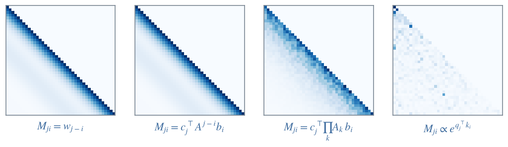

# 第 1 章 序列建模的三难困境

序列模型到今天仍然是个未解决的问题。RNN、CNN、Transformer 这三种方案看起来都很自然，各自却都有致命伤。

这一章不涉及 SSM，只把"序列建模到底难在哪"讲清楚，并立一个贯穿全书的框架：状态压缩视角。第 17 章会用它给出 Mamba 的核心论点，一个序列模型的全部差别，在于它用什么方式、用多大的代价，把历史压缩进一个状态。

有四件事需要交代：

- 一个序列模型的"能力"和"成本"分别由什么决定？
- 为什么注意力机制既是最强的，又是最贵的？
- 为什么"线性复杂度"本身并不稀奇，稀奇的是"线性复杂度且效果好"？
- Long Range Arena 到底在考什么？

最后一个问题更基本：

- 为什么"用固定大小的状态压缩整段历史"是一条值得走的路？

---

## 1.1 序列模型的形式化

先把术语固定下来。序列到序列映射（sequence-to-sequence map）是一个参数化的函数

$$
f_\theta : \mathbb{R}^{L \times D} \to \mathbb{R}^{L \times D},
$$

其中 $L$ 是序列长度（sequence length），$D$ 是每个位置的特征维度（feature dimension / model dimension）。输入写成 $X \in \mathbb{R}^{L\times D}$，第 $t$ 个位置的行向量记为 $X_t \in \mathbb{R}^D$（也有论文用列向量表示，约定不同而已）。

本书讨论的几乎所有模型都是因果的（causal）、自回归的（autoregressive）：第 $t$ 个位置的输出只允许依赖 $X_0, X_1, \dots, X_t$，不允许看到未来。这是语言建模的硬性要求，也是本系列所有 SSM 的默认设定。

在这个框架下，一个序列模型可以分解为两个正交的问题，两者可以各自换方案：

1. 沿序列轴（时间轴）的信息混合：位置 $t$ 该如何从位置 $0,\dots,t$ 取信息？
2. 沿特征轴（通道轴）的信息混合：$D$ 个通道之间该如何交互？这是普通 MLP / 线性层就够用的部分。

本书的主题几乎全部集中在第 1 个问题上。Mamba 的架构里，绝大多数参数其实花在第 2 个问题（线性投影）上，"序列混合"那部分只占很小一部分参数，但决定模型能否处理长依赖的正是它。

要讲清第 1 个问题，把序列混合直接看成一次矩阵乘法就够了，后面所有的复杂度分析都从这里出。

### 矩阵混合器视角

考虑一个因果的序列变换。它可以用一个下三角矩阵 $M \in \mathbb{R}^{L\times L}$ 来精确表示：

$$
Y = M X, \qquad M_{ji} = 0 \ \text{当} \ i > j.
$$

$M_{ji}$ 的含义是输出位置 $j$ 从输入位置 $i$ 取了多少信息。第 1 节的三种模型家族，本质上是对 $M$ 的三种参数化：

| 模型家族 | $M$ 的形式 | 参数个数 | 特殊性质 |
|---|---|---|---|
| 因果卷积 | $M_{ji} = w_{j-i}$（Toeplitz 矩阵） | $L$ | 只依赖时间差 |
| 线性递推（含 SSM） | $M_{ji} = c_j^\top \prod_{k=i+1}^{j} A_k \, b_i$ | $O(N L)$ | 由低维状态递推生成 |
| 自注意力 | $M_{ji} \propto \exp(q_j^\top k_i)$，再行归一 | $O(L^2)$ 计算，$O(LD)$ 参数 | 依赖内容相似度 |

*图 1-1　四种序列混合矩阵：卷积与线性递推都是 Toeplitz，选择性 SSM 与注意力逐行不同*

表里三行参数化值得逐条读：

- 卷积的 $M$ 是时不变的：权重只依赖距离 $j-i$，不依赖内容，也不依赖绝对位置。
- 线性递推的 $M$ 由一组低维状态（维数 $N$）递推产生。$M$ 本身是个 $L\times L$ 矩阵，却只需要 $O(NL)$ 个参数就能生成，**所有 SSM 的高效计算都建立在这一点上**。
- 注意力的 $M$ 是内容相关的：权重由 $q_j^\top k_i$ 决定，因此要显式计算 $L^2$ 个权重。

第 22 章会证明，Mamba-2 的矩阵 $M$ 属于"半可分矩阵（semiseparable matrix）"这个经典结构，注意力的 $M$ 是它的一个极端特例。三种方案各自的物理直觉先建立起来。

---

## 1.2 第一种方案：循环神经网络（RNN）

### 基本形式

RNN 用隐状态（hidden state）$h_t \in \mathbb{R}^N$ 携带历史：

$$
h_t = f_\theta(h_{t-1}, x_t), \qquad y_t = g_\theta(h_t).
$$

最朴素的版本（Elman RNN）是

$$
h_t = \tanh(W_h h_{t-1} + W_x x_t).
$$

它的成本很低：

- 训练时间：$O(L \cdot N^2)$（每步一次 $N\times N$ 乘向量）
- 推理时间：每步 $O(N^2)$，与已生成的长度无关
- 推理内存：$O(N)$，与上下文长度无关

最后一条是 RNN 最大的卖点，今天所有线性模型都想保住它：生成第 100 万个 token 时，只需要存一个 $N$ 维的状态，不需要存前 100 万个 token。

### RNN 的致命伤：梯度消失与并行性

RNN 有两个独立的致命问题，后面的模型是分别解决它们的，所以要分开讨论。

问题一：优化困难，尤其是长依赖。

反向传播穿过 $L$ 步递推时，梯度里会出现连乘项 $\prod_{t} \partial h_t / \partial h_{t-1}$。若雅可比矩阵的谱半径小于 1，梯度指数衰减；大于 1，指数爆炸。这就是经典的梯度消失/爆炸问题。

LSTM（Hochreiter & Schmidhuber, 1997）和 GRU（Cho 等, 2014）用门控（gating）缓解了这个问题：遗忘门 $f_t = \sigma(\cdot)$ 让状态可以"记住"而不衰减，输入门 $i_t$ 控制写入：

$$
c_t = f_t \odot c_{t-1} + i_t \odot \tilde{c}_t .
$$

门控本质上是在动态调整时间尺度（timescale）。遗忘门接近 1 时状态几乎不衰减（长记忆），接近 0 时立刻丢掉（短记忆）。第 2 章会重新发现这一点：**门控就是可学习的离散化步长 $\Delta$**，这个等价关系正是 Mamba 选择性机制的数学基础（第 18 章）。

问题二：训练无法并行。

RNN 被 Transformer 取代，原因不在效果，而在 GPU 上跑不起来。$h_t$ 依赖 $h_{t-1}$，$L$ 步必须串行执行。GPU 有几千个并行核心，RNN 的训练只能用到其中极少一部分，而且每一步都要把 $N$ 维状态从显存搬进搬出，是典型的访存受限（memory-bound）操作。

如果只是梯度问题，LSTM 早就够用了。让 Transformer 一统天下的是"训练时可以并行"这个工程属性。因此任何挑战 Transformer 的架构，第一道门槛不是效果，而是能否用矩阵乘法（从而用 Tensor Core）做训练。这道门槛反复出现：S5 用并行扫描跨过，S4 用 FFT 卷积跨过，Mamba-1 用硬件感知扫描跨过，Mamba-2 用块分解 + 矩阵乘法跨过，Mamba-3 用 MIMO 矩阵乘跨过。

### 状态压缩视角

Mamba 论文（Gu & Dao, 2023）给了一个我认为是理解这一切最好用的框架：

> 序列建模的本质是压缩。你要把一段任意长的上下文压进一个有固定容量的状态，然后用这个状态做预测。

按这个视角：

- RNN/SSM：状态大小 $N$ 固定，与序列长度无关 → 推理成本 $O(1)$/步，代价是压缩率极高，必然丢信息。
- 注意力：状态就是"全部历史"（即 KV cache），大小 $O(L)$ → 完全不压缩，因此效果最好，代价是推理每步 $O(L)$、训练 $O(L^2)$。
- 卷积：状态是最近 $k$ 个输入 → 压缩率由 kernel 大小决定，但压缩方式固定（不依赖内容）。

模型设计的核心问题于是变成一个工程问题：

> 如何在给定状态预算 $N$ 下，把最有用的信息压进去？

所有 SSM 的演进都是对这个问题不同侧面的回答，全书会反复出现这句话。

---

## 1.3 第二种方案：卷积网络（CNN）

因果卷积（causal convolution）用固定核 $w_0,\dots,w_{k-1}$：

$$
y_t = \sum_{i=0}^{k-1} w_i x_{t-i}.
$$

优点是训练可以完全并行：这是标准卷积，可以用 im2col 或 FFT 实现，完全是矩阵乘法友好的。

缺点是感受野（receptive field）只有 $k$。要覆盖长度 $L$，需要 $k \ge L$，参数量就变成 $O(L)$；或者堆叠 $\log L$ 层并逐层加倍膨胀率（dilated convolution，如 WaveNet、TCN），但这样的感受野是人工设计出来的，不能自适应。

更根本的问题是卷积的权重不依赖内容。输入是一段"中间夹了大量无关填充词"的文本时，卷积没有任何机制把它跳过去，只能固定地按距离加权。第 17 章会用"选择性复制任务（Selective Copying）"精确暴露这个缺陷，Mamba 正是由此而来。

卷积还有一个别的好处：它天然时不变，而时不变恰好等价于"可以用 FFT 加速"、"可以用一个固定的卷积核"。S4 能用 FFT 训练，靠的就是把 SSM 强行约束成时不变。

---

## 1.4 第三种方案：注意力（Transformer）

### 基本形式

自注意力（self-attention）为每一对位置计算一个权重：

$$
y_t = \sum_{i \le t} \frac{\exp(q_t^\top k_i)}{\sum_{j\le t}\exp(q_t^\top k_j)} v_i,
$$

其中 $q_t = W_Q x_t$、$k_i = W_K x_i$、$v_i = W_V x_i$ 都是由输入线性投影得到。

用第 1.1 节的矩阵视角，注意力写成一个下三角矩阵：

$$
M_{ji} = \frac{\exp(q_j^\top k_i)}{\sum_{i'\le j}\exp(q_j^\top k_{i'})}, \qquad Y = MX .
$$

### 为什么它强

- 内容相关：权重由 $q^\top k$ 决定，可以"按需"从历史里取出相关信息。Mamba 论文把这种能力叫作基于内容的路由（content-based routing），在语言上表现为 in-context learning、归纳头（induction heads）、联想回忆（associative recall）等能力。
- 梯度路径短：任意两个位置之间的梯度只穿过一层，不受长度影响。
- 训练并行：$QK^\top$ 是一次矩阵乘法，Tensor Core 最擅长的形状。

### 为什么它贵

- 训练时间与显存：$O(L^2)$。序列长度 $L$ 翻倍，成本变 4 倍。
- 推理：每生成一个 token 都要读取全部历史的 KV cache，即 $O(L)$ 访存。上下文 1M token 时，这个开销无法承受。
- 注意力没有状态，它用的是"记住所有东西"的策略。

注意力的昂贵来自定义，跟实现无关。KV cache 随上下文线性增长，这是"不压缩"的直接后果，多强的 kernel 优化都改不了（FlashAttention 解决的是显存占用与访存效率，但它依然要读 $O(L)$ 的 KV）。要在 1M 上下文下保持 $O(1)$ 的每步推理成本，**只有压缩一条路**。

### 一个自然的追问

卷积的 $M_{ji}=w_{j-i}$ 只看距离，注意力的 $M_{ji}=\exp(q_j^\top k_i)$ 只看内容，两者之间能不能有一种结构？

- 它应该有卷积那样的线性复杂度和并行性；
- 权重不应该固定于时间差，而要依内容变化；
- 同时只用一个固定大小的状态递推地生成这些权重，从而在推理时保持 $O(1)$/步。

这个"中间结构"就是 SSM 家族的全部内容。这条路上的第一块基石是 2020 年的 HiPPO（第 4~6 章）。讲 HiPPO 之前，得先把连续的、连续的、连续的（重要的事情说三遍）连续时间系统的数学基础补上（第 2 章）。

---

## 1.5 为什么"长程依赖"是一个独立的难题：LRA 基准

这场竞赛的计分板定义了后面所有模型的目标函数，所以在往下走之前先看一眼。

Long Range Arena（LRA；Tay 等, 2021）专门测试长序列建模能力，包含 6 个任务，序列长度从 1K 到 16K：

| 任务 | 输入长度 | 考什么 |
|---|---|---|
| ListOps | 2,048 | 层次化符号推理（括号嵌套的算术表达式求值） |
| Text | 4,096 | 字符级文本分类（IMDB 情感） |
| Retrieval | 4,000 | 双文档匹配（判断两段文本是否相似） |
| Image | 1,024 | 把 CIFAR-10 图像按像素展平成序列做分类 |
| Pathfinder | 1,024 | 判断两个点是否被一条虚线段连接（需长程视觉推理） |
| Path-X | 16,384 | 上者的难版，长度 16 倍 |

这些任务的共同点是答案依赖于相隔很远的位置之间的关系。

在 LRA 出现之前，Path-X（长度 16384）是所有模型的滑铁卢，包括各种高效 Transformer，它们在 Path-X 上只能拿到随机猜测（50%）的准确率。训练长度 16384 的注意力需要 $16384^2 \approx 2.7\times 10^8$ 个权重，显存直接爆掉；截断到局部窗口又丢掉了任务所需的长程信息。

S4 是第一个解出 Path-X 的模型（96.35%，第 13 章），S5 把它推到 98.58%（第 15 章）。这两个结果说明"线性复杂度"和"能解长程依赖"并不矛盾，只要能找到一个结构合适的 $M$。

LRA 侧重的是"感知类"的长依赖（图像、噪声信号），不是"信息检索类"的长依赖（在长文里精确找到某个事实）。后者对固定状态容量的模型更困难，第 21 章（DNA 与缩放定律）、第 24 章（MQAR 任务）和第 32 章（Mamba-3 的 NIAH 实验）会反复碰到。这个区分决定了 SSM 的适用边界：需要长期聚合统计量的任务它极强，需要精确回忆某个细节的任务它天生吃亏，前者靠压缩，后者要的恰恰是不压缩。

---

## 1.6 成本推导：从渐近到 FLOPs

前面反复出现"线性复杂度""$O(L^2)$"这类写法，形式记号省掉了常数，而工程决策几乎全由常数决定。这一节把参数量、训练 FLOPs、单步推理 FLOPs 逐项算出来，每一步都交代常数从哪来。

记账约定只有一条：一次乘加算一次 MAC，折合 2 FLOPs；只统计主项，忽略 bias、归一化、激活与 softmax，它们都是 $O(BLH)$ 量级，比矩阵项小一个数量级。记 $L$ 为序列长、$B$ 为 batch、$H$ 为隐藏维、$N$ 为状态维。

### 参数量

四族模型都在 $H$ 维特征上工作，都含一个 $H\times H$ 的通道混合矩阵（$H^2$），差别在沿序列轴的那部分：

- 因果卷积：核长 $K$ 的 depthwise 卷积，每通道 $K$ 个权重，共 $KH$。要让感受野覆盖全长取 $K=L$，于是 $LH$。S4 论文 Table 1 的 Parameters 一栏写 $LH$，指的就是这一项。
- RNN：$h_t=\tanh(W_hh_{t-1}+W_xx_t)$ 有 $W_h,W_x$ 两个 $H\times H$ 矩阵，实际是 $2H^2$。Table 1 记 $H^2$，因为它只数递推矩阵，把输入投影并进了通道混合项。
- 注意力：$W_Q,W_K,W_V,W_O$ 四个 $H\times H$，实际 $4H^2$，Table 1 同样按单矩阵记 $H^2$。
- SSM：对角情形每通道 $N$（$A$ 的对角元）、$N$（$B$）、$N$（$C$）、$1$（$\Delta$），共 $H(3N+1)$。S4 用 NPLR 参数化 $A=\Lambda-PQ^*$，每通道 $5N$，论文原文写的是"These comprise S4's 5N trainable parameters"。

"SSM 参数少"要看跟谁比。$N=16$、$H=256$ 时，$H(3N+1)=12{,}544$，而 $H^2=65{,}536$，序列混合部分只占 16%。同样是 $L=1024$ 的卷积要 $LH=262{,}144$，比 SSM 多 20 倍。这个 20 倍是"用低维状态生成 $L\times L$ 矩阵"的直接红利。

### 训练 FLOPs

反向传播的乘法次数约为前向的两倍，所以训练总 FLOPs 按前向的 3 倍估；前向的 MAC 数乘 2 换成 FLOPs，两者合起来就是 6 倍 MAC。

注意力前向有三个矩阵乘：$S=QK^\top$ 是 $(L\times H)\cdot(H\times L)$，$BL^2H$ 次 MAC；$Y=SV$ 是 $(L\times L)\cdot(L\times H)$，又是 $BL^2H$ 次；四个投影各 $BLH^2$ 次，合计 $4BLH^2$。于是

$$
\text{FLOPs}_{\text{attn}} \approx 6B\big(2L^2H+4LH^2\big)=12BL^2H+24BLH^2 .
$$

$L=4096$、$H=256$、$B=8$ 时代入：第一项 $12\cdot8\cdot4096^2\cdot256=4.1\times10^{11}$，第二项 $5.2\times10^{10}$，比例 8:1。$L$ 翻倍，第一项涨 4 倍。

RNN 每步两次 $H\times H$ 乘向量（$W_h$ 与 $W_x$），前向 $2BLH^2$ 次 MAC，训练

$$
\text{FLOPs}_{\text{rnn}} \approx 12BLH^2 .
$$

同配置下是 $2.6\times10^{10}$，比注意力少 16 倍。公式便宜，可它的时间轴是串行的，这个 16 倍在 GPU 上体现不出来：$L$ 步之间有真依赖，几千个 SM 里只有一个在干活。

因果卷积的直接算法每步 $K$ 次乘加，训练 $6BLKH$。$K=L=4096$ 时是 $2.1\times10^{12}$，比注意力还贵 5 倍。换 FFT 是另一条路：每个 $(b,h)$ 序列要做两次长为 $2L$ 的实数 FFT 和一次逐点复数乘。长度 $n$ 的实数 FFT 约 $5n\log_2n$ FLOPs，逐点复数乘每点 6 FLOPs，于是每通道

$$
2\cdot5\cdot2L\log_2(2L)+6\cdot2L=20L\log_2(2L)+12L .
$$

乘 $BH$ 再乘 3，还要加上核自身的 FFT。核只与通道有关、与 $B$ 无关，所以那部分是 $3H\big(20L\log_2(2L)+12L\big)$，占总量 $1/B$，$B=8$ 时是 12%：

$$
\text{FLOPs}_{\text{conv-fft}} \approx 3BH\big(20L\log_2(2L)+12L\big).
$$

$L=4096$ 时 $\log_2(2L)=13$，括号内 $20\cdot13+12=272$，乘 $L$ 得 $1.11\times10^6$，再乘 $BH=2048$ 与 3，约 $6.8\times10^9$。同一个卷积，直接算法 $2.1\times10^{12}$，FFT 路径 $6.8\times10^9$，差 300 倍。这个 300 才是"线性复杂度"在工程上的真实含义：不是比 $O(L)$ 更小，而是把"每步乘 $K$ 个权重"换成了"一次 $\log L$ 的变换"。

SSM 训练走卷积视图，代价分两块。算卷积核 $\bar K$ 要 $L$ 步递推，对角 $A$ 时每步 $N$ 次乘加，每通道 $LN$，全部通道 $HLN$；然后 $H$ 个通道各做一次长度 $L$ 的 FFT 卷积。于是

$$
\text{FLOPs}_{\text{ssm}} \approx 6HLN+3BH\big(20L\log_2(2L)+12L\big).
$$

$N=16$ 时第一项是 $6\cdot256\cdot4096\cdot16=1.0\times10^8$，比第二项的 $6.8\times10^9$ 小两个数量级。核的计算可以忽略，SSM 的训练成本就是一次 depthwise FFT 卷积。这也解释了一个实现现象：S4 的代码里算核的那段（`torch.cumprod` 之类）从来不是瓶颈。

### 训练显存

显存比 FLOPs 更容易成为真约束，因为反向要存中间激活。

注意力每层要存 $B(L^2+HL)$ 个元素：$L^2$ 是那张分数矩阵，$HL$ 是 $Q,K,V$ 本身。$B=8$、$L=4096$ 时是 $1.34\times10^8+(8\cdot4096\cdot256=8.4\times10^6)$，约 $1.4\times10^8$ 个数，fp16 下 286 MB，单层。SSM 每层只存 $BLH=8.4\times10^6$ 个数，17 MB。两侧差 16 倍，而且注意力的那一项随 $L^2$ 涨。这就是 FlashAttention 存在的理由：它不改 FLOPs，改的是这 286 MB 要不要落到显存里（分块计算 + 重算，把 $O(L^2)$ 的显存降到 $O(L)$）。但对 SSM 来说这张表根本不存在，因为它从不显式构造 $L\times L$ 的矩阵。

| 模型 | 每层训练激活（$B=8$、$L=4096$、$H=256$、fp16） |
|---|---|
| 注意力 | 286 MB（分数矩阵占 268 MB） |
| 注意力 + FlashAttention | 17 MB 量级（分数矩阵不落盘） |
| RNN / SSM（扫描视图） | 17 MB |
| 因果卷积（FFT） | 34 MB（输入与输出的频域副本） |

表里 RNN 与 SSM 的 17 MB 都得存，因为反传要把它读回来算梯度。$L=10^5$ 时这一项是 $8\cdot10^5\cdot256=2\times10^8$ 个数、4 GB，仍然可行；注意力在同样长度下要存 $8\times10^{10}$ 个数的分数矩阵，约 160 TB，不可行。

### 与论文表的差别

S4 论文 Table 1 写的是 $LH$、$H^2$、$L\tilde H(B+H)$ 这种形式，直接拿去算显存会差很远。三处口径差得说清：

- 表头声明 "the state size $N$ of S4 is tied to $H$"，所以 SSM 参数量记 $H^2$，把 $HN$ 并进去了。$N=16$ 时这是 16 倍的乐观估计。
- 波浪号只吃掉 $\log L$ 因子，不吃常数。$\log_2(2L)=13$ 这一项在表里只剩一个 $\tilde L$，而实际上它要乘上 FFT 的 20 与点乘的 12。
- 表里不算反向，也不算 $Q,K,V,O$ 四个（或两个）投影的个数。做容量规划时至少乘 6（3 倍反向 × 2 FLOPs/MAC），再乘投影个数。

**$O(\cdot)$ 适合比模型，不适合算卡。** 两者的桥就是这一节的乘法表。

### 单步推理

推理时切到递归视图，只算一个位置：

- SSM：$\bar Ax$ 用 $N$ 次乘加（对角），$\bar Bu$ 与 $\bar Cx$ 各 $N$ 次，共 $3N$ 次 MAC，$6N$ FLOPs。$N=16$ 时是 96 FLOPs。
- RNN：$2H^2$ 次 MAC，$4H^2$ FLOPs，$H=256$ 时 $2.6\times10^5$。
- 注意力：$q$ 与全部 $L$ 个 $k$ 做内积 $LH$ 次 MAC，$AV$ 又 $LH$ 次，加四个投影 $4H^2$，$L=4096$ 时 $4LH+8H^2=4.7\times10^6$ FLOPs。
- 因果卷积：不做 FFT，直接卷 $K$ 个权重，$2KH$ FLOPs。

四者摆在一起（$B=8$、$L=4096$、$H=256$、$N=16$、卷积核长取 $L$）：

| 模型 | 参数量 | 训练 FLOPs | 单步推理 FLOPs | 训练可并行 |
|---|---|---|---|---|
| 因果卷积（直接） | $LH+H^2$ | $2.1\times10^{12}$ | $2.1\times10^{6}$ | 是 |
| 因果卷积（FFT） | $LH+H^2$ | $6.8\times10^{9}$ | $2.1\times10^{6}$ | 是 |
| RNN | $2H^2$ | $2.6\times10^{10}$ | $2.6\times10^{5}$ | 否 |
| 注意力 | $4H^2$ | $4.6\times10^{11}$ | $4.7\times10^{6}$ | 是 |
| SSM（对角 $A$） | $H(3N+1)+H^2$ | $6.9\times10^{9}$ | $96$ | 是 |

表里最扎眼的一列是训练：SSM 与 FFT 卷积几乎打平，比注意力便宜 67 倍。推理一列更夸张，SSM 的 96 FLOPs 比注意力低近五个数量级。

这张表只在 FLOPs 口径上成立。GPU 上还有两件表里没有的事：算术强度（每读一个字节能做多少次运算）和矩阵乘的形状。FFT 卷积的算术强度只有 $O(\log L)$，属于访存受限，实测优势远小于 300 倍；Mamba-2 论文报的交叉点是序列长 2K 起优于 FlashAttention-2、16K 时快 6 倍（$N=64$），测的是墙钟时间而不是 FLOPs。**FLOPs 账本决定上界，访存与并行度决定实际上界能兑现几成。**

## 1.7 三难：长度决定取舍

代价算清楚之后，"三难"可以写得更具体。一个序列混合器想同时拿到三件事：训练能拆成矩阵乘（塞满 GPU）、推理每步的开销与 $L$ 无关、权重依赖内容而不只是距离。任意两件可以兼得，三件凑不齐。

| 模型 | 训练并行 | 推理 $O(1)$ | 内容相关 | 缺哪一条 |
|---|---|---|---|---|
| 因果卷积 | 是 | 是 | 否 | 内容路由 |
| RNN / LSTM | 否 | 是 | 部分（门控） | 训练并行 |
| 注意力 | 是 | 否 | 是 | 常量内存 |
| LTI SSM（S4） | 是 | 是 | 否 | 内容路由 |
| 选择性 SSM（Mamba-1） | 部分 | 是 | 是 | 纯矩阵乘训练 |
| SSD（Mamba-2） | 块内是 | 是 | 是 | 块间仍串行 |

Mamba-1 那一行值得单说。它让 $\Delta,B,C$ 依赖输入，换到第三条，代价是第一条退化：卷积核不再固定，FFT 视图失效，只能退回并行扫描，而扫描的并行深度是 $\log L$、每一步都是访存密集的小操作。Mamba-2 用块分解把块内重新变成矩阵乘，块间保留递推，这才在墙钟时间上把第一条买回来一部分（第 25 章）。

三难里没有一条是绝对的，取哪条腿取决于 $L$ 落在哪个区间。取一个具体配置：$H=4096$、32 层、fp16、单样本。KV cache 每个 token 占 $2\cdot H\cdot32\cdot2=524{,}288$ 字节，即 0.5 MB。SSM 侧同配置的状态是每层 $H\times N$，$N=16$ 时每层 65,536 个数、128 KB，32 层共 4 MB，与 $L$ 无关。

| $L$ | 注意力训练主项 $12BL^2H$（单层单样本） | KV cache | SSM 状态 |
|---|---|---|---|
| 512 | $1.3\times10^{10}$ | 256 MB | 4 MB |
| 8,192 | $3.3\times10^{12}$ | 4.3 GB | 4 MB |
| 131,072 | $8.3\times10^{14}$ | 67 GB | 4 MB |
| $10^{6}$ | $5.0\times10^{16}$ | 500 GB | 4 MB |

两件事从表里读得出来。

注意力的训练项随 $L$ 平方涨，KV cache 随 $L$ 线性涨，前者先撞墙。$L=8K$ 时单层单样本的训练主项已经到 $10^{12}$，32 层跑一步就是 $10^{13}$ 量级；$L=128K$ 时单步都做不完。工程上的应对是分层：把大部分层换成线性模型，只在少数层保留注意力，Mamba-2 论文在 350M、48 层的实验里报的最优点是 64 层里放 6 层注意力（第 27 章）。混合模型的收益大致是 10% 量级，不是数量级。

SSM 的成本在表里是常数，容量也是常数：4 MB 要装 $10^6$ 个 token 的信息。这是设计的直接后果，不是实现缺陷。第 21 章的 DNA 任务与第 24 章的 MQAR 任务都在测这条边界，需要长期聚合统计量时 4 MB 够用，需要精确回忆某个具体位置时不够。

推理侧的真实瓶颈还可以算得更硬。注意力 decode 每个 token 要把 500 GB 的 KV cache 读一遍，按 3 TB/s 的显存带宽算，是 167 ms/token，约 6 token/s，而且这个数与 GPU 算力无关。SSM 每步只读写 4 MB，同样带宽下 1.3 μs。两者差五个数量级，这也是 Mamba-3 把重心放到"解码阶段怎么把矩阵乘做大"（MIMO）而不是"训练怎么更快"的原因（第 31 章）。

短序列上结论反过来。$L=512$ 时注意力的分数矩阵只有 $512^2\times8$ 个元素，一次矩阵乘就能吃完，而 SSM 要跑 $\log L$ 轮访存密集的 FFT 或扫描。$H=256$ 时注意力的单层训练主项是 $1.3\times10^{10}$，与 SSM 的 $6.9\times10^{9}$ 同一量级，工程实现成熟度决定了胜负。所以"SSM 更适合长序列"这句话的准确形式是：两条成本曲线的斜率不同，交点在千级长度附近，具体位置依赖实现。

## 1.8 四个容易搞反的地方

**线性不等于更快。** 渐近优势要穿过常数、算术强度和并行度三道门才变成墙钟时间。$L=1K$ 时注意力的 $L^2H$ 项只有 $2.7\times10^{8}$ MAC，做成一个大矩阵乘正好吃满 Tensor Core；SSM 的 FFT 卷积此时要处理 $L\log L$ 的访存，实际并不占优。短序列上注意力就是更快的选择，这不是工程落后，是常数在起作用。判断该换架构的门槛是实测拐点，不是复杂度表。

**SSM 的状态不是 $N$ 维。** 层的状态是 $H\times N$，每个通道一份。$N=16$、$H=256$ 时是 4096 个数，跟 $L=16$ 的注意力 KV 差不多大。SSM 的特点在于内存不随 $L$ 涨，并不在于内存极小。把它理解成"只用 16 个数字记住一切"会导致对失败模式的误判：真正的瓶颈是 $H\times N$ 这个固定预算如何分配，而不是 $N$ 本身。

**RNN 不是效果差才被换掉。** 门控 RNN 与线性 SSM 逼近的是同一个 ODE，前者用后向欧拉、后者用双线性（第 8 章会把这条等价关系推完）。表达力不是差别，差别在时间轴能否展开成矩阵乘。这也解释了为什么 Mamba 敢把状态维度 $N$ 压到 16 却仍然有效：它买的不是容量，是并行度。

**"高效注意力"并不解决同一问题。** 稀疏注意力、滑窗注意力、低秩近似都把 $L^2$ 压到 $L\sqrt{L}$ 或 $L\log L$，但它们的 KV cache 仍然是 $O(L)$，因为近似的是打分矩阵，不是历史本身。要拿到常量内存，必须真的把历史写成固定维度的状态，这是 SSM 与高效注意力家族的分界线，也是第 22 章"半可分矩阵"那道分水岭的来源。

这几条误读背后是同一个习惯：把 $O(\cdot)$ 当成事实，把常数当成细节。实际工程里两者恰好反过来，$O(\cdot)$ 决定五年后的结论，常数决定这个季度能不能跑完。下面两章建立的语言（连续系统、离散化）不改变这些账，但它们决定了账上的每一项能不能被并行地乘出来。

## 1.9 本章小结

- 序列模型的核心操作是用某种权重结构 $M$ 沿序列轴做信息混合。三种主流家族对应三种 $M$：Toeplitz（卷积）、低维递推生成（RNN/SSM）、内容相关的 $\exp(q^\top k)$（注意力）。
- RNN 便宜（$O(N)$ 状态、$O(1)$/步推理），但训练不可并行、梯度难传；门控（LSTM/GRU）缓解了梯度问题，本质上是在学时间尺度。
- 卷积完全可并行，但感受野受限、权重与内容无关。
- 注意力在效果与并行性上最强，训练 $O(L^2)$、推理每步 $O(L)$，代价来自它根本不压缩历史。
- 状态压缩视角把三者统一起来：成本由状态大小决定，能力由状态里存了什么决定。注意力的状态大小是 $O(L)$，RNN 是 $O(N)$。
- LRA 把"长程依赖"变成了可量化的目标，Path-X（16K）是标志性难关。
- 目标模型要同时具备线性复杂度（可并行训练）、常量内存推理、内容相关的权重，以及一个固定大小的状态。

## 下一章

下一章从零建立连续时间线性系统的基本语言：什么是状态空间模型，为什么线性常微分方程的解是矩阵指数，连续系统怎么变成离散递推，以及"离散化"这个看似技术性的步骤为什么会在后面反复成为故事的主角（从 S4 的双线性变换，到 Mamba 的 ZOH 与指数-欧拉，再到 Mamba-3 的指数-梯形）。

这一章不要跳。后面所有论文的一半难度，都来自对"连续 → 离散"这一步的理解。
