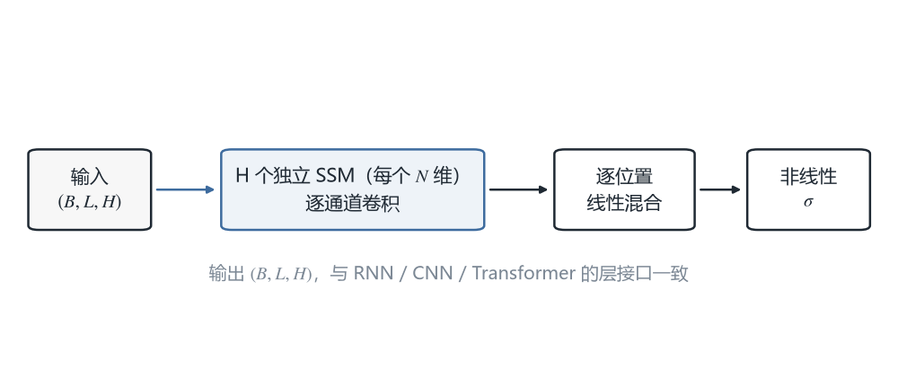

# 第 3 章 从连续到离散：SSM 如何成为一个神经网络层

前两章建立的数学对象还不能训练。要把它变成神经网络里的一个层，必须回答一堆工程问题：

1. 一个 SSM 处理的是标量序列 $u(t)\in\mathbb{R}$，但神经网络里的张量是 $(B, L, H)$ 的。多通道怎么办？
2. 参数 $A,B,C,\Delta$ 具体怎么参数化？初始化成什么？哪些可训、哪些冻结？
3. 训练时用卷积视图、推理时用递归视图，这两套参数怎么保证一致？
4. 计算量、显存、并行度到底是多少？和 Transformer、CNN 比差在哪？
5. 最后一个问题最关键：$A$ 应该取什么值？随便取一个（比如随机矩阵）会发生什么？

最后这个问题要到第 5 章才有答案，但必须先在这里提出来，因为整个 S4 系列的技术复杂度都是被它逼出来的。

---

## 3.1 把标量层拼成深度网络：SISO 广播

### 通道处理

一个 SSM 是标量到标量的映射。要处理 $H$ 维特征（隐藏维），最直接的做法是为每个通道配一份独立的 SSM：

$$
u \in \mathbb{R}^{B\times L\times H} \quad\Longrightarrow\quad
\text{对 } H \text{ 个通道各跑一个 } (A^{(h)}, B^{(h)}, C^{(h)}, \Delta^{(h)}).
$$

这被称为 SISO bank（bank of single-input single-output systems）。几个后果需要交代：

- 参数量：$A$ 是 $N\times N$ 的，$H$ 个通道就是 $H N^2$ 个参数。当 $N=64, H=512$ 时就是 200 万，太大了。所以实践中 $A$ 通常约束为对角矩阵，参数量降到 $HN$（S4D、Mamba 都是这样）。这是"必须给 $A$ 加结构"的第二个理由（第一个理由是计算速度，第 2 章已讲）。
- 通道间不交流：SISO bank 之后所有通道是独立的，所以必须加一个逐位置的线性层做通道混合（就像 Transformer 里的 $W_O$，或 depthwise separable convolution 之后的 $1\times1$ 卷积）。S4 的 `H` 通道混合矩阵是 $H\times H$，参数 $O(H^2)$。
- 有效状态维度：整个层的"状态"实际上是 $H\times N$ 那么大（S4 的论文说 $HN$）。这也是 S4 与 S5 的关键差别：S5 用单个 MIMO 系统（状态 $P$ 维，$P = O(H)$），而不是 $H$ 个 $N$ 维 SISO（第 15 章）。

### 层接口

一个 SSM 层的操作按顺序是这三步：

1. 逐通道 SSM：对第 $h$ 个通道，用 $(A^{(h)},B^{(h)},C^{(h)},\Delta^{(h)})$ 做一次长度为 $L$ 的序列变换，得到 $y^{(h)}$。$H$ 个通道互不干扰，可以并行。
2. 逐位置线性混合：$Y \leftarrow YW_{\text{mix}} + b$，其中 $W_{\text{mix}}\in\mathbb{R}^{H\times H}$，让通道之间交换信息。
3. 逐位置非线性：$Y\leftarrow\sigma(Y)$，通常是 GELU 或 SiLU。

输入输出都是 $(B,L,H)$，接口与 RNN、CNN、Transformer 的层完全一致。

整块的骨架和 Transformer 一样：线性混合 + 非线性 + 残差 + 归一化。SSM 层替换的只是"序列轴上的混合算子"（对应注意力或卷积），其余部分照旧。

这也意味着：一个"深度 SSM"模型和"深度 CNN"在结构上是同构的，只是一个用全局的隐式核，一个用局部核。S4 论文里的说法是：

> 整个深 S4 模型非常类似于一个 depthwise-separable CNN，只不过卷积核是全局的（global convolution kernels）。

---

*图 3-1　一个 SSM 层的接口：逐通道的 SSM、逐位置的通道混合、逐位置非线性*

## 3.2 参数化与初始化

### A：先按下不表

这是核心问题，第 4~12 章专门解决。这里只给结论：**随机矩阵 $A$ 不行**。LSSL 论文的消融实验显示，用随机（适当缩放的）$A$ 的 LSSL 在 permuted MNIST 上只有 62%，而用 HiPPO 矩阵的版本有 98.76%（第 7 章）。S4 论文的消融（CIFAR-10，100K 参数）也显示，所有初始化在训练集上都能到 100%，但验证集准确率相差超过 15 个点。

两组实验里所有初始化都把训练集拟合到 100%，差别全在泛化。这说明 $A$ 的作用不是"增加模型容量"，而是提供正确的归纳偏置（inductive bias）：什么样的历史压缩方式在真实序列上有用。HiPPO 提供的正是这个偏置。

### B, C：简单的初始化

- $B$：在 S4D 里初始化为全 1（论文里 HiPPO 有自己的 $B$ 公式，但消融显示差别不大）。
- $C$：用标准差为 1 的随机初始化。这个标准差不是神经网络里常见的 $1/\sqrt{N}$ 缩放。原因与 HiPPO 的理论有关：在 HiPPO 的基下，$\|C\|$ 的量级恰好要保持在 $O(1)$ 才能让核的能量不随 $N$ 爆炸（S4D 论文提到 "variance-preserving for S4's (A,B) as a consequence of the HiPPO theory"）。
- $C$ 也可以冻结在随机值上（有些变体这么做，效果略差但省参数）。

### Δ：几何均匀的初始化

$\Delta$ 被限制为正数。做法是参数化 $\log \Delta$，并初始化在一个对数均匀分布上：

$$
\log \Delta \sim \mathcal{U}\!\left(\log \Delta_{\min}, \log \Delta_{\max}\right),
\qquad \Delta_{\min} = 10^{-3},\ \Delta_{\max}=10^{-1}.
$$

这个区间是经验值，来源是"让核的时间尺度覆盖从很窄到很宽的一个范围"。不同的通道拿到不同的 $\Delta$，模型就同时拥有多个时间尺度的记忆，有点像多尺度小波分析。

Mamba 里 $\Delta$ 的初始化更明确：$\Delta = \mathrm{softplus}(\text{param} + \text{bias})$，其中 bias 用 $\mathrm{softplus}^{-1}(\mathcal{U}[0.001, 0.1])$ 初始化，也就是先算出想初始化的 $\Delta$ 值，再反推 softplus 之前的数值。写代码时这一点容易搞错。

### 稳定性

如第 2.6 节所述，必须保证 $\mathrm{Re}(\lambda(A)) < 0$。做法是把实部放进 `exp` 里再取负：

$$
A = -\exp(A_{\text{real}}) + i\,A_{\text{imag}}.
$$

或者（当 $A$ 是实数对角时）$A = -\exp(A_{\log})$。这个约束没有例外：不加它，长序列训练必然发散。

---

## 3.3 训练用卷积，推理用递归

### 训练：卷积视图

给定 $\bar A, \bar B, \bar C$，先算出核 $\bar K \in \mathbb{R}^L$（式 2.7），然后

$$
y = \bar K \ast u
$$

即一次长度为 $L$ 的因果（non-circular）卷积。实现细节：

1. FFT 卷积：补零到 $2L$，$Y = \mathrm{iFFT}(\mathrm{FFT}(u)\cdot \mathrm{FFT}(\bar K))[\,0{:}L\,]$。复杂度 $O(L\log L)$。
2. $H$ 个通道各自有独立的核 $\bar K^{(h)}$，所以这是 $H$ 个独立的 1D 卷积，即 depthwise convolution（深度可分离卷积）。批量维度上再加一层并行。

训练用卷积，是因为整个序列的输出可以一次算完，没有依赖顺序。这是 Transformer 能取代 RNN 的核心原因，也是 SSM 必须继承的。

### 推理：递归视图

生成第 $k$ 个 token 时，只需要

$$
x_k = \bar A x_{k-1} + \bar B u_k, \qquad y_k = \bar C x_k .
$$

成本：$O(N^2)$ 计算、$O(N)$ 内存，与已生成的序列长度无关。对比 Transformer：每步要读 $O(L\cdot D)$ 的 KV cache。

这就是 Mamba 论文里那张"推理吞吐 5×"图（第 21 章）的来源。这里有个前提：$\bar A,\bar B,\bar C$ 必须不随时间变化。如果它们依赖输入（Mamba 的选择性机制），递归就还在，但卷积视图失效了，这是第 17~19 章的核心冲突。

### 两种视图的一致性

它们必须给出相同的结果，这是数学上的恒等式（第 2.5 节的展开）。但在实现上有一个坑：

- 卷积视图里的 $\bar K$ 是离线算好并缓存的。如果参数更新了（训练中每步都更新），缓存必须失效重算。
- 如果训练时用卷积、推理时切递归，那么两个路径的数值误差必须控制住。S4 的早期版本在 A100 上做 FP32 训练、BF16 推理时偶尔出现不一致，就是这个问题。

---

## 3.4 成本核算：SSM 到底值不值

把 S4 论文 Table 1 的复杂度对照表完整抄录如下（$L$ 序列长、$B$ batch、$H$ 隐藏维、$N$ 状态维；波浪号表示忽略对数因子）：

| | 卷积 | 递归（RNN） | 注意力 | **S4** |
|---|---|---|---|---|
| 参数量 | $LH$ | $H^2$ | $H^2$ | $H^2$ |
| 训练计算 | $L\tilde H(B+H)$ | $BLH^2$ | $B(L^2H+LH^2)$ | $BH(\tilde H+\tilde L)+B\tilde LH$ |
| 训练空间 | $BLH$ | $BLH$ | $B(L^2+HL)$ | $BLH$ |
| 并行 | 是 | 否 | 是 | **是** |
| 推理（单样本单步） | $LH^2$ | $H^2$ | $L^2H+H^2L$ | **$H^2$** |

表里有几处需要对照着看：

1. S4 的参数量和 RNN 一样是 $H^2$（不含 SSM 本身那 $HN$ 个参数），比卷积的 $LH$ 少得多：卷积需要 $L$ 个核权重，SSM 只需要 $N$ 个。这就是"用低维状态生成 $L\times L$ 的矩阵"的红利。
2. S4 的训练计算量对 $L$ 是线性的（$\tilde L$ 表示带 log 因子），因为 FFT 是 $O(L\log L)$。
3. S4 的推理是 $H^2$（与 $L$ 无关），因为切到递归模式。
4. S4 同时是并行且推理高效的：这是它相对 RNN（不并行）和注意力（推理贵）的核心优势。

还有一点容易漏掉：S4 的参数量里 SSM 部分其实很少。当 $N=64$、$H=256$ 时，SSM 参数是 $HN = 16384$，而通道混合矩阵是 $H^2 = 65536$。到了 Mamba 时代，这个比例进一步极端化：Mamba 的 SSM 参数只占整个 block 的约 1%（第 20 章）。Mamba 系列里一个反直觉的事实是：决定性能的"序列混合"部分参数量少得可怜，绝大部分参数在普通的线性投影上。

这解释了 Mamba 的 block 设计（而不是 SSM 本身）为什么会成为 Mamba-2 论文的重点。

---

## 3.5 梯度怎么流

这一点理论课上常被一笔带过，工程上却绕不开。

训练时如果用卷积视图，反传就是标准卷积的反传，没有长链依赖问题（FFT 卷积的反传同样是 FFT）。如果用递归视图（Mamba 的情形），反传要穿过 $L$ 步递推，形式上与 BPTT 一样。

那么梯度消失的问题回来了吗？没有，因为 SSM 与 RNN 有一个本质区别：**SSM 的线性递推没有非线性压缩**。

考虑 $\bar A$ 是标量 $a$ 的退化情形：$x_k = a x_{k-1} + b u_k$，于是 $\partial x_L/\partial x_k = a^{L-k}$。如果 $|a|<1$ 且远离 1，梯度确实会消失；但如果 $a \to 1$（比如 $\Delta$ 很小），梯度几乎不衰减。

在 HiPPO-LegS 的矩阵情形下，论文（Prop. 5）证明了更强的结论：梯度范数下界是 $\Theta(1/t)$，也就是多项式衰减而非指数衰减。这是 HiPPO 优于普通 RNN 的一个理论保证：它从根本上不会指数级丢梯度。

更实际的一点：由于 $A$ 的初始化（HiPPO）本身就设计成"让状态记住长时间的历史"，训练一开始模型就处在"梯度能传到很久以前"的区域内，而不是像随机初始化的 RNN 那样一开始就处在病态区域。这也是为什么 $A$ 的初始化如此重要。

---

## 3.6 四种子方法的积分来源

第 2 章给了四种离散化的结果公式。它们全部来自同一个积分方程，也就是参数变分公式：

$$
x(t_k)=e^{\Delta A}x(t_{k-1})+\int_{t_{k-1}}^{t_k}e^{(t_k-s)A}B\,u(s)\,ds .
$$

四种方法的区别只有一处：怎么处理这个积分。把它写成 $\int (Ax+Bu)\,ds$ 后逐个看。

### 前向欧拉：左端点矩形

把区间内的被积函数换成左端点的值：

$$
\int_{t_{k-1}}^{t_k}\big(Ax(s)+Bu(s)\big)ds\approx\Delta\big(Ax_{k-1}+Bu_{k-1}\big),
$$

$$
\Longrightarrow\quad x_k=(I+\Delta A)x_{k-1}+\Delta B u_{k-1}.
$$

换成核的语言：把 $e^{(t_k-s)A}$ 在区间内当作 $I$（误差 $O(\Delta)$），把 $u(s)$ 当作 $u_{k-1}$。这就是它只有一阶精度的原因，两个近似都只到零阶。

### 后向欧拉：右端点矩形

被积函数取右端点的值，但右边含未知的 $x_k$：

$$
x_k-x_{k-1}=\Delta\big(Ax_k+Bu_k\big)
\;\Longrightarrow\;
(I-\Delta A)x_k=x_{k-1}+\Delta B u_k .
$$

解出来要左乘 $(I-\Delta A)^{-1}$。这个逆总是存在的：若 $1/\Delta$ 是 $A$ 的特征值，则 $(I-\Delta A)$ 奇异，而这要求 $\lambda=1/\Delta>0$，与 $\mathrm{Re}\lambda<0$ 矛盾。稳定性约束顺手保证了隐式方程可解。

### 双线性：梯形法则

对 $\int Ax\,ds$ 用梯形（两端平均），对 $\int Bu\,ds$ 用区间平均值：

$$
x_k-x_{k-1}=\frac{\Delta}{2}\big(Ax_{k-1}+Ax_k\big)+\Delta B u_k .
$$

移到左边：

$$
\Big(I-\frac{\Delta}{2}A\Big)x_k=\Big(I+\frac{\Delta}{2}A\Big)x_{k-1}+\Delta B u_k ,
$$

两边左乘 $\big(I-\frac{\Delta}{2}A\big)^{-1}$ 就得到第 2 章的双线性公式。$u$ 项只有一项，不是梯形造成的遗漏：LSSL 把 $u_k$ 定义成区间平均值

$$
u_k=\frac{1}{\Delta}\int_{t_{k-1}}^{t_k}u(s)\,ds ,
$$

在这个定义下 $\int Bu\,ds=\Delta Bu_k$ 本身就是精确的。这也解释了为什么双线性与后向欧拉的 $\bar B$ 都长成 $\Delta(I-cA)^{-1}B$ 的样子，两者只差 $c$ 取 $\Delta/2$ 还是 $\Delta$。

### ZOH：把积分算出来

ZOH 假设区间内 $u$ 恒定，于是积分可以精确完成：

$$
\int_{0}^{\Delta}e^{\tau A}d\tau\cdot B u_k,\qquad \tau=t_k-s .
$$

先把核的积分用级数展开：

$$
\int_0^{\Delta}\sum_{j\ge0}\frac{\tau^jA^j}{j!}d\tau=\sum_{j\ge0}\frac{\Delta^{j+1}A^j}{(j+1)!}.
$$

另一方面 $e^{\Delta A}-I=\sum_{k\ge1}\frac{\Delta^kA^k}{k!}$，左乘 $A^{-1}$ 并令 $j=k-1$：

$$
A^{-1}\big(e^{\Delta A}-I\big)=\sum_{j\ge0}\frac{\Delta^{j+1}A^j}{(j+1)!}.
$$

两边相等，所以

$$
\int_0^{\Delta}e^{\tau A}d\tau=A^{-1}\big(e^{\Delta A}-I\big),\qquad \bar B=A^{-1}\big(e^{\Delta A}-I\big)B .
$$

推导用了 $A^{-1}$，但结果对奇异 $A$ 也成立。定义

$$
\phi(z)=\frac{e^{z}-1}{z}=\sum_{j\ge0}\frac{z^{j}}{(j+1)!},
$$

它在 $z=0$ 处解析（值为 1），于是 $\int_0^{\Delta}e^{\tau A}d\tau=\Delta\,\phi(\Delta A)$ 对任何 $A$ 都有意义。对角 $A$ 时逐元素是 $\frac{e^{\Delta\lambda_n}-1}{\lambda_n}$，$\lambda_n\to0$ 时退化为 $\Delta$。这就是为什么 S5、LMU 这类用 ZOH 的实现里看不到求逆，它们用标量公式或截断级数。

### 误差阶数与代价

| 方法 | $\int Ax\,ds$ 的近似 | $\int Bu\,ds$ 的近似 | 隐式 | 局部误差 | 每步代价 |
|---|---|---|---|---|---|
| 前向欧拉 | 左矩形 | 左端点 | 否 | $O(\Delta^2)$ | 一次矩阵向量乘 |
| 后向欧拉 | 右矩形 | 右端点 | 是 | $O(\Delta^2)$ | 解一次线性系统 |
| 双线性 | 梯形 | 区间平均（精确） | 是 | $O(\Delta^3)$ | 解一次线性系统 |
| ZOH | 精确 | 区间常数 | 否 | $O(\Delta^2)$ | 一次矩阵指数 |

表里最后一行是 ZOH 的特别之处：状态转移是精确的，误差全部来自"$u$ 分段常数"这个假设。所以在输入变化缓慢的场合（比如音频的高采样率）它能用比双线性更大的步长。代价是每步要算矩阵指数，$A$ 不是对角时这笔账很贵。

误差阶数可以从 Taylor 余项直接读出来。前向欧拉相当于在 $t_{k-1}$ 处展开：

$$
x(t_k)=x(t_{k-1})+\Delta x'(t_{k-1})+\frac{\Delta^2}{2}x''(\xi),\qquad\xi\in(t_{k-1},t_k) .
$$

前两项用 $x'=Ax+Bu$ 代入就是前向欧拉的更新式，剩下的 $\frac{\Delta^2}{2}x''(\xi)$ 就是局部截断误差。后向欧拉在 $t_k$ 处展开，余项符号相反，这就是第 2.9 节的表里前向偏小、后向偏大的原因。双线性把两个一阶展开平均，一阶项对齐，二阶项相消，余项升到 $\frac{\Delta^3}{12}x'''(\xi)$。局部误差除以 $\Delta$ 就是全局误差的阶数，所以一阶方法的全局误差是一阶、双线性是二阶。

ZOH 的输入项误差可以直接写出来。设真实输入为 $u(s)$，则

$$
\int_0^{\Delta}e^{\tau A}B\big(u(t_k-\tau)-u(t_k)\big)d\tau,
$$

被 $|u'|\Delta^2/2$ 界住，仍是一阶。想让输入项也到二阶，就得把 $u_{k-1}$ 也拉进来，这就是 Mamba-3 的指数-梯形所做的事。

代价上的差别比精度上的差别更致命。$A$ 是 $N\times N$ 矩阵时，前向欧拉每步只要一次矩阵向量乘（$2N^2$ FLOPs），后向欧拉与双线性要解一个 $N\times N$ 线性系统（预分解 $O(N^3)$，之后每步 $O(N^2)$），ZOH 要算一次矩阵指数。对角 $A$ 时三者的每步代价全部降到 $O(N)$：矩阵向量乘变成逐元素乘，线性系统变成 $N$ 个标量除法，矩阵指数变成 $N$ 个标量指数。$N=16$ 时这是 16 倍到 256 倍的差距，而且它发生在推理的每一个 token 上。**这笔账全部来自"$A$ 是不是对角"。** 这比任何精度收益都重要，也是后面几章反复回到对角化的原因。

## 3.7 稳定性映射的推导

连续系统的稳定性由特征值位置判定：$\mathrm{Re}\lambda<0$ 渐近稳定。离散系统由谱半径判定：$|\bar\lambda|<1$。两者之间的桥是一个标量函数 $g$，定义为

$$
\bar\lambda=g(\Delta\lambda),\qquad g(z)=\begin{cases}1+z & \text{前向欧拉}\\ \dfrac{1}{1-z} & \text{后向欧拉}\\ \dfrac{1+z/2}{1-z/2} & \text{双线性}\\ e^{z} & \text{ZOH}\end{cases}
$$

为什么可以逐特征值算：设 $Av=\lambda v$，则每个方法对 $A$ 做的都是有理函数或解析函数的运算，而这类函数作用在特征向量上时，特征向量不变、特征值被映射。对双线性，$(I-\frac{\Delta}{2}A)v=(1-\frac{\Delta}{2}\lambda)v$，逆同样作用在 $v$ 上。

### 三种无条件稳定，一种有条件

后向欧拉。$g(z)=1/(1-z)$，分母在左半平面不为零。

$$
|1-z|^2=(1-\mathrm{Re}z)^2+(\mathrm{Im}z)^2>1 \quad\Longleftarrow\quad \mathrm{Re}z<0 ,
$$

所以 $|g(z)|<1$ 在整个左半平面成立，无条件稳定（A-稳定）。

双线性。把分母乘过去取模：

$$
\left|1+\tfrac{z}{2}\right|^2-\left|1-\tfrac{z}{2}\right|^2
= \big(1+\mathrm{Re}z+\tfrac{|z|^2}{4}\big)-\big(1-\mathrm{Re}z+\tfrac{|z|^2}{4}\big)=2\,\mathrm{Re}z .
$$

$|z|^2/4$ 两项完全抵消，所以两个模的长短只由 $\mathrm{Re}z$ 的符号决定：

$$
\left|\frac{1+z/2}{1-z/2}\right|<1\iff\mathrm{Re}z<0 .
$$

左半平面恰好映到单位圆盘内部，虚轴恰好映到单位圆上。**双线性不引入任何数值阻尼。** 这句话在 SSM 里的含义是：连续系统里的等幅振荡离散后仍然等幅，既不会凭空衰减也不会凭空发散。

ZOH。$|e^{z}|=e^{\mathrm{Re}z}$，同样只由实部决定。

前向欧拉。$|1+z|<1$ 展开成

$$
(1+\mathrm{Re}z)^2+(\mathrm{Im}z)^2<1 \iff \mathrm{Re}z<-\tfrac{1}{2}|z|^2 ,
$$

这是一个以 $-1$ 为圆心、半径为 1 的圆盘（把 $\mathrm{Re}z=-\frac12(\mathrm{Re}^2z+\mathrm{Im}^2z)$ 配方即可）。圆盘只盖住左半平面的一部分，所以是条件稳定。纯虚特征值（$\mathrm{Re}z=0$）永远落在圆外，前向欧拉对等幅振荡系统在任何步长下都不稳定。

### 相位：双线性把频率压了一点

双线性保模长但不保相位。取 $z=i\omega\Delta$，虚轴上的点映到单位圆，只差一个角度：

$$
\angle\,g(i\omega\Delta)=2\arctan\!\Big(\frac{\omega\Delta}{2}\Big)=\omega\Delta-\frac{(\omega\Delta)^3}{12}+O\big((\omega\Delta)^5\big).
$$

第二步是 $\arctan$ 的 Taylor 展开：$\arctan u=u-u^3/3+\cdots$，代入 $u=\omega\Delta/2$ 再乘 2，三次项是 $-2\cdot\frac{1}{3}\cdot\frac{(\omega\Delta)^3}{8}=-\frac{(\omega\Delta)^3}{12}$。

所以双线性的等效频率偏低：

$$
\bar\omega=\frac{2}{\Delta}\arctan\!\Big(\frac{\omega\Delta}{2}\Big)<\omega .
$$

这个现象叫频率扭曲（frequency warping）。数值上：$\omega\Delta=0.1$ 时相位偏差是 $0.1^3/12\approx8\times10^{-5}$，相对误差 $0.08\%$；$\omega\Delta=1$ 时偏差 $0.073$，相对误差 $7\%$。所以双线性只在 $\omega\Delta\ll1$ 时可信，这也是一阶、二阶方法共同的限制：步长必须小于最快时间尺度的倒数。

ZOH 没有这个偏差，$\angle e^{i\omega\Delta}=\omega\Delta$ 精确。代价是它对高频的处理过于狠：$\mathrm{Re}z\to-\infty$ 时 $|g|\to0$，而双线性的 $|g|\to1$。前者叫 L-稳定，后者不是。真实 SSM 里 $\Delta\lambda$ 通常很小（$\Delta\sim10^{-3}$，$|\lambda|\sim1$），两种方法的区别被压到小数点后好几位，所以 S4 选双线性主要是为了保住 DPLR 结构（第 12 章），而不是为了精度。

实际训练里 $|\Delta\lambda|$ 的分布比一个数宽得多。以 S4D-Real 的初始化 $A_n=-(n+1)$ 为参考，$|\lambda|$ 从 1 铺到 $N$，$\Delta$ 从 $10^{-3}$ 铺到 $10^{-1}$，两者相乘跨越四个数量级。$N=64$ 时最大可达 $0.1\times64=6.4$，已远超 $\omega\Delta\ll1$ 的适用区。这些通道恰好也是衰减最快的那几个，相位误差对输出的影响最小。**逐通道不同的时间尺度，同时也是一个逐通道不同的数值误差预算。**

还有一个前提得说清：逐特征值的稳定性判据只在 $A$ 可对角化时成立。$A$ 有 Jordan 块时，$|\bar\lambda|<1$ 仍然保证渐近稳定，但不能保证 $\|\bar A^k\|$ 单调下降（第 2.7 节的瞬态增长）。判据不假，只是"每步衰减多少"要连块的尺寸一起看。

最后一个容易混的地方：$\bar A=e^{\Delta A}$ 不是"ZOH 离散化"的全部。ZOH 是一对 $(\bar A,\bar B)$，两者同源，都从同一个分段常数假设推出来。只取指数、把 $\bar B$ 换成 $\Delta B$，得到的既不是 ZOH 也不是欧拉，而是一个没名字的混合：精度是一阶，稳定性来自指数，恰好就是 Mamba 实现里用的那一个。把它叫成 ZOH 会在讨论稳定性与误差时出错，两者只在 $\Delta\to0$ 时重合。

## 3.8 广义双线性变换族

把上一节的四种方法排成一族，只需要一个参数。对 $\int_{t_{k-1}}^{t_k}Ax\,ds$ 取两端点的凸组合，权重 $(1-\alpha)$ 给 $x_{k-1}$、$\alpha$ 给 $x_k$；对 $\int Bu\,ds$ 仍用区间平均值：

$$
x_k-x_{k-1}=\Delta\big[(1-\alpha)Ax_{k-1}+\alpha Ax_k\big]+\Delta B u_k .
$$

把含 $x_k$ 的项移到左边：

$$
(I-\alpha\Delta A)x_k=\big(I+(1-\alpha)\Delta A\big)x_{k-1}+\Delta B u_k ,
$$

$$
\boxed{\ x_k=(I-\alpha\Delta A)^{-1}\big(I+(1-\alpha)\Delta A\big)x_{k-1}+\Delta(I-\alpha\Delta A)^{-1}B\,u_k\ }
$$

这就是 LSSL 论文的广义双线性变换（generalized bilinear transform, GBT）。$\alpha=0$ 给前向欧拉，$\alpha=1$ 给后向欧拉，$\alpha=1/2$ 给双线性。一个公式盖住三个方法，意味着它们的稳定性分析也可以合成一个。

### 稳定性区域随 α 变形

代入标量映射 $g_\alpha(z)=\dfrac{1+(1-\alpha)z}{1-\alpha z}$，比较分子分母的模：

$$
\big|1+(1-\alpha)z\big|^2-\big|1-\alpha z\big|^2
=2\,\mathrm{Re}z+(1-2\alpha)|z|^2 .
$$

中间步骤：两边的常数项都是 1；一次项分别是 $2(1-\alpha)\mathrm{Re}z$ 与 $-2\alpha\mathrm{Re}z$，相加得 $2\mathrm{Re}z$；二次项是 $(1-\alpha)^2|z|^2-\alpha^2|z|^2=(1-2\alpha)|z|^2$。稳定条件就是这条式子小于零：

$$
2\,\mathrm{Re}z+(1-2\alpha)|z|^2<0 .
$$

$\alpha=1/2$ 时二次项消失，剩下 $\mathrm{Re}z<0$，回到上一节的结论。$\alpha>1/2$ 时二次项系数为负，条件变成 $|z|^2>\frac{2\mathrm{Re}z}{2\alpha-1}$，左半平面全部满足（因为右边为负、左边非负），所以 A-稳定，但区域还多包了一块右半平面的部分，等于把一部分不稳定模态也压住了。$\alpha<1/2$ 时配方：

$$
\left|z+\frac{1}{1-2\alpha}\right|^2<\frac{1}{(1-2\alpha)^2},
$$

一个以 $-\frac{1}{1-2\alpha}$ 为圆心、同半径的圆盘。$\alpha=0$ 给圆心 $-1$、半径 1，正是前向欧拉的稳定域。

所以整族的行为很干净：$\alpha\ge1/2$ 时 A-稳定，$\alpha<1/2$ 时只稳定一个有限圆盘。想让方法对任意刚性问题都安全，$\alpha$ 不能小于 $1/2$。

### 为什么 LSSL 选 α=1/2

A-稳定只排除了一半选项。选 $\alpha=1/2$ 的理由是精度：它是这族里唯一有二阶精度且不引入数值阻尼的成员。$\alpha>1/2$ 虽然稳定域更大，但对虚轴上的模态会额外衰减，等于在模型里偷偷加了一个低通滤波器，与"连续系统等价于卷积"这个论断冲突。LSSL 论文的原话是数值上发现双线性在合成函数逼近与端到端实验里都比前向、后向欧拉好。

$\alpha$ 本身也可以当成可学习参数，LSSL 论文把它与 $\Delta t$ 一起列进"难调的超参数"。工程上更常见的做法是固定 $\alpha=1/2$、只学 $\Delta$，也就是 LSSL-fixed 的做法（只留一个时间尺度参数）。

### 两种离散化拼在一起的地方

把 GBT 的 $\bar B$ 与 Mamba 实际用的 $\Delta B$ 摆在一起看：

$$
\bar B_{\text{GBT}}=\Delta(I-\alpha\Delta A)^{-1}B,\qquad \bar B_{\text{Mamba}}=\Delta B .
$$

后者恰好是 $\alpha=0$（前向欧拉）的 $\bar B$。换句话说，Mamba-1/2 的实现里 $\bar A$ 用了指数（类似 ZOH），$\bar B$ 用了前向欧拉，两半来自不同的方法。这不是笔误，是工程选择：$\Delta B$ 便宜，而且把 $B$ 的缩放直接交给 $\Delta$ 后，输入强度与时间尺度绑成了一个自由度。

Mamba-3 把这件事说清楚了，并给这种混合起了名字：指数-欧拉（exponential-Euler）。它的出发点是参数变分公式，先把状态转移精确积分出来，再用欧拉法则近似剩下的状态-输入积分，误差是 $O(\Delta^2)$（局部）。同一篇论文里的指数-梯形（exponential-trapezoidal）则在同一步用区间两端的凸组合，把局部误差降到 $O(\Delta^3)$（第 29 章）。

Mamba-3 还补了一个 LTI 时代不需要交代的问题：把 $A,B,\Delta$ 换成时变版本后，ZOH 公式是否还成立。结论是形式不变，只是在每个位置用当时的参数值，这是 LTV 下这套推导能站住的前提（第 29 章）。

## 3.9 一个二阶系统的数值对照

取一个纯振荡系统，$A=\begin{pmatrix}0&1\\-4&0\end{pmatrix}$，特征值 $\pm2i$。连续解是等幅振荡，周期 $\pi$。步长取 $\Delta=0.5$，约为周期的六分之一。

$A^2=-4I$，所以 ZOH 可以手算：

$$
e^{\Delta A}=\cos(2\Delta)I+\frac{\sin(2\Delta)}{2}A
=\begin{pmatrix}0.5403&0.4207\\-1.683&0.5403\end{pmatrix},
$$

特征值 $e^{\pm i}$，模长 1，相位 $\pm1$，与连续系统完全对齐。

双线性：

$$
\Big(I-\tfrac{\Delta}{2}A\Big)^{-1}\Big(I+\tfrac{\Delta}{2}A\Big)
=\begin{pmatrix}0.6&0.4\\-1.6&0.6\end{pmatrix},
$$

特征值 $0.6\pm0.8i$，模长 $1.000$，相位 $\pm0.9273$。模长保住了，相位比连续系统的 1 少了 $0.073$，正好是上一节 $2\arctan(\omega\Delta/2)$ 在 $\omega\Delta=1$ 时的值。这就是频率扭曲的具体样子：振荡周期从 $\pi$ 被拉长到 $\pi/0.9273=3.39$。

前向欧拉：$I+0.5A=\begin{pmatrix}1&0.5\\-2&1\end{pmatrix}$，特征值 $1\pm i$，模长 $1.414$。每步放大 41%，20 步后是 1000 倍，40 步后是 $10^6$。纯虚特征值下它永远不稳定，无论步长多小。

后向欧拉：$(I-0.5A)^{-1}=\begin{pmatrix}0.5&0.25\\-1&0.5\end{pmatrix}$，特征值 $0.5\pm0.5i$，模长 $0.707$。它稳住了，但稳定得过头：连续系统该等幅振荡，它每步衰减 30%，十个周期后振幅几乎没了。这类"数值阻尼"会让模型把周期信号当成瞬态信号。

| 方法 | $\bar A$ 的特征值 | 模长 | 每步相位 | 行为 |
|---|---|---|---|---|
| 精确（连续） | $e^{\pm i}$ | 1 | 1 | 等幅振荡 |
| ZOH | $0.5403\pm0.8415i$ | 1.000 | 1.000 | 等幅，相位精确 |
| 双线性 | $0.6\pm0.8i$ | 1.000 | 0.927 | 等幅，相位偏慢 |
| 后向欧拉 | $0.5\pm0.5i$ | 0.707 | 0.785 | 过度衰减 |
| 前向欧拉 | $1\pm i$ | 1.414 | 0.785 | 发散 |

四个方法对同一个系统给出四种行为，而它们的公式只差几个 $\Delta$ 因子。后向欧拉这一行还多了一个教训：它把每步相位从 $1$ 压到 $\pi/4=0.785$，偏差 $21\%$，是双线性 $7\%$ 的三倍。一阶方法的相位误差与阻尼误差同阶，无法只修其中一个。这解释了为什么离散化在 SSM 里从来不是"技术细节"：它直接决定模型能把哪个频段的信息保留下来。双线性在这里的表现说明了一个权衡：保模长就不能保相位，保相位（ZOH）就要付矩阵指数。

这个二阶例子不是虚构的极端情形。HiPPO 矩阵就有复特征值对，S4 的 $A=\Lambda-PQ^*$ 里的 $\Lambda$ 也是复数对角阵，目的正是让核能表达振荡。把所有特征值强制为实数（Mamba 的做法，$A=-\exp(A_{\log})$）等于放弃振荡通道，换的是每步只剩逐元素运算。两种选择在 LRA 这种以图像、噪声为主的基准上看不出差别，在音频、生理信号这类强周期数据上才会分化。步长也在变：$\Delta$ 逐通道逐位置不同，同一个 $\bar A$ 里不同通道的相位扭曲就不一样，这是把"时间精度"从模型级参数变成数据级参数的代价。

## 3.10 悬而未决的问题：A 究竟该是什么

现在把本章的悬念摆到桌面上。

三视图框架有了，$O(N+L)$ 级别的目标复杂度有了，参数化与初始化技巧也有了。但是 $A$ 该取什么，仍然不知道。

让我们把问题形式化一下。$A$ 的作用是决定"状态如何随时间演化"，而我们要它做的事是"记住过去的输入"。那么一个自然的追问是：

> 给定状态维度 $N$，如果我们的目标是"用这 $N$ 个数字尽可能好地重建整段历史 $u(s), s\le t$"，那么最优的 $A$（以及 $B$）是什么？

这个问题有精确的数学答案：把历史投影到正交多项式基上。这就是 HiPPO。

在讲 HiPPO 之前，先看一眼"没有 HiPPO"会发生什么：

| 初始化方式 | pMNIST 验证准确率（HiPPO 论文 Table 1） |
|---|---|
| 随机 $A,B$（适当归一化） | 69.93 |
| GRU | 93.04 |
| LSTM | ~95 |
| LMU（一个前身方法） | 97.08 |
| **HiPPO-LegS** | **98.34** |

同一套网络结构，只换了 $A$ 的定义，准确率从 69.93 跳到 98.34。提升不来自调参，来自把一个错误的归纳偏置换成了正确的。

下一章我们就去把这个正确的偏置推导出来。

---

## 3.11 本章小结

- 标量 SSM 通过 SISO 广播（$H$ 份独立副本）+ 逐位置线性混合（$H\times H$）变成处理 $(B,L,H)$ 张量的层；结构与 depthwise-separable CNN 同构。
- 参数化要点：$A$ 必须保证 $\mathrm{Re}(\lambda)<0$（用 $-\exp$ 技巧）；$B$ 初始化为 1；$C$ 用标准差 1 的随机初始化（不是 $1/\sqrt N$）；$\log\Delta$ 在对数均匀分布上初始化。
- 训练走卷积视图（FFT，$O(L\log L)$、完全并行），推理走递归视图（$O(N^2)$/步、常量内存）。
- 复杂度上的核心优势：参数量 $O(H^2)$ 而非卷积的 $O(LH)$；训练对 $L$ 线性；推理与 $L$ 无关；三视图同时具备。
- SSM 的梯度不会指数消失：HiPPO-LegS 的梯度范数下界是 $\Theta(1/t)$。
- 悬案：$A$ 不是任意可选的；随机 $A$ 与 HiPPO $A$ 的差距是 69.93% vs 98.34%。为什么？下一章回答。

## 下一章

现在正式进入第二篇。第 4 章把"记忆"这件事变成一个严格的数学优化问题：在线函数逼近。问题一旦问对，答案几乎自动浮现：正交多项式投影。
