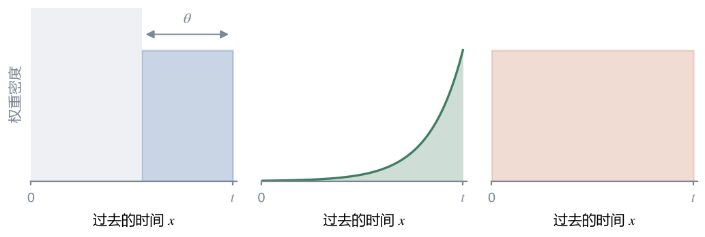

# 第 4 章 记忆问题的形式化：把"记住历史"变成一个优化问题

第 3 章结尾留下了一个悬案：$A$ 到底该取什么，才能让状态记住历史？

在 2020 年之前，人们是靠猜的：随机矩阵不行，那就试试正交矩阵；不行，再试试别的。LMU（Voelker 等, 2019）是一个例外，它从神经科学的一个脉冲模型里凑出了一个有用的一维记忆单元，但推导过程很绕，且难以推广。

HiPPO（Gu 等, 2020）走的是另一条路：先把"记忆"变成一个精确的数学优化问题，答案几乎是自动浮现的，就是函数逼近论里研究了一百多年的正交多项式。

要做的事有五件：

1. 说清楚"记忆"为什么可以等价于"在线函数逼近"。
2. 引入测度（measure）：它编码了"过去哪些时刻更重要"。
3. 说清楚正交多项式为什么是自然的基，以及"最优系数"如何写成闭式。
4. 把"随时间变化的最优投影"变成一个可在线更新的问题，也就是一个 ODE。
5. 给出三种测度的直觉：滑动窗口（LegT）、指数衰减（LagT）、缩放窗口（LegS）。

这里只建立框架，矩阵的推导放到第 5 章。

---

## 4.1 从"记忆"到"函数逼近"

### 先问一个看似幼稚的问题

什么叫"记住了过去"？

在 RNN 里，答案很技术性：隐状态 $h_t$ 是多少多少。但我们其实说不清"$h_t$ 里到底存了什么"。

HiPPO 的做法是先规定一个可检验的标准：如果我们能从状态里重建出过去的输入，就算记住了。

这个标准一出来，问题立刻变得清晰：

> 给定输入函数 $f(t)$ 在 $[0, t]$ 上的取值，我们要用固定 $N$ 个数字来表示它。怎么表示误差最小？

### 精确表述

记 $f_{\le t} := f(x)\big|_{x\le t}$ 为 $f$ 在 $t$ 时刻之前的部分。我们要找一个函数 $g^{(t)}$，用 $N$ 个数字表示，使 $g^{(t)} \approx f_{\le t}$。

关键问题是"$\approx$"是什么意思。这需要一个距离。HiPPO 采用最标准的做法：$L^2$ 距离，但带一个权重函数。

测度（measure）$\mu^{(t)}$ 是定义在 $(-\infty, t]$ 上的一个概率测度，它规定了"时刻 $s$ 的历史有多重要"。给定测度，定义内积

$$
\langle f, g\rangle_{\mu^{(t)}} = \int_{-\infty}^{t} f(x)\,g(x)\,d\mu^{(t)}(x),
$$

以及相应的范数 $\|f\|_{L^2(\mu^{(t)})} = \langle f,f\rangle^{1/2}$。所有平方可积的函数构成一个希尔伯特空间 $\mathcal{H}_\mu$。

于是"记住历史"这个模糊的目标，变成了一个精确的优化问题：

$$
g^{(t)} = \arg\min_{g \in \mathcal{G}} \left\| f_{\le t} - g \right\|_{L^2(\mu^{(t)})},
\tag{4.1}
$$

其中 $\mathcal{G}$ 是我们允许使用的函数子空间（$N$ 维，所以最多能存 $N$ 个数）。

### 为什么"最近的历史更重要"要用测度表达

一个直觉：你不可能对所有时间一视同仁。序列的"重要性"通常会随时间衰减（旧信息价值降低），也可能只关心最近的窗口。

于是不同选择对应不同的"记忆类型"：

| 测度 | 含义 | 类比 |
|---|---|---|
| $\mu^{(t)} = \frac{1}{\theta}\mathbb{I}_{[t-\theta,\,t]}$ | 只看最近 $\theta$ 长的固定窗口 | 滑动窗口 / 短期记忆 |
| $\mu^{(t)}(x) = e^{-(t-x)}\mathbb{I}_{(-\infty,t]}$ | 按指数衰减加权 | 短期记忆，越近越重 |
| $\mu^{(t)} = \frac{1}{t}\mathbb{I}_{[0,\,t]}$ | 对所有历史一视同仁，但窗口长度随时间增长 | 长期记忆，永不遗忘 |

前两个是经典的（分别对应 LMU 和早期 RNN 的做法），第三个是 HiPPO 新引入的，称为缩放测度（scaled measure），对应的方法叫 HiPPO-LegS（Scaled Legendre）。

用一张图来对比（横轴是时间，纵轴是权重）：

*图 4-1　三种测度的权重分布：固定窗口（LegT）、指数衰减（LagT）、随时间缩放的均匀权重（LegS）*

LegS 的设计动机很朴素：滑动窗口需要事先知道"该记多久"（超参数 $\theta$），而真实数据的时间尺度往往未知。把窗口设成 $[0,t]$（即"从开头到现在的全部历史，等权"），就完全不需要这个超参数了。

（严格地说，"等权"意味着远处的一个点和近处的一个点在损失函数里同等重要。这听起来有点奇怪：难道 1000 步之前的输入和刚才的输入一样重要吗？在"重建整个历史"这个目标下，答案就是重要。因为在 $L^2$ 意义下重建一段函数，本来就应该对所有时间点赋予相同的权重。至于"重要性随时间衰减"这件事，HiPPO 把它交给基函数去表达：多项式的系数天然是"越靠前的历史越难被高阶项拟合"，见后面 $\Theta(1/t)$ 的梯度界。）

---

## 4.2 为什么是正交多项式

### 正交多项式

对给定的测度 $\mu$，我们可以用 Gram–Schmidt 正交化从 $\{1, x, x^2, \dots\}$ 构造出一族正交多项式 $\{P_0, P_1, P_2, \dots\}$，满足

$$
\langle P_n, P_m\rangle_\mu = \delta_{nm}
$$

（若不做归一化则是 $\langle P_n, P_m\rangle = \gamma_n \delta_{nm}$）。不同的测度给出不同的族，这就是经典正交多项式家族的来源：

| 测度 | 正交多项式 | HiPPO 中的名字 |
|---|---|---|
| 均匀测度在 $[a,b]$ | Legendre（勒让德） | **LegT**、**LegS** |
| 指数衰减 $e^{-x}$ 在 $[0,\infty)$ | Laguerre（拉盖尔） | **LagT** |
| $1/\sqrt{1-x^2}$ 在 $[-1,1]$ | Chebyshev（切比雪夫） | （HiPPO 附录中给出） |
| 单位圆上的均匀测度 | Fourier（傅里叶） | HiPPO-FouT（附录） |

关键性质：最优系数可以直接写出来。设 $g^{(t)}$ 在正交基下展开为

$$
g^{(t)}(x) = \sum_{n=0}^{N-1} c_n(t)\,g_n^{(t)}(x),
$$

则最小化 (4.1) 的系数就是投影系数，有闭式：

$$
c_n(t) = \langle f_{\le t},\, g_n^{(t)}\rangle_{\mu^{(t)}} = \int f(x)\,g_n^{(t)}(x)\,d\mu^{(t)}(x).
$$

这就是为什么正交基"自然"：如果基不正交，解最优系数要解一个 $N\times N$ 的线性方程组（Gram 矩阵求逆）；正交的话，直接内积就行。

$c_n(t)$ 是一个纯粹的内积，里面没有 $f$ 的导数、没有 $f$ 的非线性函数，只需要 $f$ 本身。这一点在推导 ODE 时要用到：最终答案会是一个线性 ODE，形如

$$
\frac{d}{dt}c(t) = A(t)\,c(t) + B(t)\,f(t),
$$

其中 $c(t) = (c_0(t),\dots,c_{N-1}(t))^\top$ 恰好就是 SSM 的状态 $x(t)$，而 $A(t), B(t)$ 就是前面一直在找的那两个矩阵。

HiPPO 的整个技术内容可以压成一句：

> **把"最优记忆"写成一个 ODE，这个 ODE 就是一个 SSM。**

$A$ 的最优取值不再需要发明，它是推导出来的。

### 一个具体的例子：Legendre 多项式

为了不让讨论太抽象，先把 Legendre 多项式的性质摆出来（细节与更完整的推导在[附录 A](../appendix/appA.md)）。定义在 $[-1,1]$ 上、关于均匀测度正交：

$$
\int_{-1}^{1} P_n(x)P_m(x)\,dx = \frac{2}{2n+1}\delta_{nm},
\qquad P_0 = 1,\ P_1 = x,\ P_2 = \frac{3x^2-1}{2},\dots
$$

并且满足端点条件 $P_n(1) = 1$、$P_n(-1) = (-1)^n$。

把它们平移到区间 $[0,t]$ 上就得到"缩放 Legendre 多项式" $P_n(2x/t - 1)$，它们关于测度 $\mathbb{I}_{[0,t]}/t$ 正交。归一化之后（乘上 $\sqrt{2n+1}$）就是 HiPPO-LegS 使用的基：

$$
g_n^{(t)}(x) = (2n+1)^{1/2}\,P_n\!\left(\frac{2x}{t} - 1\right).
\tag{4.2}
$$

在 HiPPO-LegS 里，$g_n$ 显式依赖于 $t$（因为区间在缩放），这个 $t$ 依赖正是推导中出现 $\frac{1}{t}$ 因子（以及最终 $A$ 矩阵里那些 $O(1)$ 系数）的原因。这一点是理解 LegS 推导的关键，第 5 章会看到。

---

## 4.3 在线更新：从静态最优到动态系统

### 问题在哪

(4.1) 说的是：在每个 $t$ 上求一次最优投影。这看起来不可行：难道每一步都要做一次积分？而且 $t$ 变大时，测度 $\mu^{(t)}$ 也在变（窗口在移动 / 在缩放），最优系数的定义都会变。

HiPPO 的破解方式是：不直接算 $c_n(t)$，而是算 $c_n(t)$ 的导数。因为内积是对 $x$ 积分的，而 $t$ 出现在积分限、测度和基函数三个地方，用 Leibniz 法则求导之后，往往能把 $\frac{d}{dt}c_n(t)$ 表示为 $(c_k(t))_{k}$ 的线性组合加上一个 $f(t)$ 的项。于是我们得到一个线性 ODE：

$$
\boxed{\ \frac{d}{dt}c(t) = -A(t)\,c(t) + B(t)\,f(t)\ }
\tag{4.3}
$$

（HiPPO 论文里写成 $-A c + B f$，负号只是为了后面 $A$ 的对角元为正数、方便阅读；符号约定不影响内容。）

这个 ODE 就是记忆的动力学：给定当前的记忆 $c(t)$ 和刚刚到来的新输入 $f(t)$，记忆该如何演化。

### 推导的一般套路

虽然具体推导要到第 5 章，但套路现在就可以讲清楚。设基函数 $g_n(t, x)$、测度 $\omega(t, x)$（$\omega$ 是 $d\mu^{(t)}/dx$ 的密度）。则

$$
c_n(t) = \int f(x)\, g_n(t,x)\, \omega(t,x)\, dx .
$$

对 $t$ 求导（$f$ 不显含 $t$，因为 $f$ 是在固定时刻采样得到的输入函数）：

$$
\frac{d}{dt}c_n(t) = \int f(x)\left[\frac{\partial}{\partial t}g_n(t,x)\right]\omega(t,x)\,dx
+ \int f(x)\,g_n(t,x)\left[\frac{\partial}{\partial t}\omega(t,x)\right]dx
=: \text{(I)} + \text{(II)}.
$$

接下来的工作分三步：

- 第一步：把 (I) 写成 $c$ 的线性组合。关键是用 Legendre 多项式的导数递推关系，把 $\partial_t g_n$ 展开成 $g_n, g_{n-1}, \dots$ 的线性组合（每一项会带一个 $1/t$ 或 $1/\theta$ 的因子）。做完这一步，(I) 就变成了 $\sum_k A_{nk}c_k$ 的形式。
- 第二步：处理 (II)。测度的导数通常是一个 $\delta$ 函数（因为 $d\mu^{(t)}/dx$ 在移动的边界处会跳变）。例如对 LegS 有

$$
\frac{\partial}{\partial t}\omega(t,\cdot) = -t^{-2}\mathbb{I}_{[0,t]} + t^{-1}\delta_t = t^{-1}\left(-\omega(t) + \delta_t\right).
$$

这里第一项又回到 $\omega$ 本身（于是贡献 $-\frac{1}{t}c_n$），第二项是 $\delta_t$，积分后直接给出 $f(t)\,g_n(t,t)$，这就是 $B_n f(t)$ 项的来源。

- 第三步：把两边合并，得到 (4.3)。

整个过程只用到了两样东西：基函数的导数递推和测度的导数。HiPPO 说它给了一个"统一的框架"，正是指这一点：换一个测度/基，只是换掉这两块内容，套路完全一样。

### 从连续到离散

有了 (4.3)，剩下的就是标准的 ODE 离散化（第 2 章的工具）。以最简单的欧拉为例，把时间离散成 $k\Delta$：

$$
c_{k+1} = c_k + \Delta\left(-A c_k + B f_k\right) = (I - \Delta A)c_k + \Delta B f_k .
$$

于是我们又回到了一个标准的离散 SSM：$x_k = \bar A x_{k-1} + \bar B u_k$，其中 $\bar A = I - \Delta A$、$\bar B = \Delta B$。（HiPPO 论文的式 (4) 就是 LegS 的这个特例，见第 5 章。）

至此闭环完成：从"最优记忆"出发，推导出了 $A$ 应该是什么，并且这套东西天然就是一个 SSM 层。

---

## 4.4 一个惊人的副产品：门控就是"只用一阶多项式"

HiPPO 框架还有一个副产品：把 $N$ 降到 1，它会退化成经典的 RNN 门控。

以 HiPPO-LagT 为例（第 5 章会给出它的矩阵），当 $N=1$ 时 $A = B = 1$，于是离散更新是

$$
c(t+\Delta) = c(t) + \Delta\left(-c(t) + f(t)\right) = (1-\Delta)c(t) + \Delta f(t).
$$

再看 GRU 的更新公式：

$$
h_t = (1 - z_t)h_{t-1} + z_t \tilde{h}_t, \qquad z_t = \sigma(\cdot).
$$

这两者形式完全一致。只要令 $\Delta = z_t$、$f(t) = \tilde{h}_t$、$c = h$，它们就是同一个东西。

这个等价关系有几层含义：

- 门控 RNN 的"遗忘门"在这个视角下就是离散化步长 $\Delta$（第 2.4 节已经暗示过）。
- 门控 RNN 是"用 $H$ 个一维记忆单元、每个只做一阶多项式投影"的模型；而 HiPPO 是"用 $1$ 个 $N$ 维记忆单元、做高阶多项式投影"的模型。两者在"总容量"上可以等价，但在结构上截然不同。前者靠 3.1 节的那种"很多通道各自记忆"的方式；后者靠"一个通道做高阶记忆"。
- LSTM/GRU 是从 HiPPO 的框架里"掉出来"的一个特例，只不过历史先发现了它。门控在过去二十年如此有效，是因为它确实在做一件正确的事，只是没有理论指导，做得不系统。

这个连接还有一个实际后果：它让 Mamba 在一年后能够说"选择性机制不是凭空发明的，它是把 $\Delta$ 从常数变成输入的函数"，从而与门控理论接上（第 18 章 Theorem 1）。

---

## 4.5 三种测度，三条路

HiPPO 论文给了多个具体实例。本书会详细讲三个（第 5 章给出完整推导）：

LegT（Translated Legendre，平移勒让德）：测度是在 $[t-\theta, t]$ 上的均匀分布。推导它的结果是精确复现了 LMU 的更新公式，也就是说，HiPPO 让 LMU 这个"从神经科学凑出来"的方法第一次有了第一性原理的推导。（LMU 是 Voelker 等人 2019 年的工作，是所有 SSM 中的先驱。）

但 LegT 有一个内在缺陷需要在推导中处理：滑动窗口意味着当前状态本该包含 $f(t-\theta)$ 这个即将滑出窗口的值，而这个值已经不可得了。所以 LegT 的推导必须额外假设"用当前的重建近似代替 $f(t-\theta)$"。这是它精度上的一个额外误差源，也是它必须依赖窗口长度超参数 $\theta$ 的原因。

LagT（Translated Laguerre，平移拉盖尔）：测度是指数衰减 $e^{-(t-x)}\mathbb{I}_{(-\infty,t]}$。它比 LegT 更"平滑"（不需要突然丢弃窗口末尾的值），但引入了另一个超参数：衰减率。LagT 在 HiPPO 论文里表现不错，但同样需要调 $\Delta$。

LegS（Scaled Legendre，缩放勒让德）：测度是 $\frac{1}{t}\mathbb{I}_{[0,t]}$。它是 HiPPO 的新贡献，也是 S4 使用的那一个。它的好处：

1. 无超参数：窗口自动缩放到 $[0,t]$，不需要指定 $\theta$ 或衰减率。
2. 时间尺度等变（timescale equivariance）：把输入 $f(t)$ 换成 $f(\alpha t)$，输出系数不变（只差一个时间重参数化）。这意味着训练时用什么采样率、测试时换成 2 倍采样率，模型不需要重训。这是 LSSL 与 S4 的"分辨率不变性"实验的理论基础。
3. 有 $\Theta(1/t)$ 的梯度下界（不会指数级丢梯度）和有界的近似误差。

第 6 章会把这些性质逐一说明。

---

## 4.6 本章小结

- HiPPO 把"记忆"重新定义为"在线函数逼近"：用 $N$ 个数字表示整段历史 $f_{\le t}$，使得在某个测度下的 $L^2$ 误差最小。
- 测度 $\mu^{(t)}$ 编码"过去的哪些时刻更重要"。三种关键选择：固定滑动窗口（LegT）、指数衰减（LagT）、随时间缩放的均匀权重（LegS）。
- 正交多项式是自然的基：最优系数有闭式（就是内积投影），无需解线性方程组。
- 通过对投影系数求导，可以得到一个线性 ODE：$\frac{d}{dt}c(t) = -A(t)c(t) + B(t)f(t)$，其中 $c(t)$ 就是 SSM 的状态，$A, B$ 就是我们要找的矩阵。
- 最优记忆动力学本身就是一个 SSM，$A$ 不是发明出来的，是推导出来的。
- 副产品：$N=1$ 时 HiPPO **退化为 RNN 门控**，说明 LSTM/GRU 是这个框架的特例。
- 三个实例：LegT（复现 LMU，需窗口超参数 $\theta$，有滑动近似误差）、LagT（指数衰减）、LegS（无超参数、时间尺度等变、梯度有下界，是 S4 的选择）。

## 下一章

第 5 章会做真正的推导：把上面那个"求导 → 展开基函数 → 处理测度导数 → 合并"的套路，对 LegT、LagT、LegS 各走一遍，并给出最终的矩阵形式。如果你只想看函数逼近的部分，可以从第 5 章开始读 LegS 那一小节，然后直接跳到第 6 章。
