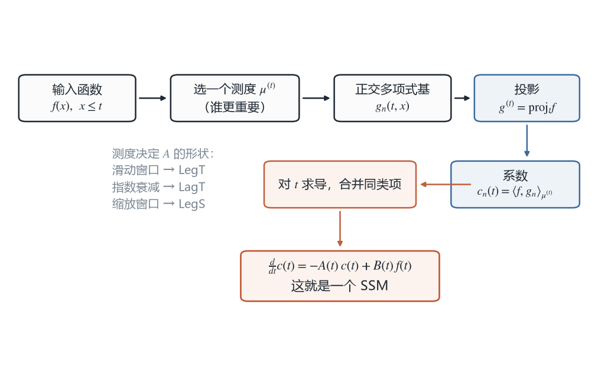

# 第 5 章 HiPPO 框架与三个具体推导

上一章我们把"记忆"变成了一个优化问题，并说明了答案应该是一个线性 ODE：

$$
\frac{d}{dt}c(t) = -A(t)c(t) + B(t)f(t).
$$

现在到了动真格的时候：这个 $A$ 和 $B$ 具体长什么样？

HiPPO 的通用推导公式只有一条式子，适用于任意测度与任意多项式基。用它依次推导三种测度：

- LegT（平移 Legendre）：推导结果精确复现 LMU，把那个从神经科学里凑出来的模型变成了一条定理。
- LagT（平移 Laguerre）：推导结果是一个下三角的"全 1 矩阵"，结构极简。
- LegS（缩放 Legendre）：推导稍复杂（因为基和测度都在随时间缩放），但换来的是"没有超参数"和"时间尺度等变"。这一条是 S4 的选择，也是本章的重点。

目标是看懂 S4 论文式 (2) 那个看起来很吓人的矩阵，知道它的每一行每一列从哪来。

阅读建议：如果你只想理解"为什么 HiPPO 有用"，读完 5.1 节和第 5.6 节即可；推导细节可以跳过。但如果你打算真正搞明白 S4 的数学，请把 5.4 节（LegS）读两遍。

---

*图 5-1　HiPPO 的推导路线：选测度与基，把函数投影成系数，再对时间求导、合并同类项，得到关于系数的线性 ODE*

## 5.1 通用推导公式

先把上一章的框架形式化一点，然后给出那条关键式子。

### 记号

- 测度 $\mu^{(t)}$，密度 $\omega(t,x) = d\mu^{(t)}/dx$。
- 基函数 $g_n(t,x)$，正交但不一定归一化：$\langle g_n,g_m\rangle_{\mu^{(t)}} = \lambda_n^2\delta_{nm}$。为简化，下面假设 $\lambda_n = 1$（即基是标准正交的），并在需要时说明 $\lambda_n$ 的作用。
- 系数

$$
c_n(t) = \langle f_{\le t}, g_n(t,\cdot)\rangle_{\mu^{(t)}} = \int f(x)\,g_n(t,x)\,\omega(t,x)\,dx .
$$

- HiPPO 论文还引入了一个"倾斜"（tilting）技巧：取一个缩放函数 $\chi(t,x)$，用基 $\{p_n\chi\}$ 配测度 $\omega/\chi^2$。这是为了让某些测度（如 Laguerre）的推导变得更整洁。本书不展开，只在下面对 LagT 的结果处提一句。

### 关键积分恒等式

对 $c_n(t)$ 关于 $t$ 求导。$f$ 本身不显含 $t$（它是"已经观测到的历史"，是一个固定函数），而 $t$ 出现在三个地方：积分区域、测度密度 $\omega$、基函数 $g_n$。用乘积法则：

$$
\frac{d}{dt}c_n(t)
= \underbrace{\int f(x)\,\frac{\partial g_n}{\partial t}(t,x)\,\omega(t,x)\,dx}_{(\mathrm I)}
+ \underbrace{\int f(x)\,g_n(t,x)\,\frac{\partial \omega}{\partial t}(t,x)\,dx}_{(\mathrm{II})}.
\tag{5.1}
$$

（积分区域的变化被 $\omega$ 在边界的跳变吸收进 $(\mathrm{II})$ 里了，因为 $\omega$ 是概率密度、在定义域外为零。）

**(5.1) 是 HiPPO 的全部技术核心**，后面所有推导都只是在计算这两项。

### 处理 (I) 和 (II) 的一般方法

处理 (I)：$\partial_t g_n$ 是一个关于 $x$ 的、次数为 $n$ 的多项式（因为 $g_n$ 是 $n$ 次多项式，对 $t$ 求导会降一次）。任何 $n$ 次多项式都可以写成 $\{g_0,\dots,g_n\}$ 的线性组合，所以可以写

$$
\frac{\partial g_n}{\partial t}(t,x) = \sum_{k=0}^{n} \alpha_{nk}(t)\, g_k(t,x) .
$$

代回 (I)：

$$
(\mathrm I) = \sum_{k} \alpha_{nk}(t)\int f g_k \omega\,dx = \sum_k \alpha_{nk}(t)\, c_k(t).
$$

这就是线性 ODE 的第一部分：$A$ 矩阵的第 $n$ 行。它只依赖 $c$ 的低阶项（$k\le n$），所以 $A$ 是上三角或下三角的（取决于指标排列）。这个"下三角"性质在 Mamba-2 里直接对应"因果掩码"，也对应半可分矩阵的定义（第 22 章）。

处理 (II)：$\partial_t\omega$ 通常可以写成"$\omega$ 本身 + 边界处的 $\delta$ 函数"的线性组合。例如

$$
\frac{\partial \omega}{\partial t} = -\gamma(t)\,\omega + \eta(t)\,\delta_t + \dots
$$

- "$\omega$ 本身"这一项代回后又是 $\int f g_n \omega = c_n$，于是贡献 $-\gamma(t)c_n(t)$，这落在 $A$ 的对角线上。
- "$\delta_t$"这一项代回后积分直接给出 $f(t)g_n(t,t)$，即当前输入乘一个数，这就是 $B_n f(t)$ 项的来源。
- 如果还有别的边界（如 LegT 的 $t-\theta$），就会多出一个 $f(t-\theta)$ 项，需要额外处理（见 5.2）。

这套"三步走"（求基函数导数 → 求测度导数 → 合并）对任何测度都适用。下面逐个执行。

### 三条递推的来历

三个推导反复要用三条式子，它们全部来自 Legendre 多项式的两个基本关系（论文附录 B.1.1）：

$$
(2n+1)P_n=P'_{n+1}-P'_{n-1},\qquad P'_{n+1}=(n+1)P_n+xP'_n .
\tag{5.1a}
$$

第一条把 $n$ 换成 $n-1$ 得 $(2n-1)P_{n-1}=P'_n-P'_{n-2}$，再换成 $n-3$ 得 $(2n-5)P_{n-3}=P'_{n-2}-P'_{n-4}$，一路写下去，相邻项两两抵消，只剩首尾两项：

$$
(2n-1)P_{n-1}+(2n-5)P_{n-3}+(2n-9)P_{n-5}+\cdots=P'_n-P'_{n-2k} .
\tag{5.1b}
$$

尾项 $P'_{n-2k}$ 在下标降到 $0$ 或 $1$ 时停住，而 $P'_0=0$、$P'_1=1=P_0$，两个值都不会给右端添东西。所以右端就是 $P'_n$。取 $n=3$ 验一下：左边 $5P_2+P_0=(15x^2-5)/2+1=(15x^2-3)/2$，右边 $P'_3$ 也是这个。

第二条与 (5.1b) 合用，能给出 LegS 需要的那一条。由 $xP'_n=P'_{n+1}-(n+1)P_n$，

$$
(x+1)P'_n=P'_{n+1}+P'_n-(n+1)P_n .
$$

把 (5.1b) 用在 $P'_n$ 上、把 $n$ 换成 $n+1$ 用在 $P'_{n+1}$ 上，两个求和合并后

$$
(x+1)P'_n=nP_n+(2n-1)P_{n-1}+(2n-3)P_{n-2}+(2n-5)P_{n-3}+\cdots .
\tag{5.1c}
$$

$P_n$ 的系数变成 $n$，因为 $(2n+1)-(n+1)=n$；其余 $P_k$（$k<n$）的系数都是 $2k+1$。取 $n=2$：左边 $3x(x+1)=3x^2+3x$，右边 $2P_2+3P_1+P_0=(3x^2-1)+3x+1$，对上。

归一化之后 $g_n=(2n+1)^{1/2}P_n$，而 $2k+1$ 恰好等于 $(2k+1)^{1/2}(2k+1)^{1/2}$。LegS 矩阵里那个 $\sqrt{(2n+1)(2k+1)}$ 就是从这里来的。

Laguerre 那边只需要一条（论文附录 B.1.2）：

$$
\frac{d}{dz}L_n^{(\alpha)}(z)=-L_{n-1}^{(\alpha+1)}(z),\qquad L_n^{(\alpha+1)}(z)=\sum_{i=0}^{n}L_i^{(\alpha)}(z) .
$$

两条串起来得 $\frac{d}{dz}L_n^{(\alpha)}=-\sum_{i<n}L_i^{(\alpha)}$。代入 $z=t-x$，对 $t$ 求导不变号：

$$
\frac{\partial}{\partial t}L_n^{(\alpha)}(t-x)=-\sum_{i<n}L_i^{(\alpha)}(t-x) .
\tag{5.1d}
$$

每一项系数都是 $-1$，这就是 LagT 那个全 1 下三角的出处。Legendre 的 (5.1b) 只取 $n-1,n-3,\dots$ 这些下标，所以 LegT 的 $(\mathrm I)$ 项只填隔行；LegS 用的是 (5.1c)，它把所有 $k<n$ 都填上。

整节推导里没有出现 $\Delta$。它直到 5.5 节离散化才第一次进来，而且只以乘积 $\Delta A$、$\Delta B$ 的形式。这不是省略：连续时间的 $A$ 与采样率无关，采样率只影响你多快地把 ODE 走完。第 6 章的时间尺度等变就建立在这个分离上。

---

## 5.2 LegT：滑动窗口与 LMU 的重新发现

### 设置

测度：固定长度 $\theta$ 的滑动窗口，均匀权重

$$
\omega(t,x) = \frac{1}{\theta}\mathbb{I}_{[t-\theta,\,t]}(x).
$$

基：把 Legendre 多项式平移到 $[t-\theta,t]$ 上：

$$
p_n(t,x) = (2n+1)^{1/2}\,P_n\!\left(\frac{2(x-t)}{\theta}+1\right).
$$

变量替换 $2(x-t)/\theta + 1$ 把 $x = t-\theta$ 映到 $-1$、$x=t$ 映到 $+1$，正是 Legendre 多项式的标准区间。端点值为

$$
p_n(t,t) = (2n+1)^{1/2},\qquad p_n(t,t-\theta) = (-1)^n(2n+1)^{1/2}.
$$

### 两个导数

测度的导数：窗口在滑动，左端丢掉一个点、右端增加一个点，

$$
\frac{\partial \omega}{\partial t} = \frac{1}{\theta}\delta_t - \frac{1}{\theta}\delta_{t-\theta}.
$$

基函数的导数：由于 $p_n$ 通过 $z = 2(x-t)/\theta+1$ 依赖 $t$，有 $\partial_t z = -2/\theta$，再用 Legendre 的导数递推 $P_n'(z) = (2n-1)P_{n-1}(z) + (2n-5)P_{n-3}(z)+\cdots$（只保留与 $n$ 同奇偶的项）：

$$
\frac{\partial p_n}{\partial t} = -\frac{2}{\theta}(2n+1)^{1/2}\Big[(2n-1)^{1/2}p_{n-1} + (2n-5)^{1/2}p_{n-3}+\cdots\Big].
$$

### 合并

把两项代入 (5.1)，经过整理（细节见 HiPPO 论文附录 D.1），得到

$$
\frac{d}{dt}c(t) = -A c(t) + B f(t),
$$

$$
\boxed{\
A_{nk} = \frac{1}{\theta}\begin{cases}
(-1)^{n-k}(2n+1) & n \ge k\\[2pt]
(2n+1) & n < k
\end{cases}
\qquad
B_n = \frac{1}{\theta}(2n+1)(-1)^n
\ }
\tag{5.2}
$$

（5.2）就是 LMU 的更新公式。HiPPO 论文明确指出："Equation (1) proves the LMU update [71, equation (1)]." 也就是说，Voelker 等人 2019 年从一个神经科学启发式模型里凑出来的公式，在这里被一条定理重新发现了。

### 但 LegT 有一个隐藏的近似

处理 $(\mathrm{II})$ 里的 $-\frac{1}{\theta}\delta_{t-\theta}$ 时会冒出一个 $f(t-\theta)$ 项：当前系数 $c(t)$ 的演化，依赖于一个已经滑出窗口、因此不可得的历史值。

HiPPO 的处理方式是：用当前的重建来估计它。因为我们已经有了 $f_{\le t}$ 的多项式近似，把 $x = t-\theta$ 代进去：

$$
f(t-\theta) \approx \sum_{k<N} c_k(t)\,(2k+1)^{1/2}(-1)^k .
$$

这是一个额外误差源（论文称之为 "another source of approximation"）。代价是：LegT 在滑动窗口边缘处的重建质量会退化，而且这个近似的好坏依赖于窗口长度 $\theta$ 选得对不对。

这解释了为什么 LegT 必须有一个超参数 $\theta$，且对 $\theta$ 很敏感：HiPPO 论文的消融显示，$p$MNIST 上 $\theta=200$ 时验证准确率 98.0%，$\theta=20$ 时掉到 91.75%。这不是调参问题，而是"窗口长度必须匹配数据的时间尺度"这个结构性缺陷。

### 把两项摊开算

取 $\lambda_n=1$（标准正交基），$g_n=(2n+1)^{1/2}p_n$。

$(\mathrm I)$ 用 (5.1b)。把 $(2n-1)P_{n-1}$ 写成 $(2n-1)^{1/2}g_{n-1}$，逐项整理：

$$
(\mathrm I)=-\frac{2}{\theta}(2n+1)^{1/2}\Big[(2n-1)^{1/2}c_{n-1}+(2n-5)^{1/2}c_{n-3}+\cdots\Big].
$$

注意求和只跑 $n-1,n-3,n-5,\dots$，下标与 $n$ 差奇数。

$(\mathrm{II})$ 有两项，分别来自 $\delta_t$ 与 $\delta_{t-\theta}$：

$$
(\mathrm{II})=\frac{1}{\theta}f(t)g_n(t,t)-\frac{1}{\theta}f(t-\theta)g_n(t,t-\theta)
=\frac{1}{\theta}(2n+1)^{1/2}f(t)-\frac{1}{\theta}(2n+1)^{1/2}(-1)^nf(t-\theta).
$$

$f(t-\theta)$ 已经滑出窗口，用重建代替（同样取 $\lambda=1$）：

$$
f(t-\theta)\approx\sum_{k<N}(2k+1)^{1/2}(-1)^kc_k(t).
$$

代回：

$$
(\mathrm{II})=\frac{1}{\theta}(2n+1)^{1/2}f(t)-\frac{1}{\theta}(2n+1)^{1/2}\sum_{k<N}(-1)^{n-k}(2k+1)^{1/2}c_k(t).
$$

合并的读法只有两种情形。$k=n-2j-1$（与 $n$ 差奇数）时，$(\mathrm I)$ 给 $2(2k+1)^{1/2}$，$(\mathrm{II})$ 给 $(-1)^{n-k}(2k+1)^{1/2}=-(2k+1)^{1/2}$，相加剩 $1$ 倍。$k$ 与 $n$ 同奇偶时 $(\mathrm I)$ 不给，$(\mathrm{II})$ 给 $+1$ 倍。两种情形结果一样。于是

$$
\frac{d}{dt}c_n(t)=-\frac{1}{\theta}(2n+1)^{1/2}\Big[\sum_{k\le n}(2k+1)^{1/2}c_k(t)+\sum_{k>n}(-1)^{n-k}(2k+1)^{1/2}c_k(t)\Big]+\frac{1}{\theta}(2n+1)^{1/2}f(t),
$$

写成 $A_{nk}=\frac{1}{\theta}(2n+1)^{1/2}(2k+1)^{1/2}M_{nk}$，那个 $M$ 就是

$$
M_{nk}=\begin{cases}1 & k\le n\\ (-1)^{n-k} & k>n\end{cases}
$$

这正是论文附录 D.1 的 $M$。$N=3$、$\theta=1$、$\lambda=1$：

$$
M=\begin{pmatrix}1&-1&1\\ 1&1&-1\\ 1&1&1\end{pmatrix},\qquad
A=\frac{1}{\theta}DMD=\frac{1}{\theta}\begin{pmatrix}1&-\sqrt3&\sqrt5\\ \sqrt3&3&-\sqrt{15}\\ \sqrt5&\sqrt{15}&5\end{pmatrix},\qquad
B=\frac{1}{\theta}\begin{pmatrix}1\\ \sqrt3\\ \sqrt5\end{pmatrix},
$$

其中 $D=\mathrm{diag}(1,\sqrt3,\sqrt5)$。换成 LMU 用的 $\lambda_n=(2n+1)^{1/2}(-1)^n$，同一个推导给

$$
A=\frac{1}{\theta}\begin{pmatrix}1&1&1\\ -3&3&3\\ 5&-5&5\end{pmatrix},\qquad
B=\frac{1}{\theta}\begin{pmatrix}1\\ -3\\ 5\end{pmatrix}.
$$

两版只差一个对角相似变换，动力学等价。第二版看着更整齐，代价是幅值随 $n$ 增长、符号跟着 $(-1)^{n-k}$ 跳。

这个 $A$ 是满矩阵，上三角不为零。只有 $(\mathrm I)$ 项是隔行的双对角结构，完整矩阵被滑动边界项填满了。

上三角非零不只是“形状不干净”，它有物理含义：$A_{nk}\ne0$（$k>n$）意味着第 $n$ 个系数的变化受更高阶系数影响。窗口一滑，一个高阶多项式的形状整体变形，它在低阶模态上的投影也跟着变，高阶就把信息“漏”回了低阶。LegS 没有这个问题，它是严格下三角，第 $n$ 个系数只依赖 $c_0,\dots,c_n$。三角性决定因果性，第 22 章定义半可分矩阵时直接用上了这个结构。

---

## 5.3 LagT：指数衰减与一个全 1 的下三角矩阵

测度：指数衰减，越近的历史权重越大

$$
\omega(t,x) = e^{-(t-x)}\mathbb{I}_{(-\infty,\,t]}(x).
$$

基：Laguerre 多项式 $L_n(t-x)$，配合"倾斜"（tilting）技巧使推导整洁。HiPPO 论文给了带两个自由参数 $\alpha,\beta$ 的广义版本，其一般结果是

$$
A = \begin{pmatrix}
\frac{1+\beta}{2} & & & \\[2pt]
1 & \frac{1+\beta}{2} & & \\[2pt]
\vdots & \ddots & \ddots & \\[2pt]
1 & \cdots & 1 & \frac{1+\beta}{2}
\end{pmatrix},
\qquad
B_n \propto \binom{n+\alpha}{n}.
$$

（原论文式 (24)、(25)，$\Lambda$ 是归一化对角阵。）取最简单的情形，就得到 HiPPO 论文正文 Theorem 1 里的形式：

$$
\boxed{\
A_{nk} = \frac{1}{\theta}\begin{cases} 1 & n\ge k\\ 0 & n<k\end{cases}
\qquad B_n = 1
\ }
\tag{5.3}
$$

得到的矩阵是**一个全 1 的下三角**。它对应的动力学是什么？把 $N=3$ 写出来：

$$
\dot c_0 = -c_0 + f, \qquad
\dot c_1 = -c_0 - c_1 + f, \qquad
\dot c_2 = -c_0 - c_1 - c_2 + f .
$$

即"每个高阶系数都在累积所有低阶系数"，同时每一个都受同一个衰减约束。这恰好是"用拉盖尔基逼近一个指数衰减窗口"的自然结构。

### 从倾斜到全 1 下三角

论文附录 D.2 的中间步骤值得看一眼，它演示了倾斜到底在做什么。

测度与基配对：$\omega=(t-x)^\alpha e^{-(t-x)}$，基 $p_n=\frac{\Gamma(n+1)^{1/2}}{\Gamma(n+\alpha+1)^{1/2}}L_n^{(\alpha)}(t-x)$。倾斜函数取

$$
\chi=(t-x)^\alpha\exp\!\Big(-\frac{1-\beta}{2}(t-x)\Big),
$$

归一化常数 $\zeta=\Gamma(1-\alpha)\beta^{\alpha-1}$ 与 $t$ 无关，正好满足框架对 $\zeta$ 的要求。密度比立刻变简单：

$$
\frac{\omega}{\chi}=\exp\!\Big(-\frac{1+\beta}{2}(t-x)\Big),\qquad
\frac{\partial}{\partial t}\frac{\omega}{\chi}=-\frac{1+\beta}{2}\frac{\omega}{\chi}+\delta_t .
$$

第一项是"自身乘常数"，第二项是 $\delta_t$。这就是倾斜的全部作用：把测度导数从"不能闭合"变成"能闭合"，代价是 $\beta$ 跑到了对角线上。

代回 (5.1)。$(\mathrm I)$ 项用 (5.1d)，每个 $\partial_tL_i^{(\alpha)}$ 贡献 $-1$，于是 $(\mathrm I)=-\sum_{k<n}c_k(t)$。$(\mathrm{II})$ 的两项分别给 $-\frac{1+\beta}{2}c_n$ 和 $\zeta^{-1/2}L_n^{(\alpha)}(0)f(t)$，而 $L_n^{(\alpha)}(0)=\binom{n+\alpha}{n}$（论文式 (10)）。合起来

$$
\frac{d}{dt}c_n(t)=-\sum_{k<n}c_k(t)-\frac{1+\beta}{2}c_n(t)+\zeta^{-1/2}\binom{n+\alpha}{n}f(t).
$$

$B_n$ 里那个组合数就来自端点值 $L_n^{(\alpha)}(0)$，不是额外假设。

取 $\alpha=0,\beta=1$：$\zeta=\Gamma(1)\cdot1^{0}=1$，$\frac{1+\beta}{2}=1$，$\binom{n}{n}=1$，于是 $A$ 是"下三角全 1、对角也 1"，$B_n=1$，回到 (5.3)。$N=3$ 写全：

$$
A=\begin{pmatrix}1&0&0\\ 1&1&0\\ 1&1&1\end{pmatrix},\qquad B=\begin{pmatrix}1\\ 1\\ 1\end{pmatrix}.
$$

这个矩阵有一个用起来很舒服的性质：$A-I$ 是严格下三角的全 1 矩阵，三次幂为零。于是

$$
e^{tA}=e^{t}\Big(I+(A-I)+\tfrac{1}{2}(A-I)^2\Big)
$$

只有三项，核 $K(t)=Ce^{tA}B$ 是"指数乘二次多项式"，有精确闭式。早期 SSM 愿意用 LagT，结构简单是主因。

LagT 的代价：它也有一个超参数，衰减率（上式里被归一化成 1，实际上对应一个可调的时间尺度，等价于 $\Delta$）。它没有 LegT 那种"窗口边缘丢弃"的问题（指数衰减是平滑的），但仍然需要事先知道"该记多久"。

### 一个事后才查出的坑

后续工作把各个变体的基函数与测度重算了一遍，发现原始 LagT 实际正交的不是 $e^{-(t-x)}$ 那个测度，而是常数测度 $\mathbb I_{[0,\infty)}$，对应的时间尺度是 $\infty$。原因在倾斜那一步：测度被换成 $\omega/\chi^2$，而重构公式里的 $\zeta^{1/2}$ 因子没把基换回来。

后果很具体。在 permuted MNIST 上，其他 HiPPO 方法的 $\Delta$ 取到 $1/784$ 附近最优（与理论预测一致），LagT 要取到 $\Delta=1.0$ 才好。同一份数据，步长差三个数量级。

这就解释了为什么“把拖尾率归一化成 1”不只是一种记号选择：LagT 的时间尺度本来就落在无穷上，任何有限的 $\Delta$ 都在补这个错位。后续工作给的结论很直接：不推荐使用原始 LagT；想要指数衰减又不丢信息，用 LegS（把它看成时不变系统时，它恰好正交于一个指数衰减的测度）。

---

## 5.4 LegS：缩放测度（本章重点）

### 设置

测度：对所有历史一视同仁，但窗口的右端点随时间移动（窗口在"拉长"）

$$
\omega(t,x) = \frac{1}{t}\mathbb{I}_{[0,\,t]}(x).
$$

$\int_0^t \frac{1}{t}dx = 1$，所以它确实是一个概率密度。

基：把 Legendre 多项式缩放到 $[0,t]$ 上并标准正交化：

$$
g_n(t,x) = p_n(t,x) = (2n+1)^{1/2} P_n\!\left(\frac{2x}{t} - 1\right).
\tag{5.4}
$$

（验证一下正交性：做变量替换 $y = 2x/t-1$，$dx = \frac{t}{2}dy$，于是

$$
\int_0^t g_n g_m \frac{dx}{t} = \frac{2n+1}{2}\int_{-1}^1 P_n(y)P_m(y)dy = \delta_{nm}.
$$

正好。）

端点值特别简单：$g_n(t,t) = (2n+1)^{1/2}P_n(1) = (2n+1)^{1/2}$，$g_n(t,0) = (2n+1)^{1/2}(-1)^n$。

### 两个导数

测度的导数（这是 LegS 推导的关键一步）：

$$
\frac{\partial}{\partial t}\left(\frac{1}{t}\mathbb{I}_{[0,t]}\right)
= -\frac{1}{t^2}\mathbb{I}_{[0,t]} + \frac{1}{t}\delta_t
= \frac{1}{t}\left(-\omega(t) + \delta_t\right).
\tag{5.5}
$$

这两个部分分工明确：

- $-\frac{1}{t}\omega(t)$：整体权重的缩放。因为窗口在变长，原来每个点占的权重 $1/t$ 在变小。这一项会贡献 $A$ 的对角线。
- $\frac{1}{t}\delta_t$：新信息的注入点。它贡献 $B_n f(t)$。因子 $1/t$ 的后果是：随着时间推移，新输入对系数的影响按 $1/t$ 衰减。这是"缩放窗口"的自然结果：历史越长，单个新点越不重要。

基函数的导数：设 $z = 2x/t - 1$，则 $\partial_t z = -2x/t^2 = -(z+1)/t$（因为 $z+1 = 2x/t$）。于是

$$
\frac{\partial g_n}{\partial t}
= (2n+1)^{1/2}\cdot\frac{-2x}{t^2}\,P_n'(z)
= -(2n+1)^{1/2}\,\frac{1}{t}\,(z+1)P_n'(z).
$$

再用 Legendre 的另一个递推关系（HiPPO 附录式 (8)）

$$
(z+1)P_n'(z) = nP_n(z) + (2n-1)P_{n-1}(z) + (2n-3)P_{n-2}(z)+\cdots,
$$

把 $P_k$ 换成 $g_k = (2k+1)^{1/2}P_k$，得到

$$
\frac{\partial g_n}{\partial t}
= -\frac{1}{t}(2n+1)^{1/2}\Big[n(2n+1)^{-1/2}g_n + (2n-1)^{1/2}g_{n-1} + (2n-3)^{1/2}g_{n-2}+\cdots\Big].
\tag{5.6}
$$

式子里的这个 $1/t$ 来自"窗口在缩放"，也正是 LegS 与 LegT 最大的结构差异：LegT 是 $1/\theta$（常数），LegS 是 $1/t$（随时间衰减）。

### 合并：得到 LegS 的 ODE

把 (5.5) 和 (5.6) 代回 (5.1)。

先算 (I)：

$$
(\mathrm I) = \int f\,\frac{\partial g_n}{\partial t}\,\omega\,dx .
$$

逐项写作：对每一项 $k$，

$$
(\mathrm I) = -\frac{1}{t}\left[n\,c_n(t) + (2n+1)^{1/2}(2n-1)^{1/2}c_{n-1}(t) + (2n+1)^{1/2}(2n-3)^{1/2}c_{n-2}(t)+\cdots\right].
$$

（第一项因为 $g_n$ 前面还有一个 $(2n+1)^{-1/2}$ 因子而被约掉，只剩 $n$。）

再算 (II)：

$$
(\mathrm{II}) = \int f\,g_n\,\frac{1}{t}(-\omega + \delta_t)dx
= -\frac{1}{t}c_n(t) + \frac{1}{t}f(t)\,g_n(t,t)
= -\frac{1}{t}c_n(t) + \frac{1}{t}(2n+1)^{1/2}f(t).
$$

合并：

$$
\frac{d}{dt}c_n(t) = -\frac{1}{t}\Big[(n+1)c_n(t) + \sum_{k<n}(2n+1)^{1/2}(2k+1)^{1/2}c_k(t)\Big] + \frac{1}{t}(2n+1)^{1/2}f(t).
$$

写成矩阵形式：

$$
\boxed{\
\frac{d}{dt}c(t) = -\frac{1}{t}A c(t) + \frac{1}{t}B f(t),
\qquad
A_{nk} = \begin{cases}
(2n+1)^{1/2}(2k+1)^{1/2} & n>k\\[2pt]
n+1 & n=k\\[2pt]
0 & n<k
\end{cases}
\qquad
B_n = (2n+1)^{1/2}
\ }
\tag{5.7}
$$

这就是 S4 论文式 (2) 那个矩阵（差别只在符号：S4 把 $A$ 整体取负号，写成 $A_{nk} = -(2n+1)^{1/2}(2k+1)^{1/2}$ 当 $n>k$、$A_{nk}=-(n+1)$ 当 $n=k$，因为 S4 的 ODE 形式是 $x' = Ax + Bu$，而 HiPPO 的写法带一个负号）。

这个矩阵有四处结构值得看：

- 它是下三角的（$n<k$ 处全零），下三角意味着"第 $n$ 个系数只依赖于 $c_0,\dots,c_n$"。这个结构在 Mamba-2 里会以"因果掩码"的形式重新出现（第 23、24 章）。
- 对角线是 $1,2,3,\dots,N$，与 $N$ 无关的量级（不是指数级的），这是它数值上良好、可以稳定计算的原因之一。
- 非对角元是 $\sqrt{(2n+1)(2k+1)}$，随 $n$ 增长只到 $\sim N$ 的量级（不是 $\sim 2^N$）。
- 整体乘了一个 $1/t$，这是它"不可能有超参数"的原因：时间尺度自动随时间调整。

### 逐项对账：那个 n+1 从哪来

上一小节的推导跳得快，两处替换值得慢放一遍。

第一处是求和下标。写成 (5.6) 时第 $j$ 项是 $(2n-2j-1)^{1/2}g_{n-1-j}$，与 $f$ 内积后配到 $c_{n-1-j}$ 上，所以 (5.6) 的省略号就是 $j\ge0$ 的无穷求和，把它展开：

$$
(\mathrm I)=-\frac{1}{t}\Big[n\,c_n(t)+\sum_{j\ge0}(2n+1)^{1/2}(2n-2j-1)^{1/2}c_{n-1-j}(t)\Big].
$$

第二处是对角线。$c_n$ 收到两份贡献：$n$ 来自 $(\mathrm I)$ 的第一项，$1$ 来自 $(\mathrm{II})$ 的 $-\omega$。相加就是 $n+1$。这是整个 LegS 矩阵里唯一需要手算加法的地方，其余都是搬下标。

非对角项要做一个换元：代入 $k=n-1-j$，得 $2n-2j-1=2(n-1-j)+1=2k+1$。所以

$$
(2n+1)^{1/2}(2n-2j-1)^{1/2}=(2n+1)^{1/2}(2k+1)^{1/2}.
$$

$A_{nk}$ 的因子 $\sqrt{(2n+1)(2k+1)}$ 不是平方出来的，是两个不同来源的根号碰到一起：一个来自基函数的归一化（行），一个来自 (5.1c) 的系数（列）。

$N=3$：

$$
A=\begin{pmatrix}1&0&0\\ \sqrt3&2&0\\ \sqrt5&\sqrt{15}&3\end{pmatrix},\qquad B=\begin{pmatrix}1\\ \sqrt3\\ \sqrt5\end{pmatrix},
\qquad
A_{\mathrm{S4}}=-A=\begin{pmatrix}-1&0&0\\ -\sqrt3&-2&0\\ -\sqrt5&-\sqrt{15}&-3\end{pmatrix}.
$$

$A$ 的特征值是 $1,2,3$（三角矩阵的特征值就是对角元），S4 版是 $-1,-2,-3$。第 6 章会用这个事实做谱分析。

### 一个重要的补充：LegS 对 Δ 不变

HiPPO 论文附录 B.3 给了一个推论：把 HiPPO-LegS 的 ODE 用广义双线性变换离散化，得到的递推与 $\Delta$ 无关。以 $c^{(k)} := c(k\Delta)$、$f_k := f(k\Delta)$ 代入：

$$
c^{(k+1)} = \left(I - \frac{\alpha}{k+1}A\right)^{-1}\left(I + \frac{1-\alpha}{k}A\right)c^{(k)} + \frac{1}{k}\left(I-\frac{\alpha}{k+1}A\right)^{-1}B f_k .
$$

这个递推里没有 $\Delta$。也就是说，无论你用多细的时间步去采样，LegS 表达的动力学是一样的（参数按 $1/k$ 自动缩放）。

用最粗糙的欧拉离散化（$\alpha=0$）写出来，就是 HiPPO 论文 Theorem 2 里的离散形式：

$$
c_{k+1} = \left(1 - \frac{A}{k}\right)c_k + \frac{1}{k}B f_k,
$$

$A,B$ 与 (5.7) 相同。

这一性质叫做时间尺度等变（timescale equivariance），形式化表述是

$$
\text{若 } h(t) = f(\alpha t),\ \text{则}\ \mathrm{hippo}(h)(t) = \mathrm{hippo}(f)(\alpha t),\quad \forall \alpha>0 .
$$

它的实际含义是：模型在 16kHz 音频上训练，直接拿去做 8kHz 的推理，不需要任何改动。这是 S4 / S5 能做"分辨率改变"实验的理论基础。第 6 章会详细讲。

---

## 5.5 离散化后的样子

三种方法离散化后都是标准 SSM 形式。以最常用的欧拉离散化为例（$\Delta$ 为步长，$k$ 为时间步）：

| 方法 | 连续 ODE | 离散递推 | 超参数 |
|---|---|---|---|
| LegT | $\dot c = -Ac + Bf$，$A,B$ 含 $1/\theta$ | $c_{k+1} = (I-\Delta A)c_k + \Delta B f_k$ | $\theta,\ \Delta$ |
| LagT | 同上 | 同上 | $\Delta$（衰减率） |
| **LegS** | $\dot c = -\frac{1}{t}Ac + \frac{1}{t}Bf$ | $c_{k+1} = (1-\frac{A}{k})c_k + \frac{1}{k}Bf_k$ | **无** |

LegS 的离散递推里出现了 $1/k$，其中 $k$ 是步数（不是时间）。这意味着 LegS 的递推天然依赖"这是第几个 token"，严格说这让它不是时不变的（time-varying）。

由此引出后面反复出现的操作：为了用卷积，必须把时变变成时不变。

S4 是怎么做的？它使用的 $A$ 矩阵就是 (5.7) 里的 $A$（取负号），但在离散化时用了一个常数 $\Delta$，于是递推变成 $x_k = \bar A x_{k-1} + \bar B u_k$，其中 $\bar A = (I-\frac{\Delta}{2}A)^{-1}(I+\frac{\Delta}{2}A)$ 是常数矩阵。也就是说，S4 把 LegS 的 $1/t$ 缩放"吸收"到了 $\Delta$ 里（可以用一个时间重参数化严格说明：LegS 的 $\frac{1}{t}$ 结构对时间缩放是等变的，因此等价于一个时不变系统加一个额外的全局时间尺度）。

这个操作不是无损的，但它保留了"用正交多项式记忆历史"的归纳偏置，而丢掉了严格的"自适应窗口"。这个取舍的代价很清楚：S4 的高效（卷积、FFT、柯西核）全部建立在"时不变"这个假设上，Mamba-1 要打破它时必须付出巨大代价（第 17~19 章）。

---

## 5.6 三个测度对比与"记忆的形状"

把结果汇总：

| | LegT（平移 Legendre） | LagT（平移 Laguerre） | **LegS（缩放 Legendre）** |
|---|---|---|---|
| 测度 | $\frac{1}{\theta}\mathbb{I}_{[t-\theta,t]}$ | $e^{-(t-x)}\mathbb{I}_{(-\infty,t]}$ | $\frac{1}{t}\mathbb{I}_{[0,t]}$ |
| 基 | 平移 Legendre | (广义) Laguerre（倾斜） | 缩放 Legendre |
| $A$ 的形状 | 满矩阵，符号随 $(-1)^{n-k}$ | 全 1 下三角 | 下三角，$\sqrt{(2n+1)(2k+1)}$ |
| 超参数 | $\theta$（窗口长度） | 衰减率 | **无** |
| 时间尺度等变 | 否 | 否 | **是** |
| 额外误差源 | 滑动窗口边缘的 $f(t-\theta)$ 近似 | 无（平滑衰减） | 无 |
| 已知对应 | **LMU** | — | **S4 的 HiPPO 矩阵** |
| 梯度界 | 有界的（需正确的 $\Delta$） | 有界 | $\Theta(1/t)$，**无需超参数** |

LegS 的多项式基在"记忆的形状"上和另外两个不同。

LegT 和 LagT 都是"滑动/衰减窗口"，它们主动遗忘：窗口外面的历史直接丢弃，或者按指数衰减。LegS 则"不遗忘"：它把 $[0,t]$ 全部保留，只是随着 $t$ 增大，用越来越高阶的多项式去拟合越来越长的历史。

那么它不会"记不住"吗？会。$N$ 个多项式系数只能表达 $N$ 阶多项式，所以它必然有信息损失（这就是压缩）。但由于 Legendre 基在 $[0,t]$ 上正交，它损失的是高频细节（快速振荡），而不是远处的信息，这是关键区别。一个 1000 步之前的阶跃，仍然会被低阶系数记住；而一个 3 步之前的剧烈抖动，可能因为频率太高而丢失。

HiPPO 论文的 Proposition 6 把这个直觉形式化了：

- 若 $f$ 是 $L$-Lipschitz 的，则重建误差 $\|f_{\le t} - g^{(t)}\| = O(tL/\sqrt N)$；
- 若 $f$ 有 $k$ 阶有界导数，则误差 $O(t^k N^{-k+1/2})$。

也就是说，输入越光滑，同样的 $N$ 就能记得越准；而阶数 $N$ 每增加一点，误差按幂律下降（不是指数下降）。这是"用有限状态记住无限历史"能做到的最好结果之一。

### 三个推导的骨架对照

把三节的内容摆到一张表里，能看出变的是哪几块，不变的是哪几块。

| 环节 | LegT | LagT | LegS |
|---|---|---|---|
| 测度导数 | $\frac{1}{\theta}(\delta_t-\delta_{t-\theta})$ | $-\frac{1+\beta}{2}\frac{\omega}{\chi}+\delta_t$ | $\frac{1}{t}(-\omega+\delta_t)$ |
| 基函数递推 | (5.1b)，隔行 | (5.1d)，全负一 | (5.1c)，系数 $2k+1$ |
| 额外假设 | $f(t-\theta)$ 用重建代替 | 无 | 无 |
| 矩阵形状 | 满矩阵，带符号项 | 全 1 下三角 | 下三角，两根号相乘 |

三行各管一件事。测度导数的常数项定对角线：LegT 是 $1/\theta$，LegS 是 $1/t$，LagT 是 $\frac{1+\beta}{2}$。基函数递推的间隔定稀疏度：(5.1b) 只跳奇数步，所以 LegT 的 $(\mathrm I)$ 只填隔行；(5.1d) 每一项都出现，所以 LagT 全填。额外假设只在 LegT 出现，这也是它精度最差的根源。

三节里唯一真正需要技巧的地方是 LagT 的倾斜。它把一个看起来不能闭合的测度变成了能闭合的，代价是多一个自由参数 $\beta$。

---

## 5.7 三个矩阵的数值体检

LagT 与 LegS 的 $A$ 是三角矩阵，特征值就是对角元：LagT 是 $N$ 重根 $1$，LegS 是 $1,2,\dots,N$。LegT 不是三角矩阵（上三角被 $M_{nk}$ 填了），它的谱得靠 $DMD$ 的显式对角化，第 10 章会说明这条路为何在数值上走不通。

### 谱的形状就是记忆的形状

LegS 的谱 $\{1,\dots,N\}$ 是一组跨度 $N$ 倍的衰减率。乘上 $\Delta$ 后变成 $\{\Delta,\dots,N\Delta\}$。$n$ 小衰减慢，管长远；$n$ 大衰减快，管眼前。多时间尺度滤波器组的准确含义就是这个：不是一个记忆，是 $N$ 个时间常数不同的记忆并联，读出矩阵 $C$ 负责组合。

LegS 的谱还有一个细节值得看。完整的 ODE 是 $\dot c=-\frac{1}{t}Ac$，第 $n$ 个模态的有效衰减率是 $n/t$，它的半衰期是

$$
\tau_n=\frac{t\ln2}{n}.
$$

$\tau_n$ 与 $t$ 成正比。历史越长，每个模态都按同一比例变慢，比例系数只由 $n$ 决定。这正是缩放窗口在谱上的样子：时间尺度不是常数，是当前时刻的 $1/n$ 倍。

把它算成数。取当前窗口 $t=1$、$N=64$：

| $n$ | 1 | 2 | 4 | 8 | 16 | 32 | 64 |
|---|---|---|---|---|---|---|---|
| 半衰期 $\ln2/n$ | 0.693 | 0.347 | 0.173 | 0.087 | 0.043 | 0.022 | 0.011 |

跨度 64 倍，最慢的模态能记住 0.69 个窗口长度，最快的 30 步就忘了一半（这里一步是 $10^{-2}$ 个窗口）。读出不只需要取一个模态：$C$ 把它们加权求和，权重就是网络学出来的“这个任务该看多远的过去”。

这个表还解释了一个常见现象：$N$ 增大时最慢的模态变得更慢，但增益递减。从 $N=16$ 到 $N=64$ 最慢半衰期只从 $0.693$ 微调到同样 $0.693$（因为 $n=1$ 不变），真正增加的是中间分辨率的密度。第 6 章引的误差界 $O(N^{-k+1/2})$ 描述的就是这个密度效应。

### 欧拉为什么不能用

欧拉给 $\bar A=I-\Delta A$，LegS 的特征值 $n$ 变成 $1-\Delta n$。稳定要求 $|1-\Delta n|<1$，即 $0<\Delta n<2$。最严的约束在 $n=N$：

$$
\Delta<\frac{2}{N}.
$$

$N=64$ 时上限是 $0.031$。把它与 S4 的 $\Delta$ 初始范围 $(0.001,0.1)$ 对比就知道问题在哪：范围的上半截全在不稳定区。HiPPO 原文的实测用的是双线性与 ZOH，论文脚注 2 写得很直白：实验用双线性与 ZOH，欧拉只作示意。

### 双线性为什么对步长免疫

双线性（梯形法、Tustin）给

$$
\bar A=\Big(I-\frac{\Delta}{2}A\Big)^{-1}\Big(I+\frac{\Delta}{2}A\Big).
$$

对 $A$ 的任一特征值 $\lambda$，$\bar A$ 的对应特征值是

$$
\bar\lambda=\frac{1-\Delta\lambda/2}{1+\Delta\lambda/2}.
$$

比较分子分母的模。$\mathrm{Re}\lambda<0$ 时 $|1-\Delta\lambda/2|<|1+\Delta\lambda/2|$，所以 $|\bar\lambda|<1$，与 $\Delta$ 取多大无关。$\mathrm{Re}\lambda=0$ 时 $|\bar\lambda|=1$，落在单位圆上。

这条性质让 S4 能把 $\Delta$ 从 $10^{-3}$ 一路调到 $10^{-1}$ 而不用担心数值爆炸。代价是 $\Delta$ 大时 $\bar\lambda\to-1$，衰减被压平，模态变成一个不衰减的振荡。换句话说，大 $\Delta$ 把系统推到了“几乎不遗忘”的边界，这正是长记忆想要的效果。

### 位移秩与线性时间

LegS 的 $A$ 能分解成

$$
A=D(L+I)D,\qquad D=\mathrm{diag}\big((2n+1)^{1/2}\big),
$$

$L$ 是严格下三角的全 1 矩阵。$N=3$ 展开就是上一节那个矩阵，可以直接验。

$Ax$ 的算法分三步：乘 $D$（逐元素）、乘 $L+I$（前缀和）、再乘一次 $D$。三步都是 $O(N)$。求逆要解 $(L+I+D')x=y$，$D'$ 是对角阵。令 $s_k=\sum_{i\le k}x_i$，第 $k$ 行给出 $s_{k-1}+(1+d_k)(s_k-s_{k-1})=y_k$，整理成

$$
s_k=\frac{d_k}{1+d_k}s_{k-1}+\frac{y_k}{1+d_k},
$$

再由 $x_k=s_k-s_{k-1}$ 回代。这个递推能写成 cumsum 除以 cumprod 的闭式，在 GPU 上是一次扫描，也是 $O(N)$。Prop. 4 说的“任意广义双线性变换下每步 $O(N)$”，全部内容就是这两段。

| 操作 | 朴素 | 用位移秩 |
|---|---|---|
| $Ax$ | $N^2$ | $N$ |
| $(I+\delta A)x$ | $N^2$ | $N$ |
| $(I+\delta A)^{-1}x$ | $N^3$ | $N$ |
| 双线性一步（含求逆） | $N^3$ | $N$ |

表里最后一行是整个 SSM 工程的分水岭。没有它，每次改 $\Delta$ 都要重算一次 $N\times N$ 求逆，训练一个深模型就不可行。

---

## 5.8 为什么矩阵与输入无关

三个推导里，$f$ 只以两个身份出现：$f(t)$（来自 $\delta_t$）和 $f(t-\theta)$（来自滑动边界）。$(\mathrm I)$ 项只含 $c$。所以 $A$ 只由测度与基决定，与 $f$ 完全无关。

这不是巧合。$c_n(t)=\langle f,g_n\rangle$ 对 $f$ 线性，求导后仍然线性，$f$ 只能以瞬时采样值的形式单独出现一次。只要测度不依赖 $f$，$A$ 就是常数矩阵。HiPPO 原文就是这样用的：特征先线性映成 $f_t$，再进 HiPPO 算子，算子本身不带可训练参数（论文图 2）。S4 才把 $A,B$ 也打开成可训练，代价是多 $5N$ 个参数（第 13 章）。

### 常数矩阵换来什么

- 卷积。$y=\bar K*u$，核只算一次，与序列内容无关。
- 并行。递推是仿射的，可以扫、可以分块（第 15、25 章）。
- 可解释。$A$ 的谱有名字，每个模态的时间常数都能写出来。

### 付掉什么

核是时间的函数，不是内容的函数。想让模型“看到关键词就多留一会儿”，LTI 里没有接口。第 17 章整章在讲这件事的后果。另一个代价在容量：$A$ 定死之后，可学的只剩读出与步长，模型的表达力被锁在“所有 LTI 系统”这个族里。

### 框架能容纳输入依赖

HiPPO 的推导不禁止 $A$ 变，有三条路：

- 让测度依赖输入。基础一变，正交多项式得重算，$A$ 的闭式没了，代价最大。
- 让 $B$ 依赖输入。$c$ 对 $f$ 就不再线性，卷积视图消失，递推还在。
- 让 $\Delta$ 依赖输入。$A$ 本身不动，离散化后的 $\bar A_t$ 随步变化，系统变 LTV。

第三条是后来实际走的路线，因为它改动最小：连续的 $A,B$ 还是 HiPPO，只有离散化那一步变成数据相关。代价是核不再固定，训练必须回到扫描（第 18、19 章）。

这里有一个容易搞反的地方。$A$ 不是超参数，$\theta$、衰减率、$\Delta$ 才是。$A$ 是这些超参数的函数，写成闭式之后就没有自由度了。把 LegT 的 $\theta$ 当成一个可以随便调的正则化系数，是早期复现里最常见的错误归因：真正决定记忆长度的是测度，而不是后面加的正则项。

---

## 5.9 本章小结

- HiPPO 的全部技术核心是一条积分恒等式 (5.1)：对投影系数求导，得到 $(\mathrm I)$（基函数随时间变化）与 $(\mathrm{II})$（测度随时间变化）两项。
- 处理 $(\mathrm I)$ 用正交多项式的导数递推（得到 $A$ 的严格三角形部分）；处理 $(\mathrm{II})$ 用测度的导数（$-\omega$ 项贡献 $A$ 的对角线，$\delta_t$ 项贡献 $B f(t)$）。
- LegT：得到的公式精确等于 LMU。代价是需要窗口长度 $\theta$，且必须用当前重建去近似已经滑出窗口的 $f(t-\theta)$。
- LagT：得到全 1 下三角矩阵，结构极简，但需要衰减率超参数。
- LegS：$A_{nk} = \sqrt{(2n+1)(2k+1)}$（$n>k$）、$A_{nn}=n+1$、$B_n = \sqrt{2n+1}$，整体乘 $1/t$。它是唯一无超参数的，且对离散化步长 $\Delta$ 不变（时间尺度等变）。
- 三种方法离散化后都是标准 SSM。LegS 的 $1/t$ 是时变的，S4 通过把它吸收进常数 $\Delta$ 来换取"时不变 → 可用卷积"。
- 误差界是幂律的（$O(N^{-k+1/2})$），不是指数的：光滑的输入用有限状态也能记很久。

## 下一章

第 6 章把 HiPPO 的几条关键性质（时间尺度等变、$O(N)$ 更新、梯度界、误差界）讲透，说明它们在工程上意味着什么，并总结 HiPPO 的"遗产"与"未竟之事"，后者正是 LSSL 要接手的工作。
