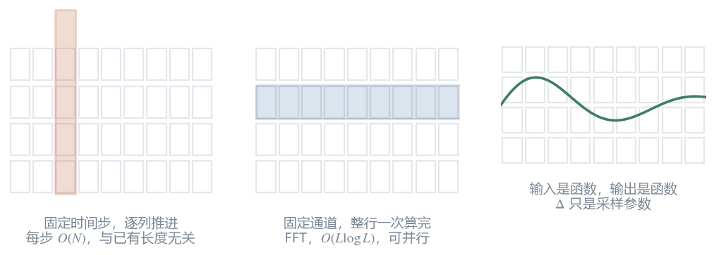

# 第 7 章 LSSL：一个拥有三重身份的网络层

HiPPO 给出了一个最优的记忆动力学，接下来要把它做成一个网络层。

LSSL（Linear State-Space Layer，线性状态空间层；Gu 等, 2021, NeurIPS）名字取得很朴素，就是把线性状态空间方程当作一层，但结论不朴素：

> 同一个层可以同时被解释为 RNN、被解释为 CNN、被解释为微分方程（NDE）。

这三者过去是三个独立的建模思路，各自有强项和弱点。LSSL 说明它们是同一个数学对象的不同视图，于是一层就能同时拿到三样东西：训练时用卷积的并行性，推理时用递归的常量内存，遇到非均匀采样时用连续系统的灵活性。

下面讲定义与三种视图、层内结构，以及它在深度网络里怎么用。第 8 章讲表达力（RNN/CNN 为什么都是它的特例），第 9 章讲它为什么实际上跑不起来。

---

## 7.1 定义

LSSL 的定义只有一句：取第 2 章那个连续时间 SSM，用数值方法离散化，就得到一个层。

$$
\begin{aligned}
\text{连续：}\quad & \dot x(t) = A x(t) + B u(t),\qquad y(t) = Cx(t) + Du(t)\\
\text{离散（步长 }\Delta\text{）：}\quad & x_t = \bar A x_{t-1} + \bar B u_t,\qquad y_t = Cx_t + Du_t
\end{aligned}
\tag{7.1}
$$

参数是 $A\in\mathbb{R}^{N\times N}$，$B\in\mathbb{R}^{N\times 1}$，$C\in\mathbb{R}^{1\times N}$，$D\in\mathbb{R}$，加上步长 $\Delta$，一共 $N^2+2N+2$ 个（$A$ 取对角或 HiPPO 结构时大幅减少）。

与 HiPPO 的差别在参数的地位：HiPPO 把记忆动力学 $A,B$ 当成给定的、推导出来的东西；LSSL 把 $A,B,C,D,\Delta$ 全部当成可学习参数，用梯度下降训练。

这就是"从算子到层"的跨越。一旦 $A$ 可训练，手里就是一个通用的序列建模层，而不是一个记忆模块。

### 层接口

LSSL 处理一批序列 $u \in \mathbb{R}^{L\times H}$（$L$ 是长度，$H$ 是特征维度）：对 $H$ 个特征各自独立跑一个 1 维 LSSL，参数 $B,C,D,\Delta$ 广播到 $H$ 个通道，$A$ 通常共享，也有每通道一份的版本。

整层因此是一个 $ \mathbb{R}^{L\times H}\to\mathbb{R}^{L\times H}$ 的映射，接口和 RNN、CNN、Transformer 一样。

$A$ 共享还是每通道独立，是个有分量的设计选择。LSSL 论文默认共享，并在消融里讨论过。

### 深度网络里的用法

堆叠方式和 ResNet / Transformer 一样：每层先过一个 LSSL 做序列混合，再过一个逐位置的线性层和非线性，外面套残差与归一化。整段结构不变，被替换的只是"沿序列轴混合"的那一步。

LSSL 论文的架构就是一堆相同的 LSSL 层加逐位置非线性，层间归一化和残差。

论文特别提到他们没用任何稳定性技巧（weight decay、梯度裁剪、weight norm、输入 dropout 等），这说明架构本身比较稳；同时期的 UnICORNN、CKConv 得精心调 $\alpha_0$、$\omega$ 才行。

---

## 7.2 三个视图

*图 7-1　同一层的三个视图：按时间步推进是逐列计算，按通道整行算可以用 FFT，连续视图把输入当作函数，$\Delta$ 只是采样参数*

### 视图一：递归（Recurrent）

直接执行 (7.1) 的离散递推，LSSL 就是一个有状态（stateful）的模型：状态 $x \in \mathbb{R}^{N\times H}$，$H$ 个通道各自 $N$ 维；每步计算 $O(N^2H)$（$A$ 对角时是 $O(NH)$）；每步内存 $O(NH)$，与已处理的序列长度无关。

这个视图对应推理，尤其是自回归生成。

### 视图二：卷积（Convolutional）

令初始状态 $x_{-1}=0$，把递推展开：

$$
y_k = C\bar A^k\bar B u_0 + C\bar A^{k-1}\bar B u_1 + \cdots + C\bar A\bar B u_{k-1} + C\bar B u_k + Du_k .
$$

这正是第 2.5 节的卷积形式：

$$
y = \bar K * u + Du, \qquad \bar K_L = \big(\bar C\bar B,\ \bar C\bar A\bar B,\ \dots,\ \bar C\bar A^{L-1}\bar B\big) \in \mathbb{R}^{L}.
\tag{7.2}
$$

于是整个序列的输出可以一次算完（用三个 FFT），完全并行。训练时整段序列都在手边，没有因果顺序的限制，这是训练的视图。

### 视图三：连续（Continuous）

LSSL 本身就是个微分方程，这带来的不是另一种算法，而是另一类可以被处理的问题：

- 非均匀采样 / 缺失数据：离散化时每一步给不同的 $\Delta_t$；
- 测试时改变采样率：把 $\Delta$ 整体缩放；
- 模拟连续过程：直接积分 ODE。

这类非标准数据 Transformer 和 CNN 都处理不了：前者接受任意长度但不理解"时间"，后者只理解等距格点。

### 三视图的"物理意义"对比

LSSL 论文用一张图（Fig. 1）说明了三者的关系。用文字复述：

- 递归视图：竖着切。固定时间步，看 $(u_t, x_t, y_t)$ 这一个切片，然后推进到 $t+1$。
- 卷积视图：横着切。固定特征，把整个序列 $(u_t)_{t\in[L]}$ 一次性映射到 $(y_t)_{t\in[L]}$。
- 连续视图：忘掉"步"这个概念。输入是一个函数，输出是一个函数，$\Delta$ 只是一个技术参数。

第 1 章的"矩阵混合器"视角下，LSSL 的 $M$ 是

$$
M_{ji} = \bar C \bar A^{\,j-i-1}\bar B \quad (j>i),
$$

即一个由"$\bar A$ 的幂"生成的 Toeplitz 矩阵。Toeplitz 结构就是"线性时不变"的另一种说法。

---

## 7.3 计算瓶颈

剩下的问题是 $\bar A$ 和 $\bar K$ 怎么算。

（全书最关键的技术问题在这里，S4 的全部贡献也就是解决它。）

### 瓶颈一：离散化需要矩阵求逆

以双线性离散化为例：

$$
\bar A = \left(I - \tfrac{\Delta}{2}A\right)^{-1}\left(I + \tfrac{\Delta}{2}A\right).
$$

对一般的 $N\times N$ 矩阵，求逆是 $O(N^3)$，而 $A$ 在更新，每一步训练都得重算，这直接不可接受。

$N=256$ 时是 1700 万次浮点运算，只为了算一个中间矩阵。

**S4 的解法**：若 $A$ 的结构使得"对角加低秩"（DPLR），那么 $\bar A$ 也是 DPLR，而 DPLR 的求逆可以用 Woodbury 恒等式在 $O(N)$ 内完成（第 12 章）。

### 瓶颈二：卷积核需要矩阵的幂

从 (7.2) 看，$\bar K$ 的每一项都需要 $\bar A^{k}$，而 $\bar A^k$ 是一次 $O(N^3)$ 的矩阵乘法（或 $O(N^2)$ 的矩阵-向量乘法）。朴素地算 $L$ 项，就是 $O(N^2L)$ 时间、$O(NL)$ 空间。

S4 论文里给了实际数字：$N=256$、$L=4096$ 时，$N^2L = 2.7\times 10^8$，只是乘法的次数；而 $O(NL)$ 的中间状态（要存下来做反向传播）是 $256\times 4096 \approx 10^6$ 个浮点数，每个 batch 每个通道都要一份。

$A$ 若是对角矩阵，$\bar A^k$ 就是逐元素的 $k$ 次幂，计算降到 $O(NL)$ 且能完全向量化，这是 S4D 后来的做法（第 14 章）。

但 HiPPO 矩阵不是对角的，它的对角化在数值上会爆炸（第 9 章、第 10 章）。

$A$ 若是时不变的，还能用平方技巧（$\bar A, \bar A^2, \bar A^4,\dots$）把深度降到 $O(\log L)$，代价是 $O(NL)$ 的中间存储。

### 瓶颈三：内存

第三个瓶颈最容易被忽略：反向传播必须保留每一步的 $x_t$，那是 $O(NL)$ 的空间。RNN 训练只要 $O(L)$（每步状态是 $N$ 维，但目标是 1 维，中间状态就是瓶颈），卷积训练也要 $O(L)$，LSSL 要 $O(NL)$。

$N$ 是 $10\sim 100$ 量级，所以 LSSL 的内存开销是同等 RNN 的 $10\sim100$ 倍。

2021 年，$N=256$（S4 论文里提到的合理规模）用 LSSL 会吃掉数十 GB 显存。LSSL 论文自己承认最大的实验必须用多 GPU 训练。

S4 论文给了直接对比（同一模型维度、同一批次，训练一步的耗时与显存）：

| 维度 | LSSL 耗时 | S4 耗时 | 加速比 | LSSL 显存 | S4 显存 | 降幅 |
|---|---|---|---|---|---|---|
| 128 | 9.32 ms | 4.77 ms | 1.9× | 222.1 MB | 5.3 MB | 42× |
| 256 | 20.6 ms | 3.07 ms | 6.7× | 1685 MB | 12.6 MB | 133× |
| 512 | 140.7 ms | 4.75 ms | 29.6× | 13140 MB | 33.5 MB | 392× |

趋势是维度越大差距越夸张，因为 LSSL 的成本是 $O(N^2L)$、S4 是 $\tilde O(N+L)$。

在 512 维（$L=4096$）时，LSSL 要 13 GB 显存，S4 只要 33 MB，差 400 倍。

S4 论文摘要里那句 "Compared to the LSSL, S4 is up to 30× faster with 400× less memory usage" 就出自这张表。

---

## 7.4 那 LSSL 的效果好吗？

LSSL 的效果很好，这也正是它值得被救的原因。

LSSL 论文的实验跨度很广，从长度 160 的序列到长度 38000 的图像像素序列。挑几个关键结果：

| 任务 | LSSL 结果 | 当时最好的对比 |
|---|---|---|
| sequential MNIST | 99.53 | LipschitzRNN 99.4 |
| permuted MNIST | 98.76 | LMU-FFT 98.49 |
| **sequential CIFAR** | **84.65** | UR-GRU 74.4（提升 10+ 点） |
| BIDMC 呼吸率预测 (RMSE) | 0.350 | UnICORNN 1.06（降低 2/3） |
| 原始语音 SC10（长度 16000） | 95.87 | CKConv 71.66（提升 24 点） |
| Speech，测试时 0.5× 采样率 | 88.66 | CKConv 65.96 |
| CelebA（长度 38000） | 92.36 (MSO) | ResNet-18 有 10 倍参数时 93.92 |

几个点值得单独看：

1. sequential CIFAR 上的 10 点提升是当时的一个大新闻。在那之前，所有非 SSM 的序列模型在这个任务上都比 2D CNN 差 25 点以上。
2. 原始语音（不做 MFCC 预处理，直接吃 16kHz 波形，长度 16000）上 LSSL 超过所有基线 20+ 点，而且比用过 MFCC 预处理的模型还好。这暗示 SSM 学到的特征比手工设计的 MFCC 更好。
3. LSSL 训练极快收敛：LSSL-fixed 达到之前 SoTA 只需 16 个 epoch（对比 CKConv 的 118 个、UnICORNN 的 75 个），墙钟时间只有 0.19×。
4. 时间尺度自适应：测试时把 $\Delta$ 改成 0.5 倍，准确率从 95.87% 掉到 88.66%，掉了，但仍然远高于其他模型在无变化时的表现。

为它解决计算问题是划得来的。LSSL 不属于"理论漂亮但没用"那一类。

---

## 7.5 一个重要的消融：A 和 Δ 谁更重要

LSSL 论文做了两个关键消融，结果都很有信息量。

### 关于 A

| 版本 | pMNIST | sCIFAR |
|---|---|---|
| 随机 $A$ | ~62 | — |
| LSSL-fixed（HiPPO $A$，冻结） | 98.60 | 81.97 |
| LSSL（HiPPO $A$ 初始化，可训练） | 98.76 | **84.65** |

两个结论。其一，必须用 HiPPO $A$：随机 $A$ 直接掉 36 个点。其二，训练 $A$ 有额外收益：sCIFAR 上 +2.7 点，而参数量只多 $O(N)$（不到 1%）。论文把这一现象解释为"学习记忆的测度"（learning the measure）。

### 关于 Δ

这一个更有意思。LSSL 论文的 Lemma 3.1（第 8 章详述）证明了"门控 = 学习 $\Delta$"，因此 $\Delta$ 可训练意味着两件事。

LSSL 是第一个能自动学习时间尺度的 ODE 类序列模型，此前 LMU、UnICORNN、HiPPO-RNN 都把 $\Delta$ 当固定超参数。另外 $\Delta$ 的初始值很关键：设错的 LSSL-fixed 在 sCIFAR 上只有 49.3%，但训练能让它自己走到合适的位置。

论文还观察到：训练过程中 $\Delta$ 会明显变化，而且"学 $\Delta$"与"学 $A$"带来的收益是正交的（各自都能提升，一起用更好）。

---

## 7.6 本章小结

- LSSL = 把连续时间 SSM 离散化后当作神经网络层，$A,B,C,D,\Delta$ 全部可训练，$H$ 个通道各自一份副本 + 广播。
- 它同时拥有三种视图：递归（推理，$O(1)$/步）、卷积（训练，$O(L\log L)$、并行）、连续（变采样率、缺失数据）。
- 深度架构：堆叠 LSSL 层 + 归一化 + 残差 + 逐位置非线性，结构极简，不需要稳定性技巧。
- 三个计算瓶颈：双线性离散化要矩阵求逆（$O(N^3)$）；卷积核要矩阵幂（$O(N^2L)$ 时间、$O(NL)$ 空间）；中间状态内存 $O(NL)$。
- S4 相比 LSSL：快至 30×，省内存至 400×（$N$ 越大差距越大）。
- LSSL 的效果完全支撑这个投入：sCIFAR +10 点，原始语音 +20 点，长度 38000 的 CelebA 接近 ResNet-18。
- 消融结论：$A$ 必须用 HiPPO（否则掉 36 点），训练 $A$ 有额外收益（≈ 学习测度），训练 $\Delta$ 与训练 $A$ 收益正交。

## 下一章

第 8 章讲一个让人意外的结果：LSSL 形式上是一个线性层，表达力却并不弱，RNN 和卷积都被它包含，而"非线性"可以搬去深度方向。这一章还会给出两个引理，其中一个（门控 $=\Delta$）将在 Mamba 里被反复引用。
