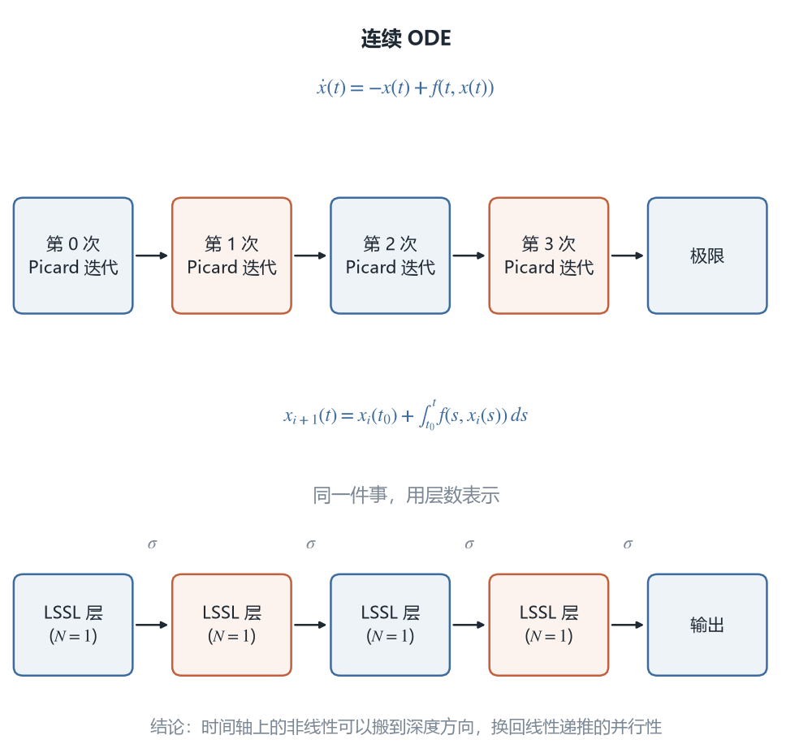

# 第 8 章 LSSL 的表达力：RNN 与卷积都是它的特例

一个直觉上的担忧：同时是递归、又同时是卷积的模型，是不是被限制得太死了？RNN 的强项在时间轴上的非线性（门控、$\tanh$），卷积的强项在局部结构，而一个线性时不变系统看起来两样都不占。

LSSL 论文用整整一节（Section 3.2）反驳这个担忧，结论很强：

> LSSL 没有牺牲表达力，反而把卷积和 RNN 都作为特例包含了进来。论文还给了两个"可能具有更广泛意义"的结果：RNN 里普遍被当作优化 trick 的门控机制，其实就是步长 $\Delta$；深堆叠的 LSSL 层可以逼近任何非线性 ODE，也就是非线性可以从时间轴搬到深度方向。

第 2 条是整条技术路线的哲学基础，下面把这两个引理讲清楚。

---

## 8.1 卷积是 LSSL 的特例

### 结论

任意一个（足够良态的）一维卷积核 $h(t)$，都可以用一个有限维状态空间模型（即 LSSL）来表示，或者至少任意精度地逼近。

### 理由：有理传递函数

从第 2.2 节我们知道，LSSL 的脉冲响应是

$$
h(t) = C e^{tA} B .
$$

对它做 Laplace 变换（连续时间类比于 $Z$ 变换）：

$$
H(s) = \int_0^\infty h(t)e^{-st}dt = C(sI - A)^{-1}B = \frac{C\,\mathrm{adj}(sI-A)\,B}{\det(sI-A)} .
$$

这里 $\det(sI-A)$ 是 $A$ 的特征多项式，次数为 $N$，所以 $H(s)$ 是一个分母次数为 $N$ 的有理函数（控制论里叫传递函数，rational transfer function）。

反过来，控制论的经典结论说任何 $N$ 阶有理传递函数都可以用一个 $N$ 维状态空间模型实现（可实现性）。

而任意连续函数（满足一些温和条件，比如绝对可积）都可以用有理函数逼近（Padé 逼近）。

两者一拼：

> 卷积 ⊂ LSSL（在逼近意义下）。

### 这个结论的实用含义

平移到 HiPPO 的情形，有一个形象的解读。取 LegT 的 $A$（滑动窗口），$\Delta$ 固定时，LSSL 做的就是"在长度为 $1/\Delta$ 的滑动窗口内记忆输入，然后从中抽取特征"，这正是卷积做的事。

所以 LSSL 是一个自动学习卷积核的卷积层，而且核的宽度（由 $\Delta$ 决定）也是学出来的。这解决了第 1 章提到的 CNN 痛点：CNN 的核宽度必须人工指定（或通过堆叠膨胀卷积间接得到），而 LSSL 可以学它。

LSSL 论文的消融里有一个直接的佐证：$\Delta$ 设错的 LSSL-fixed 在 sCIFAR 上只有 49.3%，而让模型自己学 $\Delta$ 之后能到 84% 以上。

---

## 8.2 RNN 是 LSSL 的特例（引理 3.1：门控 = Δ）

这是 LSSL 论文里影响最大的一个结果，也是全书引用最多的两个引理之一（另一个是 S4 的 Conjugation Lemma）。

### 陈述

引理 3.1：一个一维门控递推

$$
x_t = \big(1-\sigma(z_t)\big)x_{t-1} + \sigma(z_t)u_t,
\tag{8.1}
$$

其中 $\sigma$ 是 sigmoid 函数、$z_t$ 是任意表达式，可以看作一维线性 ODE

$$
\dot x(t) = -x(t) + u(t)
\tag{8.2}
$$

的**后向欧拉离散化**（即 GBT 中 $\alpha=1$ 的情形）。

### 证明

后向欧拉对 (8.2)（取 $A=-1, B=1$）的更新是

$$
x(t+\Delta) = x(t) + \Delta\left(-x(t+\Delta) + u(t+\Delta)\right)
\quad\Longrightarrow\quad
(1+\Delta)x(t+\Delta) = x(t) + \Delta u(t+\Delta),
$$

即

$$
x(t+\Delta) = \frac{1}{1+\Delta}x(t) + \frac{\Delta}{1+\Delta}u(t+\Delta) .
$$

现在关键一步：把步长参数化成 $\Delta = \exp(z)$（这样它恒为正，因为离散化步长必须是正数），代入：

$$
\frac{1}{1+e^{z}} = 1 - \frac{e^z}{1+e^z} = 1-\sigma(z),
\qquad
\frac{e^z}{1+e^z} = \sigma(z).
$$

于是

$$
x(t+\Delta) = \big(1-\sigma(z)\big)x(t) + \sigma(z)u(t+\Delta),
$$

**正是 (8.1)。** ∎

### 为什么这个结果这么重要

LSTM/GRU 的遗忘门、输入门，长期以来被视为"平滑优化过程"的工程手段。引理 3.1 说明遗忘门就是在学一个步长 $\Delta$："用 sigmoid 参数化一个正数"是参数化 $\Delta$ 的一种方式（$\sigma$ 的值域是 $(0,1)$）。RNN 的门控与连续时间模型由此接上了。

门控的值域限制也就是 $\Delta$ 的取值范围。$\sigma(z)\in(0,1)$ 意味着 $\Delta\in(0,1)$，标准 LSTM/GRU 的步长被隐式限制在一个区间里。这解释了为什么 LSTM 的"忘记偏置"（forget bias）要手动调大才能处理长依赖：它调的是 $\Delta$ 的初始值。HiPPO 论文也用过这个论据。

第三个后果落在 Mamba 上。一年半后 Mamba 的核心创新是"让 $\Delta$ 依赖输入 $x_t$"。

引理已经说明 $\Delta$ 与门控等价，所以 Mamba 的 Theorem 1 几乎是它的直接推论：

$$
\text{当 } N=1,\ A=-1,\ B=1,\ \Delta = \text{softplus}(\mathrm{Linear}(x_t))\ \text{时，}\ S6\ \text{退化为}\ h_t = (1-g_t)h_{t-1}+g_t x_t .
$$

（第 18 章给完整形式。）没有 LSSL 的引理 3.1，Mamba 的"选择性"就不会显得那么自然。

### 顺带一提：哪些 RNN 落入这个框架

LSSL 论文指出，LSTM、GRU、QRNN（Quasi-Recurrent NN）、SRU（Simple Recurrent Unit）都包含"对 $H$ 个隐藏单元各自独立门控"的结构。

按引理 3.1，它们都在逼近同一类连续动力学，这就是为什么 LSSL 可以声称"RNN 是它的特例"。

（严格说，这些模型的门控是逐单元独立的，而 LSSL 的门控（$\Delta$）在早期版本里是共享的或每通道一份。这个差别在 Mamba 里被补齐了：Mamba 的 $\Delta$ 是逐通道的，甚至可以是逐状态的。）

---

## 8.3 深 LSSL 可以逼近任何非线性 ODE（引理 3.2）

第二个结果处理的是"线性递推会不会损失表达力"这个更根本的问题。

### 陈述

引理 3.2（非正式）：无限深的、$N=1$ 的 LSSL 层堆叠，层间加逐位置非线性函数，可以逼近任何非线性 ODE

$$
\dot x(t) = -x + f(t, x(t)).
$$

### 证明思路：Picard 迭代

回忆第 2 章提到的积分方程形式。任何 ODE $\dot x = f(t,x)$ 等价于积分方程

$$
x(t) = x(t_0) + \int_{t_0}^{t} f(s, x(s))\,ds .
$$

Picard 迭代是证明 ODE 解存在性的标准方法：从任意初值函数 $x_0$ 出发，反复迭代

$$
x_{i+1}(t) := x_i(t_0) + \int_{t_0}^{t} f(s, x_i(s))\,ds,
$$

得到一列函数 $x_0, x_1, x_2,\dots$，它们在适当条件下收敛到真解 $x$。

现在看每一步迭代做了什么：每一次 Picard 迭代都是"对上一层的输出做积分再加非线性"，而一个 $N=1$ 的 LSSL 层做的恰好也是积分（准确说是用一阶线性系统累积输入）。

于是把 LSSL 层堆深、层间插入非线性 $f$，就得到 Picard 迭代的神经网络版本。

深度 $i$ 对应第 $i$ 次 Picard 迭代，层数趋于无穷时，网络输出收敛到 ODE 的真解。

用一张图表示：

*图 8-1　Picard 迭代与深 LSSL 层的对应：每一层等价于一次迭代，非线性被放到层间*

### 这个结论的哲学含义

非线性可以从"时间轴"搬到"深度方向"。

传统 RNN 在每个时间步内做非线性（$\tanh$、门控），时间轴上是串行非线性的；深 LSSL 在时间轴上保持线性（因而可以并行、可以用 FFT），把非线性全部放在层与层之间。

两者在"无限深"的极限意义下表达力等价，计算效率却差得远。

同样的想法后来出现在很多地方：线性注意力、TTT（test-time training）、以及 Mamba 的架构设计。它接近一条经验法则：当序列轴上的操作必须"顺序依赖"时，先问一句这个非线性能不能挪到深度方向去。

（一条诚实的补充：这类结论是逼近性的，不是等价的。实践中深度有限，层间还会有归一化、残差等其他结构，"无限深"的便利不等于"10 层的效果就等于非线性 RNN"。LSSL 论文用实验间接验证了这一点，它的效果确实好，但这不是一条可以直接套用的工程建议。）

---

## 8.4 那 LSSL 到底"限制"了什么

诚实地讲，LSSL 仍有受限的地方，只是这些限制在后来的论文里被逐步放宽。

限制一，线性时不变（LTI）：$A,B,C,\Delta$ 不随时间变化。这带来两种后果：

- 好的：可以走卷积视图（FFT）训练。
- 坏的：无法做"内容相关"的选择。第 17 章会用"选择性复制"任务证明这是硬伤，也是 Mamba 要打破的约束。

限制二，$A$ 必须是某种结构：为了能 $O(N)$ 算，$A$ 必须在"准可分 / 低递推宽度"族内。这个族的表达力比任意矩阵弱（但比对角强）。

S4 后来把它换成"正规加低秩"，S4D 进一步换成对角，Mamba-2 甚至换成"标量乘单位阵"，每一次都在表达力和硬件效率之间重新谈判。

限制三，$N=1$ 时的表达能力弱：引理 3.2 需要无限深度，实际用 $N\ge16$ 的 LSSL 是为了在有限深度下获得足够的记忆容量。

这也解释了后面所有工作为什么都在增加 $N$（$16\to64\to256$）：$N$ 是模型能压缩多少信息的直接度量。

限制四，计算与内存代价：这是第 9 章的主题，LSSL 在数学上优雅，在工程上不可用。

---

## 8.5 本章小结

- LSSL 包含卷积：$h(t)=Ce^{tA}B$ 的 Laplace 变换是分母次数为 $N$ 的有理函数，而有理函数可以逼近任意核。实用解读是：LSSL 是一个核宽度可学习的卷积层。
- 引理 3.1：门控递推 $x_t=(1-\sigma(z))x_{t-1}+\sigma(z)u_t$ 正是 $\dot x=-x+u$ 在后向欧拉、$\Delta=e^{z}$ 下的离散化。门控 = 步长 $\Delta$。这解释了 LSTM/GRU 为什么有效，也是 Mamba 选择性机制的直接理论前身。
- 引理 3.2：无限深的 $N=1$ LSSL 层（层间加非线性）可以逼近任意非线性 ODE，因为每一层对应一次 Picard 迭代。含义是非线性可以从时间轴搬到深度方向，从而在保持表达力的同时获得并行性。
- LSSL 的真实限制：线性时不变（→ Mamba 打破）、$A$ 必须结构化（→ S4/S4D/Mamba-2 重新谈判）、有限深度下的容量（→ 增加 $N$）、以及计算与内存代价（→ S4 解决）。

## 下一章

第 9 章讲 LSSL 为什么"跑不起来"：不是效果问题（它的效果很好），而是数值问题。这一章会引入"非正规矩阵"这个概念，它是理解 S4 为什么必须发明一套复杂参数化的关键。如果只读一章，读第 9 章和第 10 章，它们解释了整个 S4 的技术方向是怎么被逼出来的。
