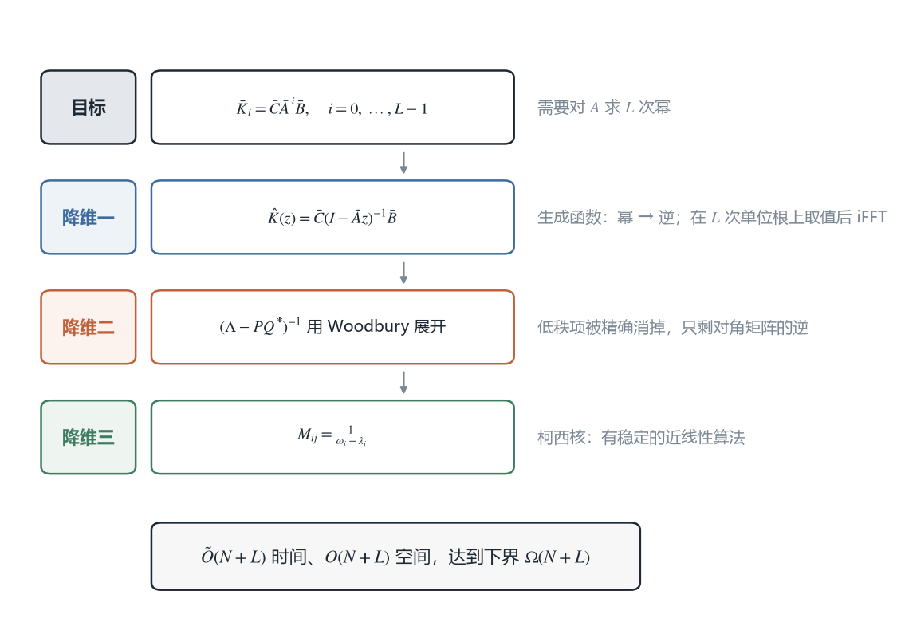

# 第 10 章 S4 的起点：为什么朴素对角化会失败


S4（Structured State Space，结构化状态空间；Gu、Goel、Ré, 2022, ICLR）解决的就是第 9 章那张病历表。

技术路线是：把 $A$ 写成"正规矩阵 + 低秩修正"，用 Woodbury 恒等式把低秩项处理掉，再借助柯西矩阵的快速算法把卷积核算出来。

这句话后面有大量细节，本章只讲动机与结构。

要回答三件事：为什么"换个基"（共轭变换）是合法的而且有用（Lemma 3.1）；为什么直接对角化不行（复习 Lemma 3.2，并给出更完整的数值论证）；S4 的三个技术性降维分别是什么，为什么它们能拼在一起。

具体算法留到第 12 章，这里先给骨架。

---

## 10.1 第一步：共轭等价（Conjugation）

### 引理

Lemma 3.1（S4）：共轭是 SSM 上的一个等价关系：

$$
(A, B, C) \sim (V^{-1}AV,\ V^{-1}B,\ CV), \qquad V \text{ 可逆}.
$$

两个等价的 SSM 计算完全相同的算子 $u \mapsto y$。

### 证明（很短，值得手推一遍）

左边（状态记为 $x$）：

$$
\dot x = Ax + Bu,\qquad y = Cx.
$$

右边（状态记为 $\tilde x$，参数为 $\tilde A=V^{-1}AV$、$\tilde B = V^{-1}B$、$\tilde C = CV$）：

$$
\dot{\tilde x} = V^{-1}AV\tilde x + V^{-1}Bu,\qquad \tilde y = CV\tilde x.
$$

在右边的第一个方程左边乘 $V$：

$$
V\dot{\tilde x} = AV\tilde x + Bu .
$$

令 $x := V\tilde x$（这就是基变换：同一个物理状态在两组基下的坐标），则 $\dot x = Ax+Bu$，与左边完全一致；输出也一致，$\tilde y = C(V\tilde x) = Cx = y$。∎

### 这个引理的含义

状态不是唯一的：对状态做任意可逆线性变换，模型的输入输出行为不变。这在控制论里叫"状态空间的坐标变换"。

实用价值在于：某个基下的 $A$ 更好处理（比如接近对角），就换到那个基去算。这正是对角化想做的事。

$A$ 的具体数值不重要，重要的是它的共轭类，我们可以在任何便利的基下表示 $A$。

### 一个技术提醒

引理里说的是"可逆矩阵 $V$"，不是"正交/酉矩阵"，而第 9 章说了只有酉（unitarily）变换才数值安全。$V$ 的条件数一大，$V^{-1}B$ 和 $CV$ 就会包含极大的数，浮点下就废了。

所以这条引理实际给出的是一个约束：只能在良态矩阵（最好是酉矩阵）张成的变换里找 $A$ 的简化形式。

---

## 10.2 第二步：为什么朴素对角化必然失败

### 诱惑

把 $A$ 变成对角矩阵 $\Lambda$ 的好处很直接：

- $\bar A^i$ 变成逐元素求幂，$O(N)$；
- 卷积核变成 Vandermonde 乘积，理论复杂度 $O((N+L)\log^2(N+L))$；
- 离散化和求逆全部简化。

### 现实

S4 论文给出了 HiPPO 矩阵的显式对角化（Lemma 3.2）：

$$
A = V\Lambda V^{-1},\qquad V_{ij} = \binom{i+j}{i-j},\qquad V_{3i,i} = \binom{4i}{2i}\approx 2^{4i} .
$$

论文的结论是 **$V$ 的元素量级可达 $2^{4N/3}$**，因此对角化在数值上不可行。

（$\binom{4i}{2i}$ 的渐近行为可以算一下。由中心二项式系数的斯特林近似 $\binom{2m}{m}\sim 4^m/\sqrt{\pi m}$，取 $m=2i$ 得 $\binom{4i}{2i}\sim 4^{2i}/\sqrt{2\pi i} = 16^i/\sqrt{2\pi i}$，这比 $2^{4i/3}$ 大得多：$16^i$ 对 $2^{4i/3}=2^{1.33i}$。论文给出的是保守下界，取哪个数结论都一样，指数级。）

### 用数字感受一下

| $N$ | $2^{4N/3}$ | 含义 |
|---|---|---|
| 16 | $1.4\times 10^{6}$ | 勉强能算，但已损失 6 位精度 |
| 32 | $2.0\times 10^{12}$ | FP32 有效数字（约 $10^7$）已完全不够 |
| 64 | $4.0\times 10^{25}$ | FP64（约 $10^{16}$ 精度）也不够 |
| 128 | $1.6\times 10^{51}$ | 直接溢出 |

SSM 里常用的状态维度是 $N=64\sim256$。

所以 $N\ge 32$ 时朴素对角化就已经不可用了。

### 问题的本质：非正规性

9.4 节给过定义，这里换个更直观的说法。

正规矩阵的特征向量互相正交，状态空间可以分解成一组互相垂直的独立振动模式，每个模式按自己的特征值衰减或振荡，互不干扰。

非正规矩阵的特征向量几乎平行，后果有三条：

- 特征值对扰动极其敏感（一个 1e-16 的扰动就能让特征值移动很多）；
- 状态可以在短时间内被放得很大再缩回来（伪谱现象），即使谱半径小于 1，中间过程也可能爆掉；
- 相似变换矩阵 $V$ 就是那个把几乎平行的向量拉开的映射，条件数极大。

HiPPO 矩阵恰好高度非正规（它的 $V$ 有指数级元素），这不是巧合。

结构上看，HiPPO 矩阵是"下三角 + 正对角"（回忆 (5.7)：$A_{nk}=0$ 当 $n<k$，$A_{nn}=n+1>0$），下三角矩阵的特征值就是对角线 $1,2,\dots,N$，特征向量是标准基的扰动，天然非正规。

### S4 的应对

S4 不能接受非正规，但也不愿意放弃 HiPPO 矩阵，于是换了一个简化目标：不追求变成对角，追求变成对角加低秩。

理由有三条。

- 对角矩阵是数值安全的（当然正规）；
- 低秩修正可以用矩阵恒等式精确处理（Woodbury），不需要真的做相似变换；
- HiPPO 矩阵恰好可以精确地写成这种形式（这是 Theorem 1，第 11 章）。

于是不去对角化那个病态矩阵，而是把它拆成一个良态部分（对角）加一个可精确处理的病态部分（低秩）。**NPLR 的全部意义就在这一句里。**

---

## 一个二阶算例：范数怎么爆掉

二阶矩阵足以把机制看清。取

$$
A_c=\begin{pmatrix}-1&0\\-c&-2\end{pmatrix},\qquad c>0 .
$$

$c=\sqrt3$ 时它就是 $N=2$ 的 HiPPO-LegS 矩阵：按 (5.7)，左下角是 $-(2\cdot1+1)^{1/2}(2\cdot0+1)^{1/2}=-\sqrt3$，对角是 $-1$ 与 $-2$。$c$ 是可控的形状参数，用它可以把"耦合强度"这一个维度单独拧大。

### 谱、特征向量、夹角

谱与 $c$ 完全无关。特征值就是对角元 $-1$ 与 $-2$，两个实根，间距恒为 $1$。

$\lambda=-2$ 的特征向量满足 $(A_c+2I)x=0$，即 $x_1=0$，取 $(0,1)$。$\lambda=-1$ 的特征向量满足 $(A_c+I)x=0$，即 $cx_1+x_2=0$，取 $(1,-c)$。

两个特征向量的夹角由内积给出

$$
\cos\theta=\frac{c}{\sqrt{1+c^2}},\qquad \theta=\arctan\frac{1}{c} .
$$

$c=\sqrt3$ 时 $\theta=30^\circ$，$c=10$ 时 $5.71^\circ$，$c=100$ 时 $0.57^\circ$。$c$ 越大，两个特征向量越接近同一条直线。这就是"非正规"在几何上的样子：谱是清清楚楚的两个点，基底却不是一组合格的坐标系。

### 幂的闭式

二阶矩阵的幂有一个不含求逆的展开。对任意 $2\times2$ 矩阵，只要两个特征值不同，就有

$$
A^k=\frac{\lambda_1^k-\lambda_2^k}{\lambda_1-\lambda_2}A-\lambda_1\lambda_2\frac{\lambda_1^{k-1}-\lambda_2^{k-1}}{\lambda_1-\lambda_2}I .
$$

把 $\lambda_1=-1$、$\lambda_2=-2$ 代进去，$A$ 的系数是 $(-1)^k-(-2)^k$，$I$ 的系数是 $2\left((-1)^{k-1}-(-2)^{k-1}\right)$。逐元素算完得到

$$
A_c^k=\begin{pmatrix}(-1)^k&0\\ c\left((-2)^k-(-1)^k\right)&(-2)^k\end{pmatrix}.
$$

（$k=1$ 时左下角是 $-c$，$k=5$ 时是 $-31c$，可以当成验算。）

左下角元素的绝对值是 $c(2^k\mp1)$，底数就是 $2$。谱半径也对 $2$，于是 $\|A_c^k\|$ 与 $\rho^k$ 同量级。真正的差别在常数上：

$$
\frac{\|A_c^k\|_2}{\rho^k}\longrightarrow\sqrt{c^2+1}\qquad(k\to\infty).
$$

这个极限可以直接读出来：$A_c^k$ 的形状是 $\begin{pmatrix}1&0\\ b&2^k\end{pmatrix}$，$b=c(2^k\mp1)$ 主导时 2-范数大约是 $\sqrt{b^2+4^k}$，除以 $2^k$ 就是 $\sqrt{c^2+1}$。实测的比值（$k\le12$）：$c=\sqrt3$ 从 1.37 升到 2.00，$c=10$ 从 5.12 升到 10.01，$c=100$ 从 50.0 升到 99.98。

### 条件数的闭式

把特征向量按列拼起来，取不做归一的 $V=\begin{pmatrix}1&0\\-c&1\end{pmatrix}$，$\det V=1$。于是 $\det(V^\top V)=1$，两个奇异值互为倒数，$\kappa_2(V)=\sigma_{\max}^2$，而 $\sigma_{\max}^2+\sigma_{\min}^2=\operatorname{tr}(V^\top V)=2+c^2$。解出

$$
\kappa_2(V)=\frac{(2+c^2)+\sqrt{c^4+4c^2}}{2}\approx c^2+2\quad(c\gg1).
$$

| $c$ | 夹角 | $\kappa_2(V)$ | $\max_{k\le12}\lVert A_c^k\rVert_2/\rho^k$ |
|---|---|---|---|
| $\sqrt3$ | $30^\circ$ | 4.79 | 2.00 |
| $10$ | $5.71^\circ$ | 102.0 | 10.05 |
| $100$ | $0.57^\circ$ | $1.0\times10^4$ | 100.0 |

三列数字互相印证。夹角越小，条件数越大；条件数越大，$\|A^k\|$ 相对 $\rho^k$ 的常数越大。不等式 $\|A^k\|\le\kappa(V)\rho^k$ 在三个例子上都成立，而且实测比值只用到条件数的平方根（$\sqrt{c^2+1}$ 对 $c^2$），离上界还有一段距离。

这张表要说的只有一句：**谱半径预测的是 $k\to\infty$ 的行为，它完全不预测 $k$ 有限时的幅度。** $c=100$ 时，$k=10$ 那一步的真实幅度是 $10^5$，谱半径给出的估计是 $2^{10}=1024$，差两个数量级。任何只看特征值的稳定性论证在非正规矩阵上都失效。

### 重根时退化成多项式增长

$c$ 的例子让两个特征值保持分离。把对角换成重根，现象更尖锐。设 $\lambda_1\to\lambda_2=\lambda$，上面的展开式取极限

$$
\frac{\lambda_1^k-\lambda_2^k}{\lambda_1-\lambda_2}\longrightarrow k\lambda^{k-1},
$$

于是 $A^k$ 里出现一个 $k$ 因子，$\|A^k\|\sim k|\lambda|^k$。指数项之外多了一个多项式因子。

它在 $k^*=1/\ln(1/|\lambda|)$ 处取峰值。$|\lambda|=0.5$ 时峰值在第 1.44 步，$|\lambda|=0.9$ 时在第 9.5 步。**谱半径小于 1 的矩阵照样能把状态放大，只要放大发生在头几步。** 离散 SSM 的 $\bar A$ 经过 $\Delta$ 缩放后常常落在 $|\lambda|$ 接近 1 的区域，这个窗口就正好罩住前几十步，也就是训练时最要紧的那一段。

### 连续时间版本

SSM 原本是连续时间对象，看 $e^{A_ct}$ 更贴近它的本体。二阶矩阵的矩阵指数可以用谱投影写出来：

$$
e^{A t}=e^{\lambda_1 t}\frac{A-\lambda_2 I}{\lambda_1-\lambda_2}+e^{\lambda_2 t}\frac{A-\lambda_1 I}{\lambda_2-\lambda_1} .
$$

代入 $\lambda_1=-1$、$\lambda_2=-2$，两项分别是 $e^{-t}(A_c+2I)$ 与 $-e^{-2t}(A_c+I)$。逐元素相加：

$$
e^{A_ct}=\begin{pmatrix}e^{-t}&0\\ -c\left(e^{-t}-e^{-2t}\right)&e^{-2t}\end{pmatrix}.
$$

左下角是两条负指数曲线之差，乘上 $c$。这条差在 $t=\ln2\approx0.693$ 处取最大，峰值是 $c(0.5-0.25)=c/4$。

$c=100$ 时，两个模态都在按 $e^{-t}$ 与 $e^{-2t}$ 衰减，矩阵却在中途长到 25 倍。实测最大 2-范数 25.006，出现在 $t=0.693$，与 $c/4$ 的预测完全对上。$c=10$ 时峰值 2.56，理论值 2.5。$c=\sqrt3$ 时峰值就是 1，起步即最大，什么也看不到。

这个差别值得多看一眼。$c=\sqrt3$（真的 HiPPO，$N=2$）在连续时间下几乎没有瞬态放大，到了离散域才是 2 倍。$c=100$（人为拉大耦合）在连续域就已经是 25 倍。**同一族矩阵，在两种时间域里的病态程度不一样，诊断时不能互相代替。**

为什么不能把 $c$ 改小？在 HiPPO 里 $c$ 不是自由参数。它由"基函数在测度下正交归一"这个要求确定，写成 $\sqrt{(2n+1)(2k+1)}$ 这样的形式。把 $c$ 压小，就不是那个投影算子了，记忆性质也跟着消失。想通过"把耦合调小"来避开病态，等于放弃 HiPPO。

### 这个例子的边界

二阶算例能说清机制，但它低估了程度。$2\times2$ 时条件数只是 $c^2$，而 $c$ 与 $N$ 的关系是线性，所以 $N$ 大时条件数大约按 $N^2$ 长。到了 $N$ 维，$N$ 条这样的耦合串起来，误差可以沿着链条逐级放大，总放大是连乘，变成指数。Lemma 3.2 算出的 $2^{4N/3}$ 就是连乘的结果，二阶例子不可能看出来。

例子里还有一个假象：它只有两个模态，谱线是两根平行的直线，没有粗细。实际 HiPPO 的谱在虚轴上排开五个数量级（11.3 节），伪谱还会把相邻的圆盘粘起来。在这种情况下，「第 $k$ 个模态」这种带着序号的描述都会失效。

所以这个例子的用途只有一个：把一个直觉钉住。病态不等于「特征值不对」，而是「用特征向量当基底这件事不对」。把这个直觉带着去看 Lemma 3.2 的元素估计和 11.1 节的谱定理，两处就能对上了。

---

## HiPPO 的病态从哪来

上面那个 $2\times2$ 例子是人为的把戏。HiPPO 矩阵的病态不是把戏，它由矩阵的定义直接决定，三条来源都在定义里。

### 谱隙固定为 1，耦合却随 N 增长

按 (5.7)，HiPPO-LegS 的下三角元素是 $A_{nk}=-\sqrt{(2n+1)(2k+1)}$，对角是 $-(n+1)$。特征值就是 $-1,-2,\dots,-N$，相邻谱隙恒为 $1$，与 $N$ 无关。

耦合项就不一样了。取相邻两层 $n$ 与 $k=n-1$，比值是

$$
\frac{|A_{n,n-1}|}{|\lambda_n-\lambda_{n-1}|}=\sqrt{(2n+1)(2n-1)}=\sqrt{4n^2-1}\approx2n .
$$

$n=2$ 时是 3.87，$n=16$ 时是 31.98，$n=32$ 时是 63.99。上一层对下一层的"拉扯"强度相对谱隙线性增长。二阶算例说明，一对这样的耦合能贡献一个 $c$ 倍的幅度放大和 $c^2$ 倍的条件数；$N$ 层串起来，放大因子就要连乘。粗算 $\prod_{n\le N}2n=2^NN!$，$N=16$ 时是 $1.4\times10^{18}$。实测的条件数比这个粗估小，但增长的方向一致，都是指数。

### 频率跨度

11.3 节的表给出 $N=256$ 时最大虚部 $2.1\times10^4$，低频端还停在个位数。同一个矩阵里，最快的模态比最慢的快四个数量级。

对角化要做的事，是把这些模态搬到坐标轴上让它们彻底解耦。搬运的代价由 $V$ 支付，而 $V$ 的元素必须能表达"这个方向的尺度是那个方向的 $10^4$ 倍"。尺度比越大，$V$ 的元素跨度越大，$\kappa(V)$ 越大。$N$ 每翻一倍，最大频率按 $N^2$ 增长，尺度比跟着翻四倍，条件数再乘一遍。

### 时间尺度

HiPPO-LegS 的测度在滑动窗口 $[0,t]$ 上是均匀的。这个选择的后果是记忆按对数分配：窗口从 $t=1$ 拉到 $t=10^6$，六个数量级的历史要挤进 $N$ 个模态。11.3 节那个 S4D 的拟合式 $\omega_n=\frac{N}{\pi}\left(\frac{N}{2n+1}-1\right)$ 说的就是这件事，频率按 $1/(2n+1)$ 递减，正好是音符式的等间隔。

要在一个坐标系里同时表示 6 个数量级的时间尺度，坐标轴本身就得跨 6 个数量级。矩阵元素 $-\sqrt{(2n+1)(2k+1)}$ 里的 $\sqrt{2n+1}$ 就是这个跨度的痕迹：$n=0$ 时是 1，$n=255$ 时是 22.6，再乘上基函数归一化的因子，就凑出了指数级的元素。

### 实测：对角化在浮点下的三层失效

拿 NumPy 对 $N=2,4,\dots,32$ 的 HiPPO-LegS 矩阵求特征分解，把特征向量按列归一到最大元素为 1，得到下表。第二列是条件数，第三列是用 $V\Lambda V^{-1}$ 重构 $A$ 的相对误差，第四列是给 $A$ 加 $10^{-7}$ 相对量级的随机扰动后特征值的最大偏移（$-1,\dots,-N$ 这些特征值本身的量级是 $N$）。

| $N$ | $\kappa_2(V)$ | 重构相对误差 | 扰动下的特征值偏移 |
|---|---|---|---|
| 2 | 3.8 | $8\times10^{-17}$ | $1.5\times10^{-7}$ |
| 4 | 97 | $1.2\times10^{-15}$ | $5.5\times10^{-6}$ |
| 8 | $9.2\times10^4$ | $1.7\times10^{-13}$ | $2.0\times10^{-3}$ |
| 16 | $1.0\times10^{11}$ | $1.5\times10^{-7}$ | 4.6 |
| 24 | $9.7\times10^{16}$ | 0.10 | 14.8 |
| 32 | $7.1\times10^{18}$ | $4.0\times10^{4}$ | 30.2 |

三层失效是依次到来的。$N\le8$ 时重构还准；条件数已经上万，但双精度扛得住。$N=16$ 时重构误差进了 $10^{-7}$，双精度只剩 9 位可用。$N=24$ 时重构出的矩阵跟原矩阵差 10%，对角化名义上完成、实际已经错。$N=32$ 时误差比矩阵本身大四个数量级，重构成了一堆噪声。

第四列更狠。$N=16$ 时，$10^{-7}$ 的扰动（fp32 舍入的量级）就能让特征值偏移 4.6。特征值本来是 $-1$ 到 $-16$，偏移 4.6 意味着连"有没有这个模态"都说不清。

### 精度预算

把这笔账摊开算。单精度有 7 位十进制有效数字，双精度 16 位。$\kappa(V)=10^{11}$ 的相似变换做一次，会在正反两次乘法里各损失约 11 位，双精度只剩 5 位。$\kappa=10^{17}$ 时双精度一位不剩。$\kappa=10^{19}$ 时连条件数本身都算不准了，NumPy 报出来的 7.1e18 只是 float64 的表达上限，真实值更大。

另一个角度是元素量级。Lemma 3.2 说 $V_{3i,i}=\binom{4i}{2i}\approx2^{4i}$，$N=32$ 时最大的元素到 $10^{12}$。$CV$ 和 $V^{-1}B$ 里就会出现 $10^{12}$ 量级的数，而最终要算的 $\bar C\bar A^k\bar B$ 是 $O(1)$。中间结果 $10^{12}$、答案 $O(1)$，需要 12 位有效数字去抵消，双精度刚好够、单精度远远不够；$N=64$ 时元素到 $10^{25}$，双精度也不够。

### 一个容易搞反的点

非正规矩阵的特征值是对的。上面每一行 $V\Lambda V^{-1}$ 的对角元都精确等于 $-1,\dots,-N$，没有错。出问题的是"用特征向量做基底表示状态"这个动作，它在浮点下不成立。所以"先对角化，再在对角基里算幂、算卷积核"这条路线，失败点不在求特征值的算法，而在基底的条件数。换一个更稳的特征值算法也救不了。

同理，LSSL 那条准可分（quasiseparable）路线失败的原因也可以在这里看明白：它绕开了显式对角化，但它的快速算法等价于在同一个病态基底里做运算，条件数原封不动地传了下去（第 9 章那张病历表的第三行）。

---

## 伪谱：特征值的有效位置

如果说条件数是一个全局的数字，预解式范数 $\|(zI-A)^{-1}\|$ 则给出了局部的信息：在复平面上哪一块区域是不稳定的。正规矩阵的预解式范数精确等于 $1/\operatorname{dist}(z,\Lambda)$，把 $z$ 放到距离特征值 $\epsilon$ 的地方，范数就是 $1/\epsilon$。非正规矩阵在同样的位置会大得多。

对 $A_c$ 算一下，取距离特征值 $0.01$ 的点：

| $c$ | $\lVert(zI-A_c)^{-1}\rVert$（$z=-1.01$） | 正规矩阵应得的 $1/\epsilon$ |
|---|---|---|
| $\sqrt3$ | 198 | 100 |
| $10$ | 995 | 100 |
| $100$ | $9.9\times10^3$ | 100 |

放大倍数就是 $c$，与前面那个幅度放大是同一个数，不是巧合。把 $A_c=V\Lambda V^{-1}$ 代进去，在 $z$ 靠近 $\lambda_1$ 时只有第一个模态的分母接近零，其余是有限的，于是

$$
(zI-A_c)^{-1}=V\operatorname{diag}\left(\frac{1}{z-\lambda_1},\frac{1}{z-\lambda_2}\right)V^{-1},
$$

主导项是 $\frac{1}{z-\lambda_1}v_1u_1^\top$，而 $\|v_1\|\|u_1^\top\|$ 就是那个 $c$ 倍。

这个量决定了特征值在浮点下的"有效位置"。定义 $\epsilon$-伪谱为 $\Lambda_\epsilon(A)=\{z:\|(zI-A)^{-1}\|>1/\epsilon\}$。对正规矩阵它是一个个半径 $\epsilon$ 的圆盘；对 $A_c$，因为范数是 $c/\epsilon$ 量级，圆盘半径被拉到 $c\epsilon$。$c=100$ 时，$\epsilon=10^{-4}$ 的"精度"对应半径 $0.01$，已经是谱隙的百分之一；$\epsilon=10^{-2}$ 时半径正好等于谱隙，两个特征值在数值上合成一个。

HiPPO 矩阵上这个数大得离谱。对 $N=16$ 的那一个，取 $z=-8.01$（距特征值 $-8$ 只有 $0.01$），预解式范数是 $1.7\times10^{11}$，而正规矩阵在同一位置只有 100。差九个数量级。在这么宽的伪谱里，"第 8 个特征值是 $-8$"这句话在双精度下没有任何可验证的意义。

工程上这条给出了一个可直接用的检查：画 $\|(zI-\bar A)^{-1}\|$ 在单位圆附近的等高线，看它是否已经漫过圆。漫过去了，$\bar A$ 的任何幂都会带上一堆虚假模态。这个检查不依赖于对 $\bar A$ 做任何分解，比求特征值稳定得多。

第 9 章说 LSSL 的算法"在精确算术下成立、浮点下就崩"，伪谱给这句话一个可量化的版本。假设伪谱把特征值向外拉了 $\gamma$，浮点噪声是 $\epsilon$，有效的谱位移就是 $\gamma\epsilon$。后面的推理只要用到"谱在左半平面"这类结论，都得先把这个位移扣掉。S4 选择 NPLR 而不是准可分，理由也在这里。

---

## 三种参数化的代价账

同一个 $N\times N$ 矩阵，三种写法在参数量和单步代价上差得很远。以单个通道、单个 SSM 为例：

| 参数化 | 需要存的东西 | 参数量 | 单步矩阵-向量乘 |
|---|---|---|---|
| 稠密 | $A$ 的全部 $N^2$ 个元 | $N^2$ | $N^2$ |
| 纯对角 | $N$ 个 $\lambda_n$ | $N$ | $N$ |
| DPLR | $\Lambda$、$P$、$Q$、$B$、$C$ | $5N$ | 约 $4N$ |

$N=64$ 时三者是 4096、64、320；$N=256$ 时是 65536、256、1280。稠密到 DPLR 省了 51 倍，代价只有 5 倍的参数量和几倍的常数。

S4 论文把 $5N$ 这个数字直接写在正文里：$(\Lambda,P,Q,B,C)$ 构成 $5N$ 个可训练参数（$r=1$ 时 $P,Q$ 各 $N$ 个），整个层的参数量是 $O(H^2)+O(HN)$，其中 $H$ 是隐藏通道数，$O(H^2)$ 那一项来自通道混合的线性层。

三列数字背后是三种主张。稠密什么都不换，代价是 $N^2$ 的参数和 $N^2$ 的步长，$N=256$ 时一个通道就是 65536 个数，$H=512$ 个通道加起来上亿，训练不动。纯对角最便宜，但拿不到 HiPPO 的归纳偏置（10.4 节的消融）。DPLR 用多出的 $4N$ 把非正规性编码进去，换来的是"矩阵本体仍是 HiPPO 的共轭"。

多出的这 $4N$ 不是白拿的。它把算法从"逐元素求幂"变成了"柯西核加 Woodbury"，也就是第 12 章那一整章的内容。纯对角路线没有这个负担，这正是 S4D 后来能用一个更简单的算法追上来的原因（第 14 章）。

还有一笔隐形成本：DPLR 的 $\Lambda$ 是复的。对角元的实部固定为 $-1/2$（11.3 节），只需要存虚部，但 $P,Q,B,C$ 都生活在复域，一个通道实际占的字节是实数情形的两倍。算力上也是：复数矩阵-向量乘是四次实数乘加，而 GPU 上复数运算没有专门的加速单元。省下的 $N^2$ 参数换来了复数的开销，这笔账在 $N$ 小时不一定划算，在 $N\ge64$ 时一边倒。

---

## 三段可复现的检查

前面那些表都可以用 NumPy 复现。把检查写成一个函数，对一个给定的 $A$ 跑三件事。

```python
import numpy as np

def diagnose(A):
    N = A.shape[0]
    w, V = np.linalg.eig(A)
    V = V / np.abs(V).max(axis=0, keepdims=True)   # 列归一，避免尺度混淆
    print("条件数", np.linalg.cond(V))

    # 一：幂的增长
    rho = np.abs(w).max()
    Ak = np.eye(N)
    for k in range(1, 33):
        Ak = Ak @ A
        if k in (1, 2, 4, 8, 16, 32):
            print(k, np.linalg.norm(Ak, 2), rho ** k)

    # 二：预解式在特征值附近的峰值
    for eps in (1e-2, 1e-4):
        z = w[0] + eps
        print(eps, np.linalg.norm(np.linalg.inv(z * np.eye(N) - A), 2))

    # 三：重构误差
    print("重构", np.linalg.norm(V @ np.diag(w) @ np.linalg.inv(V) - A) / np.linalg.norm(A))
```

三个输出对应三种失效。第一段看 $\|A^k\|/\rho^k$ 是否明显大于 1，大于就说明有瞬态放大；第二段看预解式是否远大于 $1/\epsilon$，远大于就说明伪谱很宽；第三段看重构误差，超过 $10^{-6}$ 就意味着这台机器上的对角化已经不可信。

这三个检查都不需要知道 $A$ 的来历，对学出来的 $\bar A$ 同样适用。$N$ 超过 16 时第三个检查通常直接报错，这说明对角化路线到头了，不是代码写错了。

---

## 几条实现上的启示

第一条，别拿谱半径当幅度估计。诊断一个 SSM 是否数值健康，看 $\|\bar A^k\|$ 随 $k$ 的曲线，或者看预解式 $\|(zI-\bar A)^{-1}\|$ 在单位圆附近的峰值（伪谱）。$\rho(\bar A)<1$ 不保证 $\|\bar A^k\|<1$。

第二条，任何换基都必须用酉矩阵。Lemma 3.1 允许任意可逆 $V$，数值上只允许 $\kappa(V)=1$ 的那些。这条限制看起来苛刻，实际上把可选的结构压缩到"正规矩阵"一类，而 HiPPO 恰好不在其中，于是才有了第 11 章那个分解。

第三条，病态性是可以"搬家"的。$A$ 的病态搬不走，但可以搬到一个小得多的对象上：把非正规部分压进一个秩 $r$ 的低秩项，条件数就只影响那个 $r\times r$ 的小矩阵，$N$ 多大的矩阵本体反而是酉的。这是第 11 章要展开的操作。

---

## 10.3 第三步：算法的三个降维（骨架）

有了 NPLR 参数化，剩下的问题还是如何快速算卷积核

$$
\bar K_i = \bar C \bar A^i \bar B,\qquad i = 0,\dots,L-1.
$$

S4 用了三个技巧把这个计算逐步化简。这里先给骨架，第 12 章给细节。

### 降维一：从"矩阵幂"到"矩阵求逆"

关键转换：不去直接算 $\bar A^i$，而是算生成函数（generating function）

$$
\hat K(z) := \sum_{i=0}^{L-1} K_i\, z^i .
$$

为什么？因为对无穷级数有

$$
\sum_{i\ge0} \bar C\bar A^i\bar B\, z^i = \bar C\left(\sum_{i\ge0}(\bar Az)^i\right)\bar B = \bar C\,(I-\bar A z)^{-1}\bar B .
$$

矩阵的幂变成了矩阵的逆，而逆比幂好处理，因为它可以套矩阵恒等式。

截断到长度 $L$ 要用一个技巧：把 $\bar C$ 换成 $\tilde C = (I-\bar A^L)^* C$，把 $i\ge L$ 的项扣掉（第 12 章详述）。

从 $\hat K$ 恢复 $\bar K$ 的办法是在 $L$ 次单位根 $\omega = e^{2\pi i k/L}$ 上取值，再做逆 FFT：

$$
K_i = \frac{1}{L}\sum_{k=0}^{L-1}\hat K(\omega_k)\,\omega_k^{-i} .
$$

于是"求 $L$ 个核值"变成了"求 $L$ 个点的函数值 + 一次 iFFT"，后者是 $O(L\log L)$ 且高度并行。

### 降维二：Woodbury 恒等式处理低秩项

接下来要算 $(I-\bar A z)^{-1}$，其中 $\bar A = \Lambda - PQ^*$ 是对角加低秩。这类矩阵的逆正好有 Woodbury 恒等式：

$$
(\Lambda - PQ^*)^{-1} = \Lambda^{-1} + \Lambda^{-1}P\left(I - Q^*\Lambda^{-1}P\right)^{-1}Q^*\Lambda^{-1}.
$$

（形式会随参数化略有不同，见第 12 章。）右边的关键是指：只需要对角矩阵 $\Lambda$ 的逆（$O(N)$）和一个 $r\times r$ 小矩阵的逆；$r$ 是低秩阶数，HiPPO 矩阵只需要 $r=1$ 或 $2$（见第 11 章）。

于是 $N\times N$ 求逆变成 $O(N)$ 的对角运算加一次 $2\times2$ 求逆。这是 S4 的第二个核心技术。

### 降维三：对角情形 = 柯西核

剩下的核心计算是"对角矩阵的预解式在若干点上的取值"，即形如

$$
\frac{1}{\omega_j - \zeta_k}
$$

的求和。这种形式的东西叫柯西矩阵（Cauchy matrix）：

$$
C_{jk} = \frac{1}{\omega_j - \zeta_k}.
$$

柯西矩阵的乘法是数值分析里的经典问题，算法成熟：快速多极子方法（Fast Multipole Method）可以做到 $O((N+L)\log^2(N+L))$ 时间，而且数值稳定，这与 LSSL 那个不稳的算法正好形成对比。

S4 论文的原话是，Cauchy 矩阵"与有理插值问题有关"，是"数值分析中研究得极为透彻的问题，既有快速算术算法也有快速的数值算法"。

这是 S4 的第三个核心技术，也是它"本质最优"的来源。

### 三个技巧的串接



*图 10-1　S4 的三次降维：把矩阵幂换成矩阵逆，再把低秩项消掉，最后落到柯西核*

这个串联就是 S4 论文 Algorithm 1 的内容（只有 5 行伪代码，但每一行背后都是一节数学）。

---

## 10.4 一个必要的补充：S4 为什么"必须"用 NPLR

有人会问：为什么不干脆放弃 HiPPO 矩阵，换成对角矩阵，那样计算最简单？

第 3 章和第 6 章已经给了实验答案：随机对角矩阵的效果很差（S4 消融：所有初始化的训练集都能到 100%，但验证集差 15 个点以上）。

HiPPO 提供的归纳偏置不可替代，而 HiPPO 矩阵恰好是 NPLR 的。所以 S4 的技术路线是被迫的：它必须在"保留 HiPPO"和"数值可用"之间找到一条路，NPLR 就是那条路。

一年后 S4D（第 14 章）发现了一个意外的事实：HiPPO 矩阵的"对角部分"（丢弃低秩项）单独使用效果也几乎一样好，而且理论上可以解释为什么（$N\to\infty$ 时两者动力学相同）。

这条捷径让 S4 的复杂算法在实践中的地位下降了，但对理论理解的价值不变。

这种"先有正确但复杂的方法，再被简化版取代"的模式在后来反复出现。

先有一个正确但复杂的方法（S4），然后社区找到它的简化版（S4D），简化版随后成为新基线（Mamba）。

---

## 10.5 本章小结

- Lemma 3.1（共轭等价）：$(A,B,C)\sim(V^{-1}AV, V^{-1}B, CV)$，两个 SSM 计算同一算子。因此可以自由换基，但只能用良态（最好酉）矩阵，否则数值上会毁掉一切。
- 朴素对角化失败：HiPPO 矩阵的对角化矩阵 $V_{ij}=\binom{i+j}{i-j}$ 元素量级达 $2^{4N/3}$（实际可达 $16^i$ 量级），$N\ge 32$ 时 FP32/FP64 都不够。
- 本质原因是非正规性：只有正规矩阵能被酉矩阵对角化；HiPPO 矩阵是"下三角 + 正对角"，高度非正规，特征向量几乎平行。
- S4 的策略：不追求"对角"，追求"对角 + 低秩"（NPLR/DPLR）。低秩部分用 Woodbury 恒等式精确处理，不需要做病态的相似变换。
- 算法三降维：(1) 用生成函数 $\hat K(z)=\bar C(I-\bar Az)^{-1}\bar B$ 把矩阵幂变成矩阵逆，在 $L$ 次单位根上取值后 iFFT；(2) Woodbury 把"对角加低秩求逆"化为对角情形（$O(N)$ + $r\times r$ 求逆）；(3) 对角情形归结为柯西核，有稳定的近似线性算法。
- 最终复杂度 $\tilde O(N+L)$ 时间、$O(N+L)$ 空间，达到理论下界 $\Omega(N+L)$。
- 事后看，S4D 发现"只用对角部分"也几乎一样好，说明 S4 的复杂算法在实践上可被简化，但在理论上 NPLR 是正确的第一步。

## 下一章

第 11 章给出 NPLR 参数化的精确陈述（Theorem 1）以及一个令人满意的结论：所有 HiPPO 矩阵（LegS、LegT、LagT）都是 NPLR 的，而且低秩阶数只有 $r=1$ 或 $r=2$。第 12 章把上面三个降维逐步算清楚。
