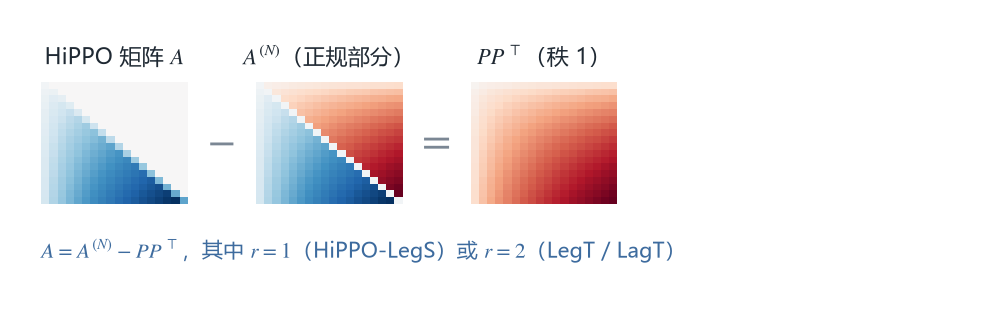

# 第 11 章 NPLR 与 DPLR：把病态矩阵拆开


第 10 章留了一个承诺：HiPPO 矩阵可以精确地写成"正规矩阵加低秩修正"（normal plus low-rank, NPLR），从而绕开非正规矩阵的数值灾难。

本章要把它做实：

1. 什么是正规矩阵，为什么它"数值安全"（一段必要的复习）
2. NPLR 的正式定义，以及 S4 的 Theorem 1：所有 HiPPO 矩阵都是 NPLR 的，低秩阶数只有 $r=1$ 或 $r=2$。
3. 对 HiPPO-LegS 具体给出这个分解（本章会给出可以用几行 NumPy 验证的显式公式）。
4. 这个分解带来什么好处：离散化变成 $O(N)$（S4 的 Theorem 2），卷积核变成可以用 Woodbury 处理（第 12 章）。

回到第 10 章末尾那个疑问：S4 明明可以只用对角矩阵，为什么要费这么大劲？因为 HiPPO 矩阵不是对角的，而我们又不敢对它做对角化。

---

## 11.1 复习：正规矩阵为什么安全

定义：矩阵 $M\in\mathbb{C}^{N\times N}$ 是正规的（normal），若

$$
M^*M = MM^* .
$$

谱定理：$M$ 正规 $\iff$ 存在酉矩阵 $U$（$U^*U = UU^* = I$）和对角矩阵 $\Lambda$ 使

$$
M = U\Lambda U^* .
$$

全部的分量都压在"酉"这个词上。

- 酉矩阵保持内积：$\|Ux\| = \|x\|$。因此它不会放大或缩小任何向量，也不会放大误差。$U$ 的条件数恒为 1。
- 对任意扰动 $E$，特征值的移动可以被 $\|E\|$ 控制住（Bauer–Fike 定理对正规矩阵给出最紧的界）。
- 用浮点算 $U\Lambda U^*$ 得到的矩阵与 $M$ 的相对误差是 $O(\epsilon_{\text{machine}})$。

对比之下，非正规矩阵的相似变换矩阵 $V$ 可能有巨大的条件数 $\kappa(V) = \|V\|\|V^{-1}\|$。第 10 章已经说了：HiPPO 矩阵的 $\kappa(V)$ 是指数级的。

正规矩阵可以在浮点下安全地"用对角矩阵表示"；非正规矩阵不行。

### 低秩修正的想法

现在假设 $A$ 不是正规的，但可以写成

$$
A = N - PQ^\top,
$$

其中 $N$ 正规、$PQ^\top$ 是秩 $r$ 的矩阵（$r \ll N$）。

这个形式之所以有用，是因为有一批矩阵恒等式专门处理"正规/对角 + 低秩"的逆与幂：

- 求逆：Woodbury 恒等式把 $(N - PQ^\top)^{-1}$ 化成 $N^{-1}$ 加一个小矩阵的逆；
- 离散化：$(I - \frac{\Delta}{2}A)^{-1}$ 依然是"对角 + 低秩"（因为 $I - \frac{\Delta}{2}A = (I - \frac{\Delta}{2}N) + \frac{\Delta}{2}PQ^\top$，第一项是正规的）；
- 矩阵-向量乘法：$O(N) + O(Nr)$。

我们不需要"消灭"$A$ 的非正规性，只需要把非正规的部分隔离到一个低秩项里，用恒等式精确处理那一项。这样既不损失精度，又不需要病态的相似变换。

---

## 11.2 S4 的 Theorem 1

**Theorem 1（S4）**：所有 HiPPO 矩阵（Gu 等, 2020 中的全部实例）都有 NPLR 表示

$$
A = V\Lambda V^* - PQ^\top = V\left(\Lambda - (V^*P)(V^*Q)^*\right)V^*,
\tag{11.1}
$$

其中 $V\in\mathbb{C}^{N\times N}$ 是酉矩阵，$\Lambda$ 是对角矩阵，$P,Q\in\mathbb{R}^{N\times r}$ 是低秩因子。

论文紧接着给出关键事实：

> **这些矩阵（HiPPO-LegS、LegT、LagT）满足 $r=1$ 或 $r=2$。特别地，S4 使用的那个矩阵（即 HiPPO-LegS，(5.7)）的 $r=1$。**

这句话的含义很具体：

HiPPO 矩阵的非正规部分只有秩 1。一个看起来极其复杂的、$N\times N$ 的、非正规得"病入膏肓"的矩阵，可以被写成一个正规矩阵减去一个"外积"。

原因是 HiPPO 矩阵的代数结构：它的非正规性只来自一个方向，也就是测度的时间缩放，因此一个秩为 1 的修正就能精确表达它。这不是数值上的凑合。

### 从 NPLR 到 DPLR

因为 $V$ 是酉的，我们可以放心地做共轭变换（Lemma 3.1 的合法应用）：

$$
A \sim V^*AV = \Lambda - (V^*P)(V^*Q)^* =: \Lambda - \tilde P\tilde Q^*
\tag{11.2}
$$

这就是复平面上的"对角 + 低秩"（diagonal plus low-rank, DPLR）形式。$V$ 是酉的，所以这一步数值上完全安全，与第 10 章那个灾难性的 $V_{ij}=\binom{i+j}{i-j}$ 形成鲜明对比。

S4 的核心把戏在这里：先不碰对角化，把 $A$ 拆成"正规 + 低秩"，再用酉变换对角化正规的那部分。

---



*图 11-1　NPLR 分解：把 HiPPO 矩阵写成正规矩阵减去一个秩 $r$ 的修正*

## 11.3 具体看看 HiPPO-LegS 的分解

理论陈述容易失去实感。下面给出 HiPPO-LegS 的显式 NPLR 分解，用几行 NumPy 就能验证。

采用 S4 的符号约定（和 (5.7) 差一个整体负号，方便后面写 $\dot x = Ax+Bu$）：

$$
A_{nk} = \begin{cases}
-(2n+1)^{1/2}(2k+1)^{1/2} & n>k\\
-(n+1) & n=k\\
0 & n<k
\end{cases}
$$

再定义向量 $P\in\mathbb{R}^N$：

$$
P_n = \left(n+\tfrac12\right)^{1/2} = \left(\frac{2n+1}{2}\right)^{1/2}.
$$

那么

$$
\boxed{\ A = A^{(N)} - PP^\top\ }
\tag{11.3}
$$

其中

$$
A^{(N)}_{nk} = \begin{cases}
-\tfrac12\sqrt{(2n+1)(2k+1)} & n>k\\[2pt]
-\tfrac12 & n=k\\[2pt]
+\tfrac12\sqrt{(2n+1)(2k+1)} & n<k
\end{cases}
$$

这个 $A^{(N)}$ 的构造很简单：它等于"反对称矩阵减 $\frac12 I$"。也就是说，若记 $S$ 为反对称矩阵（$S^\top = -S$）满足 $S_{nk} = -\frac{1}{2}\sqrt{(2n+1)(2k+1)}$（$n>k$），则

$$
A^{(N)} = -\tfrac12 I + S .
$$

验证一下各项：

- $n>k$ 时：$A_{nk} + (PP^\top)_{nk} = -\sqrt{(2n+1)(2k+1)} + \frac12\sqrt{(2n+1)(2k+1)} = -\frac12\sqrt{\cdot}$ ✓
- $n<k$ 时：$0 + \frac12\sqrt{\cdot} = +\frac12\sqrt{\cdot}$ ✓
- $n=k$ 时：$-(n+1) + \frac{2n+1}{2} = -(n+1)+n+\frac12 = -\frac12$ ✓

因为 $S$ 反对称，它的特征值是纯虚数；因此 $A^{(N)} = -\frac12 I + S$ 的特征值全部有实部 $-\frac12$，形成共轭对：

$$
\lambda_k(A^{(N)}) = -\frac12 \pm i\,\omega_k,\qquad \omega_k>0 .
$$

（这正是 S4D 论文的 Proposition 4："$\mathrm{Re}(\lambda(A)) = -\frac12$"。）

### 亲自算一遍（数值验证）

我用 NumPy 对 $N=16,64,256$ 算过 $A^{(N)}$ 的特征值（取正的虚部，降序）：

| $N$ | $\omega_0$ | $\omega_1$ | $\omega_2$ | 最小正虚部 |
|---|---|---|---|---|
| 16 | 80.97 | 25.63 | 13.83 | 5.09（第 8 个） |
| 64 | 1303.27 | 433.03 | 258.15 | — |
| 256 | 20860.2 | 6952.0 | 4169.5 | — |

这里有一个值得注意的事实：虚部（频率）的跨度极大，最大频率按 $\omega_0 \approx N^2/\pi$ 增长。这说明 HiPPO 的基函数覆盖了从很低的频率到很高的频率（$\sim N^2$ 量级），在小 $N$ 时就达到了很大的"频率带宽"。这也解释了为什么 HiPPO 用有限的 $N$ 就能记住很长的历史。

S4D 论文给出了这个规律的拟合公式（Conjecture 5 与式 (8)、(9)）：

$$
\textbf{S4D-Inv：}\quad A_n = -\frac12 + i\,\frac{N}{\pi}\left(\frac{N}{2n+1}-1\right),
\qquad
\textbf{S4D-Lin：}\quad A_n = -\frac12 + i\,\pi n .
\tag{11.4}
$$

其中 S4D-Inv 是对 $A^{(D)} = \mathrm{diag}(\lambda(A^{(N)}))$ 的"逆律"近似（我上面的数值验证显示：$N=256$ 时公式给 20779.3，真实值 20860.2，误差 0.4%），而 S4D-Lin 是更简单的一种选择（把频率取成等间距的 Fourier 频率）。这两个初始化在第 14 章会详细讨论。

$A^{(N)}$ 与 $A^{(D)}$ 的差别只在"是否保留低秩项"：$A^{(N)}$ 是正规矩阵，可对角化成 $A^{(D)}$，所以 $A^{(D)} = \mathrm{diag}(\lambda_k)$。S4D 用一个纯对角矩阵就能近似 S4，因为它丢掉的就是那个秩 1 项。

### 一个必须提的修正

S4 论文的最后一段（3.4 节末尾）加了一条重要的脚注：后续工作（Goel 等, 2022, "It's Raw!"）发现，当 $A$ 有特征值落在右半平面时，NPLR 形式 $\Lambda - PQ^*$ 会导致数值不稳定，并提出了一个微小的修改：

$$
\Lambda - PQ^* \quad\longrightarrow\quad \Lambda - PP^* .
$$

也就是说，把低秩项写成"同一个向量的外积"（半正定/半负定）而不是两个不同向量的外积。这个改动在实践中被采用（你会发现 S4 的代码里是 $\Lambda - PP^*$），代价是表达力略微降低（$P=Q$ 是一个约束），收益是永远稳定。这是一个典型的"用一点表达力换确定的安全性"的工程决策。

---

## 这个分解是怎么凑出来的

11.3 节给了一个可以直接验证的结果，但没给“为什么要取 $P_n=\sqrt{n+1/2}$”。这一步其实是可以反推的，反推的过程也说明了秩为什么恰好是 1。

### 先定目标：推到反对称

正规矩阵包括对称、反对称、以及它们的酉相似。三选一时，反对称最好用：对角必须是 0，非对角只是符号相反，一个条件就写完了。

于是目标变成找一个向量 $P$，使

$$
A+PP^\top=-\tfrac12 I+S,\qquad S^\top=-S .
$$

$S$ 的反对称性要求对角全为 0，所以 $-\frac12 I$ 必须单独拿出来。

### 非对角条件给出秩 1

看 $n>k$ 的一对位置。右边在这两个位置上的值是相反的（$S_{nk}=-S_{kn}$），左边的和是

$$
A_{nk}+A_{kn}+2P_nP_k=-\sqrt{(2n+1)(2k+1)}+0+2P_nP_k .
$$

要求它为零，就得到

$$
P_nP_k=\tfrac12\sqrt{(2n+1)(2k+1)}=\sqrt{\tfrac{2n+1}{2}}\cdot\sqrt{\tfrac{2k+1}{2}} .
$$

右边能拆成“$n$ 的函数乘 $k$ 的函数”，这个因式分解就是全部关键。因为能拆，所以 $P_n=\sqrt{(2n+1)/2}$ 一个向量就够了，秩是 1。如果右边是 $\sqrt{(2n+1)(2k+1)}+1$ 这种不可拆的形式，一个外积就写不出来，秩会跳到 2 或更高。LegT 就是这类情形（论文只笼统地说三个矩阵满足 $r=1$ 或 $2$，没有单独点出 LegT 的阶数；按附录 C.1 的构造，它落在 2 那一边）。

### 对角条件自动满足

对角位置没有反对称要求，只要两边相等：

$$
-(n+1)+P_n^2=-\tfrac12\quad\Longrightarrow\quad P_n^2=n+\tfrac12=\frac{2n+1}{2} .
$$

与上一段得到的 $P_n$ 完全一致。两个条件共用一个未知量，碰上了，这就是分解存在的证明。如果对角给出的是 $P_n^2=n+3$，那就无解，只能放弃反对称目标，换成更宽松的正规矩阵。

### 回代验证

把 $P_nP_k=\frac12\sqrt{(2n+1)(2k+1)}$ 代回去，分三种情形：

- $n>k$：$-\sqrt{\cdot}+\frac12\sqrt{\cdot}=-\frac12\sqrt{\cdot}$
- $n<k$：$0+\frac12\sqrt{\cdot}=+\frac12\sqrt{\cdot}$
- $n=k$：$-(n+1)+n+\frac12=-\frac12$

前两行符号相反，对角恒为 $-\frac12$，所以结果确实是 $-\frac12 I+S$。

### 三种 HiPPO 矩阵的对照

同一套手法在三个矩阵上的结果不一样，差别全在“非反对称部分的秩”。

| 矩阵 | 要加的东西 | 加完是什么 | 秩 |
|---|---|---|---|
| LagT | 全 1 矩阵 | 反对称 | 1 |
| LegS | 一个外积 $PP^\top$ | $-\frac12 I$ 加反对称 | 1 |
| LegT | 先减全 1 矩阵，再补一个块状对称项 | 反对称（2-准可分） | 2 |

LagT 最简单：它的非对角元只取 $0$ 与 $-1$ 两个值，加上一个所有元素相同的矩阵（秩 1）后，上下三角的元刚好变成符号相反的一对，对角则变成同一个常数，于是得到一个反对称矩阵加单位阵的倍数，秩 1。LagT 还有一个广义 Laguerre 的变体，加完秩 1 修正后对角变成纯虚加一个实常数，仍然是 DPLR。

LegT 需要两步。论文附录先减去全 1 矩阵，再在特定位置补一个 $2\times2$ 的块，最终得到的反对称矩阵不再是一阶准可分，而是二阶准可分。也就是说，低秩修正付在了“反对称部分更稀疏”上。两种写法可以互相转换，代价要么在秩上，要么在准可分的阶数上。

这张表解释了一件事：HiPPO 的三个实例都不是“碰巧”能拆。下三角加正对角的形状加上对称的幅值 $\sqrt{(2n+1)(2k+1)}$，使得非反对称部分天然是一个外积。换成任何其他形状的矩阵，$r$ 会马上涨上去。

---

## 11.4 NPLR 带来的三个直接好处

### 好处一：离散化变成 O(N)（S4 的 Theorem 2）

**Theorem 2（S4 Recurrence）**：给定任意步长 $\Delta$，递推 (7.1) 的每一步可以在 $O(N)$ 次运算内完成。

为什么成立？因为 $\bar A = (I-\frac{\Delta}{2}A)^{-1}(I+\frac{\Delta}{2}A)$ 中的两个因子都保持 DPLR：

- $(I + \frac{\Delta}{2}A) = (I+\frac{\Delta}{2}\Lambda) - \frac{\Delta}{2}PQ^*$ —— 对角 + 秩 $r$；
- $(I-\frac{\Delta}{2}A)^{-1} = \left[(I-\frac{\Delta}{2}\Lambda) - \frac{\Delta}{2}PQ^*\right]^{-1}$ —— 用 Woodbury，仍是"对角 + 秩 $r$"；
- 两个 DPLR 矩阵相乘，跨项 $PQ^* \cdot PQ^*$ 的秩最多 $r^2$（极小），因此 $\bar A$ 仍是 DPLR。

于是 $\bar A x$ 的计算是"一次对角乘法 + 一次低秩修正"，即 $O(N)$（$r$ 是常数）。

这让推理变得便宜：$N=256$ 时每步只需几千次浮点运算，稠密矩阵则要 $N^2 = 65536$ 次。

### 好处二：卷积核可以用 Woodbury 处理

第 12 章的主体。核心是：生成函数 $\bar C(I-\bar Az)^{-1}\bar B$ 里有一个 DPLR 矩阵的逆，直接上 Woodbury。

### 好处三：参数量的直觉

如果直接在"$N\times N$ 的矩阵"上做梯度下降，参数量是 $O(N^2)$（$N=256$ 时 65536 个）。而 DPLR 形式只需要：

- 对角 $\Lambda$：$N$ 个（复）参数；
- 低秩因子 $\tilde P,\tilde Q$：$2Nr$ 个（$r=1$）；
- $B,C$：$2N$ 个。

S4 论文说"$(\Lambda, P, Q, B, C)$ 构成 S4 的 $5N$ 个可训练参数"（当 $r=1$ 时 $P,Q$ 各 $N$）。从 $O(N^2)$ 降到 $O(N)$，省了 $N$ 倍。

而且 $A$ 的结构约束在训练中一直保持（它是参数化的一部分，不是初始化），所以模型永远不会离开 NPLR 族。每一步训练、每一次推理都落在"安全区"里。

---

## Woodbury：把秩 1 修正从逆里剥出来

NPLR 的用处全在“逆可以被拆开”上。把 $(A-PQ^*)^{-1}$ 手推一遍，三步就能看到低秩项被推到最外层。

### 第一步：把对角部分提出来

$$
\Lambda-PQ^*=\Lambda\left(I-\Lambda^{-1}PQ^*\right).
$$

这里用到 $\Lambda$ 可逆。右边括号里是一个“单位阵减去一个秩 $r$ 的东西”，形状还是 $N\times N$，但它的特殊结构只在那 $r$ 列上。

### 第二步：用一次恒等式

需要一个恒等式把 $I-UV$ 的逆写成 $I$ 加一个 $r\times r$ 的逆。它长这样：

$$
(I-UV)^{-1}=I+U(I_r-VU)^{-1}V,
$$

其中 $U\in\mathbb{C}^{N\times r}$、$V\in\mathbb{C}^{r\times N}$，$I_r$ 是 $r$ 阶单位阵。验算只需一行：把右边乘上 $(I-UV)$，中间那两项 $UVU(I_r-VU)^{-1}V$ 与 $U(I_r-VU)^{-1}VUV$ 可以移项合并（因为 $VU$ 与 $(I_r-VU)^{-1}$ 可交换），剩下 $I-UV+UV=I$。

### 第三步：乘回去

取 $U=\Lambda^{-1}P$、$V=Q^*$。此时 $VU=Q^*\Lambda^{-1}P$ 是 $r\times r$ 的小矩阵，于是

$$
(\Lambda-PQ^*)^{-1}=\Lambda^{-1}+\Lambda^{-1}P\left(I_r-Q^*\Lambda^{-1}P\right)^{-1}Q^*\Lambda^{-1}.
$$

形状上验一下：$\Lambda^{-1}$ 是 $N\times N$，第二项是 $(N\times r)(r\times r)(r\times N)$，也是 $N\times N$。代价从 $O(N^3)$ 变成 $O(N)+O(Nr)+O(r^3)$。

### 秩一时的标量形式

这时 $P=p$、$Q=q$ 是列向量，$Q^*\Lambda^{-1}P$ 是一个数，整个式子简化为

$$
(\Lambda-pq^*)^{-1}=\Lambda^{-1}+\frac{\Lambda^{-1}pq^*\Lambda^{-1}}{1-q^*\Lambda^{-1}p}.
$$

唯一的除法是一个标量除法。这也把风险指出来了：分母 $1-q^*\Lambda^{-1}p$ 接近 0 时，这整个式子没意义。它不是数值技巧的问题，而是“$\Lambda-pq^*$ 真的接近奇异”。

### 拿二阶的验一遍

取 $\Lambda=\operatorname{diag}(-0.5+i,\ -0.5-i)$、$p=(1,2)^\top$、$q=(0.5,1)^\top$。先算标量分母。倒数要分子分母同乘共轭，$|-0.5+i|^2=1.25$，所以

$$
\Lambda^{-1}=\operatorname{diag}\left(\frac{-0.5-i}{1.25},\ \frac{-0.5+i}{1.25}\right)=\operatorname{diag}(-0.4-0.8i,\ -0.4+0.8i).
$$

于是 $q^*\Lambda^{-1}p=-1+1.2i$，$1-q^*\Lambda^{-1}p=2-1.2i$，模长 2.33，离奇异很远。

两条路的结果

```text
direct   = [[-0.558824-0.735294j,  0.294118+0.176471j],
            [ 0.294118+0.176471j, -0.470588+0.117647j]]
woodbury = [[-0.558824-0.735294j,  0.294118+0.176471j],
            [ 0.294118+0.176471j, -0.470588+0.117647j]]
max diff = 5.6e-17
```

误差在双精度的舍入水平上。这不是巧合：Woodbury 是恒等式，不是近似。S4 的全部效率就建立在这个“恒等式”上，而不是建立在“低秩项可以忽略”上。

### 到 S4 的核公式里

第 12 章要算的生成函数里有一个 $[\frac{2}{\Delta}\frac{1-z}{1+z}I-\Lambda+PQ^*]^{-1}$。把 $\frac{2}{\Delta}\frac{1-z}{1+z}I-\Lambda$ 当成新的“对角部分”（它仍然是对角的，只是每个元都随 $z$ 变），上面那个展开直接通用，只是 $1-q^*\Lambda^{-1}p$ 变成了 $1+Q^*R(z)P$，符号变正来自 $+PQ^*$ 而不是 $-PQ^*$。

于是卷积核的计算里唯一需要求逆的，就是这 $r\times r$ 的小矩阵，而它要在 $L$ 个单位根上各求一次。$r=1$ 时是 $L$ 个标量除法，完全可并行。**Woodbury 把 $N$ 从“矩阵维度”降级成“向量长度”。**

---

## 离散化的两步展开

Theorem 2 说每步 $O(N)$，具体怎么做到的在论文附录 C.2。展开一次，就能看到两个因子各自保持 DPLR。

双线性（Tustin）离散化的定义是

$$
\bar A=\left(I-\frac{\Delta}{2}A\right)^{-1}\left(I+\frac{\Delta}{2}A\right),\qquad
\bar B=\left(I-\frac{\Delta}{2}A\right)^{-1}\Delta B .
$$

### 前向因子

$$
I+\frac{\Delta}{2}A=I+\frac{\Delta}{2}(\Lambda-PQ^*)=\frac{\Delta}{2}\underbrace{\left(\frac{2}{\Delta}I+\Lambda-PQ^*\right)}_{A_0} .
$$

$A_0$ 是“对角加秩 $r$”，对角是 $\frac{2}{\Delta}+\lambda_n$。

### 后向因子

$$
\left(I-\frac{\Delta}{2}A\right)^{-1}=\frac{2}{\Delta}\underbrace{\left[D-DP(I+Q^*DP)^{-1}Q^*D\right]}_{A_1},
$$

其中 $D=\left(\frac{2}{\Delta}I-\Lambda\right)^{-1}$ 是对角矩阵。这一步就是把 Woodbury 直接套上去，$I+Q^*DP$ 在 $r=1$ 时是标量。

### 乘起来

$$
\bar A=A_1A_0,\qquad \bar B=2A_1B .
$$

两个 DPLR 矩阵相乘，结果还是 DPLR：展开后除了两个对角项，剩下的交叉项是 $P$ 或 $Q$ 的倍数，秩不超过 $2r$。逐项数一下：$A_0A_1$ 里的低秩部分包含 $A_0$ 的 $PQ^*$、$A_1$ 的 $DP\cdots Q^*D$，以及它们的乘积 $PQ^*DPQ^*$，最后一项是一个外积乘一个标量（$r=1$ 时），仍然秩 1。于是 $\bar A$ 的秩最多 $2r$，$r=1$ 时是 2。

关键是 $A_0$ 与 $A_1$ 只通过矩阵-向量乘访问。两者都是 DPLR，一次乘只要“$N$ 次对角运算加 $r$ 次内积”，也就是 $O(N)$。稠密矩阵在这一步要 $N^2$；$N=256$ 时是 65536 对几千。

一个实现上的细节：$D$ 的元素是 $1/(\frac{2}{\Delta}-\lambda_n)$，$\Delta$ 很大时 $D$ 接近 $\Delta/2$，$\Delta$ 很小时 $D$ 的元素变小但 $2/\Delta$ 变大，两者在 $A_1$ 里乘起来互相抵消。直接用这个式子时要注意别让 $2/\Delta$ 提前溢出，把它和后面的 $\Delta B$ 合在一起算（这也是 $\bar B=2A_1B$ 里那个系数 2 的来历）。

---

## 秩一的几何含义

“秩 $r$”这个数字到底量的是什么？容易误以为它量的是“非正规的程度”。它不是。

### 用对易子度量非正规性

正规性的定义是 $[A^*,A]=A^*A-AA^*=0$。自然的想法是拿这个对易子的秩当指标。把 $A=N-pq^*$ 代进去（$N$ 正规），$N^*N=NN^*$ 的两项消掉，剩

$$
[A^*,A]=-N^*pq^*-qp^*N+\|p\|^2qq^*+Nqp^*+pq^*N^*-\|q\|^2pp^* .
$$

六项，每一项都是“某个矩阵乘上秩 $r$ 的因子”，由秩的次可加性，$\operatorname{rank}[A^*,A]\le 6r$。在 HiPPO-LegS（$r=1$）上实测，$N=4$ 与 $N=8$ 时秩都恰好是 2，小于这个上界，但与 $N$ 无关。

### 秩与病态程度是两回事

一个秩 1 的修正能造出多么病态的矩阵？10.2 节那个 $A_c$ 就是答案。它自己也是 NPLR 的：把非对角条件 $p_0p_1=c/2$ 与“对角算完相等”这两条联立，令 $u=p_0^2$，解 $u^2+u-c^2/4=0$ 得

$$
p_0=\sqrt{\frac{\sqrt{1+c^2}-1}{2}},\qquad p_1=\frac{c}{2p_0} .
$$

$c=\sqrt3$ 时解出 $p=(0.7071,\ 1.2247)^\top$，正好是 11.3 节那个 HiPPO 的 $P$，两个例子在这里对上了。$c=100$ 时 $p\approx(7.04,\ 7.11)^\top$，$A_c+pp^\top$ 的对角变成同一个数 $48.5$、非对角变成 $\mp50$，仍然正规。

秩全程是 1。而条件数从 4.79 变到 $10^4$。

所以两个量正交。秩量的是“非正规性沿着几个方向”，条件数量的是“每个方向被拉多长”。前者是一个组合量，取值是整数，不能连续变化；后者可以任意大。

这个区分对 S4 是致命的有利。Woodbury 的成本只看 $r$（$r\times r$ 的求逆，$r=1$ 时是标量除法），一点不看 $\kappa$。于是一个条件数 $10^{19}$ 的矩阵和一个性质完美的矩阵，在核算法里的代价一样。**S4 不消灭病态，它把病态搬到了不用求逆的地方。**

反面例子很好找。随机矩阵的非正规性散布在 $O(N)$ 个方向上，$r\approx N$，Woodbury 的小矩阵变成 $N\times N$，收益归零，回到 $O(N^3)$。这正是“结构”两个字的价码：不是所有矩阵都能享受这套算法。

还有一层容易被忽略：对易子的范数与它的秩是两个独立的量。$\|[A^*,A]\|$ 可以随 $N$ 幂次增长，秩却始终是 2。S4 对后者敏感、对前者完全无感。拿 $\|[A^*,A]\|$ 去衡量“能不能快算”会得到完全错误的结论。

Woodbury 里那个 $I_r$ 也值得盯一眼。写成 $(I_r-Q^*\Lambda^{-1}P)^{-1}$ 而不是 $(I_N-\cdot)^{-1}$，因为要倒的是“低秩修正作用在 $r$ 维子空间上的限制”，不是整个 $N$ 维空间上的算子。写成 $I_N$ 的话量纲都对不上：$Q^*\Lambda^{-1}P$ 是 $r\times r$，没法和 $N\times N$ 的单位阵相加。这就是低秩修正“只在 $r$ 个方向上出问题”的代数表达。

---

## 一个二阶的完整走查

把 $N=2$ 的 LegS 从头走一遍，所有数字都能手算。

$P_n=\sqrt{(2n+1)/2}$ 给出 $p=(0.7071,\ 1.2247)^\top$。外积

$$
pp^\top=\begin{pmatrix}0.5&0.866\\ 0.866&1.5\end{pmatrix}.
$$

把它加到 $A=\begin{pmatrix}-1&0\\-1.732&-2\end{pmatrix}$ 上：

$$
A^{(N)}=\begin{pmatrix}-0.5&0.866\\ -0.866&-0.5\end{pmatrix}=-0.5\,I+0.866\begin{pmatrix}0&1\\-1&0\end{pmatrix}.
$$

第二个矩阵是一个旋转（转 $-90^\circ$），反对称，特征值 $\pm i$。所以

$$
\lambda(A^{(N)})=-0.5\pm0.866i,\qquad|\lambda|=1 .
$$

而 $A$ 自己的特征值是 $-1$ 与 $-2$。两个谱完全不同，唯一的联系是迹：$\operatorname{tr}(A^{(N)})=-1=\operatorname{tr}(A)+\operatorname{tr}(pp^\top)=-3+2$。

### 两个谱，别搞混

这是全书里最容易搞反的一处。$A$ 是下三角，特征值就在对角线上，$-1,-2$。$A^{(N)}$ 是正规矩阵，它的特征值是 $-0.5\pm i\omega$，跟 $-1,-2$ 一点关系没有。

NPLR 的 $\Lambda$ 是后者的谱，不是前者的。第 10.2 节说的“病态对角化”指的是前者（$A=VMV^{-1}$，$V$ 条件数 $10^{19}$）；第 11.2 节说的“酉对角化”指的是后者（$A^{(N)}=V\Lambda V^*$，$V$ 条件数 1）。两件事共用一个字母 $V$，但完全不是一回事。

写成一行对照：

$$
\underbrace{\begin{pmatrix}-1&0\\-1.732&-2\end{pmatrix}}_{\text{特征值 }-1,-2,\ V\text{ 病态}}
=\underbrace{V\Lambda V^*}_{\text{特征值构造的谱}}-\underbrace{pp^\top}_{\text{秩 1}} .
$$

左边那个三角矩阵的特征值只是它的对角元，与 $\Lambda$ 无关。$N$ 大时这个差别更明显：$A$ 的谱是从 $-1$ 到 $-N$ 的实数，$\Lambda$ 的谱是实部全为 $-0.5$、虚部从 $O(1)$ 到 $O(N^2)$ 的一整套复数。

### 二阶情形的模长

$|\lambda|=1$ 这个小事实值得一提。它是 LegS 在 $N=2$ 的特例，更一般的规律是 11.4 节那个 S4D-Inv 拟合式：虚部按 $1/(2n+1)$ 递减，实部恒为 $-0.5$。模长是 $\sqrt{0.25+\omega_n^2}$，所以它随 $n$ 单调减小，最大的是 $n=0$ 那个（$N=256$ 时虚部 $2.1\times10^4$，模长也就是两万多）。

这对离散化有意义。$\bar A$ 的特征值是 $(1+\Delta\lambda/2)/(1-\Delta\lambda/2)$，模长小于 1 当且仅当 $\operatorname{Re}\lambda<0$。实部恒为 $-0.5$ 意味着不论 $\Delta$ 取多少，离散后的模态都是衰减的，没有一个是发散的。这是 HiPPO 的又一个好消息。

---

## 数值验证：两套基底的条件数

全章的论点可以用一张表钉死。对同一个 HiPPO-LegS 矩阵，算两种基底的条件数：一种是 $A$ 自己的特征向量（实谱 $-1,\dots,-N$），一种是 $A^{(N)}$ 的特征向量（复谱，实部恒 $-0.5$）。

```python
import numpy as np

def build(N):
    A = np.zeros((N, N))
    for n in range(N):
        for k in range(N):
            if n > k:
                A[n, k] = -((2*n+1)*(2*k+1)) ** 0.5
            elif n == k:
                A[n, k] = -(n + 1)
    P = np.array([((2*n+1)/2) ** 0.5 for n in range(N)])
    return A, A + np.outer(P, P)
```

| $N$ | $\kappa$（$A$ 的基底） | $\kappa$（$A^{(N)}$ 的基底） | $\lVert A+A^{\top}\rVert$ 偏差 | $\max\lvert\operatorname{Re}\lambda+0.5\rvert$ |
|---|---|---|---|---|
| 4 | 97 | 1.000 | $9\times10^{-16}$ | $4\times10^{-16}$ |
| 8 | $9.2\times10^4$ | 1.000 | $2\times10^{-15}$ | $7\times10^{-16}$ |
| 16 | $1.0\times10^{11}$ | 1.000 | $4\times10^{-15}$ | $1\times10^{-15}$ |
| 32 | $7.1\times10^{18}$ | 1.000 | $7\times10^{-15}$ | $1\times10^{-14}$ |

第三列是“加到 $A^{(N)}$ 上的那个 $P P^\top$ 是否真的把它变成了反对称”，把 $A^{(N)}+\frac12 I$ 与其转置相加，元素都在舍入水平。第四列验证了实部确实是 $-0.5$。

第二、三列放在一起看就是全章的论点：$N=16$ 时，同一个矩阵的两套基底，条件数差十一个数量级。一套是 $10^{11}$（双精度只剩 5 位），一套是 $1$（一位不损失）。而两套基底描述的是同一个算子，算出来的卷积核也是同一组数。病态不在矩阵里，在基底里。

这也解释了为什么 S4 的算法只用到 $A^{(N)}$ 这一侧。NPLR 分解一旦拿到，后面所有的生成函数、Woodbury、柯西核全部在 $\Lambda$ 与 $P,Q$ 上进行，$A$ 自己的特征向量从不出现。$\kappa=10^{18}$ 那一列在算法里根本没有入口。

---

## 为什么 Λ 是复的

实矩阵的 DPLR 分解里，$\Lambda$ 是复对角。这不是为了好看，是必须。

实反对称矩阵的特征值纯虚。最小的例子就是二阶旋转

$$
J=\begin{pmatrix}0&1\\-1&0\end{pmatrix},\qquad\lambda(J)=\pm i .
$$

它的特征向量是 $(1,i)$ 与 $(1,-i)$，没有实向量。一个实反对称矩阵除非是零矩阵，否则不可能在实数域内对角化。所以只要 $A^{(N)}$ 的反对称部分不是零，$\Lambda$ 就必然带虚部。

推论是：$V$ 是复酉的，$P,Q,B,C$ 全部变成复数。一个通道的参数存储翻倍，复数矩阵-向量乘是四次实数乘加。

### 想留在实数域的两条路

第一条是用实 Schur 形式。实矩阵一定能正交相似于块对角阵，每个 $2\times2$ 块对应一对共轭特征值。这样 $V$ 是实正交的（条件数 1），$\Lambda$ 变成“每两个元一个 $2\times2$ 旋转块”的块对角。

代价在 Woodbury 里。原来的 $D=(\frac{2}{\Delta}I-\Lambda)^{-1}$ 是对角矩阵，现在要对角块加非对角块，$D$ 变成块对角（每块 $2\times2$）。$I_r+Q^*DP$ 的尺寸从 $r$ 变成 $2r$（$r=1$ 时是 $2\times2$）。好在 $2\times2$ 求逆仍然是 $O(1)$，整个算法的复杂度不变，只多一个常数因子。

第二条是直接换成实数对角，把虚部丢掉。这就是 S4D 的做法：只保留 $\Lambda$ 的对角元，$P,Q$ 退化成只需要 $B,C$，整个算法退成 Vandermonde 乘积。代价是失去低秩项（第 14 章）。

S4 论文选的是第一条里的复数版本，推导全程用复的 $R(z)$，实现也是复数。好处是公式最短：$R(z)$ 对角、$r\times r$ 求逆、一次 iFFT，三步写完。后面 S4D 与 Mamba 都改用了实数对角（第 14 章、第 17 章），那时复数带来的开销就成了被优化的对象。

这里有一个交换值得记下来。复数让 $R(z)$ 严格对角，而对角是第 12 章那个柯西核能写成“一个节点对一个极点”的前提。换成实 Schur 块后，$R(z)$ 变成块对角，公式里要多一层 $2\times2$ 索引，柯西核也不再是单个标量除法，而是一批 $2\times2$ 块求逆。公式长度与实数运算，两选一。

---

## 11.5 与 LSSL 的 Theorem 1 的关系

把 S4 的 Theorem 1 和 LSSL 的 Theorem 1 放在一起看，能看出两篇论文的关系：

| | LSSL（2021） | S4（2021/2022） |
|---|---|---|
| 结构刻画 | 低递推宽度（LRW）/ 准可分 | 对角 + 低秩（DPLR） |
| 参数压缩 | $O(N)$ | $O(N)$ |
| 快速乘法 | 有，但**数值不稳定** | 有，**数值稳定**（Woodbury + Cauchy） |
| 是否实现 | 没有 | 实现并开源 |
| 覆盖范围 | 任意测度的经典正交多项式 | 全部 HiPPO 矩阵（$r=1,2$） |

两者都在刻画"HiPPO 矩阵属于哪类结构化矩阵"。S4 的胜利在于它选的结构（DPLR）同时满足两个条件：能表示 HiPPO，有数值稳定的算法。LSSL 选的准可分结构满足前者，不满足后者。

这里有一条可复用的工程方法论：当有多个物理上等价的结构化表示可选时，选那个数值性质最好的。

---

## 参数化与初始化是两件事

11.4 节的好处三说“结构约束在训练中一直保持”，这句话容易被读成“NPLR 带来了效果”。它不是。

S4 论文在消融里把两者拆开了。随机初始化的 NPLR 矩阵（有正规加低秩的结构，但数值不是 HiPPO）效果很差，与随机对角矩阵差不多；只有 HiPPO 初始化的 NPLR 才能到好结果。论文的原话是，S4 的有效性主要来自 HiPPO 初始化，而不是 NPLR 参数化。

所以分工是这样的。NPLR 决定“能不能算得快、算得稳”，它是一个可计算性条件；HiPPO 决定“算出来的东西有没有用”，它是一个归纳偏置。两个条件都满足，S4 才成立。只满足后者是 LSSL 的处境，只满足前者是随机 NPLR 的处境。

### 可学的是什么

训练时 $\Lambda,P,Q,B,C$ 都是参数，梯度会同时改它们，$A$ 也就随之变化，但始终停在 NPLR 族里。这意味着两件事。

好处是永远不会遇到“稠密 $A$ 不可对角化”的坑，每一步都在安全区。代价是表达力被结构锁住，学不出 NPLR 族以外的矩阵。从消融看，这个代价不亏：随机 NPLR 的验证集表现已经说明，“有结构但初始化对”比“没结构但自由”好得多。

### 实部的方向很敏感

$\Lambda$ 的对角元带实部，它也会被训练改。一旦某个 $\lambda_n$ 的实部滑到右半平面，$\bar A$ 的对应特征值就跑到单位圆外，长序列上的递推开始指数增长。11.3 节末尾提到的那个修正（$\Lambda-PQ^*$ 改成 $\Lambda-PP^*$）就是冲着这类不稳定去的：把低秩项写成半负定形式，可以从结构上排除一部分右半平面的情形。

这条经验后来变成了设计选择。S4D 直接把实部固定在 $-0.5$ 不动，只学虚部，参数从 $N$ 个复数降成 $N$ 个实数（第 14 章）。把一个敏感的连续参数换成常量，用表达力换确定性，这在数值方法里是常规操作。

把两个条件叠在一起看，S4 的设计就没什么神秘了。HiPPO 决定了 $A$ 该落在哪个共轭类里，这是数学层面的选择；NPLR 决定了在这个共轭类里怎么挑一个能算的代表，这是算法层面的选择。两个选择互不依赖，也互不替代。漏掉前者，得到一堆算得快但没用的模型；漏掉后者，得到一个好用但算不动的模型。

---

## 11.6 本章小结

- 正规矩阵（$MM^*=M^*M$）可以被酉矩阵对角化，因此数值安全；非正规矩阵的相似变换矩阵条件数可能指数级大。
- NPLR：$A = V\Lambda V^* - PQ^\top$（$V$ 酉、$\Lambda$ 对角、$PQ^\top$ 秩 $r$）。好处是把非正规性隔离到一个低秩项里，用矩阵恒等式精确处理，不做病态变换。
- Theorem 1：所有 HiPPO 矩阵都是 NPLR 的，$r=1$ 或 $2$；S4 用的 HiPPO-LegS 是 $r=1$。
- HiPPO-LegS 的显式分解（可用 NumPy 验证）：$A = A^{(N)} - PP^\top$，其中 $P_n=\sqrt{n+1/2}$，$A^{(N)} = -\frac12 I + S$（$S$ 反对称），因此 $\lambda(A^{(N)}) = -\frac12 \pm i\omega_k$——实部恒为 $-1/2$。
- 频率谱很宽：最大虚部约 $N^2/\pi$。S4D-Inv 用 $A_n = -\frac12 + i\frac{N}{\pi}\left(\frac{N}{2n+1}-1\right)$ 拟合（数值验证误差 <1%）；S4D-Lin 用 $A_n=-\frac12+i\pi n$。
- 实践中的修正：$\Lambda - PQ^*$ 改为 $\Lambda - PP^*$，避免右半平面特征值带来的不稳定。
- 三个好处：离散化 $O(N)$（Theorem 2）、卷积核可用 Woodbury、参数量 $O(N)$ 而非 $O(N^2)$。
- 与 LSSL 的对比：两者都在刻画 HiPPO 矩阵的结构，S4 选的结构（DPLR）同时具备"能表示 HiPPO"和"数值稳定"两个性质。

## 下一章

第 12 章的技术密度最高：把那三个降维（生成函数 → Woodbury → 柯西核）逐步算清楚，并给出 S4 的 5 行算法。读完之后你会彻底明白"为什么 S4 能在 $\tilde O(N+L)$ 内算出卷积核"。
