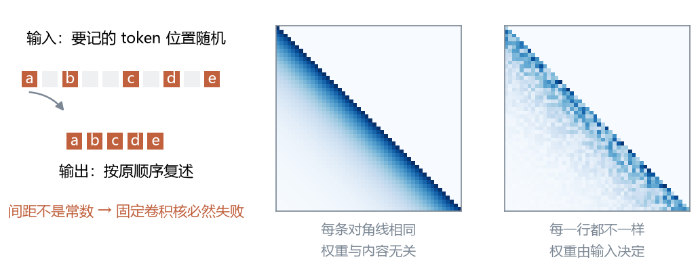

# 第 17 章 核心洞察：线性时不变是瓶颈

前三篇里，我们把 SSM 从数学理论（HiPPO）一路做到了工程可用（S4D）。但有一个事实被反复提到却从未正面处理：

**S4 在语言上还是打不过 Transformer。**

第 13 章的数字不好看：WikiText-103 上 20.95 vs 20.51 ppl，差 0.44。第 16 章讲了，H3、Hyena 这些工作试图用加门控来弥补，把差距缩到 0.4 个点，仍然没赢。

Mamba（Gu & Dao, 2023）的回答是：问题不在架构，在 SSM 本身。

诊断过程分四步：

1. Mamba 提出的统一分析框架：序列建模 = 压缩上下文，所有模型的差别都在"怎么压缩"。
2. 两个精心设计的合成任务（Selective Copying 与 Induction Heads），把线性时不变的缺陷暴露到极致。
3. 为什么加门控救不了。这个论证很精确，也很容易混淆。
4. 结论：必须让 $\Delta, B, C$ 依赖输入。这个改动叫"选择性"（selection）。

---

## 17.1 统一框架：序列建模就是压缩

Mamba 论文开篇给了一个分析框架，我认为是全书最有价值的。原话大意是：

> 一个序列模型的效率与效果，由它把上下文压缩进状态的能力决定。

把这个框架套到三大范式上：

| 模型 | 状态大小 | 压缩率 | 训练成本 | 推理成本（每步） |
|---|---|---|---|---|
| 注意力 | $O(L)$（KV cache，**不压缩**） | 1（不压缩） | $O(L^2)$ | $O(L)$ |
| RNN / SSM | $O(N)$，$N$ 固定 | $L/N$ | $O(L)$ | $O(N)$ |
| 卷积 | $O(k)$（核宽） | 固定 | $O(L\log L)$ | $O(L)$ |

注意力的"效果"来自它不压缩：整个上下文原样保存，不会丢信息，代价是成本随 $L$ 增长。

RNN/SSM 的"效率"来自它压缩，代价是可能丢掉关键信息。

压缩本身是必须的，问题在于给定状态预算下怎么把最有用的信息压进去。

Mamba 的诊断是：LTI（线性时不变）SSM 的压缩策略固定，不依赖内容。

因此它必然把"重要信息"和"无关信息"一视同仁地压。

这句话需要具体化，下面两个任务做的就是这件事。

### 一个必要的回顾：LTI 意味着什么

S4 的参数 $(\Delta, A, B, C)$ 在所有时间步上是同一组数，这就是"线性时不变"。

它的直接后果是（第 2.5 节）：

$$
y = \bar K * u,\qquad \bar K_i = \bar C\bar A^i\bar B .
$$

核 $\bar K$ 是一个固定的向量。位置 $j$ 从位置 $i$ 取多少信息，只由距离 $j-i$ 决定，与内容无关。

用第 1 章的矩阵语言：$M_{ji} = \bar C\bar A^{j-i-1}\bar B$ 只依赖 $j-i$。这是一个 Toeplitz 矩阵。

LTI 的好处是可以 FFT、可以并行、可以用柯西核或范德蒙德；坏处是 $M$ 与内容无关，而这正是下面两个任务要惩罚的性质。

---

## 17.2 任务一：Selective Copying（选择性复制）

### 先看简单的 Copying

经典的 Copying 任务（Arjovsky、Shah、Bengio, 2016）：给模型看一串 token，隔一段空白，然后让它按原顺序复述出来。

经典 Copying 任务中，输入与输出之间的间距是固定常数。

间距固定意味着 LTI 模型可以作弊：它只要学一个恰好那么长的卷积核，就能把输入原样"搬"到输出位置。

这个作弊合法而且有效。Romero 等人（2021, CKConv）验证过：全局卷积（也就是 LTI SSM）能轻松解决 Copying。

它需要的只是"时间感知"（time-awareness，知道该延迟多少步），不需要"内容感知"（content-awareness）。

### 再看 Selective Copying

Mamba 把任务改成：token 的位置随机，中间夹杂随机数量的空白。

*图 17-1　左：Selective Copying 的输入输出；中：时不变模型的权重矩阵每条对角线相同；右：选择性 SSM 的权重随内容改变*

固定的卷积核在这里必然失败，因为间距不是常数。模型必须根据内容判断哪些 token 要记、哪些要丢。

> 这就是"选择性"的字面含义：在序列维度上，按内容决定信息的去留。

论文的表述很精确：从递归视图看，LTI 的 "$(A,B)$ 转移"不随时间变化，因此无法以输入相关的方式影响传递给后续的状态。

从卷积视图看，全局卷积无法处理"间距可变"的问题，因为静态卷积核表达不了可变的间距。

### 实验结果（Mamba 论文 Table 1）

组合不同的架构（外层 block）与不同的内层序列混合层：

| 架构 | 内层 | 准确率 |
|---|---|---|
| —（无门控） | S4（LTI） | 18.3 |
| —（无门控） | **S6（选择性）** | **97.0** |
| H3 | S4 | 57.0 |
| Hyena | Hyena（LTI 长卷积） | 30.1 |
| H3 | **S6** | **99.7** |
| Mamba | S4 | 56.4 |
| Mamba | Hyena | 28.4 |
| Mamba | **S6** | **99.8** |

表的读法有两个方向。

- 换架构（S4 → H3 → Mamba）能带来一些提升（18.3 → 56.4），但离解决还很远；
- 换内层 SSM（S4 → S6）直接把准确率从 18.3 拉到 97.0；
- 两者结合最好（99.8）。

结论：在这个任务上，架构不是主要矛盾，序列混合层是不是选择性的才是。这也是第 16 章那句"门控不够"的实验证据。

---

## 17.3 任务二：Induction Heads（归纳头）

### 任务定义

Induction head 是机制可解释性（mechanistic interpretability）研究里一个有名的结构（Olsson 等, 2022），被认为是 LLM 上下文学习（in-context learning）能力的主要来源之一。

任务形式很简单：

序列里先出现 `Harry Potter` 这样的二元组，之后再次遇到 `Harry` 时，模型应当补出 `Potter`。

也就是说：如果序列里曾经出现过二元组 "Harry Potter"，那么当 "Harry" 再次出现时，模型应该输出 "Potter"。

这是联想回忆（associative recall）：给定一个键，从历史中找回对应的值。

### 为什么 LTI 模型做不好

联想回忆要求模型在正确的位置、根据内容取回特定的历史信息，LTI 的固定核做不到这种"根据内容定位"。

但这里有个区分：H3 论文认为"递归/卷积架构 + 门控"能做一定程度的联想回忆，因为门控允许输入调制输出的通路。

Mamba 论文的反驳是：门控能做"内容相关的加权"，做不了"内容相关的定位"，因为门控不沿序列轴交互（见 17.4 节）。

### 实验结果

Mamba 论文的 Induction Heads 实验设计得很能说明问题：

- 模型：2 层（注意力机制在理论上解决这个任务所需的最小结构）；
- 训练序列长度 256（$2^8$）；
- 测试长度从 64（$2^6$）一直到 1,048,576（$2^{20}$）。

结果：

> Mamba（S6 层）完美解决，并且能外推到长度为 100 万（比训练时长了 4000 倍）的序列；其他方法都无法超过训练长度的 2 倍。

4000 倍外推是个很强的主张，解释是：选择性 SSM 学到的是"算法"而不是"模式"。

它学到的是"当看到 ★→"X" 这个模式时，去历史里找上一次 ★ 后面是什么"，这个算法与序列长度无关。而 LTI 模型学到的是"一个长度约 256 的核"，换个长度就失效。

论文还提到一个细节：注意力模型（含各种位置编码，如 xPos）都没有超过 2 倍外推。原因也是它们依赖固定的位置编码模式。

另外，Mamba 论文（H3 论文同样）指出，注意力的 induction head 是 2 层机制，所以 2 层模型是公平的比较，这排除了"Mamba 只是深度更大所以更强"的解释。

---

## 17.3.5 两个任务的实验协议与完整曲线

17.2 与 17.3 给的是结论。这一节把两个任务的设置与完整曲线摆出来，目的是让“LTI 在这里必然失败”从一句话变成可以查的东西。

### Selective Copying 的设置

序列长度 4096，词表 16（其中一个是空白），需要模型记住其中 16 个数据 token。2 层，$D=64$，训 400K 步，学习率 $10^{-4}$ 恒定，batch 64。评分是整段全对才算对。

这个设置的狠处在于：任务本身很简单（只需记住 16 个位置），但间距随机。模型必须做到两件事，而这两件事对同一组参数提出相反要求。读到空白时，什么也不要写进状态（否则 4000 步的空白会把状态洗成噪音）；读到彩色 token 时，写进去并且一直保留到输出。

标量情形可以把矛盾写成一个两行的论证。设输入 $u_t\in\{0,c\}$，要求状态 $h_t$ 等于“最近一个非零 $u$”。LTI 递推是 $h_t=\bar a h_{t-1}+\bar b u_t$，$\bar a$ 对所有 $t$ 相同。

读到空白时 $u_t=0$，要 $h_t=h_{t-1}$，只能 $\bar a=1$。但 $\bar a=1$ 时递推退化成 $h_t=h_0+\bar b\sum_{s\le t}u_s$，这是个累积和，旧值永远不会被“换掉”，所以得到的是计数而不是最近值。要把旧值换掉，必须 $\bar a<1$；可一旦 $\bar a<1$，空白也会把状态洗掉。两个要求不能同时满足。

多状态情形不是这个论证的直接推论，但道理相同：核 $\bar K$ 只依赖距离，因此“该不该看某个位置”完全由距离决定。而这里需要的是由内容决定。

### Induction Heads 的设置与完整曲线

2 层模型，Mamba 的 $D=64$，其余模型 128（论文原文如此），MHA 用 8 头。词表 16，训练长度 256（$2^8$），测试长度从 64 到 1,048,576。每个“epoch”是 8192 步，Mamba 的 200K 步相当于 25 个 epoch。学习率 Mamba 用 $10^{-3}$，其余 $2\times10^{-4}$。

| 模型 | 参数量 | $2^6$ | $2^8$ | $2^9$ | $2^{10}$ | $2^{11}$ | $2^{12}$ | $2^{13}$ | $2^{14}$ | $2^{20}$ |
|---|---|---|---|---|---|---|---|---|---|---|
| MHA-Abs | 137K | ✓ | 100.0 | 58.6 | 26.6 | 18.8 | 9.8 | 10.9 | 7.8 | 爆显存 |
| MHA-RoPE | 137K | ✓ | 100.0 | 83.6 | 31.3 | 18.4 | 8.6 | 9.0 | 5.5 | 爆显存 |
| MHA-xPos | 137K | ✓ | 100.0 | 99.6 | 67.6 | 25.4 | 7.0 | 9.0 | 7.8 | 爆显存 |
| H3 | 153K | ✓ | 100.0 | 80.9 | 39.5 | 23.8 | 14.8 | 8.2 | 5.9 | 7.4 |
| Hyena | 69M | 97.7 | 100.0 | ✓ | 44.1 | 12.5 | 6.6 | 5.1 | 7.0 | 9.8 |
| Mamba | 74K | ✓ | 100.0 | ✓ | ✓ | ✓ | ✓ | ✓ | ✓ | ✓ |

（中间几列略去，数值都在 5–15% 区间。完整表在 Mamba 论文 Table 11。）

这张表的读法不是“谁高谁低”，而是“在哪里拐弯”。

所有模型在训练长度 256 上都是 100%。MHA-Abs 在 512 就掉到 58.6，是拐得最早的。RoPE 与 xPos 能撑到 512，1024 就崩。H3 与 Hyena 多撑一格，但 2048 之后落到 20% 以下，4096 之后都在 15% 以内。

回落的位置很关键：词表是 16，随机猜是 6.25%。表里所有失败模型的远端数值都在 5–15%，正好在随机水平上下。这说明它们不是“变差了一点”，而是输出退化成了一阶统计（unigram 先验），完全不看上下文。

“没训够”这个解释也被排除了。H3 与 Hyena 在 10 个 epoch（81920 步）后就收敛，再训也不涨；Mamba 训了 25 个 epoch，两关都过了。

参数量也排除了：Hyena 用了 69M（几乎全在可学习的位置编码上），是 Mamba 的 930 倍，外推能力反而差。

### 4000 倍外推意味着什么

表里那个 1M 列是训练长度的 4096 倍。能做到这一点，只能是因为模型学到的是一个与长度无关的过程。

具体是什么过程？看 induction head 的定义：找到上一次出现当前 token 的位置，输出它后面那个 token。这需要两个动作：把（前一个 token, 当前 token）这对信息存在某个位置，然后拿当前的“前一个 token”去匹配。匹配与位置无关，只与内容有关。

一个时不变的卷积核做不到“拿当前内容去匹配历史”，因为它给每个距离分配的权重是固定的。选择性 SSM 可以：$\Delta_t$ 在读到成对 token 时变小（写入门槛低），平时变大（写入门槛高），状态里就只剩下值得存的几对。这个机制与序列长度无关，所以外推不需要额外代价。

## 17.3.6 合成任务能说明什么，不能说明什么

这两个任务都很小。Selective Copying 是 2 层、$D=64$，Induction Heads 是 74K 到 153K 参数。拿它们当 benchmark 看是没意义的，它们的价值在排除变量。

Table 1 的八行就是一个排除变量表：同一架构换不同内层，同一内层换不同架构。八行里只有内层是 S6 的三行（97.0、99.7、99.8）超过 97%，其余都在 18 到 57 之间。这种对照设计比分数本身重要。

Induction Heads 还有一个细节提升了结论的可信度：训练数据每一步现场随机生成，不存在固定训练集，所以“背下来”这条路彻底堵死，能外推到 100 万长度只能是因为学到了过程。

它们不能说明的事也很具体。第一，不告诉你语言建模能不能赢，那要看 WikiText 与 Pile 上的 ppl（第 21 章）。第二，不告诉你长上下文检索能不能用，那需要真实文档与“大海捞针”这类测试。第三，不告诉你能不能 scale，而 scale 是 Mamba 真正的主张（3B 模型匹配 2 倍大小的 Transformer）。

还有一层风险：合成任务容易过拟合设计者的直觉。这两个任务能站得住，是因为它们不是随手编的：induction head 是机制可解释性研究里已经确认的最小电路，2 层注意力就能实现，所以“2 层模型”这个设置是公平的；Selective Copying 则是对已有 Copying 任务的最小修改（只把间距改成随机）。

所以它们的定位是必要条件检验：过不了的一定不行，过了的不一定行。Mamba 两关都过了，而且过得干净（全对而不是 97%），这才让后面的语言结果值得一看。

## 17.4 关键论证：为什么"加门控"救不了

这一节的论证最容易混淆，值得放慢速度。

### 门控是什么

第 16 章讲过，H3 的结构是"SSM 夹在两个门控之间"：输入先被一个门控调制，过 SSM 之后又被另一个门控调制。

这两个门控都是 $u$ 的逐元素函数（如 $\sigma(Wu)$），作用在通道维度上，乘上去做调制。

这类门控确实带来了"数据依赖"，也是 H3、Hyena、RetNet、RWKV 等一堆模型变强的直接原因。

但它数据依赖的位置在通道维，不在长度维。

### 精确的区分

用第 1 章的矩阵语言：

- 架构门控：$y = g \odot (\mathrm{SSM}(u))$，其中 $g$ 是一个逐位置的向量。它可以写成 $M' = \mathrm{diag}(g)\cdot M$。这里 $\mathrm{diag}(g)$ 是对角矩阵，只改变每一行的整体尺度，不改变 $M$ 里"哪个位置看哪个位置"的结构。
- 选择性 SSM：$M_{ji}$ 本身变成依赖输入的量，改变的是信息的连通性结构。

区别可以压成一句话：

> 门控能做的是"这个位置的信息要不要放大/缩小"；选择性 SSM 能做的是"这个位置要不要看那个位置"。

前者是逐行的缩放，后者是改变了矩阵的结构。

### 为什么这个区分是决定性的

回到 Selective Copying。考虑输入

$$
[\_, a, \_, \_, b, \_, c, \_, \dots]
$$

- 想跳过空白：需要"当 $x_t$ 是空白时，不要把它写进状态"。这需要 $B_t$ 依赖 $x_t$。
- 想记住彩色 token：需要"当 $x_t$ 是彩色时，把它写进状态并保持"。这需要 $\Delta_t$（进而 $\bar A_t$）依赖 $x_t$。

这两种操作都直接作用在递推方程上，也就是作用在 $M$ 的生成过程上。

而架构门控只能作用于 SSM 的输出（或输入）。

如果 SSM 内部已经把 $a,b,c$ 和空白混在一起压进同一个状态，再乘一个门控也分不开，信息已经丢了。

Mamba 论文的原话（Appendix A）大意是：

> 架构门控不是选择机制的一个实例。它不沿序列轴交互，因此无法影响 token 之间的间距。

### 一个类比

想象一个会议室：

- 门控 = 每个人说话的音量旋钮。你可以让某人小声、某人大声。
- 选择性 = 决定"谁听谁说话"的会议规则。你可以让 A 忽略 B 的发言，只关注 C。

如果会议记录员的记录方式（SSM 的压缩方式）本身固定，事后调音量没用，需要改的是"谁听谁"。

---

## 17.4.5 门控的天花板：一条关于行支撑集的论证

17.4 给的区分是“逐行缩放”对“改变连通结构”。它可以写成一个精确的陈述，而且不需要任何近似。

把序列混合层写成矩阵 $M\in\mathbb{R}^{L\times L}$。架构门控做的事是 $y=g\odot(Mu)$，即

$$
M'=\mathrm{diag}(g)\,M .
$$

看 $M'$ 的第 $j$ 行：它是 $g_j$ 乘 $M$ 的第 $j$ 行。所以

$$
\mathrm{supp}(M'_{j:})=\mathrm{supp}(M_{j:}),\qquad \forall g_j\neq0 .
$$

行支撑集不变。也就是说，“第 $j$ 个输出位置能读到哪些输入位置”这个二值结构完全由 $M$ 决定，门控只能调幅度，不能改连接。$g_j=0$ 可以把整行清零，但这只影响“哪个输出位置要不要说话”，不影响“某个输出位置看哪个输入”。

现在回到 Selective Copying。理想算子的第 $j$ 行应该只在一个位置非零（最近的那个彩色 token），而且这个位置随输入变。LTI 的 $M$ 是一个满的下三角，每行都有 $j$ 个非零元，密度随位置线性增长。

门控改的是每行的幅度，非零元的个数一点没少。而任务需要的是把密度降到 1。这就是“救不了”的准确含义：不是不够准，是拓扑上做不到。

选择性 SSM 为什么能做到？因为 $\bar A_t=e^{\Delta_tA}$，当 $\Delta_t\to0$ 时 $\bar A_t\to I$，乘积 $\prod_{k=i+1}^{j}\bar A_k$ 不衰减；当 $\Delta_t$ 大时它迅速衰减。于是 $M_{ji}$ 的每一行都能根据内容自发地变成“只留一项”。改变的是 $M$ 本身，不只是它的尺度。

这个论证也能解释 H3 在 Selective Copying 上的 57.0：门控能放大某些通道的响应，在参数足够多时可以把一部分行的有效支撑集拟合成接近单项，但那是拟合出来的，不是结构保证的，所以同一架构换成 S6 就跳到 99.7。

## 17.5 诊断结论：让参数依赖输入

诊断清楚了，药方就明确了：

$$
\boxed{\ \text{把 } \Delta,\ B,\ C\ \text{都变成输入 }x_t\text{ 的函数。}\ }
$$

这样：

- $\Delta_t$ 控制"要不要把当前输入写进状态、写多少"（因为离散化后的 $\bar A_t = \exp(\Delta_tA)$、$\bar B_t \approx \Delta_tB_t$ 都由 $\Delta_t$ 决定）；
- $B_t$ 控制"输入的哪些分量进入状态"；
- $C_t$ 控制"从状态里读出什么"。

三者都是逐位置、逐通道的，于是 $M$ 变成了时变的：

$$
M_{ji} = C_j^\top\left(\prod_{k=i+1}^{j}A_k\right)B_i ,
$$

其中 $A_k, B_i, C_j$ 全部依赖输入。

### 为什么"Δ 就够了"（Mamba 的取舍）

一个自然的疑问：为什么不把 $A$ 也变成选择性的？

Mamba 论文给出了理由（§3.5）：

> $\bar A = \exp(\Delta A)$，所以 $A$ 只通过它与 $\Delta$ 的乘积起作用。既然 $\Delta$ 已经是选择性的，那么 $(\bar A, \bar B)$ 就已经是选择性的了。让 $A$ 也随输入变化"可能会有类似的效果"，论文为了简单起见没有做。

这个论证的实质是参数冗余：$\Delta$ 和 $A$ 在离散化之后只以乘积形式出现，两者中有一个是选择性的就够了。

（后来 Mamba-3 论文提到，他们做了实验验证："data-dependent $A_t$ has similar performance to data-independent $A_t$"，确实如此——这验证了 Mamba 当初的猜测。）

### 一个早期尝试的提示

Mamba 论文承认，让 $\Delta$ 随时间变化这个想法并不新，早在 HiPPO（Gu 等, 2020）里就有人试过让 $\Delta$ 逐时间步变化。

真正的问题不在"想不到"：

> 一旦模型变成时变，卷积视图就失效了，只能一步步串行递推，而串行的 SSM 在 GPU 上慢得离谱。

所以 Mamba 的贡献有两半：

- 一半是概念上的：选择机制（第 18 章）；
- 另一半是工程上的：如何在时变的前提下仍然快（第 19 章）。

这两半缺一不可。只有选择机制而没有高效实现，就会重演"想法正确但跑不起来"的 LSSL 悲剧。

---

## 17.5.5 卷积视图为什么失效

17.1 说时变之后卷积视图失效，这句话需要拆开。失效的不是“卷积”这个词，是一个具体的计算路径，而拆开之后会发现只有一部分参数要为它负责。

### LTI 的算子长什么样

把状态展开。$h_j=\sum_{i\le j}\bar A^{\,j-i}\bar B\,u_i$，左乘 $\bar C$：

$$
y_j=\sum_{i\le j}\underbrace{\bar C\bar A^{\,j-i}\bar B}_{M_{ji}}u_i,\qquad M_{ji}=f(j-i).
$$

（行索引 $j$、列索引 $i$，$j\ge i$。17.1 写成 $j-i-1$，那是把输出取在更新前一位的写法，对“只依赖距离”这个结论没有影响。）$M$ 是下三角 Toeplitz，整个算子由 $L$ 个数完全决定。这 $L$ 个数就是核 $\bar K_\ell=\bar C\bar A^\ell\bar B$，于是 $y=\bar K*u$。

Toeplitz 的好处是它把乘法变成多项式乘法。定义生成函数 $K(z)=\sum_{\ell=0}^{L-1}\bar K_\ell z^{\ell}$，则 $y$ 的生成函数就是 $K(z)U(z)$ 截到 $L$ 项。三个 FFT 就能算完，$O(L\log L)$。

已知 $M$ 是 Toeplitz，也可以理解为：它是一个循环矩阵（补零之后），而循环矩阵的特征向量是固定的傅里叶基，特征值是 $H(\omega)=\sum_\ell\bar K_\ell e^{-i\omega\ell}$。卷积就是用一组固定的频率乘子去乘输入的频谱。

### 时变之后

让 $\Delta_t,B_t,C_t$ 都依赖输入，离散参数就逐位置不同：$\bar A_t=e^{\Delta_tA}$，$\bar B_t=(\bar A_t-I)A^{-1}B_t$。展开状态：

$$
h_j=\sum_{i\le j}\Big(\prod_{k=i+1}^{j}\bar A_k\Big)\bar B_i\,u_i,\qquad
M_{ji}=C_j^\top\Big(\prod_{k=i+1}^{j}\bar A_k\Big)B_i .
$$

乘积的每一项都不同，所以结果不再是 $(j-i)$ 的函数。$M$ 是一般的下三角矩阵。

### 记数：差 2048 倍

$L=4096$ 时，核有 4096 个数，而 $M$ 有 $4096\times4097/2=8{,}390{,}656$ 个自由元素。差 2048 倍。

这个差距不是“稍微不够”，而是量级错误：任何长度为 $L$ 的核都表达不了这个算子。就算允许“每个位置用一个自己的核”，那也需要 $L$ 个长度为 $L$ 的核，共 $L^2$ 个数，等于把矩阵直接存下来——那就不是卷积了，是一次稠密矩阵向量乘。

### 线性代数上到底哪里断了

卷积能被 FFT 加速，靠的是循环矩阵与傅里叶基的对应。换成矩阵语言：存在一个固定的酉矩阵 $F$（DFT），使得 $FMF^{-1}$ 是对角的。

时变的 $M$ 不是 Toeplitz，因而不是循环矩阵，DFT 不对角化它。你可以形式地写下 $FMF^{-1}$，但它是一个稠密矩阵，没有捷径。这意味着：“用一组频率乘子乘一遍输入”在数学上就不对，不是工程上没优化到。

换成信号的语言：LTI 的滤波器有一个固定频率响应 $H(\omega)$，对所有时刻一样；时变的滤波器每个时刻有自己的 $H_t(\omega)$，而一段长度 $L$ 的信号同时需要 $L$ 个不同响应。

### 到底哪个参数破坏的

这一步值得单独算，因为它决定了后面每一代模型的效率代价花在哪里。

只让 $B$ 依赖输入、保持 $\bar A$ 固定：

$$
y_j=\sum_{i\le j}\bar C\bar A^{\,j-i}B_iu_i .
$$

把 $B\odot u$ 当成新的输入，这个式子的形式与 LTI 完全一样，只是固定的 $\bar B$ 换成了逐位置的 $B_i$。一次标准卷积，再加一次逐点乘。

让 $C$ 也依赖输入：

$$
y_j=C_j^\top\sum_{i\le j}\bar A^{\,j-i}B_iu_i .
$$

卷积之后再逐点乘 $C_j$，仍然可 FFT。

只有让 $\Delta$（或 $A$）依赖输入时，$\bar A=e^{\Delta A}$ 才逐位置不同，$\bar K$ 才真的变。

这三行的差别解释了两件事。H3、Hyena 那些给 $B,C$ 加输入依赖的模型为什么没丢掉卷积效率；Mamba 为什么把工程精力全花在 $\Delta$ 上（第 19 章的 scan 就是为它服务的）。Mamba 论文那句“失去与卷积的等价”，字面上是三个参数一起改，但致命的是 $\Delta$。

### 代价的量化

Mamba 论文给了一个对照：朴素递推 $O(BLDN)$ FLOPs，卷积 $O(BLD\log L)$ FLOPs。取 $N=64$：$L=4096$ 时是 64 对 12，$L=16384$ 时是 64 对 14。两者同量级，卷积少一个因子 4 到 5。

所以时变化的不是算力，是并行度。卷积的并行宽度是 $L$，递推是 $\log L$（有了并行扫描之后）或 1（纯串行）。另一个代价是状态必须留在片上：$(B,L,D,N)$ 这个张量一旦落到显存，带宽就成了瓶颈。第 19 章的全部技巧都在处理这两件事。

如果改用稠密矩阵乘呢？$L=4096$、$H=256$、单样本：$L^2H=4.3\times10^9$ 次乘加，比递推的 $2LHN=1.3\times10^8$ 贵 32 倍（两边都乘了 $H$ 个通道）。所以 $O(L^2)$ 这条路在 4K 长度上就已经不划算。中间地带只能是块分解，那就是第 25 章。

### 一个常被说错的点

“时变 SSM 没有卷积核”这个说法不准确。它每个位置都有一个核，只是长度不同、内容不同、不能用一次 FFT 算完。准确的说法是：核还在，生成它的那道工序变成了 $L$ 道。

## 17.5.7 三个被数据排除的解释

“LTI 不行”这个诊断如果只停在定性层面，很容易被当成一句口号。三个竞争解释都能用表里的数字排掉。

第一个是容量。加大状态维 $N$ 只会把核变长，不会把核变成内容相关。H3 在 Induction Heads 上的参数量是 Mamba 的两倍（153K 对 74K），但它的外推能力仍然只能在 512 以内；在 Selective Copying 上只有 57.0。参数堆到一个固定算子上，堆到的是拟合能力，不是结构。

第二个是深度。所有模型都是 2 层，这不是为了省钱，是因为 induction head 的经典构造就是 2 层——两层注意力就能实现，所以 2 层是公平的对比点。深度相同的情况下差距还在，就只能归给层内的算子。

第三个是位置编码。三种编码的排序很清楚：Abs 在 512 就崩（58.6），RoPE 到 512 还能 83.6，xPos 到 512 是 99.6。编码方式确实有用，但它改善的只是“撑到多长”，撑不过 1024。这说明天花板不在编码方式上，而在“算子只能看固定距离”这个前提上。

三个解释都排掉之后，剩下的那个就是第 17.1 节开头那句话：压缩策略必须依赖内容。

## 17.6 本章小结

- 统一框架：序列建模 = 把上下文压缩进状态。注意力不压缩（状态 $O(L)$），RNN/SSM 压缩（状态 $O(N)$）。效率与效果的权衡就由"压缩得多好"决定。
- LTI 的致命缺陷：核 $\bar K$ 固定、$M_{ji}$ 只依赖距离，因此无法按内容决定信息的去留。
- Selective Copying 把这一点暴露出来：随机间距使固定卷积核必然失败，需要"内容感知"。实验上：S4 层 18.3% vs S6 层 97.0%，**换内层比换架构有效得多**（H3/S4 57.0，H3/S6 99.7）。
- Induction Heads 是另一类硬伤：联想回忆。Mamba 在长度 256 上训练，能外推到长度 1M（4000×），其他方法不超过 2×。
- "加门控"救不了：门控作用在通道维（对角缩放），不改变 $M$ 的连通结构；选择性作用在长度维，改变的是 $M$ 本身的生成。这是 H3/Hyena/Gated Linear Attention 等工作的共同天花板。
- 药方：让 $\Delta, B, C$ 依赖输入 $x_t$，使 $M_{ji} = C_j^\top\left(\prod A_k\right)B_i$ 成为时变的。因为 $\bar A = \exp(\Delta A)$，让 $\Delta$ 选择性就足够，$A$ 可以保持不变。
- Mamba 有两半贡献：概念上的选择机制（第 18 章）加工程上的硬件感知并行扫描（第 19 章），缺一不可。

## 下一章

第 18 章把"选择性"写成精确的算法：S6 与 S4 在伪代码上只差几行，但这几行改变了模型的性质。还会给出 Mamba 的 Theorem 1：它把 LSSL 的"门控 $=\Delta$"升级到"输入相关的 $\Delta$"，从而证明 S6 在 $N=1$ 时就是一个门控 RNN。
