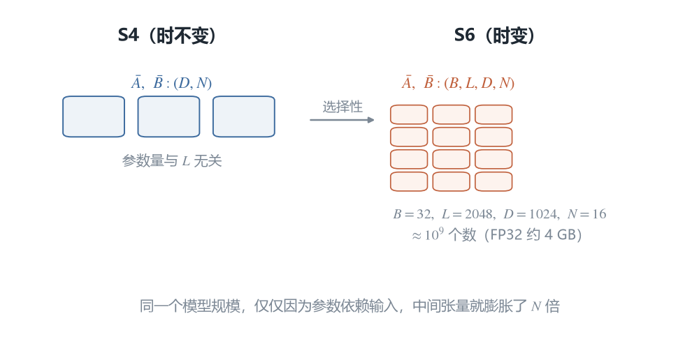

# 第 18 章 S6：选择机制的数学


第 17 章给出了诊断：LTI 是瓶颈，药方是让 $\Delta, B, C$ 依赖输入。

这一章把药方写成精确的算法。

从 S4 到 S6，伪代码上只改了几行，但这几行改变了模型的根本性质，也毁掉了卷积视图。

要讲清的是五件事：

1. 记号切换。从这里开始，改用 Mamba 论文的记号。
2. Algorithm 2：选择性 SSM（S6）的完整伪代码，与 S4 逐行对照。
3. 参数化的具体形式：$s_B, s_C, s_\Delta, \tau_\Delta$ 各是什么，为什么这样选。
4. Theorem 1：$N=1$ 时 S6 退化为一个门控 RNN。这是 LSSL 引理 3.1 的输入相关版，也是 Mamba 与 RNN 理论接轨的地方。
5. $\Delta, A, B, C$ 各自的语义：每个参数在"选择什么"这个问题上扮演什么角色。

---

## 18.1 记号切换（重要）

从本章开始，本书改用 Mamba 论文的记号，因为后面所有代码和论文都用这套。对照表：

| 本书第 1~16 章 | 第 17 章起（Mamba 记号） | 含义 |
|---|---|---|
| 输入 $u_t$ | $x_t$ | 输入（每个通道是标量） |
| 状态 $x_t$ | $h_t$ | 潜状态（每个通道 $N$ 维） |
| 输出 $y_t$ | $y_t$ | 输出 |
| 连续参数 $A,B,C$ | $A,B,C$（也写 $\mathring A$ 等） | 连续参数 |
| 离散参数 $\bar A,\bar B$ | $\bar A,\bar B$（Mamba-2 起常省略横线） | 离散参数 |
| 状态维度 $N$ | $N$ | 不变 |
| 通道数 $H$ | $D$ | 模型维度 |
| 序列长度 $L$ | $L$（Mamba-2/3 里常写 $T$） | 长度 |

换记号的理由：在 SSM 的语境里，"$x$"历史上指状态（HiPPO/LSSL/S4 都这么用），而 Mamba 论文改用它指输入。

这个不一致几乎每个读者都会踩一次，本书在这里明确划一条线。

（一个细节：Mamba-2 论文进一步把连续参数写成 $\mathring A$，并把离散参数直接写成 $A$，取消横线。本书在 Mamba-2 章节会说明。）

---

## 18.2 逐行对照：S4 与 S6

这是 Mamba 论文的核心伪代码，两栏的差别只有三处：

```text
Algorithm 1  SSM (S4)                        Algorithm 2  SSM + Selection (S6)
输入: x : (B, L, D)                          输入: x : (B, L, D)
输出: y : (B, L, D)                          输出: y : (B, L, D)

1: A : (D, N) ← Parameter                    1: A : (D, N) ← Parameter
   ⊲ 结构化 N×N 矩阵                             ⊲ 结构化 N×N 矩阵
2: B : (D, N) ← Parameter                    2: B : (B, L, N) ← s_B(x)
3: C : (D, N) ← Parameter                    3: C : (B, L, N) ← s_C(x)
4: Δ : (D)    ← τ_Δ(Parameter)               4: Δ : (B, L, D) ← τ_Δ(Parameter + s_Δ(x))
5: Ā, B̄ : (D, N) ← discretize(Δ, A, B)       5: Ā, B̄ : (B, L, D, N) ← discretize(Δ, A, B)
6: y ← SSM(Ā, B̄, C)(x)                       6: y ← SSM(Ā, B̄, C)(x)
   ⊲ 时不变: 递归或卷积                            ⊲ 时变: 只能递归（扫描）
7: return y                                  7: return y
```

三处差别：

1. $B$ 和 $C$ 变成了 $(B,L,N)$，由输入 $x$ 经函数 $s_B, s_C$ 生成（原来是与时间无关的参数 $(D,N)$）。
2. $\Delta$ 变成了 $(B,L,D)$，由输入经 $s_\Delta$ 生成（原来是长度为 $D$ 的参数向量）。
3. $\bar A, \bar B$ 变成了 $(B,L,D,N)$，因为这俩是 $(\Delta, A, B)$ 的函数，而它们现在都带时间维。

第 4 行的 `Parameter + s_Δ(x)` 里，`Parameter` 是一个偏置项（bias）。

最后一行注释是全章最关键的一句：

> 时不变时可以走"递归或卷积"；时变时只能走"递归（扫描）"。

这句话的代价就是第 19 章的全部内容。第 17 章说过：在 Mamba 之前，正是这个代价让所有工作都不敢做选择机制。



*图 18-1　S4 与 S6 的参数形状：多了时间维之后，中间张量膨胀 $N$ 倍*

### 一个必须理解的形状问题：(B,L,D,N) 有多大？

这是 S6 与 S4 在"内存"上的根本差别。

- S4：$\bar A\in\mathbb{R}^{D\times N}$，与 $L$ 无关，不需要为每个时间步存一份参数。
- S6：$\bar A\in\mathbb{R}^{B\times L\times D\times N}$，为每个时间步、每个通道都存一份。

代入数字：$B=32$、$L=2048$、$D=1024$、$N=16$，则 $BLDN = 32\times2048\times1024\times16 \approx 1.07\times10^9$，十亿个浮点数。

FP32 下是 4 GB，只为了存一个中间张量。

而输入 $x$ 本身只有 $32\times2048\times1024 = 6.7\times10^7$ 个数。

**这就是"必须做硬件感知实现"的根本原因。** 第 19 章会讲 Mamba 怎么用"不物化这个张量"的办法绕过去。

这个 $N$ 也解释了为什么 Mamba 的 $N$ 只取 16：后来 Mamba-2 才敢取 64 甚至 256，而 $N$ 每翻一倍，$\bar A$ 的隐含大小就翻一倍。

---

## 逐张量形状对照：谁带了时间维

上面的伪代码只标了形状，没标形状是怎么来的。把 S4 与 S6 的每个张量并排放一遍，膨胀发生在哪里就一目了然。取 $B=1$、$L=2048$、$D=1024$、$N=16$。

| 张量 | S4 形状 | S6 形状 | S6 元素数 | 随 $t$ 变 |
|---|---|---|---|---|
| 输入 $x$ | $(B,L,D)$ | $(B,L,D)$ | $2.1\times10^{6}$ | 否 |
| 状态转移 $A$ | $(D,N)$ | $(D,N)$ | $1.6\times10^{4}$ | 否 |
| 入口矩阵 $B_t$ | $(D,N)$ | $(B,L,N)$ | $3.3\times10^{4}$ | 是 |
| 出口矩阵 $C_t$ | $(D,N)$ | $(B,L,N)$ | $3.3\times10^{4}$ | 是 |
| 步长 $\Delta_t$ | $(D)$ | $(B,L,D)$ | $2.1\times10^{6}$ | 是 |
| 离散参数 $\bar A_t$ | $(D,N)$ | $(B,L,D,N)$ | $3.4\times10^{7}$ | 是 |
| 输入矩阵 $\bar B_t$ | $(D,N)$ | $(B,L,D,N)$ | $3.4\times10^{7}$ | 是 |
| 潜状态 $h_t$ | 不物化 | $(B,L,D,N)$ | $3.4\times10^{7}$ | 是 |
| 输出 $y$ | $(B,L,D)$ | $(B,L,D)$ | $2.1\times10^{6}$ | 否 |

表中 $3.4\times10^{7}$ 就是 $2048\times1024\times16$，FP32 下约 134 MB。

表里有两个不对称的地方。

$B_t$ 和 $C_t$ 没有 $D$ 维。论文 Algorithm 2 写的是 $B:(B,L,N)$，不是 $(B,L,D,N)$。整条序列的 $D$ 个通道共用同一组入口、出口向量：$B_t$ 是序列级的量，$\bar A_t$ 才是通道级的量。这与 SSM 的定义一致，每个通道有自己的 $N$ 维状态和自己的衰减速率，但“这一刻该不该让输入进来”的判断是全局的。

$\Delta_t$ 反过来是 $(B,L,D)$，逐通道。这跟上面那条不矛盾：$s_\Delta$ 先把 $x$ 压成一个标量再广播到 $D$ 维，所以通道间的差异只来自两处，广播前的那个标量和 $\Delta$ 的偏置（形状 $(D)$，逐通道不同）。$x_t$ 给出的是统一决策，偏置给出的是每个通道的默认快门速度。

参数量和激活量要分开记。S6 相比 S4 新增的参数只有 $s_B,s_C$ 的两个 $D\times N$ 投影和 $s_\Delta$ 的一个 $D\times1$ 投影，合计约 $2DN+D$。取 $D=1024$、$N=16$ 是 $3.3\times10^{4}$，占一个 block（$6D^2=6.3\times10^{6}$）的 0.5%。膨胀的全是激活：$\bar A$、$\bar B$、$h$ 三者都从“与 $L$ 无关”变成“正比于 $BLDN$”。

还有一处隐含的计算量。$\bar A_t=\exp(\Delta_t A)$ 的指数要逐元素做，一次前向就是 $BLDN$ 次，按上表的数是 $3.4\times10^{7}$ 次 exp。这个数字解释了 exp 为什么必须融进扫描内核：单独为它开一趟 kernel，就要把 $(B,L,D,N)$ 写回显存再读出来，几百 MB 的搬运只为了算一个 $-\Delta A$ 的指数。

再把 batch 加回去。$B=32$ 时 $(B,L,D,N)$ 是 $1.07\times10^{9}$ 个元素，BF16 下 2.1 GB。若按教科书写法让前向、反向各存一份，峰值超过 4 GB，而这只是一个层的一个中间量。真正的权重（$D=1024$ 的 block 约 $6.3\times10^{6}$ 个数，12.6 MB）反而可以忽略。选择机制把 Mamba 的显存预算从“权重为主”推到“激活为主”，这个转折就是第 19 章要处理的对象。

---

## 时变离散化：递推怎么写，卷积为什么没了

S4 的卷积视图是从递推推出来的。S6 把同一个推导重做一遍，会看到它在哪一步断掉。

连续系统固定为

$$
h'(t) = A h(t) + B x(t),\qquad y(t) = C h(t),
$$

$A\in\mathbb{R}^{N\times N}$ 取对角（每个通道 $N$ 个标量），$B,C$ 在这一步还是与时间无关的向量。离散化按 ZOH 逐区间做，第 $t$ 个区间的步长是 $\Delta_t$：

$$
\bar A_t = \exp(\Delta_t A),\qquad
\bar B_t = (\Delta_t A)^{-1}\big(\exp(\Delta_t A)-I\big)\,\Delta_t B .
$$

S4 里 $\Delta$ 是标量，$\bar A,\bar B$ 与 $t$ 无关。S6 里 $\Delta_t,B_t,C_t$ 都是 $x_t$ 的函数，于是 $\bar A_t,\bar B_t$ 逐时间步不同，递推变成

$$
h_t = \bar A_t h_{t-1} + \bar B_t x_t,\qquad y_t = C_t h_t .
$$

把 $h_t$ 展开到初值 $h_0$：

$$
h_t = \Big(\prod_{k=1}^{t}\bar A_k\Big) h_0 + \sum_{s=1}^{t}\Big(\prod_{k=s+1}^{t}\bar A_k\Big)\bar B_s x_s ,
$$

乘积按 $k$ 从右到左作用，$\prod_{k=s+1}^{t}\bar A_k := \bar A_t\bar A_{t-1}\cdots\bar A_{s+1}$，$s=t$ 时约定为空积 $I$。左乘 $C_t$：

$$
y_t = \sum_{s=1}^{t}\underbrace{C_t\Big(\prod_{k=s+1}^{t}\bar A_k\Big)\bar B_s}_{K(t,s)}\,x_s \;+\; \underbrace{C_t\Big(\prod_{k=1}^{t}\bar A_k\Big)}_{K(t,0)}\,h_0 .
$$

$K(t,s)$ 是“第 $s$ 个输入对第 $t$ 个输出的贡献”。把所有 $K(t,s)$ 拼成一个 $L\times L$ 矩阵 $K$，则 $y=Kx$ 再加初值项，$K$ 是下三角的。

S4 的时不变性在这里表现为 $K(t,s)$ 只依赖 $t-s$。$\bar A_k\equiv\bar A$、$\bar B_s\equiv\bar B$、$C_t\equiv C$，于是

$$
K(t,s) = C\bar A^{\,t-s}\bar B = \bar K_{t-s},
$$

一个 Toeplitz 矩阵。Toeplitz 矩阵的乘法等价于卷积，长度 $L$ 的核可以用 FFT 在 $O(L\log L)$ 内乘完，这是 S4 训练快的全部来源。

S6 里 $K(t,s)$ 对 $t$ 与 $s$ 不同等地依赖：$\bar A_k$ 随 $k$ 变，$C_t$ 只出现在行上，$\bar B_s$ 只出现在列上。Toeplitz 结构没了，卷积也就没了。

替代路径有两条，都很贵。一条是把 $K$ 显式算出来再乘，$K$ 有 $L(L+1)/2$ 个非零元，取 $L=2048$、$D=1024$，约 $2.1\times10^{9}$ 个数，FP32 是 8.6 GB，比 $\bar A$ 的 134 MB 大六十多倍。另一条是回到递推，沿时间串行扫。Mamba 选后者，用第 19 章的并行扫描把它并行化。

从矩阵角度看，$K$ 虽然不是 Toeplitz，却另有结构。$A$ 对角时

$$
K(t,s) = \sum_{n=1}^{N} C_{t,n}\Big(\prod_{k=s+1}^{t}a_{k,n}\Big)\bar B_{s,n},
$$

$a_{k,n}$ 是 $\bar A_k$ 的第 $n$ 个对角元。这等于说 $K$ 有 $N$ 阶半可分结构：行 $t$、列 $s$ 之间隔着的乘积可以拆成“从 $s+1$ 到某个分界”与“从分界到 $t$”两段之积。第 22 章会把这个视角完整展开，它也是 Mamba-2 的出发点。

顺带回答一个常被问到的问题：Mamba 训练时能不能像 S4 那样预计算卷积核并缓存？不能。核随输入变，每个 batch、每个位置都不一样，预计算等于把 $K$ 物化，回到上面 8.6 GB 那条路。

---

## 18.3 参数化：sB, sC, sΔ, τΔ 怎么选

Mamba 论文明确给出了这四个函数：

$$
\boxed{\
s_B(x) = \mathrm{Linear}_N(x),\qquad
s_C(x) = \mathrm{Linear}_N(x),\qquad
s_\Delta(x) = \mathrm{Broadcast}_D\big(\mathrm{Linear}_1(x)\big),\qquad
\tau_\Delta = \mathrm{softplus}
\ }
\tag{18.1}
$$

其中 $\mathrm{Linear}_d$ 表示一个到维度 $d$ 的可学习线性投影。

### 为什么 Δ 的投影维度是 1（而不是 D）

这是一个有意思的设计决策，论文给的理由很直接：

> 如果某个输入 $x_t$ 应该被完全忽略（这在合成任务里是必须的），那么所有 $D$ 个通道都应该忽略它。所以我们先把输入投影到 1 维，再广播/重复到维度 $D$。

也就是说，$\Delta$ 的选择是全局的：整条输入决定一个标量，不是逐通道的。

这样"忽略这个 token"这个决策才能一致地作用在所有通道上。

Mamba 论文进一步指出：这个广播操作等价于"一个初始化成特定 0/1 模式的线性投影"；如果让它可训练，就得到

$$
s_\Delta(x) = \mathrm{Linear}_D\big(\mathrm{Linear}_R(x)\big),
$$

即一个低秩投影（$R$ 是远小于 $D$ 的秩）。实践中 $R$ 取 $D/16$ 这样的值。

### 为什么是 softplus

$\Delta$ 必须为正数，它是离散化步长。softplus $\mathrm{softplus}(z) = \log(1+e^z)$ 的值域是 $(0,\infty)$，且处处光滑、梯度不为零，是一个理想的正数参数化。

$\tau_\Delta^{-1}$ 存在，因此可以用"想初始化的 $\Delta$ 值"反推偏置的初值（见 18.4 节）。

### A 的初始化

Mamba 论文 §3.6：

> 复数情形用 S4D-Lin（$A_n = -\frac12 + n i$），实数情形用 S4D-Real（$A_n = -(n+1)$）。实践中 Mamba 默认用实数。

这里出现了 Mamba 的一个特点：它默认用实数的 $A$。论文给的理由是：

> complex numbers are helpful for continuous modalities (e.g. audio, video) but not discrete (e.g. text, DNA).

也就是说，语言的 token 是离散的，"复频率振荡"没有意义；音频/视频是连续信号，频谱结构有用。

这个判断在 Mamba-3 里被部分修正（见第 30 章）。

### Δ 的初始化

$$
\Delta = \tau_\Delta^{-1}\Big(\mathrm{Uniform}\big([0.001,\ 0.1]\big)\Big),
$$

即先在对数尺度上抽一个 $\Delta$，再反推 softplus 之前的偏置值。这是从 S4D/S4 继承的做法。

### softplus 的反函数与初始化的数值后果

$\tau_\Delta=\mathrm{softplus}$ 有两个用处。它保证 $\Delta>0$，还让人能从“想要的 $\Delta$”反推偏置的初值。

softplus 与 sigmoid 是一次求导的关系：

$$
\frac{d}{dz}\log(1+e^{z}) = \frac{e^{z}}{1+e^{z}} = \sigma(z).
$$

这个导数处处为正，所以 softplus 在整个实数轴上单调，反函数存在：

$$
\tau_\Delta^{-1}(y) = \log(e^{y}-1),\qquad y>0 .
$$

初始化就是拿它反着用。先在对数尺度上抽一个目标步长 $u\sim\mathcal{U}[0.001,0.1]$，再把偏置设成 $\log(e^{u}-1)$。两个端点的值：$u=0.001$ 时 $e^{u}-1\approx1.0005\times10^{-3}$，取对数得 $-6.907$；$u=0.1$ 时 $e^{u}-1\approx0.1052$，取对数得 $-2.252$。偏置初值落在 $[-6.9,-2.3]$，全是负数，说明网络起步时 $\Delta$ 偏向小值。

$\Delta$ 落在哪个区间，直接决定模型能记多长。取 S4D-Real 的 $A_n=-(n+1)$，$n=0,\dots,N-1$，则 $\bar A_n=\exp(-\Delta(n+1))$。两种极端步长下的单步衰减：

| $A_n$ | $\Delta=0.001$ | $\Delta=0.1$ |
|---|---|---|
| $-1$ | 0.9990 | 0.9048 |
| $-4$ | 0.9960 | 0.6703 |
| $-16$ | 0.9841 | 0.2019 |

换成“衰减到一半要几步”更直观，$t_{1/2}=\ln 2/\big(\Delta(n+1)\big)$。$\Delta=0.001$ 时，$n=0$ 那维要 693 步，$n=15$ 那维 43 步；$\Delta=0.1$ 时，分别是 6.9 步和 0.43 步。

这张表说明两件事。$N$ 维状态天然覆盖一个尺度谱，同一个 $\Delta$ 下最长与最短的记忆相差 $N$ 倍。$\Delta$ 的整体缩放等价于把整个谱平移，$\Delta$ 放大 100 倍，所有半衰期缩短 100 倍。选择机制做的事就是把这个平移量交给输入决定，而且逐时间步决定。

数值上有两个坑。$z$ 很正时 $e^z$ 在 float32 上过了约 88 就溢出，直接写 $\log(1+e^{z})$ 会得到 inf，改写成 $\max(z,0)+\log\big(1+e^{-\lvert z\rvert}\big)$ 可以避开。$z$ 很负时 $\mathrm{softplus}(z)\approx e^{z}$，梯度也是 $e^{z}$，$\Delta$ 会停在接近 0 的位置不动，门控退化成“永久记住”，训练中表现为长序列上梯度信号极弱。

---

## 一个两维状态的手算例子

公式都在了，但“时变”到底让哪些数变了，需要算一遍才看得见。取 $N=2$、$A=\mathrm{diag}(-1,-2)$、$B_t=C_t=(1,1)$、$x=(1,0,1)$，三个步长分别取 $\Delta_1=0.1$、$\Delta_2=0.5$、$\Delta_3=0.2$，初值 $h_0=\mathbf{0}$。

先算离散参数。对角情形下 $\bar A$ 逐元素取指数，$\bar B$ 的第一分量是 $1-e^{-\Delta}$，第二分量是 $(1-e^{-2\Delta})/2$（这是 $\bar B=(\Delta A)^{-1}(e^{\Delta A}-I)\Delta B$ 在对角元上约分的结果）：

| $t$ | $\Delta_t$ | $\bar A_t$ | $\bar B_t$ |
|---|---|---|---|
| 1 | 0.1 | $(0.9048,\ 0.8187)$ | $(0.0952,\ 0.0907)$ |
| 2 | 0.5 | $(0.6065,\ 0.3679)$ | $(0.3935,\ 0.3161)$ |
| 3 | 0.2 | $(0.8187,\ 0.6703)$ | $(0.1813,\ 0.1649)$ |

逐步递推，$y_t=C_t h_t$ 是两个分量之和：

| $t$ | $x_t$ | $h_t$ | $y_t$ |
|---|---|---|---|
| 1 | 1 | $(0.0952,\ 0.0907)$ | 0.1859 |
| 2 | 0 | $(0.0577,\ 0.0334)$ | 0.0911 |
| 3 | 1 | $(0.2286,\ 0.1873)$ | 0.4159 |

$t=2$ 这一行值得看一眼。输入是 0，输出却不是 0，前一拍的残余 $h_1$ 被 $\bar A_2$ 衰减后继续输出。这维状态确实在“记忆”。

现在对照时不变的情形。假设三个步长都等于 $0.1$，则 $\bar A$ 与 $\bar B$ 全程不变，核只看距离：

$$
K(1,0)=C\bar B=0.1859,\qquad K(2,1)=C\bar A\bar B=0.1604 .
$$

而在时变例子里，$K(2,1)=C_2\bar A_2\bar B_1=0.6065\times0.0952+0.3679\times0.0907=0.0911$。同一对 $(t,s)$，时不变算出来是 0.1604，时变算出来是 0.0911，差 43%。差异全部来自中间那个 $\Delta_2=0.5$：$t=2$ 处的快门开得大，前面积累的信息被衰减得快。

这就是“核不再是 Toeplitz”的具体含义。卷积核必须满足 $K(t,s)=K(t-s)$，而这里的 $K(2,1)$ 与 $K(1,0)$ 只隔一步，值却差了近一半。任何只看距离的算法都无法表示它，所以 FFT 不可用。反过来，如果三个 $\Delta$ 相等，整张表就退化成卷积核的前缀，可以一次性算好并复用。

$y_3$ 里两项的来源可以分开看：$0.1813$ 来自当拍输入（$\bar B_3$ 的贡献），$0.0473$ 来自两拍前的 $x_1$。选择机制做的事情就是让这两个系数随内容变：想记住 $x_1$ 就把 $\Delta_2,\Delta_3$ 调小，想丢掉它就把 $\Delta_2$ 调大。

例子很小，但两件事与真实规模一致。

第一件是连乘会衰减到一个实现精度管不住的程度。取 $A_n=-(n+1)$、$\Delta=0.1$，最快那一维（$n=15$）每步只剩 $0.202$，五十多步后就落到 float32 的最小正规数（约 $1.2\times10^{-38}$）以下；最慢那一维要几百步才到。两个尺度差两个数量级以上，一个统一精度的实现只能靠对数域累加（第 19 章）。

第二件是 $K(t,s)$ 对 $t,s$ 的依赖不是单一的 $t-s$，一条长度为 $L$ 的核描述不了它。这两件事分别断掉了“直接连乘”与“卷积”两条路，剩下的只能是扫描。

---

## 18.4 Theorem 1：S6 在 N=1 时就是门控 RNN

这是 Mamba 论文里理论性最强的一节。

Theorem 1（Mamba）：当 $N=1$、$A=-1$、$B=1$、$s_\Delta(x)=\mathrm{Linear}(x)$、$\tau_\Delta=\mathrm{softplus}$ 时，选择性 SSM 的递推变成

$$
g_t = \sigma\big(\mathrm{Linear}(x_t)\big),\qquad
h_t = (1-g_t)\,h_{t-1} + g_t\,x_t .
$$

也就是说，它就是经典的一维门控递推。

### 证明（很短，值得看）

设 $N=1$、$A=-1$、$B=1$，用 ZOH 离散化（(2.6)）：

$$
\bar A = e^{\Delta A} = e^{-\Delta},\qquad
\bar B = A^{-1}\big(e^{\Delta A}-I\big)B = -\big(e^{-\Delta}-1\big) = 1-e^{-\Delta}.
$$

于是递推是

$$
h_t = e^{-\Delta_t}h_{t-1} + \big(1-e^{-\Delta_t}\big)x_t .
$$

令 $g_t := 1-e^{-\Delta_t}$，则 $h_t = (1-g_t)h_{t-1}+g_tx_t$，形式已是门控递推。

最后算 $g_t$ 与 $\mathrm{softplus}$ 的关系。设 $z_t = \mathrm{Linear}(x_t)$，$\Delta_t = \mathrm{softplus}(z_t) = \log(1+e^{z_t})$，则

$$
e^{-\Delta_t} = \frac{1}{1+e^{z_t}} = \sigma(-z_t)
\quad\Longrightarrow\quad
g_t = 1-\sigma(-z_t) = \sigma(z_t).
$$

（最后一步用了 $\sigma(-z) = 1-\sigma(z)$。）∎

### 这个定理的意义

三点：

(1) 它把 LSSL 的引理 3.1 升级了。LSSL 版说的是"门控 $=\Delta$"，$\Delta$ 可以是输入的函数，但没有明说。

Mamba 版说的是"输入相关的 $\Delta$ 就是输入相关的门控"。Mamba 论文自己的说法是 "improvement of Gu et al. (2021, Lemma 3.1) generalizing to the ZOH discretization and input-dependent gates"。

(2) 它把 S6 与 RNN 的传统智慧接上了。LSTM/GRU 的工程经验（门控的初始化、梯度流、长记忆）可以迁移过来。

反过来，S6 也给门控提供了一个新的解释框架。

(3) 它解释了为什么 Mamba 的默认设置是 $\Delta$ 选择性、$A$ 不选择性（第 17.5 节的论证）。

### 一个诚实的技术细节：ZOH 还是指数-欧拉

上面的证明用了 ZOH 的 $\bar B = 1-e^{-\Delta}$。而 Mamba 开源实现里用的是

$$
\bar A = e^{\Delta A},\qquad \bar B = \Delta\,B
$$

（即"指数-欧拉"）。这两者的差别在 $\bar B$ 上：ZOH 是 $1-e^{-\Delta}$，实现是 $\Delta$。在 $\Delta$ 很小时两者近似相等（$1-e^{-\Delta} = \Delta - \Delta^2/2+\cdots$），但不完全相同。

在实现版本下，$N=1$、$A=-1$、$B=1$ 时递推变成

$$
h_t = e^{-\Delta_t}h_{t-1} + \Delta_t x_t,
$$

门控形式仍然是 $(1-g)h + gx$，但 $g = \Delta_t = \mathrm{softplus}(z_t)$，是一个无上界的门，而不是 sigmoid（有上界 1）。

这个不一致在论文里没有澄清，直到 Mamba-3（2026）才被系统地梳理：Mamba-3 把这个实现形式命名为指数-欧拉（exponential-Euler），并给出了理论依据（第 29 章）。

读 Theorem 1 时，把它当成"ZOH 下的精确结果"，同时记住实现里有一个 $\bar B$ 的近似。

---

## 18.5 四个参数的语义

Mamba 论文 §3.5.2 逐项解释了选择机制的效果。这部分是"理解 Mamba 在做什么"的关键。

### Δ：焦点开关

> 一般地，$\Delta$ 控制"关注当前输入"与"忽略当前输入"之间的平衡。它推广了 RNN 的门（上面的 $g$）。机制上：大 $\Delta$ 重置状态并聚焦当前输入；小 $\Delta$ 保持状态并忽略当前输入。

从连续系统的角度理解更清楚：$\Delta \to \infty$ 表示"系统在当前输入上聚焦很久"（因此选择它、忘记之前的状态）；$\Delta \to 0$ 表示"当前输入是瞬态的，被忽略"。

关键是 $\Delta$ 的取值由 $x_t$ 决定，所以"要不要聚焦"这件事本身是内容相关的。

### A：为什么不必选择性

$\bar A = \exp(\Delta A)$，$A$ 只通过它与 $\Delta$ 的乘积起作用。既然 $\Delta$ 已经是选择性的，$(\bar A,\bar B)$ 就已经是选择性的了。

论文说"我猜想让 $A$ 选择性也会有类似效果，但为了简单起见没有做"，并留作未来工作。

（这个猜想后来被验证了：Mamba-3 论文 §2.2 Remark 1 说 "we empirically found that data-dependent $A_t$ has similar performance to data-independent $A_t$"。）

### B 与 C：入口与出口

- $B_t$ 选择性 = 控制"输入的哪些分量能进入状态"（入口闸门）；
- $C_t$ 选择性 = 控制"状态的哪些分量能进入输出"（出口闸门）。

论文的原话：这两个可以解释为"根据内容（输入）与上下文（隐状态）调制递归动力学"。

### 三种机制性的效果

论文列举了选择机制带来的三种具体能力，这三个词后面会反复出现：

(1) 可变间距（variable spacing）：过滤掉不相关的噪声 token。例如语言里的填充词（"嗯"、"那个"）。机制上：在门控案例里，当 $g_t\to0$ 时模型可以完全忽略 $x_t$。

(2) 过滤上下文（filtering context）：论文指出一个实证现象——很多序列模型在上下文变长时并不改善（尽管原则上更多上下文应该更好）。

原因是它们无法在必要时忽略无关上下文。选择模型可以在任何时刻重置状态，因此原则上性能随上下文长度单调改善。

第 21 章会用 DNA 与音频的实验数据检验这一点（Hyena 的困惑度随长度变差，Mamba 的随长度变好）。

(3) 边界重置（boundary resetting）：当多个独立序列被拼在一起时，Transformer 可以用注意力掩码把它们隔开，而 LTI 模型会让信息在序列之间"渗漏"。

选择性 SSM 可以在边界处重置状态（$\Delta_t\to\infty$，或门控案例里 $g_t\to1$）。这个能力在文档打包（把多个文档拼成一个长序列以提高硬件利用率）和强化学习的 episode 边界上都有用。

Mamba-2 里这个性质被形式化成"把 $A_t$ 设为 0 作为序列边界"（第 26 章），实现变长训练时很实用。

---

## 18.6 一个必须澄清的误解

最后澄清一个常见误解。

误解是"Mamba 就是在 S4 上加了门控"。门控作用在通道维，是乘性调制；选择性作用在长度维，调的是递推参数。

第 17.4 节已经详细区分过。具体到代码上：

- H3 的做法：`y = gate1 * SSM(gate2 * u)`，门控在 SSM 外面；
- Mamba/S6 的做法：`Ā, B̄ = discretize(Δ(x), A, B(x))`，依赖输入的量在 SSM 里面，且带时间维。

这个区别有可测的后果：Mamba 论文 Table 1 里，H3 架构配 S4 层只有 57.0%，配 S6 层是 99.7%。

架构相同，只有内层的序列混合方式不同。

---

## 两个不是参数的量：Ā 与 Δ

参数表里能找到 $A,B,C$ 的投影矩阵和 $\Delta$ 的偏置，找不到 $\bar A$。$\bar A_t=\exp(\Delta_tA)$ 是前向里即时算出来的，每步每通道都不同，它不进优化器，也不进 checkpoint。把它当参数会得到两个错误推论：一是以为要存 $BLDN$ 个可学量，二是以为 $\bar A$ 可以任意初始化。真实的初始化对象只有 $A$ 本身。

$\Delta$ 更容易被误当成超参。它不是。能被训练的是两部分，偏置（形状 $(D)$，初值 $\tau_\Delta^{-1}(\mathcal{U}[0.001,0.1])$）与 $s_\Delta$ 的投影权重。训练后每个位置、每个通道的 $\Delta$ 都不一样，是一个 $(B,L,D)$ 的张量。把 $\Delta$ 写成一个固定 buffer，模型就退回 S4D。

梯度路径上有一处饱和点值得知道。$\partial\bar A/\partial\Delta = A\exp(\Delta A)$，$A<0$ 时它随 $\Delta$ 增大而趋于 0。$\Delta$ 很大时状态基本被重置，再把 $\Delta$ 推大对输出影响很小，梯度自然小。这不是实现 bug，是模型在说“这里已经关闭了”。

还有一个区别值得记：$A$ 的形状是 $(D,N)$，$\Delta$ 的偏置是 $(D)$，两者都只有“每通道”一级，不随 $L$ 变。一个 block 里真正随序列长度增长的只有激活，参数永远只有 $O(D^2)$ 与 $O(DN)$ 两块。这也是为什么训练一个 Mamba 的基本显存预算可以直接从 $BLD$ 估出来，而不用数权重。

---

## 选择机制的自由度：Δ 调尺度，B 与 C 调维度

一个容易忽略的结构事实：$\Delta_t$ 在给定通道上是一个标量，它同时作用在 $N$ 个衰减率上。

$$
\bar A_{t,n} = \exp(\Delta_t A_n),\qquad n=1,\dots,N .
$$

$\Delta_t$ 变大，$N$ 个 $\bar A_{t,n}$ 一起变小；$\Delta_t$ 变小，一起变大。所以 $\Delta_t$ 提供的自由度是“整体时间尺度”，一个标量，不是 $N$ 个。状态维内部的分配由 $A_n$ 的谱形状决定，而 $A$ 与时间无关。

这个 $1:N$ 的粒度差解释了为什么选择机制必须由三个参数分担。$\Delta_t$ 决定这一刻整体记多久，$N$ 维共用一个；$B_t\in\mathbb{R}^{N}$ 决定这一刻哪几维被写入，有 $N$ 个权重；$C_t\in\mathbb{R}^{N}$ 决定这一刻哪几维被读出，也是 $N$ 个权重。三者在 $K(t,s)$ 里各占一个位置：$C_t$ 在行上加权，$\bar B_s$ 在列上加权，中间的 $\prod\bar A_k$ 由 $\Delta$ 控制衰减。

再往下推一步会看到一个失败模式。假设 $C_t$ 的某个分量长期接近 0，那一维状态对输出没有贡献，梯度也小，但它仍在被 $B_t$ 写入、被 $\bar A_t$ 更新，这块容量等于闲置，$N$ 里有一部分维在空转。反过来，若 $B_t$ 的某分量长期接近 0，那一维永远从零开始，$C_t$ 读它也读不到东西。

LTI 模型里这个问题无解，$B,C$ 是常数，一旦某维的读写通道弱，就永久弱。选择机制把 $B_t,C_t$ 变成逐时刻的量，模型可以在需要时打开某一维的写入、在另一时刻打开读出。第 21 章表 10 那个对比（$N$ 从 1 加到 16，$B,C$ 选择性时困惑度降 1.02，恒定 $B,C$ 时只降 0.07）就是这条推理的实验版：大状态只在读写权重可变时才能被用满。

最后一个推论关系到 $A$ 的初始化。既然 $\Delta_t$ 只能平移谱、不能改形状，谱的形状由 $A$ 的初值与训练共同决定。随机初始化（$\exp(\mathcal{N}(0,1))$）与 S4D-Real 在语言建模上打平，都是 8.71，说明形状本身可以从数据里学出来，只要 $\Delta_t$ 提供了足够的平移自由度。S4 没有这个自由度，HiPPO 的谱形状就是它全部的归纳偏置。

---

## 三个可选旋钮：选 A、换 s、改架构

论文在讲完主体之后留了一句话：选择机制可以作用在不同对象上，可以是不同的参数（例如 $A$），也可以是不同的变换 $s(x)$。这句话里的每个选项都有明确的代价，算一遍就知道为什么 Mamba-1 只拧了一个。

选 $A$。把 $A_t$ 也做成输入的函数，意味着要为每个 $(t,\text{通道},n)$ 生成一个衰减率，张量形状 $(B,L,D,N)$。最直接的实现是一个从 $x_t\in\mathbb{R}^{D}$ 到 $\mathbb{R}^{DN}$ 的线性投影，参数量 $D\cdot DN=D^2N$，取 $D=1024$、$N=16$ 是 $1.7\times10^{7}$，比一个 block 的全部参数（$6D^2=6.3\times10^6$）还多两倍多。每 token 的 FLOPs 是 $2D\cdot DN=3.4\times10^{7}$，而整个 block 的线性投影只花 $1.26\times10^7$。也就是说，仅仅为了让 $A$ 逐元素可变，计算量要比整块翻三倍。这是论文把它归为未来工作的真实原因：不是理论不允许，是账算不过来。

换 $s$。$s_B,s_C$ 目前是单个线性层，换成两层 MLP 或加大秩，代价是 $O(D^{2}r)$ 量级的参数，而收益要看任务。$s_\Delta$ 的秩从 1 改到 $R$ 的消融里，困惑度从 8.97 降到 8.71，参数量多了 $1.2\times10^{7}$（359.1M 到 371.5M）。这是选择性设计里性价比最高的一处改动之一：从无到有（静态 $\Delta$）降 0.15，从秩 1 到秩 64 再降 0.26。

改架构。选择机制并不绑定 SSM。把它用到 CNN 上，就是把卷积核的权重变成输入的函数；用到传统 RNN 上，就是把门控的输入从“当前输入”扩到“当前输入的函数”。这两条路论文都没有做实验，但理论上可行。真正被后来验证的是另一个方向：把选择机制从 SISO 扩到 MIMO，即让一组输入共享一组状态（第 31 章），那里的难点从“能不能选”变成“选了之后怎么在硬件上算”。

三个旋钮的共同点是：每多一个输入相关的量，就多一个 $(B,L,\cdot)$ 形状的中间张量，而扫描内核的访存随它线性增长。Mamba-1 选 $\Delta,B,C$ 而不敢选 $A$，跟数学无关，是在 $N=16$ 这个预算下能加的选择最少、收益最大的组合。$A$ 的选择性后来在 Mamba-3 里被正式采用，实验上却与数据无关的 $A$ 表现相当（第 30 章），这反过来印证了论文当年的判断。

---

## 18.7 本章小结

- 记号切换：从本章起，输入记 $x_t$、状态记 $h_t$（Mamba 惯例）。
- S6 与 S4 的伪代码差别只有三处：$B,C$ 变成 $(B,L,N)$ 由 $s_B,s_C$ 生成；$\Delta$ 变成 $(B,L,D)$ 由 $s_\Delta$ 生成；$\bar A,\bar B$ 变成 $(B,L,D,N)$。最后导致了"只能递归、不能卷积"。
- 形状的代价：$\bar A$ 的隐含大小是 $B\times L\times D\times N$。取 $B{=}32,L{=}2048,D{=}1024,N{=}16$ 时是十亿个数（4 GB），这就是必须做硬件感知实现的原因。
- 参数化：$s_B,s_C$ 是到 $N$ 维的线性投影；$s_\Delta$ 是"先投影到 1 维再广播"（因为"忽略某个 token"的决策应该对所有通道一致），可推广为低秩投影 $\mathrm{Linear}_D(\mathrm{Linear}_R(x))$；$\tau_\Delta = \mathrm{softplus}$ 保证 $\Delta>0$。
- 初始化：$A$ 用 S4D-Real（实数）或 S4D-Lin（复数，用于连续模态）；$\Delta$ 用 $\tau_\Delta^{-1}(\mathcal{U}[0.001,0.1])$。
- Theorem 1：$N=1,A=-1,B=1$、$\Delta=\mathrm{softplus}(\mathrm{Linear}(x))$ 时 S6 就是门控递推 $h_t=(1-g_t)h_{t-1}+g_tx_t$，$g_t=\sigma(\cdot)$，它是 LSSL 引理 3.1 的输入相关版。证明用的是 ZOH 的 $\bar B=1-e^{-\Delta}$，实现用 $\bar B=\Delta$（指数-欧拉），这是论文与代码的一处不一致。
- 参数语义：$\Delta$ 是焦点开关（大 $\Delta$ 重置状态并聚焦当前输入，小 $\Delta$ 保持状态并忽略输入）；$A$ 不必选择性（因为只与 $\Delta$ 以乘积出现）；$B,C$ 分别是状态的入口与出口闸门。
- 三种机制效果：可变间距、过滤上下文、边界重置。
- 区分：门控在通道维、在 SSM 外部；选择性在长度维、在 SSM 内部。

## 下一章

现在问题变成了工程问题：$\bar A,\bar B$ 是 $(B,L,D,N)$ 的张量，物化它需要几个 GB；而且时变意味着只能串行扫描。第 19 章讲 Mamba 怎么用核融合、并行扫描、重计算这三招，把这一切做得比 FlashAttention 还省内存。
