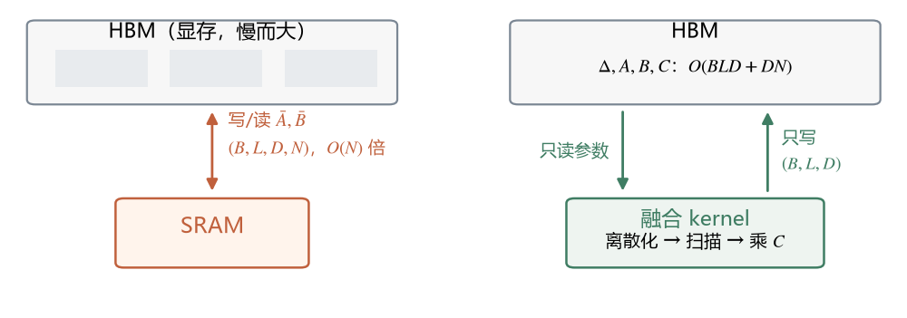

# 第 19 章 硬件感知的并行扫描

第 18 章留下了一个纯粹的工程难题。

选择机制让 $\bar A,\bar B$ 变成 $(B,L,D,N)$ 的张量。取 $B{=}32$、$L{=}2048$、$D{=}1024$、$N{=}16$：

$$
BLDN \approx 1.07\times10^{9}\ \text{个数} \approx 4\ \text{GB（FP32）}
$$

而这只是单个中间张量。更要命的是，时变意味着卷积视图失效，只能用递归，而递归是串行的。

于是 Mamba 面临的问题变成：

> 在"不能做卷积、只能做递归"的前提下，怎么把训练做得和 FlashAttention 一样快、一样省内存？

Mamba 用了三招：核融合（kernel fusion）、并行扫描（parallel scan）、重计算（recomputation）。三招都是经典技术，组合方式却很巧妙。

它的思路是不物化中间张量、把它留在快速内存里，后来被 Mamba-2 的 SSD 算法继承并推广（第 25 章）。

这一章是从数学到系统的转折点：前面都在讲为什么这样设计，这里讲凭什么跑得起来。

---

## 19.1 第一个观察：递归其实比卷积 FLOPs 更少

先破除一个直觉。通常认为卷积能用 FFT 所以更快，在选择性 SSM 的规模下恰好相反：

| 计算方式 | FLOPs |
|---|---|
| 朴素递归 | $O(BLDN)$ |
| 卷积（FFT） | $O(BLD\log L)$ |

递归的 FLOPs 更少，常数因子也更小。

原因在卷积里那个 $\log L$ 因子（FFT 的开销），递归没有。当 $N$ 不算太大、$L$ 又很长时，$N$ 和 $\log L$ 可比，递归更划算。

既然时变逼着走递归，那就把递归做好，Mamba 的选择就是这个。

### 但递归有两个麻烦

1. 串行性：$h_t$ 依赖 $h_{t-1}$，无法直接并行。
2. 内存：$\bar A,\bar B$ 是 $(B,L,D,N)$ 的大张量。

这两个麻烦分别用"并行扫描"和"核融合"解决。

---

## 19.2 第二个观察：GPUs 上除了矩阵乘法，其他都在等内存

这是理解整个 Mamba 系统的前提。

现代 GPU 有两级主要的存储：

| 层级 | 名字 | 容量 | 带宽（量级） |
|---|---|---|---|
| 慢而大 | HBM（high-bandwidth memory，就是通常说的"显存"） | 40–80 GB | 数 TB/s |
| 快而小 | SRAM（每个 SM 的片上共享内存/L1） | 每个 SM 几百 KB，整卡十几 MB | 高一个数量级 |

矩阵乘法是计算受限（compute-bound）的：算术强度高（每读一个字节做好多次乘加），能把计算单元喂饱，GPU 的 Tensor Core 就是为此设计的。

几乎所有其他操作都是访存受限（memory-bound）的：逐元素运算、归约、激活、扫描的算术强度都很低，计算单元大量空闲，时间全花在把数据从 HBM 搬到 SM 上。

Mamba 论文直接引用了这个观察（Dao 等, 2022；Ivanov 等, 2021；Williams 等, 2009）。

既然扫描注定访存受限，优化方向就是减少 HBM 上的读写量，而不是减少 FLOPs。

---

*图 19-1　两种实现的显存流量：朴素实现让 $(B,L,D,N)$ 的中间量往返显存，融合实现把它留在 SRAM*

## 19.3 招式一：核融合（kernel fusion）

### 标准做法有多浪费

如果按教科书方式实现 selective scan，会分三步：先在显存里准备 $(B,L,D,N)$ 的扫描输入，再调用扫描内核把同样大小的结果写回显存，最后乘 $C$ 得到 $(B,L,D)$。三次搬运都是 $O(BLDN)$ 量级。

总 HBM 读写量是 $O(BLDN)$。当 $BLDN$ 是 $10^9$ 量级时，这就是几 GB 的搬运量，而实际有用的输出只有 $(B,L,D)$，小了 $N$ 倍。

### Mamba 的做法

做法是把离散化、扫描、乘 $C$ 这几步融合进一个 kernel：从显存读入 $\Delta,A,B,C$（只有 $O(BLD+DN)$），在 SRAM 里做离散化得到 $(B,L,D,N)$，在 SRAM 里做扫描，最后只把 $(B,L,D)$ 写回显存。

关键差别在前两步：参数 $(\Delta, A, B, C)$ 的原始大小只有 $O(BLD + DN)$，可以在 SRAM 里现场把它们离散化成 $(B,L,D,N)$，不必先算好再写进 HBM。

于是 HBM 的读写量降低了一个 $O(N)$ 因子。

论文的实测结论：

> IO 减少 $O(N)$ 倍，实践上带来 20–40 倍加速。

### 序列太长怎么办

SRAM 只有十几 MB 量级，一整条长序列的中间状态放不下，于是分块（chunking）：把序列切成若干块，对每块做融合扫描，把块末的状态传给下一块继续。

这个"分块加传递状态"的思想就是 Mamba-2 的 SSD 算法以及张量并行/序列并行的雏形（第 25、26 章），Mamba-1 已经在用了。

---

## 融合内核的 IO 账：六次搬运与两次搬运

把两版实现的显存流量算成字节，$O(N)$ 这个说法才有分量。

未融合的标准实现（PyTorch 里直接写扫描）分三步，中间张量全在 HBM：

1. 离散化：读 $\Delta$ $(B,L,D)$、$A$ $(D,N)$、$B_t$ $(B,L,N)$、$C_t$ $(B,L,N)$，写 $\bar A,\bar B$ 各 $(B,L,D,N)$；
2. 扫描：读 $\bar A,\bar B$，写状态序列 $(B,L,D,N)$；
3. 乘 $C$：读状态序列与 $C_t$，写 $y$ $(B,L,D)$。

按元素数记，$(B,L,D,N)$ 的每一次读或写都是一个 $BLDN$。第一步写两次，第二步读两次写一次，第三步读一次，合计六次。

融合实现只有一次进出：读入 $\Delta,A,B_t,C_t$（$BLD+DN+2BLN$ 量级），在 SRAM 里做完离散化、扫描、乘 $C$，写出 $y$（$BLD$）。$(B,L,D,N)$ 从头到尾没有出现在 HBM 里。

代入论文基准设置（$B=1$、$D=1024$、$N=16$、BF16 即每元素 2 字节，$L=16384$）：

| 量 | 元素数 | 字节 |
|---|---|---|
| 一个 $(B,L,D,N)$ 张量 | $2.68\times10^{8}$ | 537 MB |
| 未融合，六次搬运 | $1.61\times10^{9}$ | 3.2 GB |
| 融合，读 $\Delta$ 与写 $y$ | $3.36\times10^{7}$ | 67 MB |
| 融合，读 $A,B_t,C_t$ | $5.4\times10^{5}$ | 1.1 MB |

比值约 48，正好是 $3N$。论文说的 IO 减少 $O(N)$ 倍与实测 20–40 倍加速，与这个账同量级；差距来自 SRAM 与 HBM 的带宽差不是唯一开销项，kernel 启动、块边界同步、exp 的计算都还在。

同一笔账还能解释重计算为什么划算。反传要么读回 $(B,L,D,N)$ 的状态（一次 $BLDN$，537 MB），要么用存下的 $\Delta,B_t,C_t$ 重算（约 34 MB 输入加一遍计算）。$N=16$ 时前者是后者的十六倍。多算少搬，在访存受限的扫描上永远赚。

---

## 19.4 招式二：并行扫描（parallel scan）

核融合解决了内存问题，但没解决串行问题。

### 线性递推是关联扫描

第 15 章已经详细讲了并行扫描（Blelloch 算法）。这里只复述结论并指出 Mamba 的用法：

线性递推

$$
h_t = \bar A_t h_{t-1} + \bar B_t x_t
$$

可以写成仿射映射的复合。定义二元算子

$$
(a_1, b_1)\bullet(a_2, b_2) = (a_2 a_1,\ a_2 b_1 + b_2),
$$

则它是结合的（associative），于是可以用 work-efficient 的并行扫描：深度 $O(\log L)$、总工作量 $O(L)$。

因为 $\bar A_t$ 是对角的（逐通道甚至逐元素的标量），算子的乘法是逐元素的，代价很低。

### 数值稳定的细节

朴素地算 $h_t = \bar A_t h_{t-1}+\dots$ 时，$\bar A$ 的连乘在长序列上会下溢到 0：每个 $\bar A_t\in(0,1)$，乘几千次就变成 0。

Mamba 的实现（以及 Mamba-2 的参考实现）用的技巧是在 log 域累加，最后取指数。

把 $\bar A_t = \exp(\Delta_t A)$ 取对数：$\log\bar A_t = \Delta_tA$（$A$ 是负的，所以这是负数）。于是连续若干步的乘积

$$
\bar A_t\bar A_{t-1}\cdots\bar A_{s+1} = \exp\left(\sum_{k=s+1}^{t}\Delta_kA\right),
$$

只要累加 $\Delta_kA$（一次 cumsum）再取指数，就不会中间下溢。

Mamba-2 的开源参考实现里这个函数叫 `segsum`（segment sum）：用 `cumsum` 相减得到区间和，再 `exp`。第 33 章会逐行讲这段代码。

这个细节是"论文里看不到、但写代码必须知道"的典型例子。不理解它，复现出来的 Mamba 会在长度 4096 上直接变成 0。

---

## 两套扫描的账：递归倍增与 Blelloch

第 15 章给了 Blelloch 两趟算法，这里把它和另一套常见做法放在一起，用 $L$ 算一遍工作量与访存。

递归倍增（recursive doubling，也叫 Hillis–Steele 扫描、Kogge–Stone 扫描）只有一趟。第 $d$ 层让每个位置与它前面第 $2^{d}$ 个位置合并：

$$
c_t^{(d)} = c_{t-2^{d}}^{(d-1)} \bullet c_{t}^{(d-1)},\qquad d=0,1,\dots,\lceil\log_2 L\rceil-1 .
$$

第 0 层是原数组，第 $d$ 层之后每个位置持有的是长度为 $2^{d+1}$ 的前缀，$d$ 走到 $\log_2 L$ 就全部算完。合并次数是 $L\log L$，比顺序扫描多一个 $\log L$；深度是 $\log L$，与 Blelloch 同阶。它在 GPU 上仍然常见，因为每层是一个规整的逐元素操作。

Blelloch 的两趟（上扫建树、下扫分发）把合并次数降回 $2L$ 左右，代价是深度涨到 $2\log L$。两套的账目对照：

| 算法 | 深度 | 合并次数 | 每通道 HBM 元素搬运 | $L=2048$ |
|---|---|---|---|---|
| 顺序扫描 | $L$ | $L$ | $\approx2L$ | 4096 |
| 递归倍增 | $\log_2 L$ | $L\log_2 L$ | $\approx2L\log_2 L$ | 45056 |
| Blelloch | $2\log_2 L$ | $\approx2L$ | $\approx4L$ | 8192 |

搬运量一栏这样来：每一层都要把整个数组从 HBM 读进 SRAM、算完写回，一次读写算两倍元素数；递归倍增有 $\log_2 L$ 层；Blelloch 上扫写入 $\sum_d L/2^{d}\approx L$ 个中间结果，下扫再读写一遍，总计约 $4L$。

$L=2048$ 时递归倍增要搬 45056 个元素，Blelloch 只需 8192 个，差五点五倍。真正让 Blelloch 在 GPU 上不好用的是层数：$2\lceil\log_2 L\rceil$ 层意味着二十多次 kernel 启动，每次一次全局同步，序列越长，同步开销占比越高。

两套算法在实践里都不原样落地。Mamba 引用 Blelloch 与 Martin–Cundy 的工作，用的是“块内串行、块间扫描”的混合方案，理由在访存而不在 FLOPs。$L=2048$ 时 Blelloch 要二十二次 kernel 启动，而按块切到 $C=1024$ 只要三趟。

---

## 分块扫描：块内串行，块间只传状态

核融合把中间量留在 SRAM，但 SRAM 总量只有十几 MB 量级，一条 $L=16384$、$D=1024$、$N=16$ 的序列放不下。分块是唯一出路。

把序列切成 $n_c$ 块，每块长 $C=L/n_c$，算法分三趟。

第一趟，每块独立扫。块 $i$ 从零状态出发顺序走 $C$ 步，得到块内所有位置的局部状态，同时记下这块累积的转移量

$$
P_i = \bar A_{iC}\bar A_{iC-1}\cdots\bar A_{(i-1)C+1},
$$

形状 $(D,N)$。块与块之间这时还没联系，$n_c$ 块可以完全并行。

第二趟，块间扫描。对 $n_c$ 个二元组 $(P_i,\ \tilde h_{iC})$ 做一次扫描，得到每块的入块状态。这一趟只有 $n_c$ 个元素，串行扫也花不了多少时间。

第三趟，回填。块 $i$ 用真实的入块状态重跑一遍递推，输出 $y$。块内仍然串行，块间并行。

三趟的总工作量是 $O(BLDN)$，与单趟递推同阶，多出来的是第二趟的 $O(BDN\,n_c)$。关键路径从 $L$ 降到 $C+n_c+C$。

具体数字。取 $L=16384$、$C=1024$、$n_c=16$：第一趟 1024 步、第二趟 16 步、第三趟 1024 步，关键路径约 2064 步，是纯串行 16384 步的八分之一。想再短就减小 $C$，但块越小，第二趟的 $n_c$ 越大，每块的固定开销（启动、边界状态搬运）也摊不掉，所以存在一个最优点在两端之间。

$C$ 的上限由 SRAM 定。一块要装下窗口内的 $\bar A,\bar B$ 与状态，逐通道看各是 $C\cdot N$ 个数。$C$ 取 1024、单通道、$N=16$、BF16，$\bar A$ 与 $\bar B$ 合起来约 $2\times1024\times16\times2=64$ KB，已经在单个 SM 的共享内存容量附近。所以 $C$ 不能取 8192 这种值，块长与 SRAM 容量互相约束。$D=1024$、$N=16$ 这个规模下能装下的块长大约是四位数，这直接决定了第二趟扫描的元素数在几十到几百之间。

这个三段式结构就是 Mamba-2 的 SSD 算法（第 25 章）的雏形，也是序列并行训练的基础：第二趟那些边界状态可以在设备间传递，把一条长序列切开分给多张卡，而块内的串行扫描互不干扰。

---

## 19.5 招式三：重计算（recomputation）

### 问题

反向传播需要中间状态（每一步的 $h_t$）。如果老老实实把它们都存下来，那就是 $O(BLDN)$ 的内存，核融合省下的内存又还回去了。

### 解法

办法是不存，反传时重算。

代价与收益的分析（论文附录 D 的论证）：

- 反传时需要从 HBM 读入的是输入 $\Delta, A, B, C$ 与输出梯度，大小都是 $O(BLN + DN)$；
- 反传需要写出的是输入梯度，大小也是 $O(BLN+DN)$；
- 如果存了中间状态，就需要额外读 $O(BLDN)$ 个元素。

由于 $N$ 通常是 16（相对于 $D$ 是千级），$O(BLDN)$ 比 $O(BLN)$ 大 $D$ 倍，存下来再读的成本远高于重算。所以重算不只省内存，还更快。

（结论反直觉，但在访存受限的世界里成立：多算少搬往往更优。这与 FlashAttention 的哲学完全一致。）

### 一次性重算整个 block

论文进一步把重算推广到整个 selective SSM block（输入投影、卷积、激活、扫描、输出投影）：

> 不保存那些"占内存大但重算很快"的中间激活（例如激活函数的输出、短卷积的输出）。

### 内存最终账目

论文给了一组很实用的数字（混合精度 FP16/BF16 训练）：

| 组件 | 每 token 的激活内存 |
|---|---|
| 注意力层（FlashAttention） | ~12 bytes |
| MLP 层 | ~20 bytes |
| **合计（Transformer 的一层 + 一个 MLP）** | **32 bytes** |
| 一个 selective SSM 层 | ~16 bytes |

结论：

> 两层 selective SSM 的激活内存 ≈ 一个注意力层 + 一个 MLP 层。

也就是说，Mamba 的 block 与 Transformer 的 block 在内存占用上可比。

注意 Mamba 的一个 block 相当于 Transformer 的 attention 加 MLP 两块，因为它把两者合并了（见第 20 章）。

论文因此说："the fused selective scan layer has the same memory requirements as an optimized transformer implementation with FlashAttention."

---

## 推理的账：每一步只算一个 token

训练看的是并行度，推理看的是带宽。两者的账完全不同。

自回归生成时每一步只处理一个新 token，扫描退化成一次递推：读入当前 $x_t$，更新 $h\leftarrow\bar A_t h+\bar B_t x_t$，输出 $y_t=C_t h$。每个通道 $N$ 次乘加，整层是 $O(DN)$，取 $D=1024$、$N=16$ 是 $1.6\times10^{4}$ 次运算。而一层注意力加一层 MLP 每 token 要做 $24D^2\approx2.5\times10^{7}$ 次运算（推导在下一章）。比一下，SSM 层的计算量小了三个量级。

算力少了三个量级，速度快不了三个量级，因为推理已经变成纯粹的访存问题。每生成一个 token，这一层的权重 $6D^2$ 个参数（BF16 下 12.6 MB）必须从 HBM 完整读一遍，而只换来 $1.26\times10^{7}$ 次运算。算术强度约 1 FLOP/byte，而现代加速器的计算带宽比在数十到上百之间，差两个量级。所以推理速度由“每步读多少字节”决定，不由 FLOPs 决定。

这就把 KV cache 的缺席变成了最大的优势。Transformer 每层要为每个已生成的 token 存 $K$ 和 $V$，每序列每层是 $2LD$ 个数；Mamba 每层每序列只存 $DN$ 个数。比值是 $2L/N$，取 $L=2048$、$N=16$ 是 256 倍，而且它随序列长度线性恶化：序列翻倍，差距就翻倍。存得少，同样的显存就容得下更大的 batch，而推理吞吐又几乎正比于 batch。论文实测的 4–5 倍吞吐优势主要来自这里，而不是单步计算更快。

这也解释了一个看似奇怪的现象：未训练的 Mamba-6.9B 推理吞吐高于 5 倍小的 Transformer-1.3B。大模型的权重读得慢，但它不需要为每个并发序列留一大块 KV cache，于是能开的并发数远远高于对手。这也意味着 Mamba 的推理优势会随 batch 增大而放大，而小 batch、低延迟场景下优势会缩到常数倍以内。

---

## 显存实测：125M 模型的六个 batch size

前面都是元素数估算，论文附录给了实测。125M 参数、序列长 2048、单张 A100 80GB，对比对象是带 FlashAttention-2 与 torch.compile 融合的最优 Transformer：

| batch size | Transformer（GB） | Mamba（GB） |
|---|---|---|
| 1 | 4.6 | 4.8 |
| 2 | 5.2 | 5.8 |
| 4 | 6.9 | 7.3 |
| 8 | 11.5 | 12.3 |
| 16 | 20.7 | 23.1 |
| 32 | 34.5 | 38.2 |

这张表有两点读法。Mamba 并不是更省，它比最优实现的 Transformer 高 4–12%，随 batch 增大差距拉大。但两边在同一量级，“RNN 状态一大就放不下”这个直觉在这里已经不成立：把状态维度做到通道数的 16 倍，显存代价被融合内核吃掉了。

第二点，这里两边都已经是高度优化的实现。拿 Mamba 的融合实现去比一个未融合的 PyTorch 扫描，得到的是几十倍，但那个比较没有意义。这张表才对得上“比 Transformer 更省还是更多”这个问题。

---

## 训练基准的读法：那张图测的不是整个模型

论文 §4.5 的速度图很容易被误读，附录 E.5 把设置写清楚了。

测的是扫描算子本身，不是完整模型。batch 固定为 1，模型维度 $D=1024$、状态维度 $N=16$、BF16 输入，序列长度从 $2^{9}=512$ 扫到 $2^{19}$ 约 500K。基线包括 PyTorch 的标准并行扫描（不融合，参数全物化）、PyTorch 的 FFT 卷积、FlashAttention-2 带因果掩码。这三个基线的共同点是只算核心算子，不包含卷积核构造或 QKV 投影的开销。

在这个设置下读出的三句话：比标准 PyTorch 扫描快至多 20–40 倍（这是融合的收益）；序列长度超过 2K 后超过 FlashAttention-2，32K 时快 7 倍；到 500K 时差距继续拉大，因为对手是二次方而它是线性。

另一张图（训练速度）说的 40 倍是端到端 block 对端到端 block 的比较，分母是一个不融合的标准扫描实现。两个 40 倍不是同一件事，引用时要说清分母。这也是读任何“快多少倍”时的通用规则：先问比什么。

---

## 失败模式：这套实现在什么情况下会坏

四种情形值得提前知道，它们分别对应序列长度、状态维度、精度和硬件。

短序列上这套优化不划算。融合的收益来自“少搬 $(B,L,D,N)$”，而 $L$ 很小时扫描本身就不是瓶颈，模型的矩阵乘占大头。论文的基准里，Mamba 的扫描在 2K 以下并不比 FlashAttention-2 快，交叉点就在 2K 附近。拿 Mamba 去做短文本分类或短序列的任务，省不了时间。这也是后来混合架构把一部分注意力层放回去的动机之一（第 27 章）。

$N$ 一大，SRAM 就成了硬约束。分块扫描的块长 $C$ 要装下 $C\cdot N$ 个中间量，$N$ 从 16 扩到 64，同容量的 SRAM 只能装四分之一的步数，块间扫描的元素数跟着涨四倍。这不是渐进变慢，是二次的：块变小、块数变多、每块的边界传递开销又摊不掉。Mamba-1 把 $N$ 锁在 16，工程原因就在这里，而 Mamba-2 要先把算法的形状换掉（第 25 章）才敢把 $N$ 抬到 64 以上。

精度方面，BF16 只有 8 位有效尾数，相对分辨率约千分之二。$\Delta$ 在 BF16 里的误差会直接传进 $\exp(\Delta A)$，而状态的递推是一个长链：每一步的相对误差都会乘进下一步。误差最坏情况按步数线性累积，实际因为部分抵消要小得多，但长序列上把状态也放在 BF16 里累加是会掉点的。扫描内核里 $\bar A$ 通常用 FP32 算、算完再下转，这不是洁癖。

最后一种是硬件绑定。整套优化的前提是“HBM 慢、片上 SRAM 快、两者差一个数量级”，而不同加速器的层级结构不一样。换到片上内存靠编译器管理的加速器，或者换到没有高效扫描原语的设备，这套 kernel 要重写，甚至根本写不出来。这也是为什么 Mamba 的生态一开始就围绕 CUDA 展开：换后端不只要重写 kernel，还要重新调块长与融合边界。

---

## 为什么这套优化绑在 GPU 上

把三招拆开看，每一招都在利用同一个事实：内存层级之间有数量级的带宽差，而扫描的算术强度极低。

CPU 上这两条都不成立。CPU 的多级缓存对程序员不可见，没有“把中间量拉到 SRAM 里别写回”这个手动旋钮，融合的收益主要来自减少函数调用与临时数组，量级远小于 GPU 上的 20–40 倍。CPU 的乱序执行与预取又能把顺序扫描的一部分延迟藏起来，串行递推没那么痛。所以同一套算法在 CPU 上既不需要并行扫描，也用不上融合。

GPU 上相反，两条都成立且都很极端。千级核心需要上万级的并行度才能喂饱，而扫描的关键路径是 $O(\log L)$，并行度充足；同时 HBM 带宽与片上带宽差一个数量级，拍脑袋把中间量写回显存就是灾难。这也是为什么扫描算法（Blelloch 1990）早就存在，却要等到 GPU 的内存层级与扫描的访存模式对应上才真正有用。

这套分析的边界也很清楚：如果未来的加速器把 HBM 与 SRAM 的差距抹平（比如全片上大容量内存），融合就不再是优化而是默认，整套账要大改。Mamba-2 的 SSD 之所以转向块矩阵乘法，一部分原因就是矩阵乘在各类加速器上都有成熟的高效实现，比手写扫描 kernel 可移植。

---

## 三招的边界

把三招放回同一个坐标系里，各自的射程和盲区就很清楚。

| 招式 | 解决的问题 | 不解决的问题 | 代价 |
|---|---|---|---|
| 核融合 | 中间张量往返 HBM | 串行递推的深度 | 依赖手写 kernel |
| 并行扫描 | 串行递推的深度 | 中间张量本身仍存在 | 多算一些合并、多几次同步 |
| 重计算 | 反传时的状态存储 | 前向的访存量 | 反传多算一遍 |

三者都是“少搬”的变体，没有一招减少 FLOPs。并行扫描甚至多做了功（递归倍增多一个 $\log L$ 因子，Blelloch 多一倍合并）。这反过来定下了它们的失效边界：当搬运不是瓶颈时，三招全部失效。短序列、大 batch 下 GPU 已经饱和，模型的时间花在矩阵乘与归一化上，这些优化就只贡献几个百分点。

还有一件三招都没做的事：抬高 $N$ 的上限。核融合把 $(B,L,D,N)$ 留在 SRAM，但 SRAM 装不下更大的 $N$；并行扫描不关心 $N$ 多大，但每步的工作量与它成正比。要真正把 $N$ 从 16 推到 64，必须换一种能把扫描变成矩阵乘的算法，那是第 25 章的主题。

推理阶段三招只剩一半。单步递推的并行度是 1，不需要并行扫描；没有反传，不需要重计算。剩下的只有融合（每步只读写必要的数据）与“不为 $L$ 存任何东西”这个结构性优势。所以下面那个 4–5 倍的推理吞吐，本质上是状态小带来的 batch 优势，不是扫描算得快。反过来，如果部署场景要求 batch=1 的交互式低延迟，这个优势就不剩多少了。

---

## 19.6 实测数据

### 训练速度

- 比标准 PyTorch 扫描实现快 40 倍，这是核融合加重计算的收益；
- 序列长度 32K 时，比最快版本的注意力实现（FlashAttention）快约 7 倍；
- 序列长度 2K 时超过 FlashAttention-2，之后越拉越开。

### 推理吞吐

- 比同规模的 Transformer 高 4–5 倍（论文摘要里说 5×）；
- 原因是没有 KV cache，可以用更大的 batch；
- 论文给了一个很直观的对比：一个未训练的 Mamba-6.9B 的推理吞吐，高于一个 5 倍小的 Transformer-1.3B。

### Induction Heads 的完整数据（论文 Table 11）

第 17 章提到"4000 倍外推"，完整表格更能说明问题：

| 模型 | 参数量 | $2^6$ | $2^7$ | $2^8$ | $2^9$ | $2^{10}$ | $2^{12}$ | $2^{16}$ | $2^{20}$ |
|---|---|---|---|---|---|---|---|---|---|
| MHA-Abs | 137K | ✓ | 99.6 | 100 | 58.6 | 26.6 | 9.8 | ✗ | ✗ |
| MHA-RoPE | 137K | ✓ | ✓ | 100 | 83.6 | 31.3 | 8.6 | ✗ | ✗ |
| MHA-xPos | 137K | ✓ | ✓ | 100 | 99.6 | 67.6 | 7.0 | ✗ | ✗ |
| H3 | 153K | ✓ | ✓ | 100 | 80.9 | 39.5 | 14.8 | 8.2 | 7.4 |
| Hyena | 69M | 97.7 | ✓ | 100 | ✓ | 44.1 | 6.6 | 6.6 | 9.8 |
| **Mamba** | **74K** | **✓** | **✓** | **100** | **✓** | **✓** | **✓** | **✓** | **✓** |

（✓ 表示完美泛化；✗ 表示显存不足。训练长度是 $2^8=256$。）

三点值得看：

1. Mamba 的参数最少（74K），却一路 ✓ 到 $2^{20}$（1,048,576），比训练长度长 4000 倍。
2. 注意力模型的失败模式很典型：训练长度附近 100%，稍长一点（$2^9$）就掉到 58.6%，然后就崩了。它学的是位置模式，不是算法。
3. Hyena 有 69M 参数（几乎全用在可学习位置编码上），仍然只在训练长度附近有效。这直接反驳了"参数量不够"的解释：**不是容量问题，是机制问题。**

---

## 19.7 一个诚实的评价：这套系统的代价

Mamba 的硬件感知实现很漂亮，代价也很明确，后续工作反复提起：

代价一，依赖自定义 CUDA kernel。核融合必须手写 CUDA（`selective_scan`），后果是：

- 研究门槛高（不能像 S4D 那样用几行 PyTorch 试想法）；
- 换硬件后端（TPU、各种加速器）需要重写；
- 改动 SSM 的内部结构就得改 kernel，这是 Mamba-3 要发布新 kernel 的原因。

代价二，不能并行化某些维度。扫描沿序列维度是串行或对数深度的，而序列维度恰好最长。Mamba-2 的 SSD 重要就重要在把扫描的负担从整个序列降到了每个块的边界（第 25 章）。

代价三，$N$ 不能太大。$\bar A$ 的隐含开销是 $O(BLDN)$，$N$ 直接决定 kernel 的工作量，所以 Mamba-1 的 $N=16$。

Mamba-2 用 SSD 算法把 $N$ 推到 64/128/256，这是量变引起质变：MQAR 任务上 $N=16$ 几乎失败，$N=256$ 表现良好（第 27 章）。

代价四，训练时不如 Transformer 的 MLP 高效。Mamba-2 论文指出：短序列（如 2K）上，$L$ 层的 Mamba-2 有 $L$ 个 SSD 层，同样参数量的 Transformer 有 $L/2$ 个注意力层加 $L/2$ 个 MLP 层，而 MLP 比 SSD 更硬件友好。

所以在短序列上纯 Mamba 可能不如混合架构，这是第 27 章混合模型的直接动机。

---

## 19.8 本章小结

- selective scan 的 FLOPs 是 $O(BLDN)$，比卷积的 $O(BLD\log L)$ 更少（少一个 log 因子），所以走递归是合理的。
- GPU 上除矩阵乘法外几乎都是访存受限，因此优化的关键是减少 HBM 读写量，而不是减少 FLOPs。
- 核融合：把离散化、扫描、乘 $C$ 融进一个 kernel；参数 $(\Delta,A,B,C)$ 从 HBM 读入 SRAM（$O(BLD+DN)$），在 SRAM 里现场展开成 $(B,L,D,N)$，最后只把 $(B,L,D)$ 写回。HBM 读写减少 $O(N)$ 倍，换来 20–40 倍加速。序列太长时分块并传递块末状态。
- 并行扫描：线性递推是仿射复合，算子是结合的，用 Blelloch 算法得到 $O(\log L)$ 深度、$O(L)$ 工作。数值上要在 log 域累加再取指数（Mamba-2 里的 `segsum` 就是干这个），否则长序列上 $\bar A$ 的连乘会下溢到 0。
- 重计算：中间状态 $O(BLDN)$ 不存，反传时重算。因为 $N \ll D$，多算少搬更优。最终激活内存：每个 selective SSM 层 ~16 bytes/token，两层 ≈ 一个注意力层加一个 MLP 层（12+20 bytes）。
- 实测：训练比标准 PyTorch 扫描快 40×，32K 长度下比注意力快 7×；推理吞吐 4–5×；Induction Heads 上 74K 参数的 Mamba 外推到 1M，而 69M 参数的 Hyena 只在训练长度附近有效，可见限制来自机制而非容量。
- 代价：依赖自定义 kernel（改架构就要改 kernel）、序列维的扫描仍有对数深度、$N$ 不能大（Mamba-1 用 16）、短序列上不如 MLP 硬件友好（因此有了混合架构）。

## 下一章

第 20 章讲 Mamba 的网络架构：它把 H3 block 和 Transformer 的 MLP 合并成了一个统一的 block（没有注意力、也没有独立的 MLP），并解释每个设计选择的来源。第 21 章讲完整的实验、消融与直觉。
