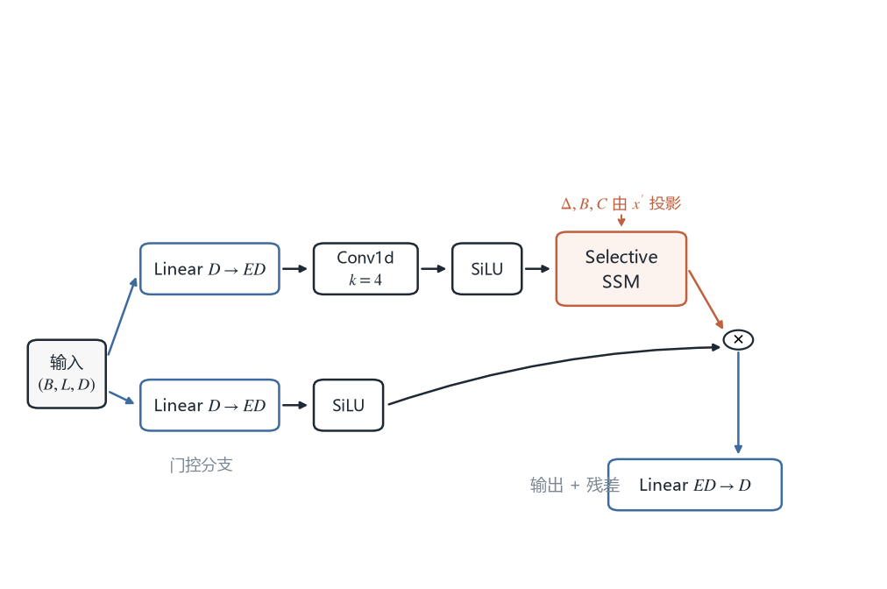

# 第 20 章 Mamba 架构：一个既没有注意力也没有 MLP 的块

前两章把选择机制和高效实现都讲完了，但这些还只是序列混合层。要把它们组成一个可用的语言模型，还需要一个 block 设计。

Mamba 的 block 设计围绕一个主张：

> 把 H3 block 和 Transformer 的 MLP block 合并成一个统一的 block，然后同质地重复它。

这个设计有三个特点：

- 没有独立的 MLP，因为门控线性单元本身就是 MLP 的变体；
- 没有注意力；
- 参数量分布极不均匀：99% 的参数在普通的线性投影上，序列混合那部分只占约 1%。

Mamba 的性能来源不只是那个 SSM，还有这个 block 的结构性简化。

第 21 章的消融会显示架构与内层都有贡献（H3+S6 = 8.95，Mamba+S6 = 8.69）。

---

## 20.1 出发点：H3 block

第 16 章讲过 H3，它的架构是 SSM 家族的标准骨架，大多数 SSM 架构都基于它：

$$
\text{H3 block}:\quad u \;\longrightarrow\; \big(\text{Linear} \to \text{SSM}\big) \otimes \big(\text{Linear} \to \text{门控}\big) \;\longrightarrow\; \text{输出投影}
$$

即两条并联的分支，一条做序列混合（SSM），一条做门控，逐元素相乘。

H3 的标准做法是把它与 MLP block 交替堆叠，就像 Transformer 里注意力层与 MLP 层交替。

这就是"SSM 版的 Transformer"：注意力换成 SSM，MLP 保留。

### 一个结构性观察

Mamba 论文认为 H3 的做法有些冗余：

- H3 block 里的门控线性分支本质上就是 gated MLP 的一半；
- 既然已经有逐位置的线性投影、乘法、激活，何必再单独放一个 MLP？

于是 Mamba 把两者合并。论文说这个想法受 Gated Attention Unit（GAU, Hua 等 2022）的启发，GAU 对注意力做了同样的事。

---

## 20.2 Mamba block 的结构

### 数据流

Mamba block 的完整数据流如下（对应论文 Figure 3 最右侧那栏）：

*图 20-1　Mamba block 的数据流：上支路做卷积与选择性扫描，下支路做门控，最后逐元素相乘*

其中 $E$ 是扩张因子（expansion factor），Mamba 固定 $E=2$。

### 与 H3 / Gated MLP 的三方对照

Figure 3 把三者的差别画得很清楚，用文字复述：

| | 主分支 | 门控分支 | 特点 |
|---|---|---|---|
| **Gated MLP** | Linear → SiLU | Linear | 无序列混合 |
| **H3 block** | Conv → SSM | Linear → 门控 | 序列混合在 SSM，但还要额外的 MLP 层 |
| **Mamba block** | Conv → SSM | Linear → SiLU（门控） | 序列混合与 MLP 合一 |

三个细节：

1. 相比 H3，Mamba 把第一个乘性门控换成了激活函数 SiLU，门控分支因此变成一个标准的 SwiGLU 一半。
2. 相比 Gated MLP，Mamba 在主分支里插入了 SSM 和短卷积。
3. 短卷积（Conv1d, kernel=4）：这个局部卷积来自 H3，作用是在 SSM 处理之前先做局部上下文的混合。它在 Mamba 里是逐通道（depthwise）的，宽度固定为 4。

第 3 点值得多说一句：Mamba-3 会证明这个短卷积可以被新的离散化方式取代（第 32 章），但在 Mamba-1/2 里它是必需组件。Mamba 论文把它当作既定设计（继承自 H3），没有专门消融。

### 为什么用 SiLU / Swish

论文给的理由很直接：

> 用 SiLU 之后，门控 MLP 就变成了广受欢迎的 SwiGLU 变体。

SwiGLU（Shazeer, 2020；被 PaLM、LLaMA 采用）的形式是

$$
\mathrm{SwiGLU}(x) = \mathrm{SiLU}(W_1x)\odot W_2x .
$$

Mamba 的门控分支 $y\odot\mathrm{SiLU}(z)$ 正是这个形式，只是主干从 $W_1x$ 换成了 SSM 的输出。

所以 Mamba 的 block 可以理解为"SwiGLU，但把其中一条分支换成选择性 SSM"。这也解释了它的参数分布：

- SwiGLU 的参数本来就几乎全在线性投影上；
- 把一条分支换成 SSM 只增加 $O(DN)$ 量级的参数。

### 额外的归一化层

论文还提到一个可选的归一化层（最终选 LayerNorm），位置在门控之后、输出投影之前：

> 这个设计的动机来自 RetNet 在类似位置使用归一化层。

（Mamba-2 保留并强化了这个设计，因为它对大模型训练稳定性很关键，见第 26、27 章。）

---

## 逐层形状：一个 token 的旅行

第 20.2 节的文字描述省掉了所有形状。补上之后，“参数几乎全在线性投影上”不用解释。取 $B=1$、$L=2048$、$D=1024$、$E=2$、$N=16$，于是 $ED=2048$。

| 步骤 | 张量 | 形状 | 元素数 | 参数量 |
|---|---|---|---|---|
| 输入（已归一化） | $u$ | $(B,L,D)$ | $2.1\times10^{6}$ | 0 |
| 输入投影 | $uW_{\text{in}}$ | $(B,L,2ED)$ | $8.4\times10^{6}$ | $2ED^2=4.2\times10^{6}$ |
| 切分 | $x',z$ | 各 $(B,L,ED)$ | $4.2\times10^{6}$ | 0 |
| 短卷积（depthwise，$k=4$） | $\mathrm{Conv}(x')$ | $(B,L,ED)$ | $4.2\times10^{6}$ | $EDk=8.2\times10^{3}$ |
| 激活 | $\mathrm{SiLU}$ | $(B,L,ED)$ | $4.2\times10^{6}$ | 0 |
| SSM 参数投影 | $s_\Delta,s_B,s_C$ | $\Delta$: $(B,L,ED)$；$B_t,C_t$: $(B,L,N)$ | — | $D(R+2N)$ |
| 步长投影 | $\Delta$ | $(B,L,ED)$ | $4.2\times10^{6}$ | $R\cdot ED$ |
| 选择性扫描 | $y'$ | $(B,L,ED)$ | $4.2\times10^{6}$ | $EDN$ |
| 门控相乘 | $y'\odot\mathrm{SiLU}(z)$ | $(B,L,ED)$ | $4.2\times10^{6}$ | 0 |
| 输出投影 | $W_{\text{out}}$ | $(B,L,D)$ | $2.1\times10^{6}$ | $ED^2=2.1\times10^{6}$ |

几处需要解释。

输入投影一次做完两条支路。$W_{\text{in}}$ 是 $D\times2ED$，前 $ED$ 列给主分支，后 $ED$ 列给门控分支。一次矩阵乘出 $(B,L,2ED)$，再按最后一维切成两半，两条分支从头到尾同形，门控就是逐元素乘，不需要广播。这个“先堆在一起再切”的做法比两个独立投影省一次 kernel 启动，也让权重布局在显存里连续。

短卷积是逐通道的。$ED=2048$ 个通道各有一个长度 4 的滤波器，分组数设成 $ED$ 就是 depthwise，参数只有 $EDk=8192$ 个，每 token 的 FLOPs 是 $2EDk\approx1.6\times10^{4}$。窗口只有 4 步，作用是把相邻 token 的局部模式先混一混，再交给全局的 SSM。因果性要求它只看过去，所以左侧补 $k-1=3$ 个零，输出长度不变。这个补零有副作用：序列最前面三个位置看到的是人为的零，相当于在开头人为造了一个边界。

$\Delta$ 的维度是 $ED$ 而不是 $D$。SSM 就在扩展后的 $ED$ 维空间里跑，每个通道一个 $\Delta$。$s_\Delta$ 先从 $x_t$ 降到秩 $R$（实现里取 $D/16=64$）再升回 $ED$，是为了“忽略这个 token”的决策在通道间保持一致，理由在第 18.3 节。秩 $R$ 很小，这一步的参数与 FLOPs 都可以忽略。

$B_t,C_t$ 只有 $N$ 维，没有 $ED$ 维，在全部通道间共享。这一步省掉的量不小：如果按通道各算一份，就是 $(B,L,ED,N)$，比现在大 $ED/N=128$ 倍。Mamba-2 把 $B,C$ 保持为单 head 形状、在多个 $X$ head 之间共享（第 26 章），相当于把这层共享关系固定成一种设计语言，而不是实现上的将就。

$N$ 维状态 $h$ 在表里找不到形状，因为它不物化。第 19 章的全部内容就是这件事。

---

## 20.3 参数量的分布：一个决定性的数字

论文给出了 block 级的参数分解：

> 每个 block 的绝大多数参数（$3ED^2$）在线性投影上（$2ED^2$ 用于输入投影，$ED^2$ 用于输出投影），内部 SSM 贡献的参数少得多。SSM 的参数（$\Delta, B, C$ 的投影以及矩阵 $A$）相比之下微不足道。

代入 $E=2$：线性投影是 $6D^2$ 个参数。

论文接着说一个设计上的匹配关系：

> 我们固定 $E=2$，并使用两层这样的 block 来匹配 Transformer 中"一个 MHA + 一个 MLP"的 $12D^2$ 个参数。

验算一下，Transformer 一层是：

- MHA：$4D^2$（$Q,K,V,O$ 四个 $D\times D$ 投影）；
- MLP：$8D^2$（两个 $D\times4D$ 投影，标准 4 倍扩张）。

合计 $12D^2$，两个 Mamba block 是 $2\times6D^2 = 12D^2$，刚好对上。这是精心设计的参数量匹配，让同样参数下的 Mamba 与 Transformer 比较变得公平。

### 这意味着什么

数字对比值得记一下：

$$
\text{SSM 相关参数} \approx O(DN),\qquad \text{其余线性投影参数} \approx 6D^2 .
$$

以 $D=1024$、$N=16$ 为例：SSM 相关约 $1.6\times10^4$，而线性投影是 $6.3\times10^6$，SSM 只占 0.26%。

这个数字带来几个推论：

1. 换 SSM 层对模型总参数量的影响很小，所以 Mamba-2 才能很方便地把 Mamba-1 换成 SSD（参数量几乎不变，性能提高）。
2. 大多数模型能力来自普通线性层。这与神经网络的普遍经验一致，但也提醒一句：不要指望 SSM 层能单独解决所有问题。
3. 增加 $N$ 几乎是免费的：$N$ 从 16 翻倍到 32，SSM 参数从 0.26% 变到 0.5%，几乎不影响 FLOPs 和参数量，但它对性能的影响很大（第 21 章的消融：$N$ 从 1 增到 16 使困惑度从 9.88 降到 8.71，只多 1% 参数）。

第 3 点是理解后面一切的关键：状态维度 $N$ 是个高性价比旋钮。Mamba-2 费那么大力气设计 SSD 算法，就是为了让这个旋钮能拧得更大。

---

## FLOPs 对账：同参数不等于同代价

上表的参数量能直接换成 FLOPs。矩阵乘按 $2mkn$ 计（一次乘加算两次运算），$m$ 按每个 token 摊。

| 组件 | 每 token FLOPs | $D=1024$ 时的值 |
|---|---|---|
| 输入投影 $D\to2ED$ | $4ED^2=8D^2$ | $8.4\times10^{6}$ |
| 输出投影 $ED\to D$ | $2ED^2=4D^2$ | $4.2\times10^{6}$ |
| 短卷积 | $2EDk$ | $1.6\times10^{4}$ |
| $s_\Delta,s_B,s_C$ 与步长投影 | $2D(R+2N)+2RED$ | $4.6\times10^{5}$ |
| 选择性扫描 | $\approx4EDN$ | $1.3\times10^{5}$ |
| 合计 | $\approx12D^2$ | $1.3\times10^{7}$ |

扫描只占 1%。这跟直觉不符：Mamba 的“新东西”就是那个扫描，它在算力表上几乎不存在。这与第 19 章的结论一致，扫描的代价在访存与串行深度，不在 FLOPs。反过来说，任何“把扫描换成更便宜的算子”的尝试，能省下的算力都很有限，真收益得从访存里找。

现在把同等参数的 Transformer 块摆上来。一层 MHA 加一层 4 倍扩张 MLP，参数刚好 $12D^2$：

| 组件 | 参数 | 每 token FLOPs |
|---|---|---|
| $Q,K,V,O$ 四个投影 | $4D^2$ | $8D^2$ |
| 注意力本身（$QK^\top$ 与 $AV$） | 0 | $4LD$ |
| MLP 两层（$D\to4D\to D$） | $8D^2$ | $16D^2$ |
| 合计 | $12D^2$ | $24D^2+4LD$ |

两个 Mamba block 才有 $12D^2$ 参数，所以该拿两个对一层。两边一对：$2\times12D^2=24D^2$ 对 $24D^2+4LD$。参数量与常数项完全对齐，差别只剩 $4LD$ 那一项。

$L=2048$ 时 $4LD=8.4\times10^{6}$，占总量四分之一；$L=32768$ 时是 $1.3\times10^{8}$，把 $24D^2$ 掩没。这就是“线性对二次”在 per-token FLOPs 上的真实形状：短序列上两者差不多，长序列上差一个数量级。

所以 Mamba 的速度优势不来自“每 token 算得少”。在 2K 这个长度上，它只少 25%，而实测训练与推理的差距远大于此。差距来自三处：没有 $L^2$ 项（长序列才显现）、推理时没有 KV cache（能开更大 batch）、以及扫描的访存特性（第 19 章）。把这三条混成一句“Mamba 更快”会丢信息。

---

## 6D² 的三种分法：论文里的一处交叉验证

同一个“参数对齐”，论文里用了两个不同的口径，混着看会混乱。

主实验（语言建模）用 $12D^2$ 对齐：两个 Mamba block 对一层 MHA 加一层 4 倍 MLP。音频消融（SC09 上比较 block 类型）用 $6D^2$ 对齐，附录 E.4.2 把三种块的具体分法写了出来：

| 块 | 参数构成 | 合计 |
|---|---|---|
| Transformer | $4D^2$（MHA）$+2D^2$（MLP，扩张 1 倍） | $6D^2$ |
| S4 + MLP | $2D^2$（SSM 与投影）$+4D^2$（MLP，扩张 2 倍） | $6D^2$ |
| Mamba | 输入投影 $2ED^2$ + 输出投影 $ED^2$（$E=2$） | $\approx6D^2$ |

三个块都是 6M 参数（该实验的总规模），但钱花在不同地方。Transformer 把钱花在 MHA 上，但 MLP 只扩张 1 倍；S4+MLP 反过来，序列混合很便宜而 MLP 扩张 2 倍；Mamba 把两块合成一块，$6D^2$ 里既有序列混合也有门控。

这张表的价值在于提醒：按参数量对齐可以有很多种排法，每种排法的 FLOPs 与归纳偏置都不一样。看到“同等参数下”这种表述时，先确认对齐口径。

---

## 同质堆叠的工程后果

整张网络只有一种 block，这件事在论文里只用一句话带过，但它在工程上省了很多。

层类型少，kernel 就少。Transformer 有两种层，反向传播与优化器要处理两套算子；混合架构有三种。Mamba 只有一套，编译一次、调优一次就完了。这对小团队意义很大。

张量并行变简单。切一个 $D\times2ED$ 的矩阵乘只需要沿输出维或输入维切，两种切法都有成熟做法。注意力层里那种“按 head 切”的特殊逻辑不存在，因为 SSM 本来就是逐通道的。第 26 章会讲 Mamba-2 怎么把这件事做得和 Transformer 一样标准化。

流水并行也变简单。流水并行要求每个 stage 的计算量均衡，层类型越单一，切分点越好找。混合架构里一个 stage 里可能既有注意力又有 MLP，而两者的显存与计算比例不同。

代价是同质也意味着失去分层设计。Transformer 可以让一部分层做局部、一部分层做全局，而 Mamba 的每一层做同一件事。要打破这一点只能靠外部手段（混入注意力层，或者像 Mamba-1 在音频任务里那样分 stage 做池化），这也是后来混合架构出现的原因之一。

---

## 那个宽度为 4 的短卷积

它是整个 block 里最不起眼的部件（参数量 8192，占比 0.13%），但承担一件 SSM 自己做不好的事。

SSM 的输出是对全部历史的加权和，权重由 $\bar A$ 的衰减决定，而衰减是单调的。想表达“相邻两个 token 组成一个词”这种非单调的局部模式，靠单调衰减很难。长度 4 的 FIR 能直接给出 $x_t-2x_{t-1}+x_{t-2}$ 这类差分，是现成的局部特征提取器。H3 把这种局部卷积称为 shift-SSM，意思是它本身就是一个只看几个固定位移的退化 SSM。

它与 SSM 的分工很清楚：卷积管“几步之内”，SSM 管“几百步之外”，中间的尺度由 $\Delta$ 的分布填上。三层机制拼起来才能同时覆盖短、中、长三种依赖。

与注意力的局部注意力窗口相比，这个方案的代价极低。一个 $w=4$ 的滑动窗口注意力需要每 token 存 4 个 $K,V$ 向量，而 depthwise 卷积只需每通道存 4 个系数，与序列长度无关。在推理时这个差别也会显现：前者要求把窗口内的 $K,V$ 留在缓存里，后者只要四个常数。

论文把它当既定设计，没有专门做消融，因为它是从 H3 直接继承的。后来证明它不是必需的：新的离散化方式（指数-梯形）本身就能提供局部平滑，那时短卷积可以被拿掉（第 32 章）。但这是 2026 年的事，在 Mamba-1 的配方里它一直当作必需部件用着。

---

## 门控那一条支路：SiLU 与 SwiGLU

门控分支是 $\mathrm{SiLU}(z)$，与主分支的输出逐元素相乘。这个形式在文献里有名字，也有历史。

门控线性单元（gated linear unit, GLU）最早的形式是 $\sigma(W_1x)\odot W_2x$，用 sigmoid 做门。换成 SiLU（$z\sigma(z)$）后得到 SwiGLU，在多个大模型上比 ReLU-MLP 表现更好，成为 PaLM、LLaMA 的默认选择。Mamba 的 $y\odot\mathrm{SiLU}(z)$ 正是一个 SwiGLU，只是主分支的 $W_1x$ 被换成了扫描的输出。

为什么是 SiLU 而不是 sigmoid。sigmoid 的值域是 $(0,1)$，门只能“调小”不能“翻转”，而且两端饱和，梯度容易消失。SiLU 在负半轴有下界（约 $-0.278$），允许小幅反号，也不在正半轴饱和。这两点让小值信号的传递更顺畅。Mamba 论文只有一句理由：“用 SiLU 之后门控 MLP 就变成了 SwiGLU”，把选择交给已有经验，而没做自己的消融。

这与第 18 章的 Theorem 1 形成了一个有趣的对照。在 SSM 内部，$\Delta$ 扮演门控，$g_t=\sigma(\cdot)$ 有上界 1；而在 block 层面，门控用的却是无上界的 $\mathrm{SiLU}$。两个门长得很像，作用维度却不同：内部那个沿时间轴调衰减，外部这个沿特征轴调幅度。两者合起来才是一次完整的选择：先决定记住多少历史，再决定让多少特征通过。

---

## 一个 block 的算子清单

把上表的步骤按实际 kernel 归并，一个 block 的算子比想象中少：

| 算子 | 输入→输出 | 是否融合 |
|---|---|---|
| RMSNorm | $(B,L,D)$ → $(B,L,D)$ | 否，单独开 |
| 输入投影 | $(B,L,D)$ → $(B,L,2ED)$ | 矩阵乘 |
| depthwise Conv1d + SiLU | $(B,L,ED)$ → $(B,L,ED)$ | 逐元素为主 |
| SSM 参数投影 | $(B,L,ED)$ → $(B,L,2N+R)$ | 矩阵乘 |
| 离散化 + 扫描 + 乘 $C$ | $(B,L,ED)$ → $(B,L,ED)$ | 论文明确写了融合 |
| 门控乘 + 输出投影 | $(B,L,ED)$ → $(B,L,D)$ | 矩阵乘 |
| 残差相加 | 逐元素 | 一般并入下一个 RMSNorm |

七个里三个是矩阵乘，一个是规约，剩下三个是逐元素或扫描。这种构成解释了为什么 Mamba block 能跟 Transformer 一样跑满 GPU：算力主要消耗在矩阵乘上，逐元素与扫描那部分即使访存受限，总量也小。

论文只明确写了扫描一侧的融合（离散化、扫描、乘 $C$ 三者一个 kernel），短卷积与激活是否也在同一个 kernel 里没有说明。这与第 19 章那个“融合到哪一步”的边界问题是同一件事，不同实现的选择不一样。

另一个数字可以拿来看融合的尺度：论文说一个 selective SSM 层存约 16 bytes 的激活每 token，混合精度下一共 8 个数。上面表里一个 token 要经过 $2ED$、$ED$、$ED$ 好几个张量，合起来上万个数字，能留下来的只有八个，其余的要么重算，要么在同一个 kernel 里用完就丢。16 bytes 这个数字背后是整个反向重算策略。

---

## 位置信息存在哪里：一个可检验的说法

第 20.6 节说 Mamba 不需要位置编码，理由要能算出来才算数。

SSM 层对位置的全部认识包含在 $\bar A^{t-s}$ 这个因子（时变情形下是连乘）里。任意两个位置的相对距离 $d=t-s$ 对应一个衰减因子，距离越大因子越小。位置信息就以“信号能被保留多少”的形式存在，没有额外的向量。

能分辨多远由半衰期决定。取 $A_n=-(n+1)$、$N=16$、$\Delta=0.001$，最慢那一维（$n=0$）的半衰期是 693 步；$\Delta=0.1$ 时降到 6.9 步。也就是说，$\Delta$ 小的时候，一层可以跨千步关联；$\Delta$ 大的时候只看几步。

这解释了一个容易被误读的现象：Mamba 在 Induction Heads 上外推到 1M（第 19 章的表），并不代表它记住了 1M 个位置。它做的是把“找前一个同样的 token”这个算法学会，而算法自身不需要位置索引。任务一旦变成“记住第 137 个 token”这种绝对位置检索，衰减就不够用了。

另一面是感受野。单层的核长度理论上是 $L$，但有效长度由衰减曲线下的面积决定，约为半衰期量级。叠 $n_{\text{layer}}$ 层后，有效感受野至少与单层相当且逐层放大，因为每层的输出又作为下一层的输入。这是深堆叠必要性的来源：与 RNN 一样，想看得远就多叠几层，或者把 $\Delta$ 学小。

---

## 这个 block 的四处薄弱点

它的设计很干净，代价也很具体。

序列开头的三个位置看到的是补的零，而不是真实的“之前”。对因果语言建模几乎无影响（预测下一个 token），但对需要读第一个 token 的任务（分类用 CLS 位、抽取首个实体）会引入一个人造边界。Mamba-2 把序列边界显式建模成 $A_t=0$，相当于把这个副作用变成了可控的开关（第 26 章）。

状态容量是硬上限。block 把全部历史压进 $DN$ 个数，$D=1024$、$N=16$ 时是 16384 个，与序列长度无关。聚合类任务（DNA、音频、长文摘要）够用，需要精确回忆某个细节的任务就吃亏，后来的 MQAR 实验把这条边界量化了（第 27 章）。

同质堆叠没有分工。每一层做同一件事，所以模型不能像 Transformer 那样分配“这一层做局部、那一层做全局”。唯一的调节手段是让 $\Delta$ 自己分层分化，而这没有保证。

归一化的位置很关键。可选的 LayerNorm 放在门控之后、输出投影之前，在 350M 这个规模上可有可无，但模型一大就不能省。Mamba-2 把它换成更稳定的归一化并把位置固定下来（第 26 章），这条经验在缩放时比任何架构细节都重要。把归一化从 block 里拿掉再训一个大模型，最先看到的不是指标下降，而是 loss 尖刺。

---

## 一个 1.3B 模型的参数预算

把上面的公式填上具体规模，看参数到底花在哪里。取 $D=2048$、$E=2$、48 层、词表 50257，权重共享。

| 项 | 单层 | 全模型 |
|---|---|---|
| 线性投影 $6D^2$ | $2.52\times10^{7}$ | $1.21\times10^{9}$ |
| 词表嵌入（共享） | — | $1.03\times10^{8}$ |
| 短卷积 | $EDk=1.6\times10^{4}$ | $7.9\times10^{5}$ |
| 矩阵 $A$（$EDN$） | $6.6\times10^{4}$ | $3.2\times10^{6}$ |
| $s_\Delta,s_B,s_C$ 与步长投影 | $8.5\times10^{5}$ | $4.1\times10^{7}$ |
| 合计 | — | $\approx1.4\times10^{9}$ |

几个可以拿走的数：

权重显存。BF16 下 $1.4\times10^{9}$ 个参数是 2.7 GB。推理时每生成一个 token 要把这 2.7 GB 从 HBM 读一遍，而这一遍只换来 $2\times1.21\times10^{9}\approx2.4\times10^{9}$ 次运算，算术强度不到 1。这是第 19 章那个“推理受带宽限制”结论的具体版本。

训练算力。每个 token 前向约 $2.4\times10^{9}$ FLOPs，反向约为前向的两倍，合起来约 $7\times10^{9}$。按 Chinchilla 口径二十倍 token 算，总量在 $10^{20}$ 量级的下沿。

SSM 的份额。若只数 $A$，它是单层参数的 0.26%；把 $s_\Delta$ 的低秩投影与步长投影也计入，升到 3.6%。两者差一个量级，原因在 $s_\Delta$ 的秩：它把 $D$ 维输入投到一个小于 $D$ 的秩上再升回 $ED$，这个升维本身是 $R\cdot ED$ 的参数，比 $A$ 大十几倍。

这一栏也解释了为什么 $E=2$ 定得这么死。$E$ 每加 1，线性投影从 $3ED^2$ 涨到 $3(E+1)D^2$，而扫描的通道数涨 $D$，两者的增长速率不同。$E=2$ 是“参数刚刚好匹配 Transformer”那个点，不是从性能扫出来的。论文没有给出不同 $E$ 的消融，只说“我们在实验中总是固定 $E=2$”。想要更宽的中间层，得自己试。

---

## 这个 block 后来被改动的三处

Mamba-1 的 block 有三处在 Mamba-2 里被改掉，每一处都与“能不能并行训练”有关。

投影从串联变并联。Mamba-1 把 SSM 层看成 $X\mapsto Y$ 的映射，所以 $(\Delta,B,C)$ 的投影发生在输入投影之后，是一串有先后的线性层。Mamba-2 把 SSD 层看成 $(A,X,B,C)\mapsto Y$，于是 $A,B,C,X$ 可以在 block 开头用一次投影全部生成，与注意力里 $Q,K,V$ 同时出并行。这一改动略减参数，更重要的是它是标准 Megatron 张量并行切分的前提。

多了一个归一化。Mamba-1 那个可选的归一化层在 Mamba-2 里变成标配，位置在乘性门控之后、输出投影之前，动机写作“更大规模上容易出现不稳定”。这与 NormFormer 的做法同源。

$B,C$ 只留一个 Head。Mamba-2 让 $B,C$ 在多个 $X$ 的 head 之间共享，类似多值注意力里的做法，参数量与描述长度都降下来。

三处改动的共同点是它们都不在序列混合算法里，而在 block 层面。这也说明 Mamba-1 的 block 设计本身很稳，能撑到 2024 年只动投影顺序与归一化。真正难改的是内层那个扫描，而它一直等到 SSD 算法出现才被替掉（第 25 章）。

---

## 20.4 完整网络

把 block 堆起来就是 Mamba 网络：

整个网络就是同一个 block 重复堆叠：每个 block 前接 RMSNorm，外接残差，最后接输出投影。

这种同质（homogeneous）结构没有注意力层与 MLP 层的交替，带来一个工程上的好处：整个模型只有一种层，便于并行化和 kernel 复用。

Transformer 有两种层（attention 和 MLP），混合架构甚至有三种。层类型越多，张量并行的切分越麻烦。第 26 章讲 Mamba-2 怎么把这件事做到和 Transformer 一样简单。

---

## 20.5 消融：架构 vs 内层

Mamba 论文的 Table 6 在 350M 规模的语言建模上同时消融了架构和内层 SSM：

| 架构 | 内层 | 困惑度 |
|---|---|---|
| Hyena | Hyena（LTI 长卷积） | 10.24 |
| H3 | S4（复数） | 10.30 |
| H3 | S4（实数） | 10.34 |
| **H3** | **S6（选择性）** | **8.95** |
| Mamba | Hyena | 10.75 |
| Mamba | S4（复数） | 10.54 |
| Mamba | S4（实数） | 10.56 |
| **Mamba** | **S6** | **8.69** |

表的读法有三个方向。

(1) 内层是主要矛盾。H3 + S6 = 8.95，H3 + S4 = 10.30，换内层降了 1.35，远大于换架构的差距。

(2) 架构也有贡献，但小得多。同样用 S6，H3 架构 8.95 到 Mamba 架构 8.69，改善 0.26。

(3) LTI 内层之间差别很小。Hyena 10.24、S4 复数 10.30、S4 实数 10.34，三者几乎一样。这印证了第 17 章的判断：所有 LTI 模型本质上是同一类东西（全局卷积），所以都在同一条水平线上。

S4（复数）与 S4（实数）在语言上几乎无差别（10.30 vs 10.34），这为 Mamba 默认用实数提供了依据。论文在别处也说，所有消融里替换内层为 S6 都带来大幅改善，而把复数 S4 换成实数 S4 对性能几乎没影响。

---

## 20.6 一个容易被忽略的点：为什么 Mamba 不需要位置编码

Transformer 需要位置编码（sinusoidal、RoPE、ALiBi……）。Mamba 不需要。

原因在 SSM 本身就是位置感知的：它的核 $\bar K_i$ 依赖距离 $i$，递推天然区分"第几个" token，位置信息被编码在 $\bar A^i$ 的衰减里。

Mamba-2 把这一点表述得更清楚：SSD 的掩码 $L$ 就是"数据相关的位置编码"的一个有原理支撑的版本（第 26 章）。传统位置编码是启发式的（固定的正弦、固定的衰减），SSM 的掩码则是算出来的。

这也解释了 Induction Heads 任务上的结果差异（第 19 章那张表）：注意力模型用固定位置编码，学到的位置模式无法外推到更长的序列；SSM 学到的算法不依赖固定位置。

（一个后续观察：Mamba-2/3 的混合模型里，注意力层必须去掉位置编码（NoPE），否则反而更差，见第 32 章。这从反面印证了位置信息可以由序列混合层自己提供。）

---

## 20.7 本章小结

- Mamba block 把 H3 block 与 Transformer 的 MLP block 合并成一个统一的、同质重复的块：没有独立 MLP，也没有注意力。
- 数据流：$u \to$ `Linear(D→ED)` → `depthwise Conv1d(k=4)` → `SiLU` → `SelectiveSSM`；同时另一条分支 $u \to \mathrm{Linear}(D\to ED) \to$（门控）；两者相乘（$y\odot\mathrm{SiLU}(z)$）再过输出投影。
- SiLU 的选择让门控 MLP 变成了 SwiGLU，因此可以理解为"SwiGLU 的一条分支换成选择性 SSM"。
- 参数量分布：线性投影 $3ED^2$（$E=2$ 时 $6D^2$），SSM 相关只有 $O(DN)$，占比约 0.26%（$D{=}1024,N{=}16$）。两层 Mamba block 恰好匹配 Transformer 的 MHA 加 MLP（$12D^2$），这是精心设计的公平比较基准。
- 推论：换内层 SSM 对总参数量几乎无影响（所以 Mamba-2 能无缝替换）；$N$ 是个高性价比旋钮（翻倍只增加 0.3% 参数，但收益显著）。
- 消融（350M，语言建模困惑度）：内层是主要矛盾（H3+S4 10.30 → H3+S6 8.95），架构是次要贡献（8.95 → 8.69）；LTI 内层之间几乎无差别（Hyena 10.24 / S4 复数 10.30 / S4 实数 10.34）。
- Mamba 不需要位置编码：位置信息编码在 $\bar A^i$ 的衰减里。这一点在 Mamba-2 里被形式化为"掩码即数据相关的位置编码"。

## 下一章

第 21 章讲 Mamba 的全部实验结果（缩放定律、下游评测、DNA、音频）与逐项消融，并把第 18 章讲的"$\Delta$ 是焦点开关"等直觉用数据串起来。这一章也是第六篇的收尾，会指出 Mamba-1 的三个遗憾，它们分别由 Mamba-2、Mamba-3 来解决。
