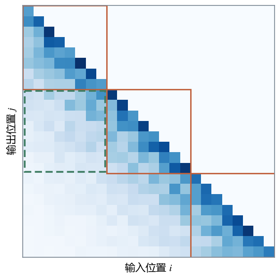

# 第 22 章 半可分矩阵：SSM 的矩阵真身

Mamba-2（Dao & Gu, 2024, ICML）的标题是 "Transformers are SSMs: Generalized Models and Efficient Algorithms Through Structured State Space Duality"，意思是"Transformer 就是 SSM"。这是对 2020 年那篇 "Transformers are RNNs"（Katharopoulos 等）的致敬，也是一个很强的主张。

支撑这个主张的路线有五步：

1. 把 SSM 写成一个矩阵乘法 $Y = MX$（本章）；
2. 证明这个矩阵属于一个经典的结构化矩阵族，也就是半可分矩阵（本章）；
3. 把线性注意力也用矩阵语言重写，发现它落在同一个族里（第 23 章）；
4. 得出对偶性：两者是同一个数学对象的两个计算视角（第 24 章）；
5. 设计一个同时利用两种视角的算法（第 25 章）。

本章走前两步。走完就能看清 SSM 和注意力共享的东西：一个矩阵秩条件。

---

## 22.1 把 SSM 写成矩阵乘法

### 递推 → 矩阵

Mamba-2 统一用离散形式，并把参数带上时间下标（选择性 SSM）：

$$
h_t = A_t h_{t-1} + B_t x_t,\qquad y_t = C_t^\top h_t,
\tag{22.1}
$$

其中 $h_t\in\mathbb{R}^{N}$、$x_t,y_t\in\mathbb{R}$（先考虑单通道）。

从 $h_0 = B_0x_0$ 出发，逐步展开：

$$
\begin{aligned}
h_0 &= B_0x_0,\\
h_1 &= A_1B_0x_0 + B_1x_1,\\
h_2 &= A_2A_1B_0x_0 + A_2B_1x_1 + B_2x_2,\\
&\ \vdots\\
h_t &= \sum_{s=0}^{t} \underbrace{A_tA_{t-1}\cdots A_{s+1}}_{=:\,A_{t:s}}B_sx_s .
\end{aligned}
$$

这里约定 $A_{t:s} := A_tA_{t-1}\cdots A_{s+1}$，即从 $s$ 到 $t$ 的乘积，但不含 $A_s$。这是 Mamba-2 的索引约定，与 Mamba-3 的 $\alpha_{t\cdots s}$ 写法一致。

于是输出

$$
y_t = C_t^\top h_t = \sum_{s=0}^{t}C_t^\top A_{t:s}B_s\,x_s .
$$

写成矩阵乘法：

$$
\boxed{\
y = M x,\qquad
M_{ji} = \begin{cases} C_j^\top A_{j:i} B_i & j\ge i\\ 0 & j<i\end{cases}
\ }
\tag{22.2}
$$

$M\in\mathbb{R}^{T\times T}$ 是下三角矩阵，下三角就是因果，$M_{ji}$ 的含义是"输出位置 $j$ 从输入位置 $i$ 取了多少信息"。

### 这个视角是本章的全部起点

第 1 章我们提过"矩阵混合器"，现在它变成了严格的工具：

- Transformer 的 $M$ 是注意力矩阵 $\mathrm{softmax}(QK^\top)$；
- SSM 的 $M$ 是 (22.2)。

接下来要问的是：这两个 $M$ 属于同一个矩阵族吗？

再看一眼参数：$A,B,C$ 一共是 $T$ 个 $A_t$（$N\times N$）、$T$ 个 $B_t$（$N$）、$T$ 个 $C_t$（$N$），加上 $M$ 里 $O(T^2)$ 个非零元。也就是说 $(A,B,C)$ 是 $M$ 的一个压缩表示，参数只要 $O(TN)$ 而不是 $O(T^2)$。所有 SSM 高效算法的立足点都在这里。

---

## 22.2 半可分矩阵

### 定义

定义 3.1（Mamba-2）：一个（下三角）矩阵 $M$ 是 **$N$-半可分的（$N$-semiseparable）**，如果它的下三角部分中的每个子矩阵秩不超过 $N$。$N$ 称为半可分的阶或秩。

"每个子矩阵"的精确含义：取任意 $j'\ge j\ge i\ge i'$（$j'$ 是行块下界、$i'$ 是列块上界），下面的块

$$
M_{j:j',\,i':i} \quad(\text{行区间 } [j,j'-1],\ \text{列区间 } [i',i-1])
$$

秩不超过 $N$。

用图来理解（Mamba-2 论文的 Figure 2）：

*图 22-1　半可分矩阵：对角块可以自由取值，任何非对角块的秩不超过状态维度 $N$*

半可分矩阵是"全局低秩 + 局部自由"的矩阵：对角线上及其附近的元素可以任意取值，离对角线越远的大块，越必须有低秩结构。

为什么这对 SSM 是自然的？看 (22.2)：

$$
M_{ji} = C_j^\top \underbrace{A_{j:i}}_{\text{从 } i \text{ 到 } j}B_i .
$$

任取一个块，里面的每个元素都要穿过"从第 $i$ 列到第 $j$ 行"的转移——而那个转移的全部信息都压缩在一个 $N$ 维状态里。于是：

$$
M_{j:j',\,i':i} = \underbrace{\begin{pmatrix}C_{j}^\top A_{j:i'} \\ \vdots \\ C_{j'-1}^\top A_{j'-1:i'}\end{pmatrix}}_{\text{左因子，} \in\mathbb{R}^{q'\times N}}
\underbrace{A_{j:i-1}}_{\in\mathbb{R}^{N\times N}}
\underbrace{\begin{pmatrix}A_{i-1:i'}B_{i'} & \cdots & A_{i-1:i-1}B_{i-1}\end{pmatrix}}_{\text{右因子，}\in\mathbb{R}^{N\times q}}
$$

这个块显式地分解成了"左因子（$N$ 列）× 中间 × 右因子（$N$ 行）"，所以秩 ≤ $N$。SSM 是半可分矩阵的证明到此结束。

### SSS 表示

定义 3.2：下三角矩阵 $M$ 有 **$N$-顺序半可分（sequentially semiseparable, SSS）表示**，如果它可以写成

$$
M_{ji} = C_j^\top A_{j}A_{j-1}\cdots A_{i+1}B_i
$$

（即 (22.2) 的形式，其中 $C_j, B_i\in\mathbb{R}^N$，$A_i\in\mathbb{R}^{N\times N}$）。记作 $M = \mathrm{SSS}(A,B,C)$。

### 两个方向都是定理

引理 3.3（Mamba-2）：$N$-SSS 矩阵必然是 $N$-半可分的。

证明就是上面那个显式的秩分解（论文式 (5) 给出了完整写法）：

$$
\begin{pmatrix}
C_j^\top A_{j:i'}B_{i'} & \cdots & C_j^\top A_{j:i-1}B_{i-1}\\
\vdots & & \vdots\\
C_{j'-1}^\top A_{j'-1:i'}B_{i'} & \cdots & C_{j'-1}^\top A_{j'-1:i-1}B_{i-1}
\end{pmatrix}
=
\begin{pmatrix}
C_j^\top A_{j:i'}\\
\vdots\\
C_{j'-1}^\top A_{j'-1:i'}
\end{pmatrix}
A_{j:i-1}
\begin{pmatrix}
A_{i-1:i'}B_{i'} & \cdots & A_{i-1:i-1}B_{i-1}
\end{pmatrix}
$$

命题 3.4（Mamba-2）：每个 $N$-半可分矩阵都有 $N$-SSS 表示。（这是半可分矩阵文献里的经典结果。）

于是：

> **$N$-半可分 $\iff$ 有 $N$-SSS 表示。**

两边可以自由使用。代价是两种描述服务于不同场合："秩条件"（定义 3.1）是几何、结构层面的，"SSS 表示"（定义 3.2）是算法层面的。我们用一个来思考，用另一个来计算。

### 参数量的故事

定义 3.2 表面上需要 $O(N^2T)$ 个参数（因为要存 $T$ 个 $A_t$，每个 $N\times N$）。

但 Mamba-2 论文指出了一个更强的结果：$N$-半可分矩阵实际上可以压缩到 $O(NT)$ 个参数，而且这个界是渐进最优的（引 Pernet、Signargout、Villard, 2023）。

为什么？因为只需要保证子块低秩，就不需要保留完整的 $A_t$，可以只保留每个 $A_t$ 的"跨越区间"作用（例如用低秩分解表示）。对 SSM 的具体情形，如果 $A_t$ 是对角矩阵，那么 $A_t$ 只需 $N$ 个数而不是 $N^2$ 个，且 $\prod A_t$ 仍然是逐元素的连乘。

对角结构因此在 SSM 里流行（第 14 章已讲）：它让 $O(NT)$ 的参数化变得平凡。

---

## 把一个四乘四的矩阵算出来

定义和分解看完，接下来按公式把一个 $T=4$、$N=2$ 的 SSM 矩阵算到底，每一格都能手算。

取 $A_t=\mathrm{diag}(0.5,\,1)$（三个 $t$ 都一样），$B_i=C_j=(1,1)^\top$。按 (22.2)：

$$
M_{ji}=\sum_{n=1}^{2}C_{j,n}\Big(\prod_{t=i+1}^{j}A_{t,nn}\Big)B_{i,n}=0.5^{\,j-i}+1 .
$$

把 $j\ge i$ 的位置填上：

$$
M=\begin{pmatrix}
2 & & & \\
1.5 & 2 & & \\
1.25 & 1.5 & 2 & \\
1.125 & 1.25 & 1.5 & 2
\end{pmatrix}
$$

逐项对一下。$(j,i)=(1,0)$：$0.5^{1}+1=1.5$。$(2,0)$：$0.5^{2}+1=1.25$。$(3,0)$：$0.5^{3}+1=1.125$。$(3,2)$：$0.5^{1}+1=1.5$。对角线上的 2 是 $n=1$ 的 $0.5^0=1$ 加 $n=2$ 的 $1^0=1$，两个通道各贡献一份。

对角线上那四个 2 不受任何秩条件约束，参数摆成这样就行，这正是定义里“对角块自由”的具体含义。

现在验秩。取块 $M_{\{2,3\},\{0,1\}}$：

$$
\begin{pmatrix}1.25 & 1.5\\ 1.125 & 1.25\end{pmatrix},\qquad \det=1.25\times1.25-1.5\times1.125=1.5625-1.6875=-0.125 .
$$

行列式不为零，秩是 2，恰好等于 $N$。这不是巧合，那个块能直接拆成两个秩一矩阵的和：

$$
M_{ji}=0.5^{j}2^{i}+1\quad\Longrightarrow\quad
\begin{pmatrix}1.25&1.5\\1.125&1.25\end{pmatrix}
=\begin{pmatrix}0.25\\0.125\end{pmatrix}(1\ \ 2)+\begin{pmatrix}1\\1\end{pmatrix}(1\ \ 1).
$$

两项都对。第一项在 $(j,i)=(2,0)$ 给 $0.25\times1=0.25$，第二项给 1，和是 1.25；$(3,1)$ 给 $0.125\times2=0.25$ 加 1，也是 1.25。两个秩一项相加，秩上界就是 2。

$2\times2$ 的块看不出“秩不超过 $N$”有多少内容，因为它的秩本来最多就是 2。要把 $T$ 拉到 6 才能看见非平凡的约束。同样两个通道、同样参数，取行 $\{3,4,5\}$、列 $\{0,1,2\}$：

$$
\begin{pmatrix}
1.125 & 1.25 & 1.5\\
1.0625 & 1.125 & 1.25\\
1.03125 & 1.0625 & 1.125
\end{pmatrix}
$$

这个 $3\times3$ 矩阵的秩必须是 2，行列式必为零。手算的验证办法是找行关系：

$$
\text{row}_4=0.5\,\text{row}_3+0.5\,(1,1,1),\qquad
\text{row}_5=0.25\,\text{row}_3+0.75\,(1,1,1).
$$

代进去对一遍：$0.5\times1.125+0.5=1.0625$，$0.5\times1.25+0.5=1.125$，$0.5\times1.5+0.5=1.25$，后两行同理。三行都是 $\text{row}_3$ 与全 1 向量的组合，所以秩 ≤ 2。而 $\text{row}_3$ 与 $\text{row}_4$ 不成比例，秩正好是 2。

这也是引理 3.3 那个分解在具体数字上的样子。左因子 $N=2$ 列，$\mathrm{row}_3$ 与全 1 向量就是它的两个方向；右因子 2 行。$3\times3$ 的块被夹在中间那个 $2\times2$ 的转移里，信息只能从两条缝隙过去。

---

## 22.3 1-SS 矩阵：标量递推的矩阵形式

Mamba-2 特别强调一个特例。

当 $N=1$ 时（状态是一维，没有 $B,C$ 投影），$M_{ji} = a_j a_{j-1}\cdots a_{i+1} =: a_{j:i}$（标量的连乘）。写成矩阵：

$$
M = \mathrm{1SS}(a_{0:T}) =
\begin{pmatrix}
1 & & & \\
a_1 & 1 & & \\
a_2a_1 & a_2 & 1 & \\
\vdots & & \ddots & \ddots\\
a_{T-1}\cdots a_1 & \cdots & a_{T-1} & 1
\end{pmatrix}
\tag{22.3}
$$

这个矩阵由 $T-1$ 个数 $a_1,\dots,a_{T-1}$ 完全决定，参数量 $O(T)$ 而非 $O(T^2)$。

### 关键等价：矩阵乘法 = 标量递推

$$
y = Mx \quad\Longleftrightarrow\quad y_t = a_t y_{t-1} + x_t
$$

验证：

$$
y_t = a_t y_{t-1} + x_t = a_t(a_{t-1}y_{t-2}+x_{t-1}) + x_t = \cdots = \sum_{s\le t}a_{t:s}x_s = (Mx)_t . ✓
$$

Mamba-2 把 $y = Mx$ 称为标量 SSM 递推（scalar SSM recurrence）或者 cumprodsum（cumulative product sum，累积求和乘积），因为它推广了 cumsum（累积和，$a_t\equiv1$）和 cumprod（累积乘积）。

### 为什么这个特例重要

Mamba-2 论文说得很明确：

> 这篇论文的核心主题之一是：很多序列模型上的算法都可以归约为结构化矩阵乘法算法。

1-SS 矩阵是这个连接最好的例证："计算一个标量递推"与"用一个 1-SS 矩阵做乘法"完全是一件事，因此所有已知的递推快速算法，都对应 1-SS 矩阵的某一种分解。Mamba-2 的附录 B 整理了一大类这样的算法（分块、并行扫描、基于 FFT、基于 Chebyshev 等）。

还有一个更实用的作用：任何 SSM 的核心递推都是"逐元素的标量递推"（当 $A$ 是对角矩阵时，$N$ 个独立通道，每个都是一维递推）。所以在实现里，SSM 的瓶颈永远是"怎么快速做 1-SS 乘法"。

---

## 为什么转移矩阵落在 1-SS 上

上一节那个例子不是特例。对角 $A$ 的情形下，任何一个 SSM 矩阵都能拆成 $N$ 个 1-SS 矩阵的叠加。

把 (22.2) 按通道拆开。$A_t$ 是对角矩阵，所以 $A_{j:i}$ 也是对角，第 $n$ 个对角元是标量连乘 $\prod_{t=i+1}^{j}a_t^{(n)}$。标量可以和 $C_{j,n}B_{i,n}$ 交换位置，于是

$$
M_{ji}=\sum_{n=1}^{N}C_{j,n}\Big(\prod_{t=i+1}^{j}a_t^{(n)}\Big)B_{i,n}
\quad\Longrightarrow\quad
M=\sum_{n=1}^{N}\mathrm{diag}(C_{\cdot n})\cdot\mathrm{1SS}(a^{(n)})\cdot\mathrm{diag}(B_{\cdot n}).
$$

三个因子都是 $T\times T$，但只有中间那个带 $T-1$ 个自由参数；$\mathrm{diag}(C_{\cdot n})$ 的第 $j$ 个对角元是第 $j$ 个位置的第 $n$ 个 $C$ 分量，$\mathrm{diag}(B_{\cdot n})$ 同理，各只有 $T$ 个数。真正混合序列的只有中间那个。

用上一节的数验一遍。$n=1$ 的 $a^{(1)}=0.5$，两头的对角阵全是 1，于是贡献 $0.5^{\,j-i}$；$n=2$ 的 $a^{(2)}=1$，$\mathrm{1SS}(1)$ 就是下三角全 1。两者相加正好是那个四乘四。刚才“每一项都能写成两个秩一外积相加”，对应的就是上面那个 $N$ 项分解里的两项。

关键一步是 $A_t$ 对角。如果 $A_t$ 是稠密矩阵，$A_{j:i}$ 就是矩阵乘积，不可交换，乘积无法拆成标量，第 $n$ 个通道与第 $m$ 个通道耦合在一起。参数从 $O(NT)$ 回到 $O(N^2T)$，每步递推从 $N$ 次标量乘回到 $N^2$ 次。对角化把两个通道解耦成 $N$ 条独立的标量递推，这就是 S4D 与 Mamba 都用对角的核心原因（第 14 章）。

再收紧一步。取 $A_t=a_tI$，所有通道的衰减系数相同，标量可以提到求和号外：

$$
M_{ji}=a_{\,j:i}\sum_{n=1}^{N}C_{j,n}B_{i,n}=a_{\,j:i}\,(C_j^\top B_i)
\quad\Longrightarrow\quad
M=L\circ(CB^\top),\qquad L=\mathrm{1SS}(a).
$$

$\circ$ 是逐元素乘，$CB^\top$ 是 $T\times T$ 的 Gram 矩阵。用一个 $T=3$、$a_t=0.5$、$C_j^\top B_i=1$ 的小例验：$L$ 是对角为 1、次对角 0.5、再次对角 0.25 的下三角矩阵，$CB^\top$ 在掩码内全是 1，逐元素乘之后得到 $L$ 本身，正是 $M_{ji}=0.5^{\,j-i}$ 要求的。把 $C_j^\top B_i$ 换成别的数，$L$ 的形状不变，每个位置只被乘上一个系数。这就是 $N=1$ 与 $N>1$ 的分界：$N=1$ 时整张矩阵只有一个 1-SS 形状，剩下的都是对角缩放。

标量情形的那个式子是第 24 章对偶性质的代数入口，这里先当恒等式看。它也说明了 $N$ 的角色：$N$ 决定“叠几条 1-SS”，不决定“怎么算一条 1-SS”。所以任何 SSM 实现的性能瓶颈永远落在同一个原语上（标量扫描，第 19 章），而 $N$ 只会线性地放大它。

Mamba-2 把 $A$ 从对角收到标量乘单位阵，就是把 $N$ 项分解换成标量那一式。$N$ 个方向塌成一个，每个 head 只剩一条 1-SS，代价是衰减模式变少；作为补偿，head 维 $P$ 从 Mamba 的 1 提到 64/128（第 26 章）。这个取舍在第 24 章会用张量缩约的语言重说一遍，但根就在这里：一个 SSM 的所有矩阵信息，本质上就存在 $N$ 条标量衰减序列里。

实现层面，那个 $N$ 项分解就是 kernel 的布局。每个 head 持有一条长度为 $T$ 的衰减序列与两个 $(T,N)$ 的矩阵，扫描在 $N$ 维向量上做逐元素乘，因此内核把 $N$ 放在最后一维一次性取完（第 19 章）。$N$ 变大时变的不是扫描深度，而是这个向量的宽度。

---

## 22.4 主定理：SSM 就是半可分矩阵

定理 3.5（Mamba-2）：状态维度为 $N$ 的 SSM 变换 $y = \mathrm{SSM}(A,B,C)(x)$，等同于用一个 $N$-SS 矩阵（顺序半可分表示）做乘法：$y = \mathrm{SSS}(A,B,C)\cdot x$。

（论文还开了一个玩笑：structured state space model 和 sequentially semiseparable matrix 的缩写竟然都是 SSM/SSS，这"underscores their equivalence"。）

### 这个等价关系立刻给出一个很强的复杂度结论

命题 3.6（Mamba-2，引 Pernet 等 2023）：一个尺寸为 $T$ 的 $N$-SS 矩阵可以用 $O(NT)$ 个参数表示，且矩阵-向量乘法可在 $O(NT)$ 时间和空间内完成。

定理 3.7（Mamba-2）：任意状态维度为 $N$、序列长度为 $T$ 的 SSM 都可以在 $O(TN)$ 时间内算出（不计预处理）。

定理 3.7 在 SSM 文献里是一个新结果。分量在于：

- 对一般的、无结构的 $A_t$ 矩阵，表示本身就看起来要 $O(TN^2)$ 个参数；
- 但定理说，经过一次预处理之后，即使是无结构的 SSM 也能做到最优复杂度；
- 而且 $O(TN)$ 与下界匹配（下界来自 $B,C$ 本身的 $O(TN)$ 个元素）。

Mamba-2 论文还给了一个补充说明（Remark 4）：这个结论并不太意外，因为"几乎所有实矩阵在 $\mathbb{C}$ 上都可以对角化"（第 14 章的 Proposition 2），所以几乎所有的实 SSM 都等价于一个复对角 SSM。但定理 3.7 的结论更强：它对所有实 SSM 成立，包括那些不可对角化的；它对任意域（包括 $\mathbb{C}$ 本身）也成立。

实践层面要加一句：这个"最优算法"需要一个昂贵的预处理步骤（$O(N)$ 的额外 FLOPs，且涉及 SVD 这类硬件不友好的操作）。所以实践中仍然需要额外的结构（对角、标量）来避开预处理。这就引出了 Mamba-2 在 22.5 节和后面章节的算法。

---

## 22.5 两种计算模式

有了矩阵视角，SSM 的两种计算方式就变成了"对 $M$ 做乘法的两种方式"。

### 线性（递归）模式

算法如下（论文式 (8)，用张量缩约记号表示）：

$$
\begin{aligned}
Z &= \mathrm{contract}(SP,\,SN \to SPN)(X,\ B) &&(T,P,N)\\
H &= \mathrm{contract}(TSN,\,SPN \to TPN)(L,\ Z) &&(T,P,N)\\
Y &= \mathrm{contract}(TN,\,TPN\to TP)(C,\ H) &&(T,P)
\end{aligned}
\tag{22.4}
$$

其中 $L\in\mathbb{R}^{T\times T}$ 由 $\mathrm{1SS}(A)$ 给出（逐状态一份）。

三步的含义：

1. 扩张：把输入 $X$ 用 $B$ 扩张到 $N$ 维（把输入映射进状态空间）；
2. 递推：用 1-SS 矩阵 $L$ 做标量 SSM 递推（状态如何随时间传播）；
3. 收缩：用 $C$ 把状态收缩回输出（从状态读出输出）。

代价是 $O(T N P)$ 时间，但中间张量 $Z, H$ 的大小是 $(T,P,N)$。以 $T{=}2048,P{=}64,N{=}64$ 计，是 840 万个数，Mamba-1 必须做核融合，原因就在这里（第 19 章）。

Mamba-2 论文明确说："a naive implementation is slow because of the expanded tensors $Z$ and $H$ of size $(T,P,N)$; Gu and Dao (2023) introduced a hardware-aware implementation to avoid materializing these tensors."

### 二次（朴素）模式

直接物化矩阵 $M = \mathrm{SSS}(A,B,C)$（大小 $T\times T$），然后做一次矩阵-向量乘。

代价 $O(T^2N)$，对长序列是二次的。但当 $T$ 很小时（比如 $T=64$ 的一个块），它反而可能更快，因为：

- 它完全是矩阵乘法，硬件友好；
- 没有串行依赖（可以并行算所有 $M_{ji}$）。

Mamba-2 后面就是靠"在小块里用二次模式、在块之间用线性模式"来同时拿到两者的好处（第 25 章）。

### 截面图：两种模式的对偶性

Mamba-2 论文的 Figure 4 给出了这张"对偶关系表"，它把两侧的符号对齐：

| | SSM 侧 | 注意力侧 |
|---|---|---|
| 收缩矩阵 | $C$ | $Q$（queries） |
| 扩张矩阵 | $B$ | $K$（keys） |
| 输入序列 | $X$ | $V$（values） |
| 状态矩阵 | $A$ | 掩码 $L$ |
| 状态维度 | $N$ | 特征维度 $N$ |
| 中间量 | 隐状态 $H$（式 22.4 第 2 步） | Gram 矩阵 $G = QK^\top$ |
| 线性模式 | $H = L\cdot XB^\top$ 型 | —— |
| 二次模式 | $M = A \circ (CB^\top)$ 型 | $G = QK^\top$ |

右列要到第 23~24 章才能讲清楚，现在先放下。

---

## 22.6 一个重要的哲学转变

按 Mamba-2 论文的说法，这一章（以及下一篇）带来一个视角上的转变：

> 过去：RNN 和 SSM 不是"矩阵混合器"，只有注意力是。
> 现在：SSM 也是矩阵混合器，而且它的矩阵属于一个经典的结构化族。

这个转变的价值有三层：

1. 理论上：SSM 与注意力不再是两套隔绝的理论，而是同一个族的两个极端（一个"低秩但有结构"，一个"内容相关但不是半可分"）。
2. 算法上：半可分矩阵有几十年的数值线性代数积累（HSS、SSS、Bruhat 形式等等），可以借过来。
3. 系统上：既然 SSM 也是矩阵乘法，那么所有为矩阵乘法优化的东西（Tensor Core、cuBLAS、块算法）都能用上。

---

## 四个常见的误读

### 半可分不是“整体低秩”

名字里的“秩”容易让人以为矩阵本身是低秩的。上一节那个四乘四矩阵是下三角且对角元全为 2，行列式 $2^4=16$，秩为 4，等于 $T$。它是一个完整的 2-SS 矩阵，同时满秩。所谓秩约束只管严格非对角的那一块，对角线及附近完全自由。一个把全部历史都混进来的矩阵，不会因为“半可分”这个名字就变成低秩阵。

### “每个子矩阵”的范围

定义 3.1 的字面是“下三角部分中的每个子矩阵”，引理 3.3 的证明却只覆盖 $j'>j\ge i>i'$ 的严格非对角块。这个差异是必要的：如果连贴对角线的块也要求秩 ≤ $N$，那连单位阵都不是 1-SS。所以严格讲这是 $(N,0)$-半可分，文献里也归入拟可分（quasiseparable）。论文 Remark 2 自己交代了这一点，并说不同文献的定义有微妙差别，本书一律按“严格非对角块”理解。

### 索引方向与空积

$M_{ji}$ 是第 $j$ 行第 $i$ 列，$j\ge i$。$A_{j:i}=A_jA_{j-1}\cdots A_{i+1}$ 不含 $A_i$，所以 $A_{j:j}$ 是空积，等于 $I$。这带来一个实用推论：

$$
M_{jj}=C_j^\top B_j,\qquad \text{而不是}\qquad C_j^\top A_jB_j .
$$

用上一节的数验：$C_j^\top B_j=1+1=2$，矩阵对角线上确实是 2。如果误写成含 $A_j$ 的版本，对角线会变成 $0.5+1=1.5$，与递推不符。这条也决定了实现里的顺序：先乘 $A_t$ 再读状态，还是先读再乘。第 19 章的扫描内核用的是 $h_t=A_th_{t-1}+B_tx_t$，读出用 $C_t^\top h_t$，与这里一致。

### 阶数只是一个上限

阶数只是一个上限，实际秩取决于参数。上一节的例子秩正好是 2，因为两个通道的衰减率不同（0.5 与 1）。把两个通道都设成 0.5，$B=C=(1,1)^\top$，于是

$$
M_{ji}=0.5^{\,j-i}(1+1)=2\cdot0.5^{\,j-i},
$$

整个矩阵变成 $2\cdot\mathrm{1SS}(0.5)$，所有非对角块秩都降到 1。参数没变、形状没变，有效阶数从 2 降到 1。Mamba-2 把 $A$ 收成标量乘单位阵，强行让所有通道共享衰减率，相当于主动把有效阶数压到 1，再用 head 维 $P$ 和层数把表达能力补回来。

## 稠密、低秩、带状、半可分

序列混合矩阵有几条压缩路线，很容易混。

带状（滑动窗口）把距离超过 $w$ 的元素直接置零。低秩近似把整个矩阵写成 $M\approx UV^\top$，$U,V$ 是 $T\times r$。半可分不置零、不全局低秩，而是把矩阵切成块，每块自己低秩。

取 $T=4096$、$N=r=16$、窗口宽度 $w=16$：

| 结构 | 非零元个数 | 自由参数 | 远处信息的处理 |
|---|---|---|---|
| 稠密（注意力） | 约 $8.4\times10^{6}$ | 同左 | 显式保留 |
| 低秩（秩 16） | 约 $8.4\times10^{6}$ | $2Tr=1.3\times10^{5}$ | 与近处共用同一组基 |
| 带状（$w=16$） | 约 $6.5\times10^{4}$ | 0（不需学习） | 直接置零 |
| 1-SS | 约 $8.4\times10^{6}$ | $T-1$ | 按累积乘积衰减 |
| $N$-SS | 约 $8.4\times10^{6}$ | $3TN\approx2.0\times10^{5}$ | 每块自己的低秩基 |

表的中间两列才是关键。带状结构把远处丢掉，代价是不可逆；低秩让每个块共享同一个子空间，代价是局部细节只能挤在 16 维里；半可分两者都要，既要远处非零，又要低参数。能这么做的前提是权重按乘积衰减，而乘积衰减正是 SSM 递推自带的东西。

因此半可分的参数效率与递推等价性是一个硬币的两面。那个分解里 $\mathrm{1SS}$ 的每个元素都是 $j-i$ 个因子的乘积，这种“链式”结构既让参数降到 $T$ 个，也让乘法降到 $\mathrm{cumprodsum}$。换成稠密的 $A$，链断了，两个好处一起消失。

低秩那一行还有一个区别。Mamba-2 论文在整理高效注意力时把 Linformer 这类方法归为“对注意力矩阵做低秩近似”，它们与半可分的假设不同：前者假设整个矩阵落在一个小秩子空间，后者只假设块内低秩。一张 $T\times T$ 的矩阵可以既是半可分也是满秩（上一节那个例子），却不可能是“低秩且满秩”。这是两个不可互推的结构假设。

这种差别在长序列上会被放大。低秩近似的误差随距离单调增长（远处的信息必须挤进同一组基），半可分的误差不随距离增长，只随 $N$ 变。这是 SSM 在 1M 长度上仍能保持困惑度不崩的结构原因。

四条归一句话：半可分是一个关于“块秩”的条件，不是一个关于“整体秩”的条件；索引方向与空积的约定决定了实现的顺序；阶数只是上限。读论文里任何一条引理前先确认这三件事，能省很多来回。

## 一个 head 的账：中间张量为什么必须融合

把第 22.5 节的两个复杂度换成人能记住的数字。取 $T=2048$、$P=64$、$N=64$。

线性模式的中间量 $Z$ 与 $H$ 都是 $(T,P,N)$，即 $2048\times64\times64=8{,}388{,}608$ 个元素，BF16 下每个 head 16.8 MB。一个 head 的二次模式中间量是 $(T,T)$，$2048^2=4{,}194{,}304$ 个元素，只有 8.4 MB。

也就是说，在 $T=2048$ 这个长度上，“线性”模式要物化的张量反而比二次模式的分数矩阵大一倍。把这个算例放大到一层二十四个 head、二十四层（Mamba-2 一百 M 量级的配置），线性模式光中间量就是 $16.8\ \mathrm{MB}\times24\times24\approx9.7\ \mathrm{GB}$，还没算反向传播的存储。

两个数字相撞的位置可以解出来：$T^2=TPN$ 给出 $T=PN$。$P=N=64$ 时交叉点在 $T=4096$。$T$ 低于 4096 时二次模式更省，高于 4096 时线性模式更省。这就是 SSD 分块策略的数字依据：把长序列切成 $C{=}64$ 的小块，块内用二次模式（$C^2$ 很小），块间用线性模式传递状态（第 25 章）。

FLOPs 上的差距则大得多。二次模式约 $T^2N$，线性模式约 $TPN$，比值 $T/P=32$。但二次模式全是矩阵乘，能上 Tensor Core，线性模式的核心是扫描，上不了。硬件把 32 倍的差距拉回到几倍，而这几倍恰好是 Mamba-2 想拿的那部分。

训练时这些中间量还要供反向用。如果不存，就得重算：Mamba 的做法是不保存 $(B,L,D,N)$ 的状态，反向时重新跑一遍前向，只看 $O(BLN+DN)$ 个输入，从而避开从 HBM 读回 $O(BLND)$ 个元素（第 19 章）。重计算的代价是多算一遍，收益是不用读写。在 $N=16$ 时两者相当，$N=64$ 时读写先输。

## 参数从哪里省下来

同一个 SSM，$A$ 选什么结构，参数差两个数量级。取 $T=2048$、$N=64$，单通道：

| $A$ 的结构 | $A$ 参数 | $B,C$ 参数 | 总参数 | 每步乘法 |
|---|---|---|---|---|
| 稠密 | $TN^2=8.4\times10^{6}$ | $2TN=2.6\times10^{5}$ | $8.6\times10^{6}$ | $N^2=4096$ |
| 对角 | $TN=1.3\times10^{5}$ | $2.6\times10^{5}$ | $3.9\times10^{5}$ | $N=64$ |
| 标量 | $T=2.0\times10^{3}$ | $2.6\times10^{5}$ | $2.6\times10^{5}$ | 1 |

稠密那一行还不是“多花一点参数”的问题。每步递推要做 $N\times N$ 矩阵乘向量，扫描的每个环节都依赖上一步的完整状态，并行度被序长限制死。对角把每步降到 $N$ 次标量乘，而 $N$ 个通道之间彻底并行，扫描深度不变但每层宽度大了 $N$ 倍。

对标定理 3.6 的下界还能看出对角为什么“几乎无损”。下界是 $O(NT)$，对角结构给出的总参数是 $3TN$，同阶。换句话说，在参数和时间的复杂度账上，对角已经最优，继续用稠密的 $A$ 只会多花 $N$ 倍的钱而不改变复杂度阶。代价只在表达力：对角矩阵产生的转移是坐标轴方向的缩放，而稠密矩阵可以把状态在 $N$ 维里旋转。S4 花了两章（第 10 至 12 章）就是为了把旋转用低秩修正的方式补回来。

标量那一行的意义是把 $A$ 压到与 $T$ 同阶，瓶颈随即完全落到 $B,C$ 的 $2TN$ 上。Mamba-2 的 head 结构设计（第 26 章）实质上就是在分这块饼：$B,C,X$ 各自开几个 head，直接决定参数量与表达力怎么分。

## 同一个矩阵，四种算法

半可分矩阵是一个数学对象，算 $Mx$ 有很多种办法，选哪种取决于 $A$ 是否随 $t$ 变。

递推（扫描）。按 $h_t=A_th_{t-1}+B_tx_t$ 逐步推。时间 $O(TN)$，空间常数，但串行深度 $T$，不碰矩阵乘法单元。它的算术量最小，但每一步都要把状态写回显存再读回来，所以实际速度几乎完全取决于是否融合。

分块。把矩阵切成对角块与非对角块，块内按稠密算，块间只传状态。复杂度可以写成 $O(TN+T^2N/C)$ 这种形状，$C$ 是块长。$C$ 取小就接近递推，取大便接近二次。工程上 $C$ 的选择还受 SRAM 容量限制，不只是 FLOPs 问题。

FFT。$A,B,C$ 都不随 $t$ 变时，$M_{ji}=C^\top A^{j-i}B$ 只依赖 $j-i$，矩阵是 Toeplitz，于是 $Mx$ 就是一次卷积，可以用 FFT 做到 $O(T\log T)$。这就是 S4 的卷积模式（第 12 章）。选择机制一上来，$A_t$ 随 $t$ 变，Toeplitz 结构就碎了，FFT 这条路直接堵死。这也是 Mamba 必须回去做扫描的根本原因。

多项式与 Chebyshev。把 $M$ 展开成 $A$ 的多项式，再用快速多项式乘法。论文附录 B 把这一族算法归了类。它的好处是不需要序列维的串行依赖，代价是多项式阶数一大，数值稳定性就变差。

四条路径的共同点：它们算的是同一个矩阵。这正是第 22.6 节那个“哲学转变”的实用价值，也是理解后续算法的前提：只要不改变 $M$，换算法不会改变模型输出，只会改变速度与显存。改变 $M$ 才是改模型。

四者在速度上并不等价。Mamba-2 论文在状态扩张因子 $N=64$ 时测得 SSD 比 Mamba 的 fused scan 快 2 到 8 倍；序列长 2K 以上超过 FlashAttention-2，16K 时快 6 倍。差别不在 FLOPs，在子步骤里有多少能交给 matrix multiply 单元。这条留给第 25 章。

反过来的误读也常见：把 $M$ 当成一个必须存下来的对象。$T=10^{6}$ 时 $M$ 有 $10^{12}$ 个元素，任何实现都不可能物化它。它只是一份用 $3TN$ 个数写成的“计算说明书”，在哪里物化、物化多大一块，是算法选择的事。

## 22.7 本章小结

- SSM 可以写成下三角矩阵乘法 $y = Mx$，$M_{ji} = C_j^\top A_{j:i}B_i$（$j\ge i$）。$M$ 是 $T\times T$ 的，但由 $O(TN)$ 个参数压缩生成。
- $N$-半可分：下三角部分中每个子块秩 ≤ $N$。SSM 天然如此，因为任何块都能分解成"左因子（$N$ 列）× 转移 × 右因子（$N$ 行）"。
- SSS 表示 $M_{ji}=C_j^\top A_j\cdots A_{i+1}B_i$；**$N$-半可分 $\iff$ 有 $N$-SSS 表示**（Lemma 3.3 + Proposition 3.4）。参数量可压缩到 $O(NT)$（最优）。
- 1-SS 矩阵：$M_{ji}=a_{j:i}$，与标量递推 $y_t = a_ty_{t-1}+x_t$ 严格等价，也叫 cumprodsum。它是所有 SSM 实现的性能瓶颈所在，也是"递推 $\leftrightarrow$ 矩阵分解"的枢纽。
- 定理 3.5：SSM 变换 = 半可分矩阵乘法（缩写巧合：SSM = structured state space model = semiseparable matrix）。
- 定理 3.7：任意 SSM 都能在 $O(TN)$ 时间内算出（经预处理），达到下界。但预处理成本高，所以实践中仍需要对角/标量等额外结构。
- 两种计算模式：线性（递归）$O(TNP)$，但中间张量 $(T,P,N)$ 巨大（这是 Mamba-1 核融合的动机）；二次（朴素）$O(T^2N)$，但全是矩阵乘法、无串行依赖。小块用二次、大范围用线性，这就是第 25 章 SSD 算法的思路。

## 下一章

第 23 章从注意力那一侧走进来：用张量缩约的语言重新推导线性注意力，并把它一般化为**结构化掩码注意力（SMA）**。这一步会看到，注意力的"因果掩码"其实就是一个 1-SS 矩阵。第 24 章把两侧合起来，就是"状态空间对偶"。
