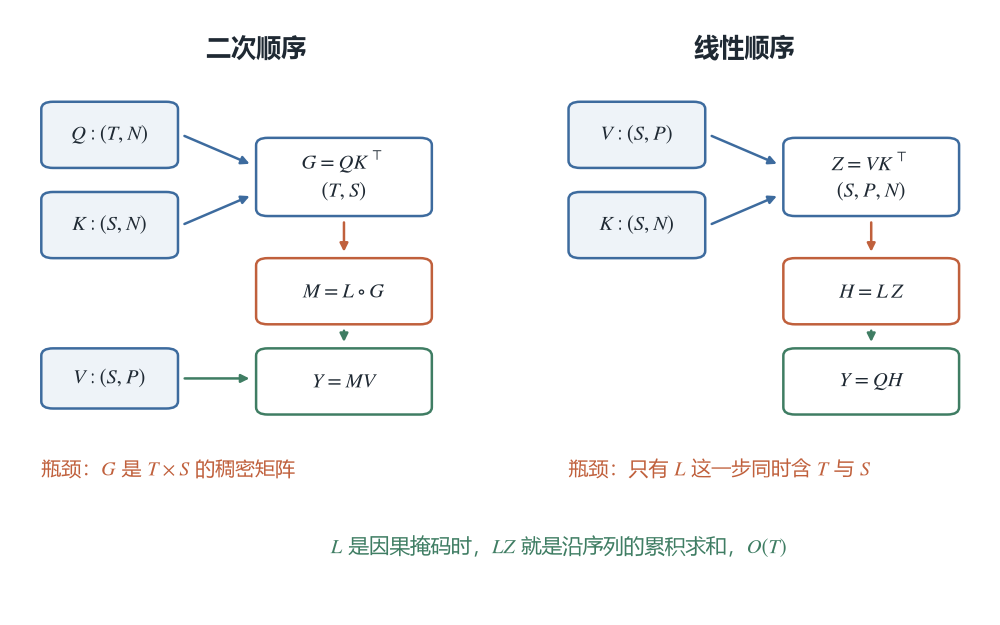

# 第 23 章 结构化掩码注意力：把线性注意力一般化

上一章从 SSM 那一侧走进来，发现 SSM = 半可分矩阵。本章换到注意力这一侧。

问题在于：标准注意力是二次复杂度，看上去和"线性"毫无关系。但线性注意力（Katharopoulos 等, 2020）早就指出，把 softmax 挪走之后，$Q(K^\top V)$ 与 $(QK^\top)V$ 只是乘法结合顺序不同，于是就有了线性复杂度的算法。

Mamba-2 认为这个推导虽然对，但"讲得不够清楚"（论文原话是 "somewhat less straightforward"，并指出原始论文和一些后续工作"陈述了公式但没有证明"）。它用**张量缩约（tensor contraction）**的语言重新推了一遍，顺手把它推广了：

> 任何"结构化的掩码"都能给出一个线性复杂度的注意力变体。这个推广叫**结构化掩码注意力（structured masked attention, SMA）**。

具体要讲的有五件事：

1. 用张量缩约怎么写注意力（以及为什么这个语言比矩阵记号清楚）；
2. 线性注意力的"两行证明"；
3. 因果掩码为什么就是"累积求和"（cumsum）；
4. SMA 的定义，以及它统摄了哪些已有工作（Linear Attention、RetNet、……）；
5. 一个问题：什么样的掩码才能有快速的自回归形式？（第 24 章的 Theorem 5.2 给出答案）

---

## 23.1 记法与形状注解

Mamba-2 用了一套"形状注解"（shape annotation）的记法：把张量的维度名字写在右上标，例如

$$
X \in \mathbb{R}^{(T,P)}
$$

表示 $X$ 的第一维长度是 $T$（序列轴）、第二维是 $P$（特征/head 轴）。这比 $\mathbb{R}^{T\times P}$ 更适合读张量缩约。

**张量缩约记号**：

$$
\mathrm{contract}(MN,\,NK \to MK)(X, Y) = X\cdot Y
$$

即 numpy 里的 `einsum('mn,nk->mk', X, Y)`。

本书会和常规矩阵记号并用。

### 注意力的基本形式

单头注意力的定义（输入三个矩阵 $Q,K,V$）：

$$
\begin{aligned}
Q &= \text{input} &&(T,N)\\
K &= \text{input} &&(S,N)\\
V &= \text{input} &&(S,P)\\
G &= QK^\top &&(T,S)\\
M &= f(G) &&(T,S)\\
Y &= GV &&(T,P)
\end{aligned}
$$

这里 $S$、$T$ 分别是源序列长度与目标序列长度（自注意力时 $S=T$），$N$ 是特征维（同时也是 $Q,K$ 的维），$P$ 是 head 维（$V$ 的维）。

$N$ 不出现在输出里，只在中间过程出现。Mamba-2 论文特别强调了这一点：在自注意力情形下，应该把 $V$ 看成"主要输入"，把整个注意力看成一个 $V\mapsto Y$ 的序列变换。

（为什么要在意这个细节？因为它决定了后面"SSM 对偶"里谁是 $X$。答案是：$V\leftrightarrow X$。）

### 核注意力与掩码注意力

核注意力（kernel attention）把 softmax 拆成两部分：指数化和按行归一化。归一化可以暂时忽略（相当于把 $V$ 增加一列全 1 然后相除）。指数化则可以用一个特征映射 $\varphi$ 表示：

$$
\exp(QK^\top) = \varphi(Q)\varphi(K)^\top .
$$

于是把 $\varphi$ 吸收进 $Q,K$ 的定义里，就得到"任意 $Q,K$"的核注意力。这一族包括：

- Linear Attention（原版）：$\varphi$ 是逐点激活函数（如 $x\mapsto 1+\mathrm{elu}(x)$）；
- Random Feature Attention：用随机傅里叶特征逼近 exp 核；
- Performer：用正随机特征（PRF）；
- cosFormer：加一个余弦重加权来强调局部性。

**掩码（核）注意力**：在 $QK^\top$ 上逐元素乘一个掩码矩阵 $L$：

$$
y = (L\circ(QK^\top))\cdot V .
$$

最常见的 $L$ 是因果掩码（下三角全 1 矩阵）。其他还有带状、稀疏、块对角等。

---

## 23.2 用张量缩约看：一次缩约，两种顺序

Mamba-2 的第一个"小技巧"是把掩码注意力写成一个四路缩约：

$$
\boxed{\
Y = \mathrm{contract}(TN,\,SN,\,SP,\,TS \to TP)(Q,\ K,\ V,\ L)
\ }
\tag{23.1}
$$

（注意力 = 四个张量的一次缩约。$Q$ 和 $K$ 缩掉了 $N$，$L$ 缩掉了一个 $S$，$V$ 缩掉了另一个 $S$。）

### 顺序一：标准（二次）算法

按"先算 $G$，再掩码，再乘 $V$"的顺序做两两缩约：

$$
\begin{aligned}
G &= \mathrm{contract}(TN,\,SN\to TS)(Q,K) &&(T,S)\\
M &= \mathrm{contract}(TS,\,TS\to TS)(G,L) &&(T,S)\\
Y &= \mathrm{contract}(TS,\,SP\to TP)(M,V) &&(T,P)
\end{aligned}
\tag{23.2}
$$

这就是标准注意力的计算方式。瓶颈在第 1 步：需要物化 $T\times S$ 的矩阵。自注意力时 $T=S$，所以是 $O(T^2)$。

### 顺序二：线性算法

换一个缩约顺序：

$$
\begin{aligned}
Z &= \mathrm{contract}(SP,\,SN \to SPN)(V,K) &&(S,P,N)\\
H &= \mathrm{contract}(TS,\,SPN \to TPN)(L,Z) &&(T,P,N)\\
Y &= \mathrm{contract}(TN,\,TPN \to TP)(Q,H) &&(T,P)
\end{aligned}
\tag{23.3}
$$

三步的含义：

- 第 1 步（扩张）：把 $V$ 和 $K$ 先乘起来，得到 $(S,P,N)$。这是一个"扩张"操作，把特征维度从 $P$ 扩张到 $P\times N$。
- 第 2 步（沿序列轴传播）：用掩码 $L$ 在这个扩张后的张量上做沿序列轴的混合。这是唯一同时涉及 $T$ 和 $S$ 两个轴的步骤，因此按定义是 $\Omega(TS)$ 复杂度，除非 $L$ 有特殊结构。
- 第 3 步（收缩）：用 $Q$ 把扩张的 $N$ 维收缩掉，得到 $(T,P)$。

对比 (23.2) 和 (23.3)：同一个函数，两种缩约顺序，复杂度一个二次、一个线性。这就是"线性注意力"的全部内容。

Mamba-2 用这个视角给出的解释很简洁：

> 如果把 $K$ 看作输入（对应 SSM 的 $B$），那么 $V$ 和 $Q$ 分别扮演扩张和收缩的角色。

（这正是第 22.5 节 SSM 线性算法里的 $B$、$C$ 的分工：$B$ 扩张输入进状态、$C$ 收缩状态到输出。对应关系已经呼之欲出了。）

---

## 三种掩码画成矩阵

掩码是 $T\times T$ 的矩阵，$L_{ts}$ 的含义是位置 $t$ 的输出从位置 $s$ 的输入取多少。取 $T=4$ 看三个最常见的族。

因果（causal），下三角全 1：

$$
L_{\text{causal}}=\begin{pmatrix}
1& & & \\
1&1& & \\
1&1&1& \\
1&1&1&1
\end{pmatrix}
$$

衰减（decay），$\gamma=0.5$，$L_{ts}=\gamma^{\,t-s}$：

$$
L_{\text{decay}}=\begin{pmatrix}
1& & & \\
0.5&1& & \\
0.25&0.5&1& \\
0.125&0.25&0.5&1
\end{pmatrix}
$$

1-半可分，取 $a_1=0.5$、$a_2=0.8$、$a_3=0.4$，$L_{ts}=a_{t:s}$：

$$
L_{\text{1SS}}=\begin{pmatrix}
1& & & \\
0.5&1& & \\
0.4&0.8&1& \\
0.16&0.32&0.4&1
\end{pmatrix}
$$

三个矩阵对角线上都是 1（自己看自己永远是满权重），差别全在左侧。因果掩码左侧全是 1；衰减掩码每一行相邻元素的比固定是 0.5；1-SS 的比值是可变的，第三行是 $0.5$ 与 $0.8$，第四行是 $0.5$、$0.8$、$0.4$。

比值可变才有实际内容。某个位置的 $a_t$ 接近 0，它之前的历史几乎被清零；接近 1 就几乎全保留。“由数据决定何时截断”这件事，因果掩码和固定 $\gamma$ 都表达不了。

三个矩阵都只填了下三角，上三角为零。这是因果的直接后果：位置 $t$ 不能看 $t$ 之后的输入。如果源序列与目标序列长度不同（源长 $S$、目标长 $T$），$L$ 就是 $T\times S$ 的矩形，下三角的写法退化成 $L_{ts}=\mathbb{I}[t\ge s]$ 在不同长度上的推广。四路缩约对此没有限制，它本来就把 $T$ 与 $S$ 分开写；但后面讨论的 1-SS 递推要求两个长度相等，因为递推是沿一个轴向前走的。

三者可以写成一个模板 $L_{ts}=a_{t:s}$：

- 因果：$a_t\equiv1$；
- 衰减：$a_t\equiv\gamma$；
- 1-SS：$a_t$ 随位置与输入变化。

论文把因果关系写成 $L=\mathrm{SS}(1_T)$，即 1-SS 掩码在 $a_t=1$ 时的退化（RetNet 则对应 $a_t\equiv\gamma$）。这条链说明三者在结构上是一家人，差别只在那一个标量系数从哪里来。后面第 23.4 节的各个名字，无非是在给这个系数填不同的来源。

## 23.3 因果掩码就是累积求和

现在关键问题：第 2 步"用 $L$ 做沿序列轴的混合"什么时候能快？

### 答案：L 是因果掩码时，"乘 L"就是 cumsum

设 $L$ 是下三角全 1 矩阵：

$$
L = \begin{pmatrix}
1 & & & \\
1 & 1 & & \\
1 & 1 & 1 & \\
\vdots & & & \ddots
\end{pmatrix}
$$

则对任意 $x$，

$$
(Lx)_t = \sum_{s\le t}x_s
$$

这就是前缀和（cumulative sum, cumsum）。而 cumsum 可以在 $O(T)$ 时间内算完（一次串行扫描或对数深度并行扫描）。于是 (23.3) 的第 2 步从 $O(T^2)$ 降到 $O(T)$，整个注意力变成线性。

线性注意力的证明就这两行。论文的 Figure 3 把这件事画成一张表：

不同的掩码对应不同的线性模式：

| 掩码 $L$ | 对应的模型 |
|---|---|
| 因果掩码（全 1 下三角） | Linear Attention |
| 衰减掩码 $\gamma^{i-j}$ | RetNet |
| 1-半可分掩码 | SSD（Mamba-2） |
| Toeplitz 掩码 | Toeplitz 结构化注意力 |
| 离散傅里叶矩阵 | Fourier 结构化注意力 |

### 一个"为什么之前要绕那么久"的解释

原始线性注意力论文说 $Y = Q\cdot\mathrm{cumsum}(K^\top V)$ 与 $Y=(L\circ QK^\top)V$ 等价，但没有给证明（Mamba-2 论文指出了这一点）。用张量缩约的语言，等价的理由一目了然：这只是同一个四路缩约的两种计算顺序，而"乘下三角全 1 矩阵"恰好等于 cumsum。

## 从一个掩码到一个递推

把上一节的直觉写成三步推导，每一步只用到一个恒等式。

第 $t$ 行的输出按定义展开。标量 $L_{ts}(q_t^\top k_s)$ 可以自由换位置，于是

$$
y_t=\sum_{s}L_{ts}\,(q_t^\top k_s)\,v_s
=q_t^\top\Big(\sum_{s}L_{ts}\,k_sv_s^\top\Big).
\tag{23.4}
$$

定义括号里的东西为状态

$$
S_t=\sum_{s\le t}L_{ts}\,k_sv_s^\top\in\mathbb{R}^{N\times P},\qquad y_t=q_t^\top S_t .
\tag{23.5}
$$

到这里没有用任何近似，也没用到 $L$ 的具体形式。$S_t$ 是 $N\times P$ 的矩阵，不是向量。这一步是整个推导的关键：输出总是“先与一个状态矩阵收缩”，区别只在于状态怎么更新。

第二步，把 1-SS 的递推形式代进去。$L_{ts}=a_{t:s}$，且 $a_{t:s}=a_t\,a_{t-1:s}$（$t>s$）：

$$
\begin{aligned}
S_t &= k_tv_t^\top+\sum_{s<t}a_{t:s}\,k_sv_s^\top\\
&=k_tv_t^\top+a_t\sum_{s<t}a_{t-1:s}\,k_sv_s^\top\\
&=k_tv_t^\top+a_t\,S_{t-1} .
\end{aligned}
\tag{23.6}
$$

第二个等号只用了 $a_{t:s}=a_t a_{t-1:s}$ 这一个恒等式；第三个等号用到 $S_{t-1}$ 的定义，其中对角线项 $L_{t-1,t-1}=1$ 与 $a_{t-1:t-1}=1$ 一致。于是得到

$$
S_t=a_tS_{t-1}+k_tv_t^\top,\qquad y_t=q_t^\top S_t .
\tag{23.7}
$$

这就是 SSM 的递推，只不过“输入”是外积 $k_tv_t^\top$，“读出”是 $q_t$。把 $a_t\equiv1$ 代入，得到 $S_t=S_{t-1}+k_tv_t^\top$，累加就是 cumsum，$a_t\equiv\gamma$ 则是 RetNet。

第三步看成本。二次模式算 $G=QK^\top$ 需要 $T^2N$ 次乘加，再乘 $V$ 需要 $T^2P$，合计 $T^2(N+P)$。线性模式每个位置先累加一个 $N\times P$ 的外积（$NP$），再用 $q_t$ 收缩（$NP$），合计 $2TNP$。取 $T=2048$、$N=P=64$：前者 $5.4\times10^{8}$，后者 $1.7\times10^{7}$，比值 32。

用数字验一次。取 $P=1$、$v_s=s$、$q_t^\top k_s=1$，算位置 $t=2$ 的输出：

- 因果：$0+1+2=3$；
- 衰减 $\gamma=0.5$：$0.25\times0+0.5\times1+1\times2=2.5$；
- 1-SS（$a_1=0.5,a_2=0.8$）：$0.4\times0+0.8\times1+1\times2=2.8$。

三个数不同，但都是 (23.5) 用不同 $L$ 算出来的。区别只在“多远的历史还算数”这一件事上。

最后一句关于状态大小。Mamba-1 的 head 维 $P=1$，状态是 $N$ 维向量；Mamba-2 的 $P=64$，状态是 $N\times P$ 的矩阵。状态变大了两个数量级，反而更快，原因是 (23.7) 的每一步是外积与矩阵乘，能上 Tensor Core，而逐元素的标量扫描不能。

---

*图 23-1　同一个四路缩约的两种计算顺序：先算 $G$ 是二次的，先做扩张是线性的*

## 23.4 结构化掩码注意力（SMA）

### 定义

既然线性注意力的关键其实是"$L$ 是结构化的（有快速矩阵乘法）"，那把它推广就顺理成章了。

定义 4.2（Mamba-2）：**结构化掩码注意力（structured masked attention, SMA）** 是如下定义的函数：

$$
Y = \mathrm{contract}(TN,\,SN,\,SP,\,TS\to TP)(Q,K,V,L)
$$

其中 $L$ 是任意结构化矩阵（即有次二次矩阵乘法复杂度的矩阵）。

- SMA 的二次模式：按 (23.2) 的顺序算（标准掩码注意力）。
- SMA 的线性模式：按 (23.3) 的顺序算，其中第 2 步用 $L$ 的快速矩阵乘法加速。

### 重要的概念分离

Mamba-2 强调："注意力"是一个函数，"二次算法/线性算法"是两种算法。很多文献把这两者混为一谈，导致讨论混乱。区分之后：

- 掩码注意力函数 = (23.1) 这个四路缩约；
- 二次算法与线性算法 = 两种缩约顺序；
- 缩约顺序的不同导致了"二次 vs 线性"的分野。

这个分离也适用于 SSM（第 22.5 节的两种模式）。而"状态空间对偶"就是把两侧的这两种模式对齐（第 24 章）。

### 已有一批工作都是 SMA 的实例

| $L$ 的形式 | 对应的方法 | 备注 |
|---|---|---|
| 因果掩码 $L_{ij}=\mathbb{I}[j\ge i]$ | **Linear Attention** | 等价于 cumsum |
| 衰减掩码 $L_{ij}=\gamma^{i-j}\mathbb{I}[j\ge i]$ | **RetNet** | $\gamma\in[0,1]$ 是衰减因子 |
| Toeplitz $L_{ij}=\alpha_{i-j}$ | Toeplitz 结构化注意力 | 可看作"乘性而非加性的相对位置编码"（类比 ALiBi） |
| 离散傅里叶矩阵 $L_{ij}=\omega^{ij}/T$ | Fourier 结构化注意力 | 位置信息编码的另一种方式 |
| **1-半可分掩码** | **SSD（本文）** | 下一章的主角 |

注意 RetNet 那一行：它的掩码是与输入无关的固定衰减（$\gamma$ 是超参数），所以 RetNet 是"时不变的"。而 SSD 的掩码 $L_{ij}=a_i\times\cdots\times a_{j+1}$ 里的 $a_i$ 是输入相关的，因此是时变的。这一点在第 27 章会作为"为什么 RetNet 不如 Mamba-2 的 head 结构/掩码选择"的一部分讨论。

### 一个副产品：掩码 = 位置编码

这个框架还给出一个比较有意思的视角。

在标准注意力里，位置信息靠加性的位置编码（正弦、RoPE、ALiBi）注入。而在 SMA 里，位置信息由掩码 $L$ 提供：

- 因果掩码提供"只看过去"；
- 衰减掩码提供"越远越弱"；
- 1-SS 掩码提供"由数据决定的衰减"。

Mamba-2 论文的原话大意：

> $L$ 可以看作用数据相关的位置掩码替代了 Transformer 里启发式的位置编码，控制多少信息跨时间传递。

这个视角解释了几件事：

1. 为什么 SSM 不需要位置编码（第 20.6 节）；
2. 为什么 $a_t$ 的累积乘积 $a_{j:i}$ 控制"位置 $i$ 到位置 $j$ 之间允许多少交互"；
3. 为什么 Mamba-2/3 的混合模型里，注意力层要用 NoPE（去掉位置编码），因为序列混合层自己会提供位置信号。

（这个观点也被同期工作 GateLoop 独立提出。）

---

## 线性注意力、RetNet、SSD 只差一个系数

把上一节的结论摆成一张表，三个模型的差别一目了然。

| 模型 | 掩码 $L_{ts}$ | 系数 | 状态更新 | 时变 |
|---|---|---|---|---|
| 线性注意力 | $\mathbb{I}[t\ge s]$ | $a_t\equiv1$ | $S_t=S_{t-1}+k_tv_t^\top$ | 否 |
| RetNet | $\gamma^{\,t-s}\mathbb{I}[t\ge s]$ | $a_t\equiv\gamma$ | $S_t=\gamma S_{t-1}+k_tv_t^\top$ | 否 |
| 1-SS SMA | $a_{t:s}\mathbb{I}[t\ge s]$ | $a_t$ 随输入 | $S_t=a_tS_{t-1}+k_tv_t^\top$ | 是 |

三个状态更新公式长得一模一样，只有那个乘在 $S_{t-1}$ 上的标量不同。线性注意力选择永不遗忘，RetNet 选择以固定速率遗忘，SSD 把遗忘速率交给输入。三者的状态大小也相同，都是 $N\times P$，所以对模态长度的伸缩性一致，差别完全在表达能力上。

这不是类比，是定理。Mamba-2 的 Corollary 5.1 说得很直接：1-半可分掩码注意力是“对角 SSM 中 $A$ 为标量乘单位阵”这一情形的特例。也就是说，从 SSM 那一侧往下收、从注意力这一侧往下收，两边在同一个地方会合。

为什么要把遗忘速率交给输入，可以用 23.3 节那张表回答。固定 $\gamma$ 的模型对所有位置一视同仁，它不知道哪个 token 重要。$a_t$ 随输入变化之后，模型可以在遇到分隔符时把状态清零，在遇到关键实体时把状态锁住。这是 H3 那种“沿特征维做门控”做不到的（第 17 章），因为门控没有序列轴。

代价也在同一处。既然 $a_t$ 随输入变，cumsum 就不能预先算好，必须逐步扫描。线性注意力和 RetNet 都能把括号里的 $\sum_s k_sv_s^\top$ 写成一次前缀和，SSD 不行，它每一步都要先算 $a_t$。多出来的运算是一次 exp（或 softplus 加 exp），以及一次逐元素乘。

另一个旋钮是特征映射 $\psi$，它与掩码正交：掩码管“多远还算数”，$\psi$ 管“相似度怎么算”。Mamba-2 的核函数消融（Table 6）把两者放在一起比了，结果值得看：

| 特征映射 | 困惑度 |
|---|---|
| 无（线性） | 11.58 |
| Exp | 11.62 |
| Swish | 11.66 |
| ReLU | 11.73 |
| ReLU + 归一化 | 11.64 |
| cosFormer | 11.97 |
| 随机特征（RFA） | 11.57 |
| 正随机特征（Performer） | 12.21 |

前五行挤在 0.15 的区间内。花力气用随机傅里叶特征去逼近 exp 核（Performer 那一行）反而最差，12.21。这说明在 SSD 这个结构里，特征映射几乎可以随便选，因为状态大小固定时真正的稀缺资源是“能不能忘”，而不是“相似度算得多准”。

这条结论在实践中很有用：少一个可调旋钮，就少一组 ablation。Mamba-2 最终用的是 Swish（SiLU）。它在表里不是最优的一行，但实现代价最低：一次逐点非线性，不需要 exp，也不需要随机特征。

## 掩码要多快才够用

SMA 的线性模式能不能成立，取决于第 (23.3) 步那个 $L$ 的矩阵乘向量有多快。按掩码族排一下：

| 掩码 | 矩阵乘向量的代价 | 靠什么 |
|---|---|---|
| 因果（全 1 下三角） | $O(T)$ | 扫描（cumsum） |
| 衰减 $\gamma^{t-s}$ | $O(T)$ | 扫描（带系数的 cumsum） |
| 1-SS | $O(T)$ | 标量扫描（cumprodsum） |
| Toeplitz $\alpha_{t-s}$ | $O(T\log T)$ | FFT |
| 离散傅里叶 | $O(T\log T)$ | FFT |
| 带状，宽 $w$ | $O(Tw)$ | 带内直接求和 |

前三行的 $O(T)$ 是同一个道理：掩码的每一行只比上一行多一个乘法，因此“乘掩码”可以写成递推。带状靠截断得到线性，但丢掉了远处信息。Toeplitz 与 Fourier 靠 FFT 得到亚二次，但有两个隐患：$\log T$ 因子在长序列上不可忽略，FFT 本身的常数也比一次扫描大得多，而且它需要把整个序列放在一起变换，没有递推形式，推理时无法逐 token 增量计算。

“结构化矩阵”这个术语在论文里有严格定义：能用亚二次（最好线性）的参数表示，且能直接在压缩表示上做快速矩阵乘。最常见的两族是稀疏与低秩，此外还有 Toeplitz、Cauchy、Vandermonde、butterfly。SMA 的贡献是把“找一个能加速的 $L$”变成“从已知的快速矩阵族里选一个”，而半可分是这篇论文选中的那个。

最后一条才是决定性的。自回归解码时每来一个 token 就要算一次输出，只有递推形式能做到 $O(1)$ 每步。所以“能快速做矩阵乘”还不够，还得“能增量地做”。这正是定理 5.2 要回答的问题：一个自回归、状态有界的注意力变体，它的掩码必须是半可分的。

这三个条件拆开看都不弱：自回归要求 $L$ 下三角，有界阶要求 $y_t$ 只经过一个固定维度的压缩，高效要求这个压缩能逐 token 更新。三个一叠，剩下的形式就是 $L_{ts}=a_{t:s}$。2019 年以后的各类线性模型，基本都落在这一格或它的邻居里。

## 逐元素乘不是矩阵乘

(23.1) 里那个 $L\circ(QK^\top)$ 是 Hadamard 积（逐元素），不是矩阵乘法。这个区别在阅读代码时经常弄错。

逐元素乘的含义是“位置 $(t,s)$ 的分数乘上一个权重”，它不混合任何位置对。写成矩阵乘 $L\cdot(QK^\top)$ 就变成“把多行的分数线性组合起来”，完全不是掩码了。两者在 $L$ 是单位阵时恰巧相同，这也是为什么一些仅验证单位阵的实现能跑通却算错。

在 SSM 那一侧，这个逐元素乘对应的是 $\mathrm{diag}(C)\cdot\mathrm{1SS}(a)\cdot\mathrm{diag}(B)$ 两侧的对角缩放（第 22 章讲 1-SS 分解的那一节）。三个因子中只有中间那个混合序列，两边的对角阵只是给每一行、每一列各乘一个系数。把对角阵吸进 $Q,K$ 的定义里，剩下的就只有一个 1-SS，这就是 SSD 的形式。

## 二次模式在长序列上占多少显存

把 23.2 节两种缩约顺序的中间量换成具体数字。取 $T=8192$、$N=64$、$P=64$，单 head。

二次模式的 $G$ 是 $T\times T$，$8192^2=67{,}108{,}864$ 个元素，BF16 下 134 MB。一个 head 一层就这么多，三十二个 head 就是 4.3 GB，三十二层是 137 GB。这个数字直接解释了 FlashAttention 为什么必须存在：不把 $G$ 物化，就没有这个坑。

线性模式的中间量是 $(T,P,N)=8192\times64\times64=33{,}554{,}432$ 个元素，67 MB，正好是 $G$ 的一半。递推形式真正需要长期保存的只有 $N\times P$ 的状态，4096 个数，8 KB。两者相差四个数量级，这也是“常数量存”这个说法的来源。

两个中间量的大小关系会在某个长度上翻过来：$T^2=TPN$ 给 $T=PN=4096$。短于这个长度，二次模式的中间量更小；长于它，“线性”模式反而更大。分块算法就是针对这一点设计的：块内用二次（块长 64 时分数矩阵只有 4096 个数），块间用线性传递状态。

## 同一设定下的 FLOPs 与每 token 代价

用上一个例子里的尺寸（$T=8192$、$N=P=64$）把两种模式的预算算完。

| 阶段 | 二次模式 | 线性模式 | 比值 |
|---|---|---|---|
| 训练，整个序列 | $T^2(N+P)=8.6\times10^{9}$ | $2TNP=6.7\times10^{7}$ | 128 |
| 推理，每新增一个 token | $2T(N+P)=2.1\times10^{6}$ | $2NP=8.2\times10^{3}$ | 256 |

训练那一行的比值就是 $T/P$，序列越长优势越大，但与 $N$ 无关。这一点值得记：$N$ 在两种模式下都线性出现，所以把状态做大并不会改变两者的相对优势。Mamba-2 能同时把 $N$ 提到 64 并且保持速度，靠的不是这个比值，而是把线性模式里的运算换成矩阵乘。

推理那一行的比值是 $T(N+P)/(NP)$。这一行才是实际部署时关键的地方：$T$ 是上下文长度，上下文越长，二次模式的每 token 代价越高，而线性模式的每 token 代价是一个只与 $N,P$ 有关的常数。这也是 Mamba-1 那个 5 倍吞吐数字的根源（第 21 章）。注意这个常数并不小：$2NP=8192$ 次乘加对一个 token 来说并不算便宜，真正的优势来自它不随上下文增长。

差别在这两行里已经显完，但它们都是理论 FLOPs。真实硬件上还有一个变量：二次模式能用 Tensor Core，线性模式的扫描不能，所以 128 倍的 FLOPs 优势换算到墙上时间只剩几倍。这笔对账留到第 25 章。

## 归一化与掩码的交互

softmax 注意力自带一个按行归一化（分母是 $\exp$ 的和），SMA 把它拿掉了。拿掉之后有两个后果，论文都碰到了。

第一个是输出尺度不再受控。直观上应该补一个分母，但消融结果不这么简单：在 ReLU 特征映射上加归一化，困惑度从 11.73 到 11.64，略有改善；换成其他特征映射，论文的原话是这个归一化“在大多数变体上引入了不稳定”。所以 Mamba-2 最终没有在 SMA 内部做行归一化，而是把归一化挪到了块的外侧：块级额外归一化把困惑度从 11.76 降到 11.54（并行投影再加一层归一化后是 11.49）。

第二个是 attention sink 现象。论文提到 softmax 最近被观察到会导致部分头把几乎全部注意力分给第一个 token（Darcet 等 2024；Xiao 等 2024），拿掉 softmax 就顺手绕开了这个病。这条不是 Mamba-2 的主要动机，但它解释了为什么“去掉 softmax”在这个架构里没有被补回来。

工程上的含意是归一化的位置变了：softmax 注意力在内部按行归一，SMA 在外部按特征归一。位置一变，数值行为也跟着变，梯度裁剪与初始化都要重新调，这是把线性注意力搬进大模型时实际会踩的坑。另一个直接后果是层的形状：softmax 的输出分量在 $[0,1]$ 且行和为 1，SMA 的输出没有这个界限，因此在残差流里与其余分支的尺度关系需要重新平衡。

## 什么叫有界阶

定理 5.2 里的“有界阶”（bounded order）不是模糊的说法，它指的是状态大小与序列长度无关。

把任何因果序列模型的输出写成 $y_t=g_t(x_0,\dots,x_t)$。如果存在一个固定维度 $d$ 的 $h_t$，使得

$$
h_t=f_t(h_{t-1},x_t),\qquad y_t=C_t^\top h_t,
$$

就说明模型把全部历史压进了一个固定大小的槽。阶数就是这个 $d$。它不随 $t$ 增长，所以解码每步的代价是常数。

标准 softmax 注意力不满足这一条。它的 $y_t$ 依赖于全部 $K,V$，要精确复现就得存下 $t$ 个键值对，状态大小随 $t$ 线性增长。拿掉这个依赖是不可能的，因为注意力矩阵的每一行都是独立算出来的，没有“压”这一步。

线性注意力满足这一条，因为 $S_t=\sum_{s\le t}k_sv_s^\top$ 的大小是 $N\times P$，与 $t$ 无关。RetNet 和 SSD 同理。三者的阶相同，区别只在那个标量系数上。

所以定理 5.2 的内容可以重述成一句话：一旦要求“固定大小的状态”与“自回归”同时成立，剩下的掩码只有半可分这一族。它不是在说半可分很好，而是在说其他选择根本不存在。

## 23.5 一个必要的形式化：什么掩码才能快速自回归

SMA 给了"任意结构化 $L$ 都可以有线性模式"的结论。但还有一个更尖锐的问题：

> 给定一个想要"自回归（因果）且高效"的注意力变体，它的掩码 $L$ 必须长什么样？

这不是"哪些 $L$ 可以加速"的问题，而是"哪些 $L$ 本质上必须有结构"的问题。

Mamba-2 的 Theorem 5.2 给出了答案，而且答案恰好落在上一章讲的那个族上：

> 任何有界阶的自回归结构化掩码注意力，其掩码 $L$ 必须是半可分矩阵。

也就是说：

> **"高效的自回归注意力" $=$ "半可分掩码的结构化注意力"。**

这个定理是第 24 章"对偶"的最后一块拼图：它说明半可分性不是 SSM 的特殊性质，而是"任何能高效自回归的线性序列模型"的共同性质。

（定理的证明在 Mamba-2 论文附录 C.2，思路是：自回归意味着 $y_t$ 只依赖 $x_{\le t}$；"有界阶"意味着状态大小有限；把状态递推展开就得到 $L$ 的一个 SSS 表示，于是 $L$ 半可分。）

---

## 23.6 本章小结

- 掩码核注意力可以写成一次四路张量缩约：(23.1)。$N$（特征维）不出现在输出里，因此自注意力下应把 $V$ 看作主输入。
- 两种缩约顺序：(23.2) 先算 $G=QK^\top$（$O(T^2)$，二次模式）；(23.3) 先做扩张（$VK^\top$）再沿序列轴混合再收缩（$O(T)$，线性模式）。
- 线性注意力的关键：唯一同时涉及 $T$ 和 $S$ 的第 2 步就是"乘掩码 $L$"；当 $L$ 是因果掩码（下三角全 1）时，这就是 cumsum，$O(T)$ 可算。
- SMA：把 $L$ 推广为任意结构化矩阵。实例包括 Linear Attention（因果掩码）、RetNet（衰减掩码）、Toeplitz/Fourier 掩码等。
- 概念分离：注意力是一个函数（四路缩约）；二次/线性是两种算法（缩约顺序）。SSM 也有同样的二分。
- 掩码即数据相关的位置编码：$L$ 替代了 Transformer 的启发式位置编码，解释了 SSM 为什么不需要位置编码，以及混合模型为什么要用 NoPE。
- 定理 5.2：任何有界阶的高效自回归注意力，其掩码必须半可分。"高效自回归注意力" = "半可分掩码注意力"。

## 下一章

第 24 章把两侧合起来。会看到一个很干净的结果：**当你把 SSM 的 $A$ 限制为"标量乘单位阵"，它就精确地等于一个 1-半可分掩码的线性注意力。** 于是"状态空间对偶"不是一个类比，而是一个恒等式。
