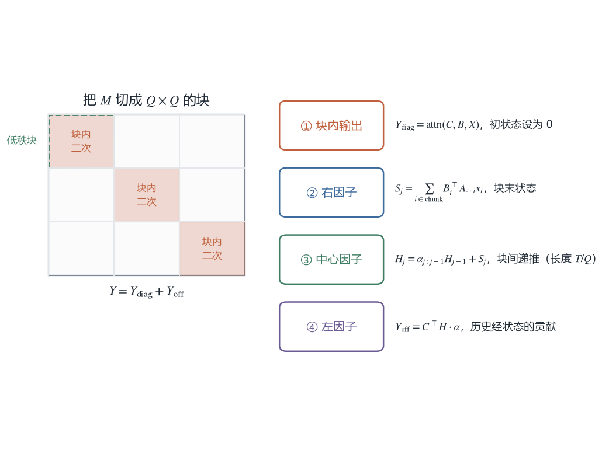

# 第 25 章 SSD 算法：块分解的艺术


第 24 章给了对偶性：SSD 层既有线性（递推）模式，又有二次（注意力）模式。接下来的工程问题是：

> 怎么设计一个算法，同时用上两者的优点？

- 线性模式：$O(TNP)$ 计算量，但串行、逐元素、不用矩阵乘法单元。
- 二次模式：全是矩阵乘法、无串行依赖，但 $O(T^2N)$ 太高。

答案：**块分解（block decomposition）**。

- 在小块（chunk）内部用二次注意力模式：块长是常数（如 64），$O(\text{chunk}^2)$ 完全可接受，而且是矩阵乘法。
- 在块与块之间用线性递推模式：块的数量是 $T/\text{chunk}$，递推的负担降低了 $O(\text{chunk})$ 倍。

下面给出这个算法、它的复杂度证明，以及那段"几十行纯 PyTorch"参考实现。

结论可以写成一句话：

> **用纯 PyTorch 写的 SSD，比 Mamba-1 精心优化的 CUDA 扫描快 2–8 倍。**

---

## 25.1 主定理

**Theorem 6.1（Mamba-2）**：考虑状态扩张因子为 $N$、head 维 $P=N$ 的 SSD 模型。存在一个算法，对任意输入 $X\in\mathbb{R}^{(T,P)}$ 计算模型输出，只需要

- $O(TN^2)$ 训练 FLOPs；
- $O(TN)$ 推理 FLOPs；
- $O(N^2)$ 推理内存；
- 且工作量主要花在矩阵乘法上。

这些界都是紧的：

- 状态扩张 $N$、head 大小 $N$ 的 SSM 总状态大小是 $N^2$，因此训练 FLOPs 下界是 $O(TN^2)$、推理 FLOPs 下界是 $O(N^2)$；
- 输入 $X$ 本身有 $TN$ 个元素，因此内存下界是 $TN$。

看第三行：$O(N^2)$ 的推理内存。这是与注意力最鲜明的对比。注意力的推理内存是 $O(TN)$（KV cache），而 SSD 是 $O(N^2)$，与序列长度无关。

---

## 25.2 块分解

### 分块

把 $M\in\mathbb{R}^{T\times T}$ 切成 $\frac{T}{Q}\times\frac{T}{Q}$ 个 $Q\times Q$ 的子块（$Q$ 是块长，通常取 64）：

$$
M = \begin{pmatrix}
M^{(0,0)} & & & \\
M^{(1,0)} & M^{(1,1)} & & \\
\vdots & & \ddots & \\
M^{(T/Q-1,0)} & \cdots & \cdots & M^{(T/Q-1,T/Q-1)}
\end{pmatrix}
$$

对每个块（论文给出精确公式）：

$$
\begin{aligned}
\text{（对角块）}\quad & M^{(j,j)} = \mathrm{SSM}\big(A_{jQ:(j+1)Q},\ B_{jQ:(j+1)Q},\ C_{jQ:(j+1)Q}\big)\\
\text{（非对角块）}\quad & M^{(j,i)} = \begin{pmatrix}C_{jQ}^\top A_{jQ:jQ-1}\\ \vdots\\ C_{(j+1)Q-1}^\top A_{(j+1)Q-1:jQ-1}\end{pmatrix}
A_{jQ-1:(i+1)Q-1}
\begin{pmatrix}B_{iQ}^\top A_{(i+1)Q-1:iQ}\\ \vdots\\ B_{(i+1)Q-1}^\top A_{(i+1)Q-1:(i+1)Q-1}\end{pmatrix}^\top
\end{aligned}
$$

这个公式的形状就是全部内容：

- 对角块是"原问题缩小到 $Q$ 长"的自相似问题；
- 非对角块是"左因子（$Q\times N$）× 中心（$N\times N$）× 右因子（$N\times Q$）"的乘积，秩不超过 $N$。这正是第 22 章 Lemma 3.3 的那个分解。

用一张图（Mamba-2 论文 Figure 5）来理解：



*图 25-1　SSD 的块分解：对角块用二次模式，非对角块拆成左因子、中心因子、右因子三步*

---

## 25.3 四个部分逐一拆解

下面按 Mamba-2 论文的叙述顺序，把四个部分讲清楚。每个部分都配一句"它的语义是什么"。

### 部分一：对角块（Intra-chunk，块内输出）

做法：对每个块，直接用小规模的二次模式算（即用一个 $Q\times Q$ 的注意力）。

语义：**假设块初状态为 0，块内输入 $x_{jQ:(j+1)Q}$ 产生的输出是多少？**

为什么可行：块长 $Q$ 是常数（64），所以 $O(Q^2)$ 的二次计算完全可接受；而且所有块并行处理。

为什么用二次模式：因为它是纯矩阵乘法，硬件友好。

### 部分二：右因子（Right factors / B-block-factors）

做法：对每个块，计算一个 $(N,P)$ 的张量：

$$
\sum_{i\in\text{chunk}} B_i^\top A_{(\text{chunk end}):i}\, x_i
$$

语义：**假设块初状态为 0，这个块结束时的状态是多少？**（也就是"由块内输入贡献的那部分末状态"。）

代价：每个块是一次 $(N,Q)\times(Q,P)$ 矩阵乘，即 `BMM(T/Q, N, P, Q)`。

### 部分三：中心因子（Center factors / A-block-factors）

做法：上一步得到的是"每块自己的末状态（假设初状态 0）"，形状 $(T/Q, N, P)$。现在要用一个 1-SS 矩阵（由块间的 $A^\times$ 生成）把它们串起来：

$$
A^\times_{2Q-1:Q-1},\ A^\times_{3Q-1:2Q-1},\ \dots,\ A^\times_{T-1:T-Q-1}
$$

语义：**考虑上所有历史输入之后，每个块真正的末状态是什么？**

代价：这是一个长度只有 $T/Q$ 的标量 SSM 扫描。因为长度缩短了 $Q$ 倍，这一步的代价可以忽略不计。

这一步是整章的技术核心：它把"沿整个序列的串行扫描"压缩成了"沿 $T/Q$ 个块边界的串行扫描"。块长 $Q=64$ 时，串行深度降低了 64 倍。

### 部分四：左因子（Left factors / C-block-factors）

做法：对每个块，计算

$$
C_{\text{chunk}}^\top\, h_{\text{chunk start}} \cdot (\text{块内的衰减因子})
$$

即一次 `contract(QN, NP → QP)` 的矩阵乘。

语义：**给定正确的块初状态 $h_{jQ-1}$，且假设块内输入为 0，这个块产生的输出是多少？**（也就是"历史输入通过状态贡献的那部分输出"。）

### 合并

$$
\boxed{\ Y = \underbrace{Y_{\text{diag}}}_{\text{块内输出}} + \underbrace{Y_{\text{off}}}_{\text{状态贡献的输出}}\ }
$$

---

## 25.4 复杂度核算

Mamba-2 用 `BMM(B, M, N, K)` 表示"一个 batch 维为 $B$、形状 $(M,K)\times(K,N)$ 的批量矩阵乘"，代价 $O(BMNK)$ FLOPs、$O(B(MK+KN+MN))$ 内存。

| 步骤 | 代价 |
|---|---|
| 对角块：算 $C^\top B$（Gram） | `BMM(T/Q, Q, Q, N)` |
| 对角块：逐元素乘掩码 | $(T/Q, Q, Q)$ 的逐元素操作 |
| 对角块：乘 $X$ | `BMM(T/Q, Q, P, N)` |
| 右因子 | `BMM(T/Q, N, P, Q)` |
| 中心因子（块间扫描） | $\frac{TNP}{Q}$——**可忽略** |
| 左因子 | `BMM(T/Q, Q, P, N)` |

如果取 $N = P = Q$（状态维、head 维、块长相等），所有 BMM 都变成 `BMM(T/N, N, N, N)`：

- 总 FLOPs：$O(TN^2)$；
- 总内存：$O(TN)$；
- 主要工作量：对形状 $(N,N)$ 的矩阵做矩阵乘法。

论文特别强调两件事：

1. 内存是紧的：输入输出 $X, Y$ 就是 $(T,P) = (T,N)$ 个数，所以 $O(TN)$ 已经是最优。
2. FLOPs 里多出来的 $N$ 因子是状态的自回归代价，这是所有模型共有的（注意力是 $T$ 倍的代价）。

另外那个"块间扫描"的代价 $\frac{TNP}{Q} = O(TN^2/Q)$ 很小，而且虽然它不是矩阵乘，但仍然可并行（$O(\log(T/Q))$ 深度），总工作量可忽略。

### 与纯 SSM / 纯注意力的对照（论文 Table）

| | 注意力 | 线性 SSM | **SSD** |
|---|---|---|---|
| 状态大小 | $T$ | $N$ | $N$ |
| 训练 FLOPs | $T^2N$ | $TN^2$ | $TN^2$ |
| 推理 FLOPs | $TN$ | $N^2$ | $N^2$ |
| （朴素）内存 | $T^2$ | $TN^2$ | $TN$ |
| **用矩阵乘** | ✓ | ✗ | **✓** |

SSD 与线性 SSM 的 FLOPs 相同，但：
- SSD 的内存比朴素线性 SSM 少 $N$ 倍；
- SSD 的工作量主要是矩阵乘，而线性 SSM 的朴素实现需要（a）物化 $(T,P,N)$ 的扩张张量、(b) 沿序列做逐元素的标量运算。

---

## 25.5 参考实现：几十行 PyTorch

Mamba-2 论文的 Listing 1 给出了完整的参考实现，本书把它逐段拆开（代码取自论文，注释是本书加的）。

### 一个关键工具：`segsum`

```python
def segsum(x):
    """Naive segment sum calculation. exp(segsum(A)) produces a 1-SS matrix,
    which is equivalent to a scalar SSM."""
    T = x.size(-1)
    x_cumsum = torch.cumsum(x, dim=-1)
    x_segsum = x_cumsum[..., :, None] - x_cumsum[..., None, :]
    mask = torch.tril(torch.ones(T, T, device=x.device, dtype=bool), diagonal=0)
    x_segsum = x_segsum.masked_fill(~mask, -torch.inf)
    return x_segsum
```

这段代码在做什么？

输入 `x` 是"每步的对数衰减率" $x_t = \Delta_tA_t$（注意 $A_t<0$，所以 $x_t<0$）。要构造 1-SS 矩阵 $\exp(x)_{ji} = \exp(x_j + x_{j-1}+\cdots+x_{i+1})$。

朴素做法是逐步连乘 $e^{x_j}e^{x_{j-1}}\cdots$，会下溢（第 19.4 节讲过）。这里用的是先累加、再取指数：

1. `x_cumsum = cumsum(x)`：前缀和 $S_t = \sum_{k\le t}x_k$；
2. `x_segsum[i,j] = S_i - S_j`：区间和 $\sum_{k=j+1}^{i}x_k$（因为 $S_i - S_j = x_{j+1}+\cdots+x_i$）；
3. 上三角部分（$i<j$）填 $-\infty$：这样 $\exp$ 之后是 0，正好对应因果掩码；
4. 结果矩阵 $\exp(\texttt{x\_segsum})_{ji} = \exp(\sum_{k=j+1}^{i}x_k) = a_{i:j}$。

**所以 `exp(segsum(A))` 就是 1-SS 矩阵 $L$。** 这个实现的精髓是：用一次 cumsum + 一次广播相减，在 log 域直接构造出整个掩码矩阵，完全不涉及连乘，因此数值稳定。

### 主函数

```python
def ssd(X, A, B, C, block_len=64, initial_states=None):
    """
    Arguments:
      X: (batch, length, n_heads, d_head)     # 输入（对应注意力里的 V）
      A: (batch, length, n_heads)             # 每步的对数衰减（标量）
      B: (batch, length, n_heads, d_state)    # 对应 K
      C: (batch, length, n_heads, d_state)    # 对应 Q
    Return:
      Y: (batch, length, n_heads, d_head)
    """
    assert X.dtype == A.dtype == B.dtype == C.dtype
    assert X.shape[1] % block_len == 0

    # 1. 分块：把长度维 l 拆成 (c=块数, l=块长)
    X, A, B, C = [rearrange(x, "b (c l) ... -> b c l ...", l=block_len) for x in (X, A, B, C)]
    A = rearrange(A, "b c l h -> b h c l")
    A_cumsum = torch.cumsum(A, dim=-1)

    # 2. 【对角块】块内输出（用二次注意力模式）
    L = torch.exp(segsum(A))
    Y_diag = torch.einsum("bclhn,bcshn,bhcls,bcshp->bclhp", C, B, L, X)

    # 3. 【右因子】块内输入 → 块末状态
    decay_states = torch.exp((A_cumsum[:, :, :, -1:] - A_cumsum))
    states = torch.einsum("bclhn,bhcl,bclhp->bchpn", B, decay_states, X)

    # 4. 【中心因子】块间 1-SS 递推 → 真正的块初状态
    if initial_states is None:
        initial_states = torch.zeros_like(states[:, :1])
    states = torch.cat([initial_states, states], dim=1)
    decay_chunk = torch.exp(segsum(F.pad(A_cumsum[:, :, :, -1], (1, 0))))
    new_states = torch.einsum("bhzc,bchpn->bzhpn", decay_chunk, states)
    states, final_state = new_states[:, :-1], new_states[:, -1]

    # 5. 【左因子】块初状态 → 块内输出
    state_decay_out = torch.exp(A_cumsum)
    Y_off = torch.einsum('bclhn,bchpn,bhcl->bclhp', C, states, state_decay_out)

    # 6. 合并且还原形状
    Y = rearrange(Y_diag + Y_off, "b c l h p -> b (c l) h p")
    return Y, final_state
```

**逐段解读**：

第 2 步（对角块）：`einsum("bclhn,bcshn,bhcls,bcshp->bclhp", C, B, L, X)` 就是 $\sum_n\sum_s C_{ln}B_{sn}L_{ls}X_{sp}$。这就是一次完整的块内掩码注意力（$Q=C$，$K=B$，$V=X$，掩码 $L$）。它在块内是 $O(Q^2)$，但块之间完全并行。

第 3 步（右因子）：`A_cumsum[:,:,:,-1:] - A_cumsum` 是"块末的累积衰减 − 当前位置的累积衰减"，即"从位置 $l$ 到块末的衰减"。这就是"块内每个位置对块末状态的贡献权重"。然后对 $B$ 和 $X$ 做缩约。

第 4 步（中心因子）：
- 先在前面 pad 一个 0 并把状态拼上去，这样递推有了初值；
- `segsum(F.pad(A_cumsum[:,:,:,-1], (1,0)))`：取每块的总衰减、在最前面补 0、然后构造块级的 1-SS 掩码。补 0 的操作相当于"第 0 块之前的初状态没有衰减"；
- `einsum("bhzc,bchpn->bzhpn", decay_chunk, states)`：这就是块间的标量 SSM 递推，用矩阵乘法形式写成（`decay_chunk` 是 $(T/Q+1)\times(T/Q+1)$ 的矩阵，规模很小）。
- 切出 `states`（每块的初状态）和 `final_state`（整个序列的末状态）。

第 5 步（左因子）：`state_decay_out = exp(A_cumsum)` 是"从块初到当前位置的衰减"。用它把块初状态实际贡献的输出算出来。

第 4 步里为什么要 `initial_states`？这是为序列并行 / 变长序列准备的：可以先用一个初状态喂进去，拿到 `final_state` 再传给下一个设备/下一个片段。第 26 章会讲这个用法。

### 这段代码的分量

论文明确说：

> 相对于 Gu and Dao (2023) 的通用选择性 SSM，这个实现简单得多，而且即使只用原生 PyTorch、不需要任何特殊的底层 kernel，也相当高效。

这对比出 Mamba-1 与 Mamba-2 在"可及性"上的差别：

| | 实现方式 | 研究者能否方便地改结构 |
|---|---|---|
| Mamba-1 | 自定义 CUDA `selective_scan` | 很难（改一步就要改 kernel） |
| **Mamba-2** | **纯 PyTorch（frame 让 `einsum`/`matmul` 完成）+ 可选优化 kernel** | **容易** |

这就是为什么 Mamba-2 之后生态迅速繁荣（Gated DeltaNet、各种混合架构、派生论文都基于 SSD 的形式）。一个算法如果只能在某个特定的 CUDA kernel 里存在，传播速度会被严重限制；一旦写成几十行 PyTorch，它就可以被大量研究者修改使用。

（Mamba-2 之后仍官方提供了优化的 Triton/CUDA kernel，但那是可选的加速，不是可运行的必要条件。这是与 Mamba-1 最本质的区别。）

---

## 25.6 代价与说明

诚实地列出这个算法的取舍：

1. 表达力下降：$A_t$ 被限制为"标量乘单位阵"，而 Mamba-1 的对角 $A$ 有 $N$ 个不同的衰减率。论文明确承认这是"略微降低表达力换取训练效率"。
2. 块长的选择：$Q = N = P$ 时最优（论文说这给出很好的逻辑）。$Q$ 太小则块内矩阵太小、利用不到 Tensor Core；$Q$ 太大则块内二次代价上升。
3. 仍然有一个小的串行部分（块间扫描），但代价是 $O(TN^2/Q)$，可忽略。
4. 需要 $T$ 被 $Q$ 整除（或处理 padding）。

但收益也很明确：

- 快 2–8×（相比 Mamba 的融合扫描）；
- $N$ 可以大 8 倍（甚至更多）而几乎不减速；
- 纯 PyTorch 可达；
- 支持张量并行、序列并行、变长序列（第 26 章）。

---

## 25.7 本章小结

- Theorem 6.1：SSD 可以用 $O(TN^2)$ 训练 FLOPs、$O(TN)$ 推理 FLOPs、$O(N^2)$ 推理内存算出，且工作量主要是矩阵乘法。这些界都是紧的。
- 块分解：把 $M$ 切成 $Q\times Q$ 的块。对角块是自相似的小问题（用二次注意力模式，全并行）；非对角块是"左因子 × 中心 × 右因子"的低秩分解（秩 ≤ $N$）。
- 四个部分的语义：
  - 对角块 = "假设初状态为 0，块内输入产生的输出"；
  - 右因子 = "假设初状态为 0，块的末状态"；
  - 中心因子 = "考虑所有历史后，每块真正的状态"（块间 1-SS 扫描，长度缩短 $Q$ 倍）；
  - 左因子 = "给定正确初状态、假设块内输入为 0 时的输出"。
- 代价账：取 $N=P=Q$ 时全部变成 $(N,N)$ 的矩阵乘；总 FLOPs $O(TN^2)$、内存 $O(TN)$。块间扫描代价 $O(TN^2/Q)$，可忽略。
- 对照：注意力状态大小 $T$、内存 $T^2$；S6 内存 $TN^2$；SSD 内存 $TN$，而且只有它用矩阵乘法。
- `segsum` 技巧：用 `cumsum` 相减在 log 域构造 1-SS 掩码，避免连乘下溢。`exp(segsum(A))` 就是 $L$。
- 参考实现：几十行纯 PyTorch，无需自定义 kernel。这让 Mamba-2 从"需要写 CUDA 的项目"变成"两天就能改着玩的代码"，也是生态繁荣的关键。
- 取舍：表达力略降（$A$ 退化为标量）换取 2–8× 加速和 $N$ 可增大 8 倍。

## 下一章

第 26 章讲 Mamba-2 的架构与系统优化：它从注意力借来一整套设计语言（head 模式、并行投影、归一化位置），并解决了大规模训练的两个工程问题，张量并行与序列并行。第 27 章给出全部实验。
