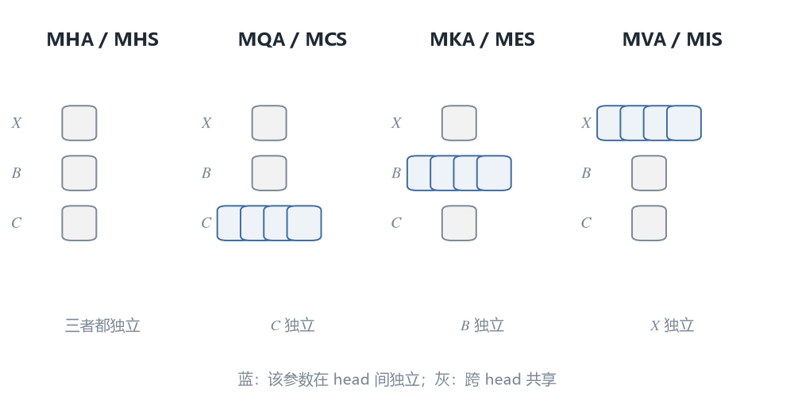

# 第 26 章 Mamba-2 架构：从注意力借来的设计语言

第 25 章给了我们一个又快又简单的 SSD 算法。接下来要把它装进一个可用的模型，而且这个模型还得能在**大规模分布式训练**里跑起来。

Mamba-2 论文的一句话点出了核心矛盾：

> 采用新架构（例如 SSM）的一大障碍，是**围绕 Transformer 建立的整个生态**——包括硬件优化，以及大规模训练的并行化技术。

光有一个好层不够，还得让这个层能被现有的大模型基础设施"装得上"。

Mamba-2 的做法是用对偶关系做翻译，把注意力领域已有的设计语言和系统技术搬过来。

具体有四件事：

1. block 设计的两处改动（并行投影、额外归一化）及其动因；
2. head 模式：从多头注意力的词汇表里借来一整套命名，并回答"Mamba-1 属于哪一种"；
3. 系统优化：张量并行、序列并行、变长序列，这三件事 Transformer 早就解决了，Mamba-2 要做的是表明"我们也能"；
4. 顺带给出几个负面结果（kernel 近似、多查询 head 结构），这也很有教育意义。

---

## 26.1 block 设计的两处改动

Mamba-2 的 block 与 Mamba-1 的差别（论文 Figure 6）有两点。

### 改动一：并行参数投影（Parallel Parameter Projections）

Mamba-1 的做法（SSM 中心视角）：

Mamba-1 的顺序是：先把 $u$ 投影成 $x$，再从 $x$ 投影出 $\Delta,B,C$。

参数的来源是 SSM 的输入。投影链是 $u\to x\to(\Delta,B,C)$，背后是"SSM 是主输入、参数是附属品"的视角。

Mamba-2 的做法（注意力视角）：

Mamba-2 把 $A,X,B,C$ 都当成 block 的一等输入，在开头一次性并行投影出来，正好对应注意力里 $Q,K,V$ 的投影方式。

在注意力的语言里，$X,B,C$ 就对应 $V,K,Q$ 投影，而它们本来就是在 block 开头并行算的。

论文指出这个改动的两个好处：

1. 略省参数；
2. 对张量并行友好，可以用标准的 Megatron 切分模式（见 26.4 节）。

从消融上看（论文 Table 4）：顺序投影 11.76 → 并行投影 11.66，省参数且略好。

### 改动二：额外的归一化层

在 block 内、最终的输出投影之前加一个归一化（LayerNorm / GroupNorm / RMSNorm）：

额外的归一化放在门控相乘之后、输出投影之前。

动因：论文说在初步实验里发现，更大的模型容易出现不稳定，加上这个归一化后缓解了。

来源：这个设计与 NormFormer（Shleifer、Weston、Ott, 2021）最直接相关（它在 MLP 和 MHA block 的末尾也加了归一化）。同时也与几个线性注意力系的做法类似：TransNormerLLM 和 RetNet 发现线性注意力层后需要额外加 LayerNorm/GroupNorm。差别在于 Mamba-2 的归一化发生在乘性门控分支之后，而不是之前。

从消融上看（Table 4）：不加 11.66 → 加 11.49。困惑度小幅改善，稳定性提升则明显。

（第 34 章会讨论这个设计在实践中的重要性，以及 Mamba-3 如何用 "B/C 归一化" 取代它。）

---

## 并行投影到底省了什么

“略省参数”这四个字值得算一遍，因为真正的收益不在这里。

先看两代 block 的前向。Mamba-1 的投影链是（论文 §8.1 的记号，$e$ 为扩张因子，取 2）：

$$
x = uW^{(x)\top},\qquad x_c=\mathrm{conv1d}(x),\qquad \Delta,B,C = \mathrm{low\text{-}rank}(x_c) .
$$

关键在于那个 $\mathrm{low\text{-}rank}$ 的输入形状。它的输入是 $x_c\in\mathbb{R}^{L\times ed}$，输出是 $(\Delta,B,C)$，所以投影矩阵的规模是 $ed\times(r+2N)$，其中 $r$ 是 $\Delta$ 的低秩维。Mamba-2 把它换成从 $u$ 投影，输入维度从 $ed$ 降到 $d$，投影矩阵变成 $d\times(r+2N)$。

两者相比，参数比就是 $ed/d=e$。扩张因子取 2，这一组投影的参数直接减半。论文的消融里，总参数从 129.3M 降到 126.5M（125M 档，$N=P=64$），约 2.2%。单看这个数，它不值得写进论文。

值得写进论文的是另一侧。Mamba-1 的 $\Delta,B,C$ 是 $x_c$ 的函数，而张量并行会把 $x_c$ 的通道维切开，每张卡只拿到一半。要让每张卡算出完整的 $\Delta,B,C$，就得先把 $x_c$ 拼回来，多一次 all-reduce。加上输出投影那次，一个 block 要两次全归约；Transformer 的注意力或 MLP 只要一次。论文的原话是“通信时间翻倍”，而大规模训练里通信本来就要吃掉 10–20% 的时间。

把 $\Delta,B,C$ 改成从 $u$ 投影之后，每张卡直接用完整的 $u$ 算出自己那组 $\Delta,B,C$，不需要先凑齐 $x_c$。多出来的那一次全归约就消失了。

所以这笔买卖的正确读法是：**单卡上省 2.2% 的参数，多卡上省一半的同步。** 如果只看消融表，会觉得这个改动可有可无；如果看 8 卡甚至更多卡的实际吞吐，它是能不能用 TP 的分界线。

---

## 26.2 head 模式：从注意力借来的词汇表

这一节是 Mamba-2 在"架构语言"上贡献最直接的部分。

### 问题

SSM 只有"一个 head"的概念（$A,B,C$ 有状态维度 $N$，序列变换是 $T\to T$）。而注意力有丰富的 head 结构（MHA、MQA、MKA、GQA）。当模型维度 $D$ 变大时，我们该怎么办？

现代惯例的答案是：**保持 head 维 $N$ 和 $P$ 固定在 64 或 128，增加 head 的数量 $H$**，就像 LLaMA 那样。

真正的问题是：哪些参数应该跨 head 共享、哪些应该独立？注意力用"$K,V$ 共享与否"定义了一整套命名。Mamba-2 把这套命名翻译到 SSM 上。

*图 26-1　四种 head 模式：蓝色表示该参数在 head 间独立，灰色表示共享*

### 四种 head 模式

Mamba-2 论文给出了四种（论文式 (17)–(20)）：

| 模式 | 名称（SSM 侧） | 注意力类比 | $X$ | $A$ | $B$ | $C$ |
|---|---|---|---|---|---|---|
| Multi-head SSM (MHS) | 多头 SSM | **MHA** | $(T,H,P)$ | $(T,H)$ | $(T,H,N)$ | $(T,H,N)$ |
| Multi-contract SSM (MCS) | 多收缩 SSM | **MQA**（多查询） | $(T,1,P)$ | $(T,H)$ | $(T,1,N)$ | $(T,H,N)$ |
| Multi-expand SSM (MES) | 多扩张 SSM | **MKA**（多键） | $(T,1,P)$ | $(T,H)$ | $(T,H,N)$ | $(T,1,N)$ |
| Multi-input SSM (MIS) | 多输入 SSM | **MVA**（多值） | $(T,H,P)$ | $(T,H)$ | $(T,1,N)$ | $(T,1,N)$ |

读法：$H$ 表示"这一维有 $H$ 份独立副本"，$1$ 表示"跨 head 共享"。

为什么 MQA 对应"多收缩"、MVA 对应"多输入"？

- $C$ 是收缩矩阵（把状态收缩到输出）。$C$ 独立，意味着每个 head 能决定怎么读自己的状态，所以叫多收缩。
- $B$ 是扩张矩阵（把输入扩张进状态）。$B$ 独立，意味着每个 head 能决定怎么把输入写进状态，所以叫多扩张。
- $X$ 是主输入。$X$ 独立，就叫多输入。

### Mamba-1 属于哪一种？

Proposition 7.2（Mamba-2）：Mamba 架构中的选择性 SSM（S6）层可以看作具有

- head 维 $P = 1$：每个通道有独立的 SSM 动态 $A$；
- 多输入 SSM（MIS）/ 多值注意力（MVA）head 结构：$B,C$ 矩阵（对应注意力的 $K,Q$）在输入 $X$ 的所有通道间共享（$X$ 对应 $V$）。

也就是说，Mamba-1 就是"$P=1$ 的 MVA"。

这不是一个显然的结论。Mamba-1 的设计是从 SSM 视角自然长出来的（"$X$ 是主输入，$B,C$ 是共享参数"），但它恰好对应了注意力的一个特定模式。Mamba-2 论文也特别指出，这个对应关系"之前没有被消融过"。

### 消融结果（Table 5）

在 125M（2.5B token）与 360M（7B token）两个规模上，控制参数量与总状态大小相同：

| head 模式 | 注意力类比 | 125M 困惑度 | 360M 困惑度 |
|---|---|---|---|
| **MIS** | **MVA** | **11.66** | **8.73** |
| MCS | MQA | 12.62 | 9.33 |
| MES | MKA | 12.59 | 9.36 |
| MHS | MHA | 12.06 | 9.01 |
| MSS（全共享，$X$ 也共享） | —— | 12.00 | 9.04 |

结论：MVA（即 Mamba-1 原本的设计）最好，领先幅度也不小（8.73 vs 9.01–9.36）。

论文对此用了一个词："striking"。这些模式"看起来非常相似"（它们的状态总大小相同、参数量也控制住了），但表现差异明显。

为什么 MVA 最好？论文给出的直觉是：MQA 的意义在于减少 KV cache 的大小（对注意力推理有利），但这个动机对 SSM 不适用，SSM 根本没有 KV cache。而 SSM 的"主输入"是 $X$，所以让 $X$ 有独立的 head、而 $B,C$ 共享，是自然的选择。也就是说，Mamba-1 的设计不是从注意力的类比推出来的，而是从 SSM 的物理直觉推出来的，只是它恰好是对的。

### 一个扩展：分组模式（GVA）

注意力的 GQA（grouped-query attention）可以推广到 SSM，得到 grouped-input SSM (GIS) 或 grouped-value attention (GVA)：让 $B,C$ 有 $G$ 份独立的 head（$1<G<H$，$G$ 整除 $H$）。

这个推广有两个用途：一是性能上可以在 MVA 与 MHA 之间插值；二是让 $G$ 是张量并行度的倍数，从而简化切分（见 26.4 节）。

---

## 五种模式各自的参数账

论文 Table 5 把五种 head 模式在 125M 档（2.5B token）下拉平了比。把参数与层数列出来，能看清“控制变量”控制到了什么程度：

| 模式 | $A$ 头 | $B$ 头 | $C$ 头 | $X$ 头 | 层数 | 参数 | 困惑度 |
|---|---|---|---|---|---|---|---|
| MIS / MVA | 24 | 1 | 1 | 24 | 24 | 126.5M | 11.66 |
| MCS / MQA | 24 | 1 | 24 | 1 | 24 | 126.5M | 12.62 |
| MES / MKA | 24 | 24 | 1 | 1 | 24 | 126.5M | 12.59 |
| MHS / MHA | 24 | 24 | 24 | 24 | 15 | 127.6M | 12.06 |
| MSS（全共享） | 24 | 1 | 1 | 1 | 36 | 129.6M | 12.00 |

前三行的参数与层数完全一样。它们只是把“独立份数”在 $X,B,C$ 三条轴上重新分配，总通道数不变，所以参数量不变。

第四行不一样。三条轴全部独立，每层参数变多，同参数预算下只能放 15 层，比 MIS 少 9 层（37.5%）。第五行反过来，连 $X$ 也只留 1 份，每层最便宜，预算能堆到 36 层。

层数差了这么多，困惑度却几乎不按层数排：15 层的 MHS（12.06）与 36 层的 MSS（12.00）相差无几，而 24 层的 MIS（11.66）明显最好。**差异不是容量，而是共享结构。** 论文还补了一句：五种模式的总状态量都是 $HPN$，所以也不能把差异归给状态大小。

具体贵在哪可以算一下。取 $N=P=64$、$H=24$，主投影（$x$ 与 $z$）都是 $d\to ed$，两种模式下不变；变的是 $B,C$ 这一对：MVA 下各是一个 $d\times N$ 的投影矩阵，MHA 下各是一个 $d\times HN$ 的矩阵，宽度差 $H$ 倍。这正好对应层数那笔账：同参数预算下，MHS 只能放 15 层，而 MIS 能放 24 层。

四种带注意力类比的模式在形状上完全对称，在 SSM 的语义上不对称。$B$ 是把输入写进状态的基，$C$ 是把状态读出来的基，$X$ 是被处理的内容。

- MIS：读写基共享，内容分 $H$ 路。
- MCS：写入基共享，内容只 1 路，读法分 $H$ 种。
- MES：读出基共享，内容只 1 路，写法分 $H$ 种。
- MHS：内容的读写方式全部分开。

于是 MVA 胜出的含义很具体：在 SSM 里，该分开的是内容，不是读写方式。MQA 在注意力里成立，是因为它的动机是省 KV cache；SSM 没有 cache，它的状态就是一个 $N\times P$ 的矩阵，共享 $B,C$ 既不省显存也不省带宽，只会让 $H$ 个 head 变成“同一个信号的不同读法”。

---

## 多输入不是多输入多输出

名字很容易让人误会。MIS 里的“多输入（multi-input）”指的是 $X$ 有 $H$ 份，与多输入多输出（MIMO）系统没有关系。SSD 层本身是严格的单输入单输出（SISO），每个 $(h,p)$ 通道各自一套递推，通道之间除了共用 $B,C$ 的数值之外互不影响。

写成形状就很清楚。MIS 的 $B$ 与 $C$ 都是 $(T,1,N)$，全层只有一套，同时作用在 $H$ 路 $X$ 上；真正的 MIMO 会把 $B$ 写成 $(T,N,R)$、$C$ 写成 $(T,R,N)$，$R$ 路输入共用一组 $N$ 维状态，这才是“多对多”。

论文把这个区别放在“维度”这一轴上讨论，并给出了一个直接的权衡：传统 RNN 要么 $N=1$，要么是 dense $B,C$ 的 MIMO，两种情形的有效状态都小；SISO 加状态扩张能把有效状态推到 $ND$。语言这类信息密集的任务需要大状态，这是 Mamba 系列一直坚持 SISO 的原因。

所以本章四个 head 模式切的是“同一层内部哪些参数分 head”，而不是“几路信号进、几路信号出”。把这两件事分开，才不会把 MIS 读成 MIMO。（真正的 MIMO 重建在第 31 章，那里的动机完全不同：把解码从访存瓶颈里救出来。）

还有一点值得提前分清。MIS 里的 $H$ 是 head 数，它决定了状态矩阵 $h\in\mathbb{R}^{(H,N,P)}$ 的份数；而 MIMO 里的 $R$ 是共用同一组状态的输入路数。前者靠堆 head 换容量，后者靠多路共用换带宽。两者的参数形状不一样，优化目标也不一样：前者冲容量，后者冲解码时的算术强度。

---

## 26.3 一个负面结果：kernel 近似的尝试

Mamba-2 论文还做了一个"从线性注意力文献搬运"的尝试（第 7.3 节）：既然 SSD 是线性注意力的一般化，那能不能把线性注意力里的各种技巧也搬过来？

它试了：

- 核特征映射 $\psi$：none、Swish、Exp、ReLU（含/不含归一化）、cosFormer、Random Feature Attention、Performer 的 Positive Random Features、Based 的 Taylor 展开、ReBased 的 LayerNorm 平方等；
- 归一化项（类似 softmax 的分母）。

结果（Table 6、7）：这些都没有明显优于一个简单的逐点非线性（Swish），而且归一化项在多数变体里引入不稳定。

论文的结论是"negative result"，并给出解释：

> SSD 与普通线性注意力的差别在于那个 1-半可分掩码 $L$。而这些线性注意力方法当初是为了在**没有这个掩码**的情况下逼近 softmax 而设计的。所以负结果并不意外。

Mamba-2 的默认选择仍然是 $\psi(x)=\mathrm{Swish}(x)$（跟随 Mamba-1），但论文补了一句：

> 我们建议，完全去掉这个激活可能是一个更简单的选择（我们没有广泛测试）。

这个"少即是多"的态度在 Mamba-3 里得到了确认：Mamba-3 的架构精修里，很多"上一代加上的东西"被重新审视（第 32 章）。

---

## 26.4 系统优化：让 Mamba-2 能装进大模型基础设施

这一节是 Mamba-2 论文里最工程、也最容易被读者跳过的一部分。它回答的正是开头那个问题：这个层能不能上大规模分布式训练？

### 优化一：张量并行（Tensor Parallelism, TP）

背景：TP 是把一个层切到同一个节点的多张 GPU 上（Megatron 风格）。它要求层的结构能被切成"每张卡算一部分，最后一次 all-reduce"。

Mamba-1 的问题：回忆第 18、20 章，$\Delta,B,C$ 都是从 SSM 的输入 $x_c$（卷积之后）投影出来的。如果在 TP 下把输入投影切开，那么每张卡只有一半的 $x_c$，要算 $\Delta,B,C$ 就得先 all-reduce 把完整的 $x_c$ 拼起来，多一次通信。

论文的原话：

> 相比 Transformer，我们会额外多出两次 all-reduce 而不是一次，**通信时间翻倍**。对大规模 Transformer 训练来说，通信可能已经占了 10–20% 的时间，翻倍会让 Mamba 在大规模训练上不再高效。

Mamba-2 的解法：让 $\Delta, B, C$ 直接从 block 输入 $u$ 投影出来（而不是从卷积后的 $x_c$）。这正是 26.1 节的"并行投影"改动。于是：

- 输入投影 $W^{(x)},W^{(z)}$ 照常切分；
- $\Delta,B,C$ 的投影也切分（每张卡有自己的 $\Delta,B,C$，等价于"在更大的逻辑 GPU 上有若干组 $\Delta,B,C$"）；
- 块内的归一化用 GroupNorm，并且组数要能被 TP 度整除，这样块内完全不需要通信；
- 最后只需要一次 all-reduce（输出投影处）。

论文的结论：

> 我们只需要切分输入投影和输出投影，并且只需要在 block 末尾做一次 all-reduce。**这与 Transformer 里 MLP 层或注意力层的 TP 设计相同。**

这个例子很能说明问题：架构层面的改动（并行投影）的直接动因是系统层面的需求（少一次通信）。如果只看单卡的消融（11.76 → 11.66），会觉得这个改动只是略好；但它在 8 卡训练时的价值远大于那 0.1 个点。

### 优化二：序列并行 / 上下文并行（Sequence / Context Parallelism）

背景：序列太长时，激活值放不进单卡，需要沿序列维切分。注意力的做法是 Ring Attention 一类，难点在于"每个 query 块要和所有 key 块交互"，通信量与 worker 数相关（甚至二次）。

SSD 的做法很简单（正好对应第 25 章的块分解）：

序列并行时，GPU1 算完前半段，把末状态 $h_{\text{mid}}$ 交给 GPU2，GPU2 接着算后半段并输出 $h_{\text{end}}$。通信量随设备数线性增长。

写成一句：每张卡拿一个初状态，算完自己的那段，把末状态传给下一张卡，通信量与 worker 数呈线性。

而且 SSD 层的实现里已经内置了这个接口：第 25 章 Listing 1 的 `initial_states` 参数就是为它准备的（函数返回值里也带着 `final_state`）。

另外，Transformer 的 SP 还包括"把 TP 里的 all-reduce 拆成 reduce-scatter + all-gather，在中间做残差和归一化"。Mamba-2 用完全相同的残差与归一化结构，所以这部分可以不加修改地套用（Korthikanti 等, 2023）。

### 优化三：变长序列

背景：微调和推理时，一个 batch 里的序列长度往往不同。Transformer 的朴素做法是右 padding 到最长，浪费算力；而为了效率需要专门的负载均衡或掩码技巧。

SSD 的做法：把整个 batch 当作一条长序列，在序列边界处不传递状态。

具体做法（论文 §8.3）：

$$
\boxed{\ \text{在一条序列的最后一个 token 处，令 } A_t = 0\ }
$$

因为 $A_t = 0$ 意味着"状态乘 0"，也就是重置状态，正好就是第 18 章讲的"边界重置"能力的一个直接应用。于是不需要 padding，也不需要特殊的掩码逻辑。

这个技巧在实际的微调/推理流水线里很实用："文档打包"（把多个短文档拼成长序列以提高硬件利用率）是标准操作，Mamba-2 用一个赋值就够了。

---

## 归一化为什么必须选 GroupNorm

26.1 只说“加一个归一化”，没解释为什么论文在 LayerNorm、GroupNorm、RMSNorm 三者中特别点名 GroupNorm 与张量并行的关系。这个选择不是风格问题，是通信问题。

LayerNorm 的统计量跨整个特征维计算。取 $ed$ 个通道的均值与方差，就得看到这 $ed$ 个通道。TP 把这个维切成 $t$ 份之后，每张卡只持有 $ed/t$ 个通道，它手上的局部均值不等于全局均值，要得到全局统计量必须再做一次 all-reduce。这一下就把刚才省下来的同步又还回去了。

GroupNorm 把通道分成 $g$ 组，每组内部各自算均值方差。只要 $g$ 能被 TP 度整除，就能让每一组完整地落在同一张卡上：$t$ 张卡、$g$ 组、每组由 $g/t$ 个相邻通道组成，切分点刚好落在组边界上。这样每张卡归一化自己那几组，全程不需要跨卡通信。论文的写法是“number of groups divisible by the degree of tensor parallel, so that the GPUs in a TP group do not have to communicate within the block”。

这里的“整除”不能读成“相等”。$g$ 取 TP 度的倍数时，每张卡拿好几组，每组仍然完整，依然不需通信；$g$ 大于通道数就无意义了。$g=1$ 逆回 LayerNorm，$g=ed$ 逆回逐通道归一，两端都不好用，所以真实配置取中间的一个值。

这一条也解释了架构设计里一个反复出现的模式：**归一化的位置与类型，往往是被并行策略反向决定的。** 26.1 那两处 block 改动（并行投影、额外归一化）外表上看是模型层面的选择，内里都是为了一次 all-reduce。这条经验在后来几代模型里反复出现：归一化的类型往往不是按效果选的，而是按“能不能在本地算完”选的。

---

## 26.5 Mamba-2 block 的完整结构

把本章内容汇总：

Mamba-2 block 的组成可以逐行列出：

| 步骤 | 操作 | 输出形状 |
|---|---|---|
| 1 | 线性投影得到 $X$，再过 depthwise 因果卷积与 SiLU | $(B,L,ED)$ |
| 2 | 线性投影得到 $A$（标量衰减，每 head 一个） | $(B,L,H)$ |
| 3 | 线性投影得到 $B,C$（跨 head 共享，MVA 模式） | $(B,L,N)$ |
| 4 | 线性投影得到门控分支 $z$ | $(B,L,ED)$ |
| 5 | SSD 层 | $(B,L,ED)$ |
| 6 | 门控 $Y\odot\mathrm{SiLU}(z)$，再过 GroupNorm | $(B,L,ED)$ |
| 7 | 输出投影，接残差 | $(B,L,D)$ |

与 Mamba-1 的差别可以概括成一句话：

> Mamba-2 把"从 SSM 输入生成参数"改成"从 block 输入并行生成参数"，并在门控后加了归一化。

其余（扩张因子 $E=2$、短卷积、SiLU 门控、残差）保持不变。

---

## 两个 block 的逐行对照

把 Mamba-1 与 Mamba-2 的前向逐行摆在一起。记号沿用论文 §8.1（$e$ 为扩张因子，$L$ 为序列长，$d$ 为模型维）：

| 步骤 | Mamba-1 | Mamba-2 |
|---|---|---|
| 1 输入投影 | $x=uW^{(x)\top}$, $z=uW^{(z)\top}$ | 同左 |
| 2 短卷积 | $x_c=\mathrm{conv1d}(x)$ | 同左 |
| 3 参数投影 | $\Delta,B,C=\mathrm{low\text{-}rank}(x_c)$ | $\Delta,B,C=\mathrm{projection}(u)$ |
| 4 序列混合 | S6 选择性扫描 | SSD 块分解 |
| 5 门控 | $y_g=y\cdot\phi(z)$ | 同左 |
| 6 归一化 | 无 | GroupNorm |
| 7 输出投影 | $y_gW^{(o)\top}$ + all-reduce | 同左 |

七行里五行没动。变的三行（参数投影、序列混合、归一化）都能追溯到同一个动机：让这个层在分布式训练里可切。第四行涉及数学，另两行只是工程。

这个表能纠正一个常见印象。Mamba-2 常被描述成“换了个 block”，实际上 block 的形状（双分支、depthwise 卷积、SiLU 门控、残差）一字未改，参数总量也只差了 2.2%。真正的改动全在“参数从哪里来”与“序列怎么混”这两处。

顺着这张表还能看出一个代价。第三行把参数投影的输入从 $x_c$ 换成了 $u$，意味着 $\Delta,B,C$ 看不到了卷积之后的信号。这在表达力上是一点损失，因为卷积本来是局部的特征提取，把它的输出再送进参数投影，等于让选择性建立在局部平滑后的信号上。代价不大，但不是零。

---

## 吞吐：不是处处更快

把本章的设计收益与第 25 章的算法收益分开算，结论要谨慎得多。

先看层本身。SSD 在 $N=64$ 时比 Mamba 的融合扫描快 2–8 倍；与 FlashAttention-2 相比，序列长到 $2\text{K}$ 才追平，$16\text{K}$ 时快 6 倍。两个数字的方向相反，前者是“同长度的不同算法”，后者是“不同模型的缩放”。

再看分布式。TP 的同步点减一半；按论文给的 10–20% 通信占比推算，端到端拿回 5–10%。SP 通信量随设备数线性，而注意力的 ring attention 随 worker 数二次。变长序列不需要 padding，batch 内长度差异越大省得越多。

但整模型对比是另一回事。论文自己写了一句话：在短序列（例如 $2\text{K}$）上，Mamba-2 训练未必比 Transformer 高效。原因是参数分配方式不同。相同参数预算下，一个 $L$ 层的 Transformer 有 $L/2$ 层 MLP 与 $L/2$ 层注意力，而 Mamba-2 是 $L$ 层 SSD。MLP 层只是矩阵乘加点乘，硬件效率极高，SSD 层有卷积、扫描、门控、归一化，跑得没那么顺。

所以吞吐优势的正确说法是：**不是处处更快，而是随序列长增长得更慢。** 在 $2\text{K}$ 以上越来越明显，在几百 token 的短序列上不占便宜。这也直接引出论文建议的混合配方：一半 SSD 层加一半 MLP 层，短序列没有额外负担，长序列仍保留线性缩放。

---

## 三处改动的代价汇总

本章一直在讲 Mamba-2 从注意力借了什么，最后得把借的代价列清楚。四处让步拼在一起，才是这个层完整的面貌。

并行投影让 $\Delta,B,C$ 看不到卷积之后的信号。卷积本来做局部特征提取，把它的输出再送进参数投影，等于让选择性建立在平滑后的信号上；直接从 $u$ 投影，少了这一层中介。论文没有量化这个损失，只能说它被包含在那个 11.76 → 11.66 里。

额外归一化多了一次归约。它不是 LayerNorm 的替代品，位置也固定：门控相乘之后、输出投影之前。模块整体因此比 Mamba-1 多一个算子，在短序列上这部分开销不可忽略。

MVA 的胜出也有另一面。$B,C$ 共享意味着 $H$ 个 head 只能用同一套读写基，想增加多样性只能加宽 $N$ 或加深层数；GVA 可以把 $G$ 提到 $1<G<H$ 去换一点多样性，代价是参数与切分的复杂度都上去了。

再加上第 25 章的标量化：每个状态一条衰减变成所有状态共享一条。四处让步合起来，换来的是一层能被 TP 与 SP 切开、能在 GPU 上跑满、又保留固定大小状态的层。

四处让步里，只有标量化真正改动了模型的函数类，其余三处改的都是“参数从哪里来”与“算完在哪里归一化”。这个区分有实用价值：前者决定模型能拟合什么，后者只决定同一类函数能不能在给定硬件上跑得动。Mamba-3 沿这条线继续走时，改的仍然是后者（第 28 章）。

这笔交换值不值，取决于目标。如果目标是长序列上的单位时间成本，四处让步都是必要的；如果目标是同等参数下的困惑度，Mamba-1 的对角 $A$ 与顺序投影并不差（11.76 对 11.49，而只换并行投影是 11.66，剩下那 0.17 来自归一化）。两个目标不能同时最优，Mamba-2 选了前者。

---

## 26.6 本章小结

- Mamba-2 的目标不只在于"更快的层"，还要是"能被大模型基础设施装上的层"。
- block 两处改动：(1) 并行参数投影，$A,B,C,X$ 都在 block 开头从 $u$ 并行产生（类比 $Q,K,V$），省参数且对 TP 友好；(2) 门控后的额外归一化（NormFormer 风格），提升大模型稳定性。消融：11.76 → 11.49。
- head 模式词汇表：MHS/MHA、MCS/MQA（多查询=$C$ 独立）、MES/MKA（多键=$B$ 独立）、MIS/MVA（多值=$X$ 独立）。Proposition 7.2：Mamba-1 的 S6 就是"$P=1$ 的 MVA"。
- 消融（Table 5）：MVA 最好（8.73 vs 9.01–9.36），尽管各种模式"看起来非常相似"。原因：MQA 的动机（省 KV cache）对 SSM 不适用，而 $X$ 才是 SSM 的主输入。
- 负面结果：把线性注意力的核近似技巧（Performer、cosFormer、Based、ReBased、各种归一化）搬过来，均无明显收益，因为 SSD 与它们的关键差别是那个半可分掩码 $L$。默认仍用 Swish。
- 系统优化三件套：(1) 张量并行：因为并行投影，块内无需通信，每 block 只需一次 all-reduce（与 Transformer 相同）；归一化用 GroupNorm 且组数可被 TP 度整除。(2) 序列并行：把状态在设备间传递，通信量线性；SSD 实现里的 `initial_states`/`final_state` 就是接口。(3) 变长序列：在序列边界处令 $A_t=0$ 即重置状态，无需 padding。
- Mamba-2 block = 扩张因子 $E=2$ + 短卷积 + SSD + SiLU 门控 + GroupNorm + 输出投影 + 残差。

## 下一章

第 27 章给出 Mamba-2 的全部实验：MQAR 合成任务（状态大小的重要性）、缩放定律、下游评测、以及混合架构（SSD 层 + 注意力层 + MLP 层的最佳配比）。混合架构是第七篇的收尾，也是理解当代线性模型部署形态的关键。
