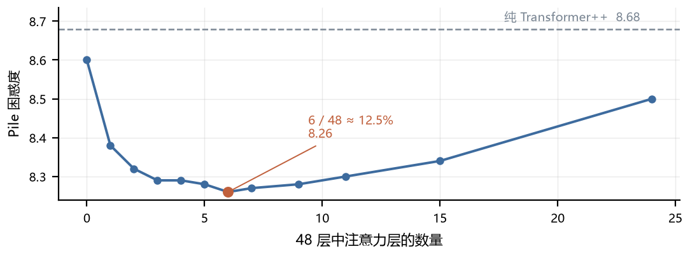

# 第 27 章 Mamba-2 的实验：混合架构与新能效前沿

Mamba-2 给了我们三样东西：一个理论（SSD）、一个算法（块分解）、一个架构（借来的设计语言）。下面看它到底做到了什么。

三个问题：

1. 状态大小真的那么重要吗？第 21 章的消融暗示"$N$ 越大越好"，Mamba-2 把 $N$ 做到 64/128/256。这在什么任务上看得出来？
2. 它比 Mamba-1 好多少？在语言建模上，困惑度、下游评测、速度。
3. 纯 SSM 够不够？还是必须和注意力混着用？这个问题的答案决定了当代模型的形态。

---

## 27.1 MQAR：状态大小的试金石

### 任务

Multi-Query Associative Recall（MQAR）是 Arora 等（2024）提出的合成任务。任务形式：先给模型看若干组「键-值」对，再依次给出键，要求它回忆对应的值。

一次要记住多个关联，所以叫 multi-query。

为什么这个任务对 SSM 是硬骨头？

因为它直接考验状态的存储容量：模型必须把 $k$ 个键值对全部编码进一个固定大小的状态里。如果状态只有 $N$ 维，那它能记住的关联数量受限于 $N$。

这与第 17 章讲的 Selective Copying / Induction Heads 是同一类能力（联想回忆），但 MQAR 更难：它要求同时记住多个关联。

Mamba-2 论文说这个任务"与 phonebook lookup 任务密切相关，已被证明对 SSM 这类循环模型很困难，因为它们的有限状态容量"。

### 结果（论文 Figure 8）

在"更难的 MQAR 设置"下（更长序列、更小模型），比较：

- 标准多头 softmax 注意力；
- Based（一个混合了卷积、局部注意力和线性注意力的架构）；
- Mamba-1；
- Mamba-2（$N=16, 64, 256$）。

结论：

1. Mamba-1 在这个任务上挣扎（在多数设置下接近随机）。
2. Mamba-2 在所有设置下都表现良好。
3. 即使控制状态大小（$N=16$），Mamba-2 也显著优于 Mamba-1。论文坦诚地说："我们不确定是架构的哪个方面起主要作用，这仍是未来工作需要探索的问题。"
4. 增大 $N$ 持续改善性能：$N=16 \to 64 \to 256$ 一致提升，因为"更大的状态允许记住更多信息（键值对）"。
5. 在较长序列/较大模型维度下，Mamba-2（$N=256$）甚至超过了普通注意力。

### 这一节的意义

这个实验是"Mamba-2 为什么值得存在"的最直接证据。它量化了两件事：

- 状态容量是联想回忆的瓶颈（$N$ 越大越好）；
- Mamba-2 的算法让大 $N$ 变得便宜（所以才能用 $N=256$）。

对比第 25 章的效率图（论文 Figure 10 右）：Mamba 的优化扫描实现随 $N$ 线性变慢，而 SSD 几乎不变。两张图合起来才是完整的论证：不是"SSD 更好"，而是"SSD 让大 $N$ 可行，而大 $N$ 是必要的"。

---

## 27.2 语言建模

### 缩放定律

在 Pile 上按 Chinchilla 协议训练 $\approx 125$M 到 $\approx 1.3$B。对比 Mamba 与 Transformer++。

结论（论文 Figure 9）：

> Mamba-2 **匹配或超过** Mamba 与强 Transformer++ 配方。相对 Transformer 基线，Mamba-2 在**性能（困惑度）、理论 FLOPs、实际墙钟时间**三个维度上都是 **Pareto 占优**的。

"三个维度都 Pareto 占优"意味着不存在"用更多算力换更好效果"的权衡点，它在所有维度上同时更好。

### 下游零样本评测（Table 1）

| 模型 | Pile ppl↓ | LAMBADA ppl↓ | 平均准确率↑ |
|---|---|---|---|
| Pythia-1B | 7.82 | 7.92 | 49.0 |
| Mamba-790M | 7.33 | 6.02 | 53.0 |
| **Mamba-2-780M** | **7.26** | **5.86** | **53.5** |
| Pythia-1.4B | 7.51 | 6.08 | 51.7 |
| Mamba-1.4B | 6.80 | 5.04 | 56.4 |
| **Mamba-2-1.3B** | **6.66** | **5.02** | **56.4** |
| Pythia-2.8B | 6.73 | 5.04 | 55.7 |
| RWKV4-3B | 7.00 | 5.24 | 56.4 |
| Mamba-2.8B | 6.22 | 4.23 | 59.9 |
| **Mamba-2-2.7B** | **6.09** | **4.10** | **60.2** |

> **一个容易误读的地方**：第 21 章说 Mamba-2.8B 的平均准确率是 63.3%，这里却写 59.9%。两个数都对——平均的任务集合不同。Mamba-1 论文 Table 3 平均了 6 个任务（LAMBADA、HellaSwag、PIQA、Arc-E、Arc-C、WinoGrande），Mamba-2 论文 Table 1 加上了 OpenbookQA（共 8 个任务）。跨论文比较平均准确率之前要先对齐任务集合，否则会得出错误的结论。本书在两个地方都保留了各自论文的原始口径。

几个观察：

- Mamba-2 在每个规模上都优于 Mamba-1（困惑度与平均准确率都是），而参数量略小。
- Mamba-2-2.7B（60.2%）超过 Mamba-2.8B（59.9%），也超过 RWKV4-3B（56.4%）与 Pythia-2.8B（55.7%）。
- 论文摘要的原话："Mamba-2 with 2.7B parameters trained on 300B tokens on the Pile outperforms Mamba-2.8B, Pythia-2.8B and even Pythia-6.9B trained on the same dataset."

"even Pythia-6.9B"的意思是，用 2.7B 参数打败了 6.9B 的 Transformer。

---

## 27.3 混合架构：本章最重要的部分

### 动机

Mamba-2 论文引用了一批同期工作（H3、De、Glorioso、Lieber 等）的观察：

> **SSM 层与注意力层混合的架构，可能比纯 Transformer 或纯 SSM 都有更好的模型质量**，尤其是在上下文学习（in-context learning）方面。

Mamba-2 系统地做了这个实验。

### 实验一：注意力层的比例（Table 2）

固定 350M 参数、48 层，训练 7B token，只改变"48 层里有几层是注意力"：

| 注意力层数 | 0（纯 Mamba-2） | 1 | 2 | 3 | 4 | 5 | 6 | 7 | 9 | 11 | 15 | 24 | Transformer++ |
|---|---|---|---|---|---|---|---|---|---|---|---|---|---|
| 困惑度↓ | 8.60 | 8.38 | 8.32 | 8.29 | 8.29 | 8.28 | **8.26** | 8.27 | 8.28 | 8.30 | 8.34 | 8.50 | 8.68 |

这张表的信息量很大：

- 纯 Mamba-2 是 8.60，纯 Transformer++ 是 8.68，两者几乎持平（Mamba-2 略好）。
- 只要加 1 层注意力就降到 8.38（改善 0.22）。
- 最优在 6 层左右（8.26），即 6/48 ≈ 12.5%。
- 继续增加注意力层反而变差（24 层时 8.50，比纯 Mamba-2 还差）。

论文的结论：

> **大约 10% 的层是注意力时表现最好。**

至于原因，论文给出的假设是：

> SSM 层作为通用的序列到序列映射工作得很好，而注意力层则充当**检索机制**，可以快速引用序列中之前的 token，而不是强迫模型把所有上下文都压缩进它的记忆（SSM 状态）。

这个假设值得记住，因为它精确地对应了我们从第 17 章一路走来的框架：

- SSM 擅长压缩（长期聚合统计量、平滑信息）；
- 注意力擅长检索（精确定位、逐字回忆）；
- 两者互补。

它也解释了为什么"太多注意力反而变差"：注意力不压缩，在长序列上会把大量算力和参数花在"不压缩"上；而 Mamba-2 的压缩已经足够处理大部分需求。

*图 27-1　注意力层数量与困惑度：纯 Mamba-2 为 8.60，6 层注意力时最好（8.26）*

### 实验二：SSD + MLP + 注意力的组合（Table 3）

在 2.7B 规模（64 层）、300B token 上比较五种配置：

| 配置 | 组成 | Pile ppl↓ | 平均准确率↑ |
|---|---|---|---|
| Transformer++ | 32 注意力 + 32 gated MLP（交替） | 6.13 | 60.2 |
| Mamba-2 | 64 SSD | 6.09 | 60.2 |
| Mamba-2-MLP | 32 SSD + 32 MLP（交替） | 6.13 | 59.6 |
| **Mamba-2-Attention** | **58 SSD + 6 注意力** | **5.95** | **61.0** |
| Mamba-2-MLP-Attention | 28 SSD + 4 注意力 + 32 MLP | 6.00 | 60.7 |

（注意力层放在第 9、18、27、36、45、56 层。）

结论：

1. Transformer++ 与纯 Mamba-2 质量相同（6.13 vs 6.09，60.2 vs 60.2）。
2. 加 6 层注意力明显改善（5.95，61.0），比纯 Mamba-2 好，也比 Transformer++ 好。
3. 加 MLP 会降低质量（6.13），但有两个好处：(i) 训练和推理更快（MLP 简单且硬件友好）；(ii) 更容易升级成 MoE（把 MLP 换成专家混合）。
4. 最复杂的组合（SSD + MLP + 注意力）质量介于中间（6.00），但兼顾了效率与可升级性。

### 这一节的深远影响

"约 10% 注意力层"这个结论，后来成了工业界线性模型部署的标准做法。2025–2026 年出现的各种"混合线性模型"（Kimi Linear、NVIDIA 的混合架构、腾讯混元的线性版本等）基本都遵循这个比例。Mamba-2 的这张表是它的实验依据。

这里还有一个微妙之处：纯 Mamba-2 与纯 Transformer++ 质量相同。这意味着：

> 选择混合架构不是因为纯 SSM 质量不够，而是因为"两种能力互补"这件事本身有价值。

如果纯 SSM 质量更好，那就没人会混；如果纯 SSM 质量更差，混也只是补救。质量持平加能力互补，才使得混合成为帕累托改进。

---

## 混合架构的消融全表

上面两张表是结论，证据则散在正文、脚注和附录里。把它们拆开会发现五个独立的旋钮：注意力层的数量、注意力层的位置、每层放什么类型、SSD 块内部怎么接、head 维度怎么分配。五个旋钮分开看，才知道哪条结论是硬的，哪条只是当时那一组配置的产物。

### 旋钮一：注意力层数量

350M、48 层、7B token，同一套超参与数据，只改数量：

| 注意力层数 | 占 48 层的比例 | Pile ppl↓ | 相对纯 Mamba-2 的改善 |
|---|---|---|---|
| 0（纯 Mamba-2） | 0% | 8.60 | — |
| 1 | 2.1% | 8.38 | 0.22 |
| 2 | 4.2% | 8.32 | 0.28 |
| 3 | 6.3% | 8.29 | 0.31 |
| 4 | 8.3% | 8.29 | 0.31 |
| 5 | 10.4% | 8.28 | 0.32 |
| 6 | 12.5% | 8.26 | 0.34 |
| 7 | 14.6% | 8.27 | 0.33 |
| 9 | 18.8% | 8.28 | 0.32 |
| 11 | 22.9% | 8.30 | 0.30 |
| 15 | 31.3% | 8.34 | 0.26 |
| 24 | 50% | 8.50 | 0.10 |
| 48（Transformer++） | 100% | 8.68 | −0.08 |

曲线的形状是急跌、长平台、缓升。第一层的边际收益 0.22，占全部收益的三分之二；从第 1 层到第 6 层再拿 0.12；第 6 层之后每一层都在还债，加到 50% 时收益只剩 0.10，加到全注意力时反而不如纯 Mamba-2。

平台很宽：3 层到 9 层（6.3% 到 18.8%）的整段区间里，ppl 在 8.26 到 8.29 之间，差 0.03。所以"约 10%"是一个带，不是一个点。论文说 around 10%，而 10.4%（5 层）对应 8.28，最小值 8.26 在 12.5%（6 层），两者差 0.02。在 7B token 的短训练里这个量级不该当真，把它当成精确的最优比例会在别的规模上翻车。

真正硬的信息有两条。一是曲线的两个端点几乎等高（8.60 对 8.68），说明两种纯架构在语言建模上打平。二是有注意力层的模型整段都优于两个端点，最差的一格（24 层，8.50）也比 Transformer++ 好。混合不是折中，是整条曲线抬高。

### 旋钮二：注意力层位置

论文在脚注里给了一句结论，语气很轻，信息量很大：

> 在小规模实验中我们发现，只要注意力层被间隔开、并且不放最前面也不放最后面，模型质量对注意力层的具体位置不太敏感。

这句话省掉了一整轮网格搜索。它意味着"第几层放注意力"不是关键变量，工程上按"每 $k$ 层插一个"实现就够了。2.7B 那组实验的做法正是这样：64 层里 6 层注意力放在第 9、18、27、36、45、56 层，间隔 9、9、9、9、11，前 8 层与后 7 层都是纯 SSD。

首尾要留空这一点值得单独记下来。最前面几层的输入还是原始 embedding，注意力的检索没有可检索的对象；最后几层直接接输出头，插一层注意力对困惑度的帮助也很小。两端都是"信息最稀"的位置。

### 旋钮三：每层的类型

2.7B、64 层、300B token，五种配置。注意每种配置都恰好占满 64 层：

| 配置 | 层构成 | ppl↓ | 平均准确率↑ | 速度（定性） |
|---|---|---|---|---|
| Transformer++ | 32 注意力 + 32 gated MLP | 6.13 | 60.2 | 慢（二次项） |
| Mamba-2 | 64 SSD | 6.09 | 60.2 | 快 |
| Mamba-2-MLP | 32 SSD + 32 MLP | 6.13 | 59.6 | 最快 |
| Mamba-2-Attention | 58 SSD + 6 注意力 | 5.95 | 61.0 | 中等 |
| Mamba-2-MLP-Attention | 28 SSD + 4 注意力 + 32 MLP | 6.00 | 60.7 | 中偏快 |

（速度一列是按 FLOPs 结构做的定性判断，论文只对"加 MLP 更快"这一点给了明确说明。）

把这张表看成两条独立的轴会更清楚。MLP 轴：32 层 SSD 换成 32 层 MLP，ppl 从 6.09 涨到 6.13，代价 0.04，平均准确率掉 0.6。注意力轴：58 层 SSD 里挖掉 6 层换成注意力，ppl 从 6.09 降到 5.95，收益 0.14，平均准确率涨 0.8。两条轴几乎互相抵消，所以最复杂的组合落在 6.00。

MLP 的坏处只有质量一项，好处是两条：MLP 是纯矩阵乘加逐点非线性，硬件利用率高；而且以后想换成专家混合（mixture of experts, MoE），换的就是 MLP 层，SSD 层没有对应物。这两条是后来的混合模型普遍保留 MLP 层的理由。

### 旋钮四：块内接法与 head 分配

前三个旋钮改的是层的排列，这两个改的是单层内部。先是块内投影：

| 块 | $A,B,C,X$ 投影 | 额外归一化 | 参数量 | ppl↓ |
|---|---|---|---|---|
| Mamba-1 | 串行 | 无 | 129.3M | 11.76 |
| Mamba-1 | 串行 | 有 | 129.3M | 11.54 |
| Mamba-2 | 并行 | 无 | 126.5M | 11.66 |
| Mamba-2 | 并行 | 有 | 126.5M | 11.49 |

四行是两个因素的全组合，可以分别读出各自的贡献。并行投影把参数从 129.3M 压到 126.5M（省 2.2%），ppl 同时改善 0.10；额外归一化在两种接法下各贡献 0.17 到 0.22，与接法无关。这是"为了张量并行而做的重构顺便让模型变好"的少见例子，论文自己也说，归一化层的初衷是训练稳定性，质量提升是附带的。

再看 head 分配。所有配置的总状态大小相同（都等于 head 数乘 head 维乘状态维），差别只在 $B,C,X$ 各有几个 head：

| 模式 | 注意力类比 | $A$ | $B$ | $C$ | $X$ | 层数 | ppl↓ |
|---|---|---|---|---|---|---|---|
| 多输入（MIS） | 多值（MVA） | 24 | 1 | 1 | 24 | 24 | 11.66 |
| 多收缩（MCS） | 多查询（MQA） | 24 | 1 | 24 | 1 | 24 | 12.62 |
| 多扩张（MES） | 多键（MKA） | 24 | 24 | 1 | 1 | 24 | 12.59 |
| 多头（MHS） | 多头（MHA） | 24 | 24 | 24 | 24 | 15 | 12.06 |
| 多状态（MSS） | — | 24 | 1 | 1 | 1 | 36 | 12.00 |

表里的数字列是 head 数。MVA 与 MQA/MKA 的差距接近 1 个 ppl，而三者看起来几乎一样。共同点更重要：共享 $C$ 与 $B$、每头独立 $X$ 最好；反过来共享 $X$、每头独立 $C$ 或 $B$ 最差。用 SSM 的话说，多个 head 可以共用一个写入口和一个读出口，但不能共用写入的内容。用注意力的话说，$K$ 与 $Q$ 共享、$V$ 每头独立，这正是"多值"这个名字的来源。

MHS 与 MSS 要 15 层和 36 层才能对齐参数量，因为它们的 $B$、$C$ 投影是 24 份。它们的结果在 12 附近，说明"参数量对齐"这个口径本身会改变比较的含义：状态总量相同、参数总量相同，仍然差 0.4 个 ppl。

### 读这张表的三个提醒

第一，这几张表的模型规模、训练 token 数、tokenizer 各不相同（350M/7B/GPT-2、360M/7B、125M/2.5B、2.7B/300B/NeoX），跨表比较 ppl 没有意义，只能表内比较。

第二，"注意力层数"与"MLP 层数"可以互换位置。纯 Mamba-2 的 64 层全是 SSD，Mamba-2-MLP 用 32 层 MLP 换掉一半 SSD，质量只掉 0.04。所以"10% 注意力"这个结论隐含了"剩下 90% 全是 SSD"这个前提；如果把剩下的一半换成 MLP，最优比例可能移动。

第三，所有消融都在远低于收敛的 token 数上做（7B token 对 350M，约 20 token/参数），比 Chinchilla 最优少一个量级。论文没有声称这些比例在 300B token 上仍然最优，2.7B 那组只是检查了 6/64 这个点还在。

### 这几张表读不出来的东西

表里只有困惑度。四个空白值得标出来。

没有长上下文。所有实验都在固定长度上训练和评测，注意力层在 2K 上的优势与它在 32K 上的优势不是同一件事。第 28 章会看到，Mamba-2 的上下文外推能力在 2K 训练后会在更长的长度上崩掉，而这一组消融完全测不到。

没有多种子。350M 那张表的 13 个点各只跑一次，6 层与 7 层差 0.01、3 层与 4 层完全相同。这些差异在单种子下不构成信号，只能当平台看。论文没给重复实验的方差。

没有推理吞吐。表里只给困惑度和（定性的）训练速度。真实部署里混合架构的成本取决于 batch 大小与序列长度：小 batch 短序列时访存受限，KV 缓存的开销比 FLOPs 更主导；大 batch 长序列时反过来。同一组层配比在不同 serving 配置下的排序可以翻转。

没有"能力"而只有"平均分"。八任务平均把检索类、常识类、阅读理解类混在一起，两类能力此消彼长的配置会在平均分上打平。注重检索就要单看 SWDE、NQ 这些任务，注重长文本建模就要单看困惑度随位置的变化。平均分只适合做粗筛。

---

## 困惑度与下游任务打架时信哪个

27.2 的表里已经出现了一个小裂缝。Transformer++ 与 Mamba-2 在 2.7B 上困惑度是 6.13 对 6.09（差 0.04），八任务平均准确率却完全相同，都是 60.2。Mamba-2-MLP 的困惑度 6.13 与 Transformer++ 一模一样，平均准确率却低 0.6 个百分点。困惑度说"前者略好或相等"，下游说"有差距"。

哪个可信？取决于两个指标各自的分辨率。

### 困惑度的方差很小

困惑度是在留出集的每个 token 上取平均的交叉熵指数。一个 300B token 训练出来的模型，验证集通常在百万 token 之上，平均之后的标准误小到可以忽略。同配方、同数据、同 token 数下，0.05 的困惑度差是真实的，重复训练会复现。

代价是它的口径被高频 token 主导。交叉熵按 token 平均，语料里占多数的虚词、标点、常见搭配决定了大部分数值。这解释了为什么困惑度与 LAMBADA 这类"预测下一个词"的任务高度一致：两者测的是同一件事的不同刻度。

### 下游准确率的方差很大

零样本准确率是离散计数，每个任务几千道题，正确率在 30%–70% 区间。取 $n$ 道题、真实正确率 $p$，标准误是 $\sqrt{p(1-p)/n}$。代入 $n=1000$、$p=0.4$ 得 1.5 个百分点。八个任务取平均，若误差独立，标准误会降到 $1.5/\sqrt{8}\approx0.5$ 个百分点；实际任务之间正相关（同一个模型在 HellaSwag 与 PIQA 上同好同坏），所以真实的标准误比 0.5 大。

这个量级决定了一件事：**八任务平均上 0.5 百分点以内的差异不构成结论。** 回头核对前面几张表，Mamba-2-MLP 的 59.6 对纯 Mamba-2 的 60.2 差 0.6，刚过线；Mamba-2-Attention 的 61.0 差 0.8，可以算。而 780M 那组 Mamba-2-780M 的 53.5 对 Mamba-790M 的 53.0 只差 0.5，处在噪声边缘。

### 一个跨论文的例子

更清楚的分歧出现在别处。Mamba-3 论文在同一套流程下训练的 180M 模型里，Gated DeltaNet 的困惑度是 16.52、下游平均 43.2；Mamba-3（SISO）是 16.59、平均 43.4。困惑度上后者更差 0.07，下游上后者更好 0.2。两个方向相反。这个表的细节留到第 32 章，这里只用它说明分歧不是偶发。

再看 440M：Gated DeltaNet 13.01、Mamba-3 12.87，困惑度差 0.14，平均准确率 49.7 对 49.8。困惑度拉开了，下游没拉开。到 1.5B，困惑度 10.45 对 10.35，平均 55.8 对 56.4，两者才同时指向 Mamba-3。

规律是：规模越大，两种指标越倾向一致。小模型上下游准确率的分辨率不够，任何 0.2 到 0.5 的差别都可能是采样噪声。

### 判断顺序

遇到两个指标冲突，按这个顺序处理：

1. 先看是否对齐了口径。任务集合、tokenizer、训练 token 数、评测实现（LM Evaluation Harness 的版本）任何一项不同，平均准确率就不可比。第 21 章那个 63.3 与 59.9 的例子就是这么来的。
2. 若口径一致，看差异量级。困惑度差大于 0.1 且多个规模方向一致，信困惑度。
3. 若困惑度差异在 0.05 以内、下游差异在 0.5 以内，两个都不信，这一组实验没有结论。
4. 若下游差异超过 1 个百分点且集中在同类任务（都是检索类，或都是常识推理类），信下游的方向，因为它反映的是能力而不是拟合精度。
5. 单个任务上超过 3 个百分点的差异，几乎一定是配置问题（提示格式、few-shot 数、答案抽取），先查实现再谈模型。

这张清单没有涵盖一种情况：困惑度相同而下游大幅不同。这时最可能的原因是训练数据与下游任务的分布关系，而不是架构。同一份 Pile 上，一个模型在代码上多花了容量，另一个在自然语言上多花了容量，困惑度可以打平而 SWDE、DROP 这类结构化抽取任务差很远。第 32 章的检索实验表就属于这种情形。

---

## 27.4 效率

### 与 Mamba-1 的对比（Figure 10 左）

- SSD 比 Mamba 的融合扫描快 2–8×（$N=64$ 时）；
- 序列长度 ≥ 2K 时比 FlashAttention-2 快，16K 时快 6×；
- 因为 SSD 是线性缩放，注意力是二次缩放，所以交叉点之后差距持续拉大。

### 状态维度的伸缩性（Figure 10 右）

在序列长度 4K 下：

- Mamba 的优化扫描实现随 $N$ 线性变慢（从 $N=16$ 到 $N=256$ 慢了十几倍）；
- SSD 几乎不变（从 $N=16$ 到 $N=256$ 只有很小变化）。

这张图是第 25 章"块分解"最直接的实证。

### 一个诚实的说明

Mamba-2 论文自己指出（§9.3）：

> Mamba-2 模型整体上在短序列（如 2K）上可能**不如** Transformer 训练高效，因为一个 $L$ 层的 Transformer 有 $L/2$ 个 MLP 层和 $L/2$ 个注意力层，而同样参数量的 Mamba-2 有 $L$ 个 SSD 层。**MLP 层通常非常硬件友好**（简单的矩阵乘 + 逐点线性）。

这正是实验二里"加 MLP 会降低质量但更快"的背景。所以在短序列场景下，"SSD + MLP"的混合可能比纯 SSD 更划算，这也是混合架构的另一个理由（不只是质量，还有速度）。

---

## 混合架构的算力账

"10% 注意力"这个配比在短序列上几乎免费，在长序列上很贵。把账算出来，才知道为什么后来的混合模型在长上下文场景会把比例压得更低。

设模型维度 $D=1024$、head 维 $P=64$（16 个 head）、状态维 $N=64$、层数 48、其中 6 层是注意力。只算序列混合部分，不含 MLP。

### 每 token 每层

注意力的投影（$Q,K,V,O$ 四个 $D\times D$）每 token 是 $8D^2$ FLOPs，打分与加权求和每 token 是 $4TD$（两个 $T$ 长的点积与加权和，各 $2TD$）。SSD 层的投影也是 $O(D^2)$ 量级（实际 Mamba-2 把 $B$、$C$ 投到 $N$ 而不是 $D$，常数更小），下面统一按 $8D^2$ 计，比较的是序列项而不是投影项。块内项是 $2\mathsf{C}(N+P)$，取 $\mathsf{C}=N=P=64$ 得 16384 FLOPs。

两个数一比就看出结构：$D=1024$ 时 $8D^2\approx8.4\times10^6$，块内项只占 0.2%。**SSD 层的算力几乎全在投影上，序列长度几乎不影响它。** 这正是"线性复杂度"在算力账上的真实含义：$O(T)$ 那一项前面的系数小到可以忘掉。

### 交叉点

注意力的序列项追上投影项，需要 $4TD=8D^2$，即 $T=2D=2048$。$T$ 小于它时，一层注意力比一层 SSD 贵不了多少；$T$ 大于它时，注意力开始按 $T$ 线性变贵，而 SSD 停在原地。

论文实测的交叉点是"序列长 2K 起 SSD 快于 FlashAttention-2"。两个数落在一起，但成因不同：前者是 FLOPs 的交叉，后者是墙钟时间的交叉，中间隔着 kernel 效率、显存布局、tensor core 利用率。能对上是巧的，不能当成定律。

### 6 层注意力的额外开销

$T=2048$ 时，6 层注意力的序列项合计 $6\times4\times2048\times1024\approx5.0\times10^7$ FLOPs/token，48 层投影合计 $48\times8.4\times10^6\approx4.0\times10^8$ FLOPs/token。比例 12.5%，与注意力层的占比 6/48 恰好相同，因为此时一层注意力的总开销约为两层 SSD。

$T=16384$ 时，序列项涨到 $6\times4\times16384\times1024\approx4.0\times10^8$，与 48 层投影合计相等。混合架构的训练算力翻倍。

| 序列长度 $T$ | 6 层注意力的序列项 | 48 层投影 | 额外开销占比 |
|---|---|---|---|
| 2048 | $5.0\times10^7$ | $4.0\times10^8$ | 12.5% |
| 4096 | $1.0\times10^8$ | $4.0\times10^8$ | 25% |
| 16384 | $4.0\times10^8$ | $4.0\times10^8$ | 100% |

（单位 FLOPs/token，$D=1024$。）

### 显存账更难看

算力只是训练的一半。推理时注意力层要存 KV 缓存，每层每 token 存 $K$ 与 $V$ 各 $D$ 个数。6 层、$T=16384$、bf16：

$$
6\times2\times16384\times1024\times2\ \text{字节}=4.0\times10^8\ \text{字节}\approx384\ \text{MiB}
$$

一条序列。batch 取 32 就是 12 GiB，80GB 的卡还塞得下，但已经占掉七分之一，剩下的留给权重、激活与 SSD 状态。而同样的模型如果是纯 SSD，全部 48 层的状态合计只有 $48\times16\times64\times64=3.1\times10^6$ 个元素，bf16 下 6.3 MB，与序列长度无关。

384 MiB 对 6.3 MB，差 60 倍。这个比例解释了后面几年混合架构的两个走向：长上下文场景里注意力层的比例从 10% 继续往下压；以及混合模型的卖点从"质量更好"变成"在同等质量下把 KV 缓存压到几分之一"。

### 这个账的边界

三个成立条件要说清楚。第一，只算了序列混合部分，MLP 没算；如果模型有一半是 MLP，上面所有比例都要除以二。第二，$D=1024$ 与 $N=P=64$ 是假定值。换成 $D=2048$，投影翻四倍而序列项只翻两倍，交叉点从 $T=2048$ 移到 $T=4096$，也就是说大模型上注意力的相对代价更低。第三，FLOPs 不是墙钟时间，长序列下注意力的实际开销通常高于 FLOPs 账，因为 softmax 与掩码的额外访存不算在 FLOPs 里。

---

## 27.5 Mamba-2 的遗产

把 Mamba-2 的贡献按"对后世的影响"排序：

第一，SSD 算法（工程遗产）。一个几十行纯 PyTorch 的实现，比精心优化的 CUDA 扫描快 2–8 倍，而且 $N$ 可以大 8 倍。这把"研究 SSM"的门槛从"要会写 CUDA"降到"会写 einsum"。后续几乎所有线性模型工作（Gated DeltaNet、Kimi Linear、各种混合架构）都建立在 SSD 的形式上。

第二，对偶理论（理论遗产）。"SSM = 半可分矩阵 = 线性注意力"这个等价关系，让两个原本隔绝的领域可以互相借工具，也是"线性注意力"这条线在 2024 年之后重新活跃的直接原因。

第三，head 模式与系统优化（架构遗产）。MVA/MCS/MES/MHS 的词汇表、并行投影、GroupNorm 位置、$A_t=0$ 做序列边界，这些"小设计"让 SSM 真正能上大规模训练。

第四，混合架构的定量结论（实践遗产）。"约 10% 注意力层"成了行业标准。

遗憾则留给了 Mamba-3：

1. $A$ 退化为标量，表达力下降。第 24 章说过这是"用表达力换效率"。但表达力具体损失了什么能力？第 28 章会给出精确的答案：状态追踪（state tracking）。
2. 离散化仍是启发式的。Mamba-1/2 的实现用 $\bar B = \Delta B$，而论文写的是 ZOH。这个不一致在理论上没有依据（第 29 章解决）。
3. 推理时算术强度太低。SSD 的解码阶段仍然是访存受限（每步只做很少的 FLOPs，却要搬一整个状态），硬件利用率低（第 31 章解决）。

---

## 27.6 本章小结

- MQAR（多查询联想回忆）是状态容量的试金石：Mamba-1 挣扎，Mamba-2 良好（即使 $N=16$ 也更好）；$N$ 从 16 → 64 → 256 持续改善，$N=256$ 时甚至超过普通注意力。这证明了"大 $N$ 必要"+ "SSD 让大 $N$ 可行"。
- 语言建模：缩放定律上对 Transformer++ 在困惑度、理论 FLOPs、墙钟时间三维 Pareto 占优；2.7B（60.2%）超过 Mamba-2.8B（59.9%）、Pythia-2.8B（55.7%）、甚至 Pythia-6.9B。
- 混合架构：350M/48 层实验显示，纯 Mamba-2（8.60）与纯 Transformer++（8.68）几乎持平；加 1 层注意力就到 8.38，最优在 6 层（8.26，约 12.5%）；过多注意力反而变差（24 层 8.50）。解释：SSM 擅长压缩，注意力擅长检索，两者互补。
- 2.7B 组合实验：Transformer++ 6.13/60.2，纯 Mamba-2 6.09/60.2，58 SSD + 6 注意力 = 5.95/61.0（最好）；加 MLP 略降质量但更快且易于升级成 MoE。
- 效率：SSD 比 Mamba 扫描快 2–8×，16K 时比 FlashAttention-2 快 6×；Mamba 的扫描随 $N$ 线性变慢，SSD 几乎不变。但短序列上纯 SSD 可能不如 Transformer（MLP 更硬件友好）。
- 遗产：SSD 算法（工程）、对偶理论（理论）、head 模式与系统优化（架构）、10% 注意力配比（实践）。
- 三个遗憾（→ Mamba-3）：$A$ 退化为标量导致表达力损失（具体是状态追踪）、离散化仍是启发式、解码算术强度太低。

## 下一章

进入第八篇 Mamba-3。第 28 章先做诊断：Mamba-2 到底损失了什么能力？为什么"状态追踪"是一个根本性的缺陷？为什么"线性复杂度"在实践中并不等于"硬件高效"？这两个诊断分别对应 Mamba-3 的前两个创新，而第三个（MIMO）来自对解码阶段算术强度的分析。
