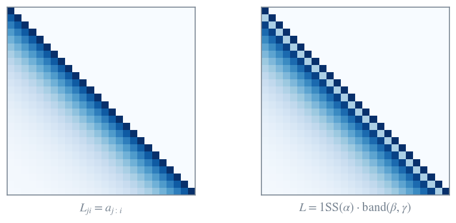

# 第 29 章 指数-梯形离散化

这一章几乎全是推导，要做三件事：

1. 给 LTV（线性时变）系统一个严格的离散化框架。前面说过，ZOH 是为 LTI 系统推导的，"把参数换成时变的"这一步没有数学依据，Mamba-3 补的就是这个缺口。
2. 给 Mamba-1/2 的实现"正名"。它们实际用的 $\bar A = e^{\Delta A}$、$\bar B = \Delta B$ 被命名为指数-欧拉，并在这个框架里被严格导出。
3. 提出一个更高阶的变体：指数-梯形。它是二阶精度的，并且等价于在状态输入上做一个宽度为 2 的卷积。

第 3 点是 Mamba-3 在"架构"层面引发连锁反应的原因：离散化本身就自带一个卷积，那 Mamba 架构里那个独立的短卷积（kernel=4）就不再一定必需（第 32 章会用实验验证）。

---

## 29.1 出发点：一个关于指数的观察

Mamba-3 的推导起点很朴素。

最简单的线性 ODE 是 $\dot x = Ax$，它的闭式解是 $x(t) = e^{tA}x(0)$。离散化之后就是 $x_{t+1} = e^{\Delta A}x_t$。

这个例子里主导整个动力学的是指数。所以用低阶方法（欧拉、梯形）直接近似整个方程、不把指数部分单独拆出来，误差会很大，除非 $\Delta$ 被压得很小。

Mamba-3 的思路就是把指数部分精确地分离出来，只对剩下的部分做数值近似。

### 指数调整系统

定义一个"调整后的状态"：

$$
\tilde h(t) := e^{-A t}h(t)
$$

（这里先用常数 $A$ 说明，后面推广到时变）。对它求导：

$$
\frac{d}{dt}\tilde h = -A e^{-At}h + e^{-At}\dot h = -Ae^{-At}h + e^{-At}\left(Ah + Bu\right) = e^{-At}B u .
$$

$A$ 项消掉了。调整后的系统只由输入驱动：

$$
\frac{d}{dt}\left(e^{-At}h(t)\right) = e^{-At}B(t)u(t).
$$

积分回去（从 $t_{k-1}$ 到 $t_k$）：

$$
h(t_k) = e^{\Delta A}h(t_{k-1}) + \int_{t_{k-1}}^{t_k}e^{(t_k-s)A}B(s)u(s)\,ds .
\tag{29.1}
$$

这个式子没做任何近似。现在问题变成：

> 如何近似那个积分？

而所有离散化方法的区别只在于"如何近似这个积分"。框架本身很干净。

### 推广到时变（LTV）

Mamba-3 论文把它推广到 $A(t)$ 随时间变化的情形。做法是对 $A(s)$ 在区间 $[t_{k-1},t_k]$ 上取右端点：

$$
A(s) \approx A(t_k) =: A_k,\qquad \forall s\in[t_{k-1},t_k].
$$

（这个近似的合法性来自"$\Delta$ 足够小，$A$ 变化缓慢"。）

于是 (29.1) 变成（论文式 (16) 的雏形）：

$$
h_k \approx e^{\Delta_k A_k}h_{k-1} + \int_{t_{k-1}}^{t_k}e^{(t_k-\tau)A_k}B(\tau)x(\tau)\,d\tau .
\tag{29.2}
$$

这个式子就是 Mamba-3"指数调整离散化框架"的全部内容。它的价值在三处：

- 状态转移部分是精确的（$e^{\Delta_kA_k}$，这正是 Mamba-1/2 已经在用的）；
- 剩下的只是一个普通积分，可以用任何数值积分公式去近似（欧拉、梯形、Simpson……）；
- 对 LTV 系统也成立（因为 $A_k$ 是区间内的常数近似）。

"时变离散化"于是从一个启发式变成了标准的数值分析问题。

---

## 29.2 从框架导出各种方法

现在把不同的积分近似代入 (29.2)，就得到不同的离散化。

### 前向欧拉（forward Euler）

区间内 $B(\tau)x(\tau)$ 取左端点、$e^{(\cdot)A_k}$ 取 1：

$$
h_k = (I + \Delta_kA_k)h_{k-1} + \Delta_kB_{k-1}x_{k-1}.
$$

### 后向欧拉（backward Euler）

取右端点：

$$
h_k = (I - \Delta_kA_k)^{-1}h_{k-1} + (I-\Delta_kA_k)^{-1}\Delta_kB_kx_k .
$$

### 梯形（trapezoidal）

对积分用梯形法则（两端点平均）：

$$
h_k = \left(I - \frac{\Delta_k}{2}A_k\right)^{-1}\left(I+\frac{\Delta_k}{2}A_k\right)h_{k-1} + \left(I-\frac{\Delta_k}{2}A_k\right)^{-1}\Delta_kB_kx_k .
$$

这就是 S4 用的双线性变换（第 2 章式 2.4）。Mamba-3 论文的 Table 1 把它的"出现"一栏标为 S4。

### 零阶保持（ZOH）

假设区间内 $A_k, B(\tau), x(\tau)$ 都是常数（取右端点）：

$$
h_k = e^{\Delta_kA_k}h_{k-1} + A_k^{-1}\left(e^{\Delta_kA_k}-I\right)B_kx_k .
$$

这就是 S4D / S5 用的 ZOH（第 2 章式 2.6）。

Mamba-3 论文特别指出：这个推导形式化地证明了"经典 ZOH 公式可以用于 LTV 系统——只要朴素地把 $A,B,\Delta$ 换成它们的时变版本"。这是第一个严格的结果。

### 指数-欧拉（exponential-Euler）：Mamba-1/2 的实现

现在做 Mamba-1/2 实际做的事：把 $e^{(\cdot)A_k}$ 保留（精确），但对积分用欧拉法则加右端点常数：

$$
h_k \approx e^{\Delta_kA_k}h_{k-1} + (\tau_k - \tau_{k-1})e^{(\tau_k-\tau_k)A_k}B_kx_k
= e^{\Delta_kA_k}h_{k-1} + \Delta_kB_kx_k .
\tag{29.3}
$$

这就是 Mamba-1/2 开源实现里的那一行。Mamba-3 把它命名为指数-欧拉：从指数积分出发，再用欧拉近似。

这是本章第一个成果：Mamba-1 论文声称用 ZOH，实现却用了别的东西，两者不一致，后者也没有依据。Mamba-3 说明后者其实是一个可以严格导出的离散化方法，只是精度只有一阶。

### 指数-梯形（exponential-trapezoidal）：Mamba-3 的新方法

既然欧拉是一阶的（局部截断误差 $O(\Delta^2)$），那自然要问：能不能用梯形法则得到二阶？

但直接用"平均两端点"的经典梯形法则有一个问题：它会引入一个固定的 $\frac12$ 权重，而这个权重不一定最优。Mamba-3 的做法是推广成数据相关的凸组合：

$$
\int_{t_{k-1}}^{t_k}e^{(t_k-\tau)A_k}B(\tau)x(\tau)d\tau
\approx (1-\lambda_k)\Delta_k\,e^{\Delta_kA_k}B_{k-1}x_{k-1} + \lambda_k\Delta_k\,B_kx_k .
\tag{29.4}
$$

其中 $\lambda_k\in[0,1]$ 是一个数据相关的标量。于是：

Proposition 1（Mamba-3，指数-梯形离散化）：

$$
\boxed{\
h_k = \underbrace{e^{\Delta_kA_k}}_{\alpha_k}h_{k-1}
+ \underbrace{(1-\lambda_k)\Delta_k e^{\Delta_kA_k}}_{\beta_k}B_{k-1}x_{k-1}
+ \underbrace{\lambda_k\Delta_k}_{\gamma_k}B_kx_k
\ }
\tag{29.5}
$$

记 $\alpha_k := e^{\Delta_kA_k}$、$\beta_k := (1-\lambda_k)\Delta_ke^{\Delta_kA_k}$、$\gamma_k := \lambda_k\Delta_k$。

### 两个 Remark

Remark 2（表达力）：指数-梯形是以下两者的推广：

- 经典梯形法则：取 $\lambda_k = \frac12$ 时恢复；
- Mamba-2 的欧拉法则：取 $\lambda_k = 1$ 时恢复（此时 $\beta_k=0$，只剩两项）。

所以它是从欧拉（$\lambda=1$）到经典梯形（$\lambda=1/2$）之间连续可调的一族方法。而且 $\lambda_k$ 是学出来的，依赖输入。

Remark 3（误差阶）：这是对状态输入积分的二阶离散化，误差 $O(\Delta_k^3)$（在标准稳定性假设下，且要求 $\lambda_k = \frac12 + O(\Delta_k)$）。

但论文紧接着说了一句很有意思的话：

> 然而，我们的消融表明不强制这个约束（即不要求 $\lambda_k$ 接近 $1/2$）对经验性能更好。

这是"理论最优不等于实践最优"的一个例子。二阶精度要求 $\lambda\to1/2$，但让 $\lambda$ 完全由数据决定反而更好，模型会自己找到合适的权重。

### 一个必要的对照表

Mamba-3 论文 Table 1 把所有离散化列在一起（本书补充"出现在哪"一列）：

| 方法 | $\alpha_t$ | $\beta_t$ | $\gamma_t$ | 出现 |
|---|---|---|---|---|
| 前向欧拉 | $I+\Delta A$ | — | $\Delta$ | — |
| 后向欧拉 | $(I-\Delta A)^{-1}$ | — | $(I-\Delta A)^{-1}\Delta$ | — |
| 梯形 | $(I-\frac{\Delta}{2}A)^{-1}(I+\frac{\Delta}{2}A)$ | — | $(I-\frac{\Delta}{2}A)^{-1}\Delta$ | **S4** |
| ZOH | $e^{\Delta A}$ | — | $A^{-1}(e^{\Delta A}-I)$ | **S4D、S5** |
| 时变 ZOH | $e^{\Delta_tA_t}$ | — | $A_t^{-1}(e^{\Delta_tA_t}-I)$ | — |
| **指数-欧拉** | $e^{\Delta_tA_t}$ | — | $\Delta_t$ | **Mamba-1、Mamba-2** |
| **指数-梯形** | $e^{\Delta_tA_t}$ | $(1-\lambda_t)\Delta_te^{\Delta_tA_t}$ | $\lambda_t\Delta_t$ | **Mamba-3** |

表里 $\beta_t$ 一栏只有指数-梯形是非零的，三项递推与两项递推的全部差别就在这里。

---

## 29.3 关键性质：指数-梯形 = 状态输入上的宽度 2 卷积

先把两种递推并排写出来。

### 观察

对比两种递推：

普通 SSM，两项：

$$
v_t := B_tx_t \quad(\text{先算出"状态输入"}),\qquad
h_t = \alpha_t h_{t-1} + \gamma_t v_t .
$$

指数-梯形，三项：

$$
h_t = \alpha_t h_{t-1} + \beta_t v_{t-1} + \gamma_t v_t .
$$

区别在于：指数-梯形在把 $v$ 送进递推之前，先对 $v$ 做了一次宽度为 2 的加权组合，权重是 $\beta_t, \gamma_t$。

也就是说：

$$
h_t = \alpha_t h_{t-1} + \gamma_t v_t + \beta_t v_{t-1}
= \alpha_t h_{t-1} + \big(\underbrace{\beta_t v_{t-1} + \gamma_t v_t}_{\text{宽度 2 的卷积}}\big) .
$$

Remark 4（Mamba-3）：这个"卷积"与序列模型（如 Mamba、GDN）里用的短卷积有一个本质区别：

- 标准短卷积是作用在 $x_t$（常常还有 $B_t,C_t$）上的独立操作，位于核心递推之外；
- 指数-梯形的卷积是作用在状态输入 $B_tx_t$ 上的，位于核心递推之内。

区别听起来细微，后果不小：前者是架构上额外加的一个模块，后者是离散化方法本身的一部分。

### 为什么这很重要

它解释了一个长期的困惑。Mamba-1/2、GDN 等现代线性模型都发现"短因果卷积是必需的"（Mamba 论文 §3.4、Mamba-2 都保留 kernel=4 的 depthwise conv1d）。为什么要加？此前没有人给出原则性的解释。

Mamba-3 的答案：

> 因为一阶离散化（指数-欧拉）丢掉了 $t-1$ 时刻的状态输入。补上它（指数-梯形）之后，模型就自带了"局部混合"能力，于是独立的短卷积变得多余。

第 32 章的实验验证了这一点：Mamba-3 去掉短卷积后性能反而更好（441M 消融：完整 15.72 vs 加 conv 15.85）。理论预测和实验在这里对上了。

---

*图 29-1　Mamba-2 与 Mamba-3 的掩码结构：后者在紧贴主对角处多出一条带宽为 1 的带*

## 29.4 并行形式：三项递推也是 SSD

三项递推还能用矩阵乘法并行算吗？能。这一节给出形式。

### 展开

从 $h_0 = \gamma_0B_0x_0$ 出发（现在初值也带 $\gamma_0$），展开：

$$
h_T = \alpha_{T\cdots2}(\gamma_0\alpha_1+\beta_1)B_0x_0 + \cdots + \gamma_TB_Tx_T,
$$

其中 $\alpha_{t\cdots s} = \alpha_t\times\cdots\times\alpha_s$（连乘）。

输出

$$
y_T = C_T^\top h_T = \alpha_{T\cdots2}(\gamma_0\alpha_1+\beta_1)\,C_T^\top B_0x_0 + \cdots + \gamma_T\,C_T^\top B_Tx_T .
$$

把系数排成矩阵，就得到 Mamba-3 的掩码 $L$：

$$
\boxed{\
L = \begin{pmatrix}
\gamma_0 & & & \\
\gamma_0\alpha_1+\beta_1 & \gamma_1 & & \\
\alpha_2(\gamma_0\alpha_1+\beta_1) & \gamma_1\alpha_2+\beta_2 & \gamma_2 & \\
\vdots & & & \ddots\\
\alpha_{T\cdots2}(\gamma_0\alpha_1+\beta_1) & \cdots & & \gamma_T
\end{pmatrix}
\ }
\tag{29.6}
$$

这个掩码不是"固定平均两端点"的经典梯形，而是数据相关的凸组合。论文明确指出了这一点。

### 分解成"1-SS × 2-band"

(29.6) 可以分解成两个矩阵的乘积（论文式 (7)）：

$$
L = \underbrace{\begin{pmatrix}
1 & & & \\
\alpha_1 & 1 & & \\
\alpha_2\alpha_1 & \alpha_2 & 1 & \\
\vdots & & & \ddots\\
\alpha_{T\cdots1} & \cdots & & 1
\end{pmatrix}}_{\text{1-SS 矩阵（衰减）}}
\cdot
\underbrace{\begin{pmatrix}
\gamma_0 & & & \\
\beta_1 & \gamma_1 & & \\
0 & \beta_2 & \gamma_2 & \\
& & \ddots & \ddots\\
& & 0 & \beta_T & \gamma_T
\end{pmatrix}}_{\text{2-band 矩阵（卷积）}}
\tag{29.7}
$$

分解出来是两个熟悉的东西：

- 左边是纯衰减（1-SS 矩阵，由 $\alpha$ 生成），也就是 Mamba-2 的掩码；
- 右边是一个"双对角带"矩阵（由 $\beta, \gamma$ 生成），也就是那个"宽度 2 的卷积"。

所以：

> Mamba-3 的掩码 = Mamba-2 的掩码 × 一个宽度 2 的卷积矩阵。

用 Mamba-3 论文的话：

> Mamba-3 的掩码可以看作 Mamba-2 的推广：Mamba-2 用的是只有 $\gamma_t$ 的对角矩阵，而不是 2-band 矩阵。

### Remark 5 的另一层含义

论文还指出：Mamba-3 的掩码是 2-半可分矩阵（2-semiseparable）的一个特例。

道理很简单。一个 $N$-半可分矩阵的秩是 $N$；而这里左边是 1-半可分（秩 1）、右边是 2-band（带宽 2）。两者相乘之后，得到的矩阵在"半可分"的意义上是 2 阶的。

Mamba-3 因此仍然完地落在 SSD 框架内，可以用第 25 章的块分解算法并行计算，只是块内的"二次模式"需要处理这个更复杂的掩码。

这是 Mamba-3 设计上的一个取舍：它选了表达力更强的离散化，同时刻意让新方法留在 SSD 框架内。离散化一旦复杂到破坏半可分结构，Mamba-2 那些工程收益（矩阵乘法、张量并行、序列并行）就全没了。

---

## 29.5 一个必要的说明：三项递推的代价

代价也得说清楚：

代价一，每个状态要多存一份 $v_{t-1}$。在推理时，除了状态 $h$，还要缓存上一步的 $B_{t-1}x_{t-1}$。这增加了常量内存（$O(NP)$ 或 $O(NPR)$），但不随序列长度增长，所以影响可控。

代价二，并行形式的掩码更复杂。块内的"二次模式"从 $L_{ji}=a_{j:i}$ 变成 $\alpha_{j:i}(\gamma_i\alpha_{i+1}+\beta_{i+1})$ 这类形式。实现上需要额外算一个 2-band 的项。

代价三，$\lambda_t$ 是一个新的可学习参数。它需要自己的投影（论文说这是"lightweight"的）。

代价四，理论上的二阶精度要求 $\lambda\to1/2$，但实践中最优的 $\lambda$ 不满足这个条件。所以"二阶精度"这个理论保证在实际模型里不一定成立，论文在 Remark 3 里也承认了这一点。

但收益也很明确：

- 更精确的离散化（尤其对快速变化的输入）；
- 可以去掉短卷积（省参数、省一次 kernel）；
- 仍然在 SSD 框架内（保住全部工程收益）。

---

## 29.6 本章小结

- 指数调整框架：把 $h$ 换成 $e^{-At}h$，$A$ 项消失，剩下纯输入驱动的积分。这一步是精确的，对 LTV 系统也成立（对 $A(s)$ 用右端点近似）。
- 于是所有离散化方法都变成"如何近似一个积分"：
  - 前向/后向欧拉、梯形（=S4 的双线性）、ZOH（=S4D/S5）；
  - 指数-欧拉（=Mamba-1/2 的实现）：保留 $e^{\Delta A}$，对积分用欧拉，得到 $\bar B=\Delta B$。这是第一次为 Mamba 的实现提供理论依据，并证明"ZOH 公式可以朴素地用于 LTV"。
  - 指数-梯形（Mamba-3）：把积分用数据相关的凸组合近似，得到三项递推：
    $h_t = \alpha_th_{t-1}+\beta_tB_{t-1}x_{t-1}+\gamma_tB_tx_t$，$\alpha_t=e^{\Delta_tA_t}$、$\beta_t=(1-\lambda_t)\Delta_te^{\Delta_tA_t}$、$\gamma_t=\lambda_t\Delta_t$。
- 指数-梯形是经典梯形（$\lambda=1/2$）与 Mamba-2 欧拉（$\lambda=1$）的推广；理论二阶精度要求 $\lambda\to1/2$，但实践中不强制这个约束反而更好。
- 关键性质：指数-梯形等价于在状态输入 $B_tx_t$ 上做一个宽度 2 的卷积，而这个卷积位于递推内部，不同于 Mamba 架构里那个位于递推外部的短卷积。它解释了"为什么现代线性模型都需要短卷积"，并预测它可以被取代，第 32 章实验已证实。
- 并行形式：掩码 $L$ 可分解为"1-SS 衰减矩阵 × 2-band 卷积矩阵"，因此 Mamba-3 的掩码是 Mamba-2 掩码的推广（对角 → 2-band），且仍是 2-半可分矩阵，可以复用块分解算法。
- 代价：多缓存一份 $v_{t-1}$；块内二次模式更复杂；$\lambda_t$ 多一组参数；"二阶精度"在实践中不成立。

## 下一章

第 30 章处理第 28 章的第一个问题：状态追踪。答案是复值状态，难点在于怎么在不增加成本的前提下把它实现出来。Mamba-3 用数据依赖的 RoPE 做到了这一点，这个联系还顺带解释了 RoPE 在 Transformer 里的作用。
