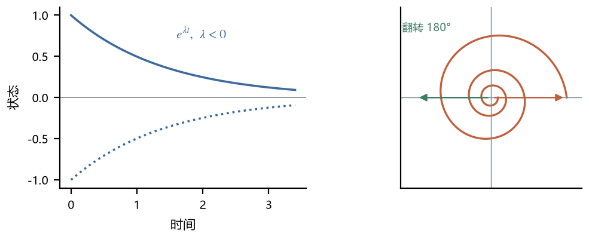

# 第 30 章 复值状态与数据依赖 RoPE

第 28 章讲了：Mamba-2 的标量实衰减 $a_t\in[0,1]$ 让它在数学上不可能解决 parity（Grazzi 等 2025, Theorem 1）。根因是实特征值只能缩放、不能旋转。

解法很简单：

> 把状态空间改成复值，但用"数据依赖的 RoPE"来实现，使计算成本几乎与实数相同。

本章要讲清五件事：

1. 复值 SSM 的定义，以及它为什么能表达"旋转"；
2. Proposition 2：复值 SSM 精确等价于一个实值 SSM，其转移矩阵是"标量衰减 $\times$ 块对角 2×2 旋转矩阵"；
3. Proposition 3：这个实值 SSM 等价于"在 $B,C$ 上施加数据依赖的旋转"，也就是数据依赖 RoPE；
4. 与普通 RoPE 的对照：为什么普通 RoPE 解决不了 parity，而数据依赖 RoPE 可以；
5. Proposition 4：指数-梯形 + 复值 + RoPE 的完整递推。

---

## 30.1 复值 SSM 与"旋转"

### 定义

Mamba-3 考虑的复值 SSM（论文式 (8)）：

$$
\begin{aligned}
\dot h(t) &= \mathrm{Diag}\big(A(t) + i\Theta(t)\big)\,h(t) + \big(B(t) + i\hat B(t)\big)x(t),\\
y(t) &= \mathrm{Re}\left(\big(C(t)+i\hat C(t)\big)^\top h(t)\right),
\end{aligned}
\tag{30.1}
$$

其中

$$
h(t)\in\mathbb{C}^{N/2},\qquad \Theta(t),B(t),\hat B(t),C(t),\hat C(t)\in\mathbb{R}^{N/2},\qquad x(t),A(t)\in\mathbb{R}.
$$

几个要点：

- 状态维度写成 $N/2$（复数），这样它等价于 $N$ 个实数，与 Mamba-2 的实数状态维度对齐，便于公平比较。
- $A(t)$ 是实部（负的，控制衰减），$\Theta(t)$ 是虚部（控制旋转频率）。
- $B, C$ 也有实部与虚部（$\hat B, \hat C$）。
- 输出取实部，因为最终要的是实数输出。

### 为什么"虚部"就是旋转

一个复数的乘法 $e^{i\theta}\cdot z$ 在复平面上就是"把 $z$ 旋转 $\theta$ 角度"。写成 $2\times2$ 实矩阵：

$$
e^{i\theta} \;\longleftrightarrow\; R(\theta) = \begin{pmatrix}\cos\theta & -\sin\theta\\ \sin\theta & \cos\theta\end{pmatrix}.
$$

所以：

- 实特征值 $\lambda<0$：$e^{\lambda t}$ 让状态沿一条直线衰减；
- 复特征值 $\lambda\pm i\theta$：$e^{(\lambda\pm i\theta)t}$ 让状态螺旋衰减，一边转一边缩。

这就是"旋转型动力学"。parity 需要的正是"在两个状态之间翻转"（旋转 $\pi$），模 3 计数需要"在三个状态之间循环"（旋转 $2\pi/3$）。

### 一个具体的构造（Mamba-3 论文的例子）

parity 可以用

$$
h_t = R(\pi x_t)\,h_{t-1}
$$

实现：当 $x_t=1$ 时旋转 $\pi$（翻转），$x_t=0$ 时不转。初值 $h_0 = (1,0)^\top$，则 $h_t$ 在 $(1,0)$ 与 $(-1,0)$ 之间交替，正好编码 parity。

这种动力学用实特征值表达不出来，这正是 Grazzi 等 Theorem 1 的直观内容。

---

*图 30-1　实特征值只能沿直线缩放；复特征值可以在平面内旋转，这正是 parity 需要的动力学*

## 30.2 Proposition 2：复值 → 实值块对角旋转

Proposition 2（Mamba-3，复值到实值等价）：考虑 (30.1) 的复值 SSM，在指数-欧拉离散化下，它等价于一个实值 SSM

$$
h_t = e^{\Delta_tA_t}R_t\,h_{t-1} + \Delta_tB_tx_t,\qquad y_t = C_t^\top h_t,
\tag{30.2}
$$

其中

- 状态 $h_t\in\mathbb{R}^N$（实数，维度翻倍）；
- 投影

$$
B_t := \begin{pmatrix}\hat B_t\\ B_t\end{pmatrix}\in\mathbb{R}^N,\qquad
C_t := \begin{pmatrix}\hat C_t\\ -C_t\end{pmatrix}\in\mathbb{R}^N;
$$

- 转移矩阵

$$
R_t := \mathrm{Block}\Big(\{R(\Delta_t\theta_t^{[i]})\}_{i=1}^{N/2}\Big)\in\mathbb{R}^{N\times N},
\qquad
R(\theta) = \begin{pmatrix}\cos\theta & -\sin\theta\\ \sin\theta & \cos\theta\end{pmatrix}.
$$

### 逐项解读

(1) 状态维度翻倍。$N/2$ 个复数 ↔ $N$ 个实数。每个复数对应一个 $2\times2$ 的块。

(2) 转移矩阵 = 标量衰减 × 块对角旋转。$e^{\Delta_tA_t}$ 是标量（所有状态共享同一个衰减），$R_t$ 是块对角的旋转矩阵（每个复数维度一对，旋转角 $\Delta_t\theta_t^{[i]}$）。

这个结构对硬件很友好：

- 标量 × 块对角 2×2 的矩阵-向量乘法，只需要 $O(N)$ 次运算；
- 不需要任何稠密矩阵乘法；
- 而且它是正交矩阵乘标量，范数恰好是 $|e^{\Delta A}|\le 1$，数值稳定（这与第 28 章"特征值在 $[-1,1]$ 内保证稳定"的论述一致）。

(3) $B, C$ 的实/虚部被"交叉排列"。$C_t = (\hat C_t, -C_t)$ 里有一个负号，这是因为取实部时虚部的贡献带负号。这个细节在实现时很容易写错。

### 证明思路（很短，值得看）

把复数拆成实部与虚部：$h = u + iv$。复值递推

$$
h_t = e^{\Delta(A+i\Theta)}h_{t-1} + \Delta(B+i\hat B)x_t
$$

中的 $e^{\Delta(A+i\Theta)} = e^{\Delta A}e^{i\Delta\Theta}$。而 $e^{i\Delta\Theta}$ 作用在 $u+iv$ 上就是旋转：

$$
e^{i\theta}(u+iv) = (u\cos\theta - v\sin\theta) + i(u\sin\theta + v\cos\theta).
$$

写成矩阵就是 $R(\theta)\begin{pmatrix}u\\v\end{pmatrix}$。对 $N/2$ 个复数维度分别做，就得到块对角的 $R_t$。

最后处理输出：$y = \mathrm{Re}(C^{*}h)$，把 $C = C_r + iC_i$、$h = u+iv$ 展开：

$$
\mathrm{Re}\big((C_r - iC_i)^\top(u+iv)\big) = C_r^\top u + C_i^\top v .
$$

这正是"把 $\begin{pmatrix}C_i\\C_r\end{pmatrix}$ 与 $\begin{pmatrix}u\\v\end{pmatrix}$ 做内积"（符号取决于排列约定）。∎

结论：复值 SSM 的计算成本与实值 SSM 相同，都是 $O(N)$ 的逐元素运算加一次旋转。这就是 Mamba-3 说"设计成对训练与推理都是轻量的"（designed to be lightweight）的意思。

---

## 30.3 Proposition 3：等价于数据依赖 RoPE

现在到了本章关键的一步。

### 陈述

Proposition 3（Mamba-3，复值 SSM ↔ 数据依赖 RoPE）：在 Proposition 2 的记号下，把 (30.2) 的实值 SSM 展开 $T$ 步，其输出等价于一个"普通标量转移 SSM"（(29.3) 的形式），但在 $B, C$ 上施加了数据依赖的旋转：

$$
h_t = e^{\Delta_tA_t}h_{t-1} + \left(\prod_{i=0}^{t}R_i\right)^{\!\top}\Delta_tB_tx_t,
\qquad
y_t = \left[\left(\prod_{i=0}^{t}R_i\right)^{\!\top}C_t\right]^{\!\top}h_t .
\tag{30.3}
$$

其中 $\prod_{i=0}^{t}R_i = R_0R_1\cdots R_t$，右乘的连乘。

### 这是什么意思

$R_i$ 是旋转矩阵，所以 $\prod R_i$ 也是一个旋转矩阵（旋转角的和）。

(30.3) 说的是：把累积的旋转作用在 $B$ 和 $C$ 上，然后做普通的 SSM 递推。

而在 SSD 框架里（第 24 章）：

$$
B \leftrightarrow K\ (\text{keys}),\qquad C\leftrightarrow Q\ (\text{queries}).
$$

所以这正是在 $Q$ 和 $K$ 上施加旋转，也就是 RoPE。

### 与普通 RoPE 的对照

RoPE（Su 等, 2023）在 Transformer 里做的事是：对 $Q,K$ 施加位置相关的旋转，旋转角按固定频率表 $\theta^{[i]} = 10000^{-2i/N}$ 随位置递增。

Mamba-3 的版本：

| | 普通 RoPE | Mamba-3 的 RoPE |
|---|---|---|
| 旋转角 | 固定频率表 $\times$ 位置 | $\Delta_t\theta_t^{[i]}$，**由数据决定** |
| 是否依赖输入 | 否（只依赖位置） | **是**（$\Delta_t$ 与 $\theta_t$ 都是输入的函数） |
| 作用位置 | $Q,K$ | $B,C$（在 SSD 对偶下就是 $K,Q$） |
| 累积方式 | 按位置线性累加 | 按 $\sum\Delta_i\theta_i$ 累加 |

Mamba-3 论文的说法：

> 注意在上述命题中，数据相关的旋转 $R_i$ 跨时间步被累积，并施加到 $C,B$ 上。而通过状态空间对偶框架，它们对应注意力的 query（$Q$）与 key（$K$）分量。类比地，普通 RoPE 施加的是数据无关的旋转矩阵，旋转角遵循固定的频率表。

### 为什么"数据依赖"是关键

这是本章最要紧的一点。

普通 RoPE 解决不了 parity，因为它的旋转角只依赖位置，不依赖内容。而 parity 要求"当 $x_t=1$ 时旋转 $\pi$，当 $x_t=0$ 时不转"，这个旋转必须由输入决定。

Mamba-3 的 $\theta_t$ 与 $\Delta_t$ 都是 $x_t$ 的函数，所以当模型看到 $x_t=1$ 时可以学出"$\Delta_t\theta_t = \pi$"，看到 $x_t=0$ 时学出"$\Delta_t\theta_t = 0$"。于是 parity 可以被精确实现。

这就是为什么 Mamba-3 的实验里，"Mamba-3 + 标准 RoPE" 完全无法解决 parity（1.56%），"Mamba-3 无 RoPE" 也不行（2.27%），只有数据依赖 RoPE 才做到了 100%（第 32 章的 Table 5b）。

### 为什么这个实现"轻量"

一个自然的疑问：每步都要算一个旋转矩阵并累积，不会很贵吗？

不会：

1. 旋转角只需要累加：$\sum_i\Delta_i\theta_i^{[j]}$ 是一次 cumsum（在 log 域或角度域累加，与第 25 章的 `segsum` 技巧同源）；
2. 旋转本身是 2×2 的，每个复数维度只需 4 次乘加；
3. 总开销与 Mamba-2 的逐元素衰减同阶：Mamba-2 每步是 $N$ 次标量乘，Mamba-3 是 $N/2$ 次 2×2 旋转（即 $2N$ 次乘加），常数因子约 2，但没有渐进的复杂度增加。

Mamba-3 论文称之为 "the RoPE trick"：用"变换后的实值 SSM"来计算复值 SSM，计算开销相对实值 SSM 最小。

---

## 30.4 Proposition 4：三项递推 + 复值 + RoPE

把第 29 章的指数-梯形与本章的复值结合起来：

Proposition 4（Mamba-3，指数-梯形下的旋转嵌入等价）：把复值 SSM 用指数-梯形规则离散化，得到递推

$$
\boxed{\
\begin{aligned}
h_t &= \alpha_t h_{t-1}
+ \beta_t\left(\prod_{i=0}^{t-1}R_i\right)^{\!\top}B_{t-1}x_{t-1}
+ \gamma_t\left(\prod_{i=0}^{t}R_i\right)^{\!\top}B_tx_t,\\
y_t &= \left[\left(\prod_{i=0}^{t}R_i\right)^{\!\top}C_t\right]^{\!\top}h_t .
\end{aligned}
\ }
\tag{30.4}
$$

其中 $R_t$ 是 Proposition 2 里的块对角旋转矩阵，$\alpha_t,\beta_t,\gamma_t$ 是第 29 章的三个系数。

### 读这个式子

- 第一项 $\alpha_t h_{t-1}$：状态衰减，不旋转，因为旋转已经被"提到" $B,C$ 上了；
- 第二项：上一步的输入，带累积到 $t-1$ 的旋转；
- 第三项：当前输入，带累积到 $t$ 的旋转；
- 输出：用带累积到 $t$ 的旋转的 $C$ 读出。

旋转是被"提出来"的：原始的复值递推里旋转作用在状态上，经过 Proposition 3 的变换，旋转被"搬到" $B,C$ 上，状态本身退化为纯标量衰减。轻量就来自这里：标量衰减的递推是 Mamba-2 已经在做的事，额外工作只是在 $B,C$ 上加一次旋转。

### 一个必要的提醒

严格说，(30.4) 里第二项的旋转是"累积到 $t-1$"而第三项是"累积到 $t$"，这个差别来自 $\beta_t$ 那一项对应的是上一步的状态输入。实现时要小心。

而且这个"提旋转"的操作在数学上是精确的，不是近似，因为旋转矩阵的乘积与标量可交换。但对指数-梯形（三项）的情形，"提出"的过程需要更小心，因为 $\beta_t$ 项与 $\gamma_t$ 项的旋转基准不同。Mamba-3 的附录 B.3 给了完整证明。

---

## 30.5 一个副作用：为什么 Mamba-2 用实数就够了

第 18 章引用过 Mamba 论文的说法：

> 复数对连续模态（音频、视频）有帮助，对离散模态（文本、DNA）没有。

而 Mamba-2 直接把 $A$ 退化成标量实数，语言建模性能并没有崩。这与"复值状态能带来状态追踪能力"的说法矛盾吗？

不矛盾，但需要精确区分：

- 语言建模的困惑度主要衡量"预测下一个 token 的能力"，它高度依赖局部统计规律和压缩能力，不太依赖状态追踪，所以纯实数模型可以做得很好。
- 状态追踪是一项能力（capability），它体现在特定任务上（parity、模运算、代码求值、括号匹配）。这些能力在标准困惑度上几乎看不出来。

这正是 Mamba-3 论文的核心论点之一：现有的评测（困惑度 + 常见下游任务）反映不出状态追踪能力的缺失。"实数就够了"是一个被评测方式误导的结论。

论文的实证支持（第 32 章 Table 3）：Mamba-3 SISO 在 1.5B 上比 Mamba-2 的平均准确率高 0.7 个点，困惑度从 10.47 降到 10.35，改善有限。但在形式语言任务上，Mamba-2 是 0.90%（parity），Mamba-3 是 100.00%。这里差的不是程度，是有和无。

这个对比的分量在于：只看困惑度，会认为"复值状态没什么用"；关心"模型能不能做代码求值"，它就是决定性的。

---

## 30.6 与 GDN 的对比

Mamba-3 论文还把 Mamba-3 与 GDN（Gated DeltaNet）的"状态追踪版本"做了对比（Table 5b）：

| 模型 | Parity↑ | 模运算（无括号）↑ | 模运算（有括号）↑ |
|---|---|---|---|
| Mamba-3 | 100.00 | 98.51 | 87.75 |
| Mamba-3（标准 RoPE） | 1.56 | 20.70 | 2.62 |
| Mamba-3（无 RoPE） | 2.27 | 1.49 | 0.72 |
| Mamba-2 | 0.90 | 47.81 | 0.88 |
| **GDN（特征值 $[-1,1]$）** | **100.00** | **99.25** | **93.50** |

几个观察：

1. Mamba-3 与 GDN 都能解决 parity（100%），说明"允许负/复特征值"这条路是有效的，与 Grazzi 等的理论一致。
2. GDN 在模运算上略好（93.50 vs 87.75）。原因是 GDN 用的是广义 Householder 矩阵（$I - \beta vv^\top$），它是非对角的，因此按 Theorem 2 能做"模非 2 幂"的计数。而 Mamba-3 的 $A$ 是复对角的：它有复特征值，但矩阵是（块）对角的。
3. Mamba-3 接近但没完全追平 GDN，论文自己也只说 "nearly closes the accuracy gap"。

这是一条诚实的边界：Mamba-3 的复对角结构比实对角强，比非对角（Householder）弱。选对角结构是因为对角结构是 SSD 算法与并行扫描的前提。换成一句话：Mamba-3 为了保住工程效率，在表达力上做了一次有意识的让步。

---

## 从复指数到旋转矩阵

单个复值通道的动力学写成

$$
\dot z(t) = (a + ib)\,z(t),\qquad a<0,\ b\in\mathbb{R}.
$$

这个方程有闭式解 $z(t) = e^{(a+ib)t}z(0)$。把时间取成一步 $\Delta$ 并展开指数：

$$
e^{(a+ib)\Delta} = e^{a\Delta}\big(\cos(b\Delta) + i\sin(b\Delta)\big).
$$

右边是两个因子的乘积，各自负责一件事。$e^{a\Delta}$ 是正实数，只管模长；括号那一项模长恒为 1，只改辐角。于是每步有

$$
|z_t| = e^{a\Delta}|z_{t-1}|,\qquad \arg z_t = \arg z_{t-1} + b\Delta,
$$

走 $T$ 步之后模长是 $e^{aT}$，辐角是 $bT$。衰减与旋转在复指数里是两个独立的指数，这是 Mamba-3 能把实部 $A_t$ 交给衰减、虚部 $\Theta_t$ 交给旋转的前提。

要把乘法写成实矩阵，先看复数乘法这个算子。取 $z = u + iv$，乘 $a+ib$：

$$
(a+ib)(u+iv) = (au - bv) + i(av + bu).
$$

按 $(u,v)$ 排列，就是

$$
\begin{pmatrix}u'\\ v'\end{pmatrix} = \begin{pmatrix}a & -b\\ b & a\end{pmatrix}\begin{pmatrix}u\\ v\end{pmatrix} = aI\begin{pmatrix}u\\v\end{pmatrix} + bJ\begin{pmatrix}u\\v\end{pmatrix},\qquad J = \begin{pmatrix}0&-1\\1&0\end{pmatrix}.
$$

$J$ 满足 $J^2 = -I$，它是「乘以 $i$」这个运算的矩阵形式。把 $a,b$ 换成 $a\Delta, b\Delta$ 再做矩阵指数：

$$
e^{\Delta(aI + bJ)} = e^{a\Delta I}\,e^{b\Delta J} = e^{a\Delta}\big(\cos(b\Delta)\,I + \sin(b\Delta)\,J\big).
$$

中间这一步用了 $I$ 与 $J$ 可交换，所以矩阵指数能拆成两个指数相乘。对不可交换的矩阵 $e^{X+Y}=e^Xe^Y$ 一般不成立，这里能拆是因为两项只差一个标量和一个固定的 $J$。展开后

$$
e^{a\Delta}\begin{pmatrix}\cos(b\Delta) & -\sin(b\Delta)\\ \sin(b\Delta) & \cos(b\Delta)\end{pmatrix} = e^{a\Delta}\,R(b\Delta).
$$

这就是「复指数 = 标量缩放 × 旋转」的完整推导，两个因子分别来自复指数的实部与虚部。

可以用特征值验一遍。$R(\theta)$ 的特征多项式是 $(\cos\theta-\lambda)^2 + \sin^2\theta = 0$，根为 $\lambda = \cos\theta \pm i\sin\theta = e^{\pm i\theta}$。乘上 $e^{a\Delta}$ 后特征值是 $e^{(a\pm ib)\Delta}$，与复标量 $e^{(a+ib)\Delta}$ 及其共轭对上。同一个式子还说明了一件事：$N/2$ 个复通道等价于 $N$ 个实通道，但每个复通道的两个实坐标被同一个 $2\times2$ 块绑死，不能当两个自由坐标用。

范数上，$R(\theta)$ 正交，$R^\top R = I$，无输入时有

$$
\|h_t\|_2 = e^{a\Delta}\|h_{t-1}\|_2 .
$$

范数严格按标量指数收缩。这比「特征值在单位圆内」强一档：一般的稳定矩阵特征值都在单位圆内，但瞬态仍可能把范数放大若干倍，非正规矩阵尤其如此。块对角旋转矩阵没有这个空间，它只有一个统一的缩放因子，任何输入范数都不会被放大。第 28 章讲 $\alpha_t\in(0,1)$ 保证稳定，到复值这里稳定性由「正交乘标量」直接给出，不需要额外约束或谱归一化。

把 $N/2$ 个通道堆起来就是 Proposition 2 的

$$
R_t = \mathrm{Block}\Big(\{R(\Delta_t\theta_t^{[i]})\}_{i=1}^{N/2}\Big).
$$

块与块之间没有耦合，矩阵向量乘只在每一对坐标上做 4 次乘、2 次加，共 6 次浮点运算；同一位置上的标量衰减只要 1 次乘。取 $N=64$、$P=64$，一个 head 一步的 SSM 总计 $5NP - P = 20416$ 次运算，旋转这一项是 $32\times 6 = 192$ 次，占 $0.94\%$。所谓复值状态「几乎不要钱」，说的就是这个比例。

---

## 非负实特征值与 parity 的边界

parity 的定义是 $y_t = \big(\sum_{s=1}^{t} x_s\big) \bmod 2$，$x_t\in\{0,1\}$。论文给的实现是 $h_t = R(\pi x_t)h_{t-1}$，$h_0 = (1,0)^\top$。$x_t=1$ 时旋转 $\pi$，把 $(1,0)$ 翻到 $(-1,0)$；$x_t=0$ 时不动。状态只有两个取值，读第一维就得到累计奇偶。

要讲清 Mamba-2 为什么写不出这条动力学，得把「写不出」分成强弱两个版本，两个版本的结论不一样。

弱版本针对 $a_t\in(0,1)$。一维递推 $h_t = a_t h_{t-1} + \Delta_t b_t x_t$ 里，历史项每步都要乘一个正数。输入项的符号是自由的，但历史项的符号被锁住：一旦 $h_{t-1}$ 的符号定了，$a_t h_{t-1}$ 的符号就不变。想让 $h$ 停在 $+1$ 或 $-1$ 表示奇偶，必须让 $x_t=0$ 时 $h$ 原样保持，而 $a_t<1$ 让它每步缩一点。$a_t$ 可以被推到 1，但 $\alpha_t = e^{\Delta_t A_t}$ 只在 $A_t\to0$ 或 $\Delta_t\to0$ 的极限等于 1，不是可达参数点。Grazzi 等（2025）的 Theorem 1 把这个直觉变成了定理：转移矩阵特征值限制在非负实数时，模型的表达力落在 $\mathrm{TC}^0$ 的一个受限子类，parity 不在其中。

强版本不成立。允许负实数特征值就够了，$a_t = -1$ 本身就是翻转，一维也能编码 parity。Table 5b 里 GDN 那一行标注 eigenvalue range $[-1,1]$，parity 是 100.00，这不是巧合。准确的说法只能是：限制在非负实特征值上做不到，复值状态是恢复能力的一条路径，并非唯一路径。

两条路径的分岔在周期长度上。一维线性映射 $h\mapsto \lambda h$ 的最长周期是 2，$\lambda=-1$ 给 2-循环，其他实 $\lambda$ 没有非平凡循环。要做模 3 计数，状态得在三个位置之间轮转，需要阶为 3 的置换。$2\times2$ 的 $R(2\pi/3)$ 能办到，它的特征值是 $e^{\pm 2\pi i/3}$；$3\times3$ 的非对角实置换矩阵也能办到，但它不再是对角或块对角结构。

Mamba-3 走前一条路，保持块对角、换成复特征值。这个选择保住了第 25 章那套分块算法：每个坐标对的递推只依赖自己，块内可写成矩阵乘，块间可写成扫描。代价是块对角矩阵不能把第 $i$ 个坐标的内容搬到第 $j$ 个坐标。模运算里括号嵌套要求把中间结果在「操作数」和「累加器」之间搬运，跨坐标搬运恰好是块对角做不到的事。Table 5b 中 Mamba-3 在带括号的模运算上 87.75、GDN 93.50，差距从这里来。

GDN 的非对角结构是「单位阵减秩一」$I-\beta vv^\top$，可以用 Woodbury 恒等式把求逆压到 $O(N)$，所以它既能跨坐标搬运，又能分块计算。旋转矩阵没有这种低秩结构，$R(\theta)$ 满秩，$R(\theta)-I$ 除了 $\theta=0$ 之外也满秩。想用非对角的一般旋转，就得付稠密矩阵的代价。三种结构摆在一起，取舍很清楚：

| 转移结构 | 特征值 | 能跨坐标搬运 | 有分块算法 |
|---|---|---|---|
| 标量对角（Mamba-2） | 单个非负实数 | 否 | 是 |
| 复对角块（Mamba-3） | 复共轭对 | 否 | 是 |
| 单位阵减秩一（GDN） | 混合，可取到 $-1$ | 是 | 是（Woodbury） |
| 稠密旋转 | 复共轭对 | 是 | 否 |

---

## 旋转角是路径积分

Proposition 3 的累积旋转写成 $\big(\prod_{i=0}^{t}R_i\big)^\top$。这个连乘可以化简。块对角结构下每一对坐标只管自己那个 $2\times2$ 块，而同一平面内的旋转互相可交换，于是

$$
\prod_{i=0}^{t}R(\Delta_i\theta_i^{[k]}) = R\Big(\sum_{i=0}^{t}\Delta_i\theta_i^{[k]}\Big).
$$

把相位记成 $\Phi_t^{[k]} = \sum_{i\le t}\Delta_i\theta_i^{[k]}$，「累积旋转」就退化成一个标量累加和，取 $\cos$ 与 $\sin$ 即可。这是 RoPE trick 能被工程实现的原因：不存矩阵，只存一个角度。

与标准 RoPE 的差别全在这个相位怎么定义。标准 RoPE 用 $\Phi_m^{[k]} = m\,\theta^{[k]}$，$\theta^{[k]} = 10000^{-2k/N}$，$m$ 是 token 位置。两个位置的内积只依赖相位差

$$
\Phi_m - \Phi_n = (m-n)\,\theta^{[k]},
$$

所以 $q_m^\top k_n$ 只依赖相对距离 $m-n$，这就是 RoPE 的平移不变性。频率表按几何级数排布，低频通道变化慢、高频通道变化快，多个尺度叠在一起。

Mamba-3 把 $\Delta_i\theta_i$ 换成数据相关的量，相位差随之变成

$$
\Phi_j^{[k]} - \Phi_i^{[k]} = \sum_{i<s\le j}\Delta_s\theta_s^{[k]}.
$$

右边是区间 $(i, j]$ 上内容的加权和，权重是 $\Delta_s$。「相对位置」在这里被替换成「相对相位」，而相对相位由这一段输入决定。$x_s=1$ 时把 $\Delta_s\theta_s$ 抬到 $\pi$，这一段就走过了半个圆；$x_s=0$ 时相位不动。parity 需要的正是这个。

与 SSD 的 mask 放在一起看会更清楚。第 25 章的 mask 元素是 $L_{ji} = \prod_{i<s\le j}\alpha_s$，一个标量路径积，取对数就是 $\sum\Delta_s A_s$。复值版本把标量换成「标量乘旋转」，取对数之后是复数 $\sum\Delta_s(A_s+i\theta_s)$。衰减与旋转共用同一套累加机制，实部累加给出衰减，虚部累加给出相位，一次 cumsum 能同时算出来。

相位是「不取模」的累加，这里有个精度问题。取 $T=4096$、每步平均 $0.1$ rad，累积相位到 $409$ rad，约 $65$ 圈。fp32 尾数 24 位，$409$ 落在 $2^{8.7}$ 量级，相位的绝对分辨率约 $2^{-24+8.7}=2^{-15.3}$，$\cos$ 的误差在 $10^{-5}$ 量级，够用。bf16 只有 8 位尾数，同量级下分辨率约 $2^{-8+8.7}\approx 1.6$ rad，相位信息基本没了。所以角度累加与 $\cos/\sin$ 必须留在 fp32，只在进矩阵乘之前降到 bf16。论文没有讨论这一点，这是从数值格式本身推出来的要求。

---

## 三个实现层面的坑

第一个坑是 $C$ 的相对符号。(30.2) 里 $B_t = (\hat B_t;\, B_t)$、$C_t = (\hat C_t;\, -C_t)$，两个通道排列顺序相同、符号相反。把输出展开能看清这个负号的来处。设 $h = u+iv$、$C = C_r + iC_i$：

$$
(C_r + iC_i)^\top(u + iv) = \big(C_r^\top u - C_i^\top v\big) + i\big(C_r^\top v + C_i^\top u\big).
$$

取实部得 $C_r^\top u - C_i^\top v$，写成内积是 $(C_i;\,-C_r)^\top(u;\,v)$，差一个整体负号。整体负号无所谓，$C$ 是学出来的投影，翻号等价于换一组参数。错的是相对符号：若写成 $+\hat C$，等价于对 $C$ 取共轭，读出的旋转方向与写入的相反。模型照样能训，损失照样降，但所有旋转都变成「写进去转 $+\theta$、读出来按 $-\theta$ 解」。这类 bug 不报错，只让某一类任务停在随机水平，而困惑度上看不出异常。

第二个坑是三处符号约定必须同时一致。一套约定是：状态按 $(u,v)$（实部在前）、$R$ 用逆时针、$C$ 取 $+\hat C$。另一套是论文的 $(\hat h, h)$（虚部在前）、$C$ 取 $-\hat C$。两套都能跑，混用就错。检查办法是拿 $N=2$、很短的序列对一遍：令 $x_1=1$、其余为 0，手算 $y_2$ 应等于 $C_2^\top R(\Delta_1\theta_1)B_1$，符号与数值一眼能看出对错。

第三个坑是 $N$ 必须为偶数。$N/2$ 个复通道要求 $N$ 能被 2 整除。Mamba 系列默认 $d_{\text{state}}\in\{64,128\}$，没有问题；做小规模消融时若取 $N=3$ 或 $N=5$，要么补到偶数，要么退回实值版本。

还有一个容易忽略的点：MIMO 下 $B_t\in\mathbb{R}^{N\times R}$，$R_t$ 仍然只有一个，作用在 $N$ 这个维度上，$R$ 列共享同一个旋转。相位 $\Delta_t\theta_t$ 是按 $N/2$ 个通道给的，与 rank 无关。实现时若把旋转矩阵按 rank 展开成 $R$ 份，结果不会错，但白算 $R$ 倍。

---

## 复值状态的代价清单

把三处开销摆在一起，取 $N=64$、一个 head：

| 项目 | 每 token 运算量 | 说明 |
|---|---|---|
| 标量衰减 $\alpha_t h_{t-1}$ | $N$ 次乘 | Mamba-2 已有 |
| 块对角旋转 | $3N$ 次运算 | $N/2$ 对，每对 6 次 |
| 相位累加 | $N/2$ 次加 | cumsum，可与上一步融合 |
| 取 $\cos$ 与 $\sin$ | $2N$ 次查表或求值 | 每 token 每通道一次 |

新增项合计 $3N + N/2 + 2N = 5.5N$，即 $352$ 次运算，对 $5NP-P = 20416$ 的占比是 $1.7\%$。全序列上乘 $T$，占比不变。

参数量方面，$\Theta$ 需要一路 $D\to N/2$ 的投影；$B,C$ 的实虚部把有效宽度从 $N$ 变成 $2N$（等价于 $N/2$ 个复数分量）；$A$ 从每通道一个实数变成每通道两个。论文没有给出这几项的参数量明细，从结构上只能判断它们与 $N$ 成正比，相对 $D\cdot P$ 主导的 head 参数是小量。

与 S4 相比，代价的性质完全不同。S4 的 $A$ 也是复对角（NPLR/DPLR 之后），但那是线性时不变系统，卷积核可以通过 FFT 或 Cauchy 核在 $O(L\log L)$ 里算出来，复特征值不进入逐步递推。Mamba-3 的 $\Delta_t$ 与 $\theta_t$ 都是时变的，卷积形式不存在，只能在每步用 RoPE trick 现转。两个要求各自都不贵，凑在一起就只能走数据依赖旋转这条路。

---

## 一个可以手算的对照

把 $N/2$ 取到最小，即 $N=2$，只有一对坐标，就能把 Proposition 2 的两边各算一遍。取 $A_t=0$、$\Delta_t=1$、$\theta_t=1$ rad（约 $57.3^\circ$）、$B_t=1$、$\hat B_t=0$、$x_1=x_2=x_3=1$，初值 $h_0=0$。

复值一侧的系数是 $e^{\Delta(A+i\theta)} = e^{i} = \cos 1 + i\sin 1 = 0.5403 + 0.8415i$。逐步算：

$$
\begin{aligned}
h_1 &= e^{i}\cdot 0 + 1 = 1,\\
h_2 &= e^{i}\cdot 1 + 1 = (1+\cos 1) + i\sin 1 = 1.5403 + 0.8415i,\\
h_3 &= e^{i}(1.5403+0.8415i) + 1 = 1.1242 + 1.7509i .
\end{aligned}
$$

实值一侧，状态按 $(\hat h, h)$ 排列，即虚部在前，与 (30.2) 里 $B_t=(\hat B_t;\,B_t)$ 的排列一致。输入增量是 $(\hat B_t;\,B_t)x_t = (0;\,1)$。按这个排列，旋转的正方向对应

$$
T = R(-1) = \begin{pmatrix}0.5403 & 0.8415\\ -0.8415 & 0.5403\end{pmatrix},
$$

（与 (30.2) 里的 $R(\theta)$ 差一个 $\theta$ 的符号，$\theta$ 是学出来的量，两者等价）。逐步算：

$$
\begin{aligned}
s_1 &= (0,\,1),\\
s_2 &= T(0,1) + (0,1) = (0.8415,\,0.5403) + (0,1) = (0.8415,\,1.5403),\\
s_3 &= T(0.8415,1.5403) + (0,1) = (1.7509,\,0.1242) + (0,1) = (1.7509,\,1.1242).
\end{aligned}
$$

两边对上了：$s_2$ 的两个坐标正好是 $h_2$ 的虚部与实部，$s_3$ 同理。这个对照每步只要四次乘、两次加，三步就能手算完，值得在写代码之前先对一遍。

三步步长相同，累积相位是 $3$ rad，接近 $172^\circ$。若把这三步画在平面上，轨迹是一段绕原点的弧，每步转约 $57^\circ$。把 $\theta_t$ 换成由 $x_t$ 决定的量，比如 $x_t=1$ 时令 $\Delta_t\theta_t=\pi$、$x_t=0$ 时令它等于 0，同一个递推就变成 parity 的状态机：每一步要么转半圈（翻号），要么不动。状态只落在实轴上的两个点，与构造 $h_t=R(\pi x_t)h_{t-1}$ 完全一致。

反过来看固定频率会出现什么。若 $\Delta_t\theta_t$ 恒等于 $\pi$，不论 $x_t$ 取什么都转半圈，$h_t$ 就变成 $(-1)^t h_0$，与输入无关，读出来的是步数的奇偶而不是输入的奇偶。若频率表只随位置变（标准 RoPE），两步之间相位差固定为 $\theta^{[k]}$，同样与内容无关。Table 5b 里标准 RoPE 的 1.56% 就是这件事在实验上的样子：结构上已经有旋转了，旋转轴与输入无关，信息接不进去。

相位累加还有一个可直接验证的后果：输入全零时，$\Delta_t\theta_t=0$，相位停在原地，状态只受 $\alpha_t$ 衰减，这就是「$x_t=0$ 不转」的实现方式；而 $x_t=1$ 时相位跳 $\pi$，跳多少由 $\theta_t$ 与 $\Delta_t$ 的乘积决定。两个量都是 $x_t$ 的投影，乘起来才能扫过任意角度，单独调其中一个不够。这也是为什么 $\theta_t$ 必须与 $\Delta_t$ 一起做数据依赖。

---

## 复值状态的历史包袱

复值 SSM 在深度学习里不是新东西。S4 本身就是复对角加低秩，早期 SSM 几乎都是复值的，因为连续时间系统的特征值天然成共轭对出现。问题出在语言建模上：复值模型在视觉与音频上表现好，这两个模态有明确的频率结构；在文本上则长期打不过 Transformer。H3、RetNet、Megalodon 都保留了复值状态并直接做语言建模，结果都明显弱于 Transformer。Mamba-1 之后复值被砍掉，后续的线性注意力与测试时训练路线也没再捡回来。论文对此的表述是，复值「在语言建模上被经验地发现没有帮助，因此在 Mamba-1 及其后继中被淘汰」。

这些早期复值模型还有一个共同点：它们都是线性时不变的，用卷积或显式递推计算，与 Mamba 这类选择性 SSM 的算法完全不同，所以它们没有动机也没有渠道去用 RoPE trick 处理复数部分。RetNet 是个例外，它在常数标量衰减之上加了一个常数复相位，并用 RoPE 实现，相当于介于线性注意力与 Mamba-2 之间的形态。但那个相位是固定频率的，与内容无关。

Mamba-3 的位置因此很特殊：它是第一个把复值状态转移重新拿回现代选择性循环模型的，也是第一个把数据依赖 RoPE 建立在理论动机上的。前者靠 Proposition 2 把复值写成块对角旋转，后者靠 Proposition 3 把旋转搬到 $B,C$。两件事合起来，复值就不再是「多一倍运算量换不确定收益」的赌注，而是「多 1.7% 运算量换回 parity 能力」的确定买卖。

回头看 Mamba-1 那句「复数对连续模态有帮助，对离散模态没有」，它描述的是当时的算法条件：那时没有 RoPE trick，复值要么进 FFT 卷积（时不变前提），要么进稠密矩阵乘（$O(N^2)$）。在只能走这两条路的前提下，复值在文本上确实不划算。算法变了，结论就变了，这是同一句话在两年后失效的原因。

---

## 30.7 本章小结

- Mamba-2 的 $a_t\in[0,1]$ 无法表达"旋转"，因此数学上不可能解决 parity（Grazzi 等 2025, Theorem 1）。
- 复值 SSM：$\dot h = \mathrm{Diag}(A+i\Theta)h + (B+i\hat B)x$，$y=\mathrm{Re}((C+i\hat C)^\top h)$。虚部 $\Theta$ 控制旋转。
- Proposition 2：指数-欧拉下的复值 SSM 精确等价于实值 SSM $h_t = e^{\Delta_tA_t}R_th_{t-1}+\Delta_tB_tx_t$，其中 $R_t$ 是块对角 2×2 旋转矩阵。成本与实值相同（$O(N)$），且因为 $R$ 正交、衰减 $\le1$，数值稳定。
- Proposition 3：这个实值 SSM 等价于在 $B,C$ 上施加累积旋转；而在 SSD 对偶下 $B\leftrightarrow K$、$C\leftrightarrow Q$，这就是 RoPE。与普通 RoPE 的差别在旋转角 $\Delta_t\theta_t$ 由数据决定，而不是固定的频率表乘位置。
- 数据依赖为什么是关键：parity 要求"$x_t=1$ 时转 $\pi$、$x_t=0$ 时不转"，普通 RoPE 的固定频率做不到。实验：Mamba-3 100%，加标准 RoPE 1.56%，无 RoPE 2.27%，Mamba-2 0.90%。
- Proposition 4：指数-梯形 + 复值的完整三项递推，旋转被"提到" $B,C$ 上，状态本身是纯标量衰减，所以实现只需要在 Mamba-2 的框架上加一次旋转。
- 一个容易被评测掩盖的事实：语言困惑度反映不出状态追踪能力的缺失。Mamba-3 在困惑度上只比 Mamba-2 好 0.12，但在 parity 上是 100% 对 0.90%，差的是能力本身。
- 诚实边界：Mamba-3 的复对角结构弱于 GDN 的非对角（Householder）结构（模运算 87.75 vs 93.50）。选对角是为了保住 SSD 算法与并行扫描的前提，又一次拿表达力换工程效率。

## 下一章

第 31 章解决第 28 章的第二个问题：解码的算术强度。答案是 MIMO——把"外积式的状态更新"换成"矩阵乘法式的状态更新"，让同样的访存做 $R$ 倍的运算。这一章还会讲清楚 MIMO 如何在训练时只增加 $R$ 倍（而非 $R^2$ 倍）的成本。
