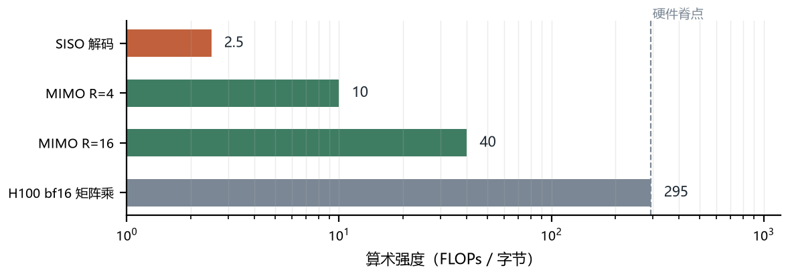

# 第 31 章 MIMO：把解码从访存瓶颈里救出来

第 28 章算了笔账：SSM 单步解码的算术强度约 2.5 ops/byte，而 H100 上 bf16 矩阵乘约 295 ops/byte。差距 100 倍以上，意味着解码时 GPU 绝大部分算力在空转。

本章讲 Mamba-3 的解法：MIMO（multi-input multi-output，多输入多输出）。

核心思路只有一句：

> 既然访存已经花了（状态必须读写），那就让每次访存做更多的有用运算。

具体做法：把"外积式"的状态更新换成"矩阵乘法式"的状态更新，在不增加状态大小的前提下把 FLOPs 提高 $R$ 倍，而墙钟延迟几乎不变。

本章按以下顺序展开：

1. SISO 与 MIMO 的差别（信号处理的视角）；
2. 为什么 MIMO 能提升算术强度（Table 2 的定量分析）；
3. 为什么矩阵乘法"几乎免费"（Tensor Core）；
4. 训练怎么做（$R^2$ 个 SISO 的黑盒调用，或 $R$ 倍的 chunked 算法）；
5. 参数量怎么控制（不要爆炸）。

---

## 31.1 SISO → MIMO：一个信号处理的视角

### SISO 的情形（Mamba-1/2）

考虑一个 head，head 维 $P$，状态维 $N$。Mamba-1/2 做的是 $P$ 个共享 $a_t,\Delta_t,B_t$ 的 SISO 递推：

$$
h_t \leftarrow a_t h_{t-1} + \Delta_tB_tx_t^\top,
$$

其中 $h_t\in\mathbb{R}^{N\times P}$、$x_t\in\mathbb{R}^P$、$B_t\in\mathbb{R}^N$。

$B_tx_t^\top$ 是一个外积，也就是 rank-1 的 $N\times P$ 矩阵。这就是"单输入单输出"的含义：一个标量输入通道对应一个标量输出通道，只是共享了同一个状态衰减。

### MIMO 的情形（Mamba-3）

把 $B_t$ 与 $x_t$ 各增加一个维度 $R$：

$$
B_t\in\mathbb{R}^{N}\to\mathbb{R}^{N\times R},\qquad
x_t\in\mathbb{R}^{P}\to\mathbb{R}^{P\times R}.
$$

于是状态更新变成

$$
h_t \leftarrow a_t h_{t-1} + \Delta_t\,B_tx_t^\top,
$$

其中 $B_tx_t^\top$ 现在是 $(N\times R)\times(R\times P)$ 的矩阵乘法，结果仍是 $N\times P$。

状态 $h_t$ 的大小没变（还是 $N\times P$），计算量却增加了 $R$ 倍。

输出同理：把 $C_t$ 从 $\mathbb{R}^N$ 扩展到 $\mathbb{R}^{N\times R}$，则

$$
y_t = C_t^\top h_t \in \mathbb{R}^{P\times R}.
$$

（实际上输出会再投影回去，见 31.5 节的参数控制。）

### 这就是"多输入多输出"

用信号处理的语言：

- SISO：单输入、单输出（每个通道独立）；
- MIMO：多输入、多输出（输入输出的多个"流"共享同一个状态）。

而 Mamba-3 论文指出一个关键洞察：

> 从 SSM 的信号处理基础来看，从 SISO 到 MIMO 的转变，恰好就是"从外积式的状态更新到矩阵乘法式的状态更新"的推广。

也就是说，"MIMO"这个控制论的经典概念，在现代硬件上恰好对应"能不能用 Tensor Core"这个工程问题。概念和工程在这里对上了。

---

*图 31-1　算术强度：SISO 解码约 2.5，MIMO 随 $R$ 线性提升，仍远低于硬件的脊点*

## 31.2 定量分析：算术强度提升 R 倍

Mamba-3 论文 Table 2 给出了精确的核算。逐步推一遍。

### SISO（Table 2a）

| 张量 | 形状 |
|---|---|
| $h_t$ | $(N,P)$ |
| $x_t$ | $(P)$ |
| $a_t$ | $(1)$ |
| $b_t$ | $(N)$ |
| $c_t$ | $(N)$ |

FLOPs：论文给出 $5NP-P$。拆解：

- $h$ 的衰减 $a_t h_{t-1}$：$NP$ 次乘；
- 外积 $b_tx_t^\top$ 加到 $h$ 上：$NP$ 次乘 + $NP$ 次加；
- 输出 $c_t^\top h_t$：$NP$ 次乘 + $NP$ 次加。

合计约 $5NP$。

字节数：主要开销是状态的读写。FP16 下 $h_t$ 是 $2NP$ 字节，读一次写一次，共 $4NP$ 字节（加小项）。

算术强度：

$$
\frac{5NP-P}{2(1+2N+P+NP)} \approx 2.5 .
$$

### MIMO（Table 2b）

| 张量 | 形状 |
|---|---|
| $h_t$ | $(N,P)$（**不变**） |
| $x_t$ | $(P,R)$ |
| $a_t$ | $(1)$ |
| $b_t$ | $(N,R)$ |
| $c_t$ | $(N,R)$ |

FLOPs：论文给出 $4NPR + NP - PR$。拆解：

- 衰减 $a_t h_{t-1}$：$NP$；
- 矩阵乘 $b_tx_t^\top$（$(N,R)\times(R,P)$）：$2NPR$；
- 输出 $c_t^\top h_t$（$(R,N)\times(N,P)$）：$2NPR$。

合计约 $4NPR$。

字节数：状态还是 $4NP$ 字节；$x_t$ 从 $2P$ 变成 $2PR$，$b_t,c_t$ 从 $2N$ 变成 $2NR$。当 $R\ll N,P$ 时，这些增加很小。

算术强度：

$$
\frac{4NPR+NP-PR}{2(1+2NR+PR+NP)} = \Theta\big(\min(N,P,R)\big) .
$$

关键结论：算术强度从 $\Theta(1)$ 提升到 $\Theta(\min(N,P,R))$，而且随 $R$ 线性增长。

论文的表述：

> MIMO 的算术强度随 rank $R$ 线性增长，从而在访存受限的阶段（如解码）实现更好的硬件利用率。

### 数字感受

取 $N=P=64$、$R=4$：

- SISO 算术强度 ≈ 2.5；
- MIMO 算术强度 ≈ $O(\min(64,64,4)) = O(4)$ 量级——即提升约 4 倍（严格算会更高一些，因为分母里的 $NP$ 没变而分子多了 $R$ 倍）。

Mamba-3 论文的实测（§3.3）：MIMO 在固定状态大小下把解码 FLOPs 提高最多 4 倍，而墙钟解码延迟基本不变，同时改善困惑度与下游性能。

"免费午餐"就是这么来的：访存本来就在等，现在等内存的同时多做了 4 倍的运算，而这 4 倍运算有实际收益（更强的表达力）。

---

## 31.3 为什么矩阵乘法"几乎免费"

这是理解 MIMO 的物理直觉，先说硬件。

### 硬件的现实

在 GPU 上：

- 逐元素运算（如 $a_t h_{t-1}$）跑在 CUDA core 上，吞吐有限；
- 矩阵乘法跑在 Tensor Core 上，吞吐是 CUDA core 的几十倍（专门的脉动阵列）。

等在内存上的时候（访存受限），Tensor Core 的算力正好是闲置的那一份。

### 一个类比

把访存想成等快递：

- SISO = 快递到了，只拆一个小包裹（做很少的计算）；
- MIMO = 快递到了，拆 4 个包裹（做 4 倍的计算）。

快递的等待时间一样（因为访存是瓶颈），完成的活却是 4 倍。

这就是 Mamba-3 论文那句话的精确含义：

> 额外的表达力让我们能在受访存限制的状态更新中做更多计算，而不增加状态大小，也不牺牲速度。

### 为什么 MIMO 的"矩阵乘"是小矩阵

$B_tx_t^\top$ 是 $(N,R)\times(R,P)$，当 $R=4$ 时这是一个瘦长的矩阵乘（$64\times4$ 乘 $4\times64$）。这种形状在 Tensor Core 上效率不算最高（Tensor Core 喜欢大的方阵），但比外积好得多，因为外积（rank-1）根本用不上 Tensor Core。

Mamba-3 论文的实测（Table 6）：MIMO（$R=4$）的 kernel 延迟相比 SISO 只增加很少（例如 $d_{\text{state}}=128$、BF16 时：SISO 0.110 ms vs MIMO 0.137 ms，增加 25%），而 FLOPs 增加了约 4 倍。

---

## 31.4 训练：如何只增加 R 倍而不是 R2 倍

这是本章的技术难点。MIMO 的解码很划算，训练呢？

### 观察：MIMO = R2 个 SISO

Mamba-3 论文给出了一个关键分解。设

$$
C_t^{(i)}\in\mathbb{R}^N,\quad B_t^{(j)}\in\mathbb{R}^N,\quad x_t^{(j)}\in\mathbb{R},\quad i,j\in\{0,\dots,R-1\},
$$

则

$$
\begin{aligned}
h_t^{(j)} &\leftarrow \alpha_t h_{t-1}^{(j)} + \Delta_t B_t^{(j)}x_t^{(j)} &&\text{（$R$ 个 SISO 递推）}\\
h_t &= \sum_{j=0}^{R-1}h_t^{(j)} &&\text{（求和）}\\
y_t^{(i)} &\leftarrow \big(C_t^{(i)}\big)^\top h_t &&\text{（$R$ 个输出）}
\end{aligned}
\tag{31.1}
$$

于是

$$
y_t^{(i)} = \sum_j \mathrm{SSM}\big(\alpha,\Delta,B^{(j)},C^{(i)},x^{(j)}\big)_t .
$$

也就是说：一个 rank-$R$ 的 MIMO SSM = $R^2$ 个 SISO SSM 之和。

这个观察的实用价值在于：

> 任何针对 SISO 的算法（包括第 25 章的 SSD、第 29 章的指数-梯形、第 30 章的 RoPE），都可以作为黑盒直接用在 MIMO 上，只需调用 $R^2$ 次（并行）。

所以"训练"在算法层面是免费的，问题只在效率。

### 直接的 R2 代价

如果老老实实调用 $R^2$ 次 SISO，训练成本会变成 $R^2$ 倍。$R=4$ 时是 16 倍，不可接受。

### chunked 算法：降到 R 倍

Mamba-3 的关键洞察：在分块（chunked）算法里，只需要 $R$ 倍。

先回顾第 25 章 SSD 的 FLOPs（论文 §3.3 给出精确分解）：

- 块内（intra-chunk）：每块 $2C^2N + 2C^2P$ FLOPs，总 $T\cdot\frac{2C^2N+2C^2P}{C} = 2TC(N+P)$；
- 块间（inter-chunk）：每块 $4NPC + 2NP$，总 $T\left(4NP + \frac{2NP}{C}\right)$；
- 取 $C=P=N$ 时总计 $8TN^2$（线性于 $T$）。

现在推广到 MIMO（rank $R$）：

- 状态投影 $Bx^\top$ 与状态读出 $C^\top h$ 的 FLOPs 增加 $R$ 倍；
- 块内 $C^\top B$ 的 FLOPs 增加 $R^2$ 倍（因为 $B,C$ 都有 $R$ 份）。

于是：

- 块内：$2\cdot\frac{T(CR)^2N + T(CR)^2P}{C}$，这里 $C\to CR$（有效块长变大）；
- 块间：$4\cdot\frac{TNP(CR)}{C} + 2\cdot\frac{TNP}{C}$。

关键技巧：取 $CR = N = P$，即

$$
\boxed{\ C_{\text{MIMO}} = \frac{1}{R}C_{\text{SISO}}\ }
$$

（MIMO 的块长取 SISO 的 $1/R$。）

这样：

- 块内的 FLOPs 与 SISO 相同（因为 $(CR)^2 = N^2$）；
- 但块的数量增加了 $R$ 倍（因为块更短）；
- 所以总 FLOPs 增加 $R$ 倍，而不是 $R^2$ 倍。

论文的总结：

> 直观上，把 MIMO 的块长设为 SISO 的 $1/R$ 倍，保持了 SISO 的块内 FLOPs，同时把块的数量增加 $R$ 倍，导致整体 FLOPs 增加 $R$ 倍而非 $R^2$ 倍，同时保持算法硬件友好。

只用一个块长的选择，就把 $R^2$ 降到了 $R$。

### 实测训练开销

论文的实测（§3.3）：

> 我们发布的 Triton Mamba-3 SISO kernel 大致与 Triton Mamba-2 kernel 持平，MIMO kernel 在 $R=4$ 时只带来 2 倍的减速，因为计算延迟可以与内存移动并行。

2 倍减速比理论上的 4 倍还好，原因是计算能与访存重叠。

---

## 31.5 参数控制：不要让参数量爆炸

这是 MIMO 落地的一个实际障碍。

### 问题

如果直接把 SISO 转成 rank-$R$ MIMO，那么所有"建模 SSM 输入"的投影都要增加 $R$ 倍：

- $B$：$\mathbb{R}^N\to\mathbb{R}^{N\times R}$；
- $C$：$\mathbb{R}^N\to\mathbb{R}^{N\times R}$；
- $x$：$\mathbb{R}^P\to\mathbb{R}^{P\times R}$；
- $y$：$\mathbb{R}^P\to\mathbb{R}^{P\times R}$；
- 还有门控 $z$、输出投影。

参数量会增加 $R$ 倍，在大模型规模下不可接受。

### Mamba-3 的解法

Mamba-3 论文的观察：Mamba 的 MVA head 结构（第 26 章）让 $B,C$ 跨 head 共享。这里头有两件事：

- $B,C$ 的投影可以从 $DN$ 直接变成 $DNR$，只增加少量参数（因为 $N$ 小）；
- 但 $x, y, z$ 是每个 head 独有的，它们主导了参数量：直接调整会让每个 head 从 $DP$ 变成 $DPR$。

所以 Mamba-3 的做法是：

> 保持原来的 SISO 投影不变，然后对投影输出的每个维度用一个可学习的、数据无关的向量做逐元素缩放，把它扩展到 $R$ 份。

于是参数量从 $DPR$ 降到 $DP + PR$（每个 head）。

参数增长是加法而不是乘法：$DP \to DP+PR$，而不是 $DPR$。

### 参数匹配

论文说：

> 本文所有 MIMO 变体都通过减小 MLP 宽度来与对应的 SISO 变体做参数匹配。

具体数字：1.5B 模型上，MLP 内部维度从 4096 减到 3824（减 6.6%），就补偿了 MIMO 带来的参数增加。

拿 6.6% 的 MLP 宽度换 4 倍的解码算术强度和明显的性能提升，这笔账是划算的。

---

## 31.6 MIMO 的收益

### 效率

- 解码 FLOPs 提升最多 4 倍（$R=4$），墙钟延迟基本不变；
- 训练开销约 $R$ 倍（实测 2 倍）；
- kernel 延迟：MIMO（$R=4$）相比 SISO 只增加 25%（$d_{\text{state}}=128$, BF16, Table 6）；
- 端到端（Table 7，1.5B，$d_{\text{state}}=128$）：Prefill+Decode 在 4096 token 时，SISO 35.11 ms、MIMO 37.85 ms、Mamba-2 37.22 ms——MIMO 与 Mamba-2 几乎相同。

### 质量

- 1.5B：困惑度从 SISO 的 10.35 降到 MIMO 的 10.24（降 0.11）；
- 下游平均准确率从 56.4 提升到 57.6（+1.2）；
- 相比 Mamba-2（55.7）：+1.9；
- 相比 GDN（55.8）：+1.8；
- 相比 Transformer（55.4）：+2.2。

### Pareto 前沿

第 32 章的 Figure 3 会展示：把"验证困惑度"对"$d_{\text{state}}$"（推理速度的代理）作图，Mamba-3 MIMO 的前沿比 Mamba-3 SISO 更低（更好），而 SISO 又比 Mamba-2 更低。

MIMO 相当于在同一条速度线上把质量再往前推一步。

---

## 31.7 一个重要的反思：为什么这个想法来得这么晚

MIMO 是控制论的经典概念（1960 年代就有）。直到 2026 年才被用到线性序列模型上，是因为动机不同：

- 历史上的 MIMO SSM（S5、LRU）是为了简化训练算法（用一个大 MIMO 替代一堆 SISO，从而能用并行扫描），代价是降低表达力（第 15 章：S5 的有效状态从 $HN$ 降到 $P$）。
- Mamba-3 的 MIMO 是为了提高解码效率，而且保持状态大小不变（$N\times P$），只是增加 rank。

Mamba-3 论文明确指出了这个区别：

> MIMO 的引入显著不同于先前工作。与之前的 MIMO 模型（旨在以略微降低表达力为代价简化训练算法）不同，Mamba-3 的 MIMO 结构是为了在保持推理效率的同时提高建模能力。相应地，它的状态扩张保持在 Mamba-1/-2 的水平以维持建模能力，代价是额外的训练算力。

同一个数学概念，因为"要解决什么问题"不同，会导向完全不同的设计。S5 用 MIMO 换效率（牺牲表达力），Mamba-3 也用 MIMO 换效率（提升表达力）。

瓶颈的位置决定了这笔交易划不划得来：S5 卡在"不能并行扫描"，Mamba-3 卡在"解码算术强度低"。

---

## 31.8 本章小结

- 问题：SSM 单步解码算术强度约 2.5 ops/byte，而 H100 上 bf16 矩阵乘约 295 ops/byte，差 100 倍，解码时算力大量闲置。
- 解法：MIMO。把 $B_t\in\mathbb{R}^N\to\mathbb{R}^{N\times R}$、$x_t\in\mathbb{R}^P\to\mathbb{R}^{P\times R}$，于是状态更新从外积（rank-1）变成矩阵乘法（rank-$R$）。
- 状态大小不变（还是 $N\times P$），FLOPs 却增加 $R$ 倍。算术强度从 $\Theta(1)$ 提升到 $\Theta(\min(N,P,R))$，随 $R$ 线性增长。
- 为什么"免费"：访存是瓶颈，Tensor Core 是闲置资源。等内存的时间一样，但多做了 $R$ 倍计算。
- 训练：MIMO 可分解为 $R^2$ 个 SISO（所以任何 SISO 算法都能黑盒使用）。但直接做是 $R^2$ 倍成本；关键技巧是取块长 $C_{\text{MIMO}} = C_{\text{SISO}}/R$，使总成本只增加 $R$ 倍。实测 $R=4$ 时训练只慢约 2 倍（计算与访存可重叠）。
- 参数控制：$B,C$ 因为 MVA 共享所以增加很少；$x,y,z$ 用"保持 SISO 投影 + 可学习逐元素缩放"把 $DPR$ 降到 $DP+PR$。最后用减小 MLP 宽度（1.5B 上减 6.6%）做参数匹配。
- 收益：解码 FLOPs ×4 而延迟几乎不变（MIMO 与 Mamba-2 的端到端延迟几乎相同）；1.5B 上困惑度 10.24（SISO 10.35、Mamba-2 10.47），下游平均 57.6（SISO 56.4、Mamba-2 55.7、GDN 55.8、Transformer 55.4）。
- 历史反思：S5 用 MIMO 换"能并行扫描"（牺牲表达力）；Mamba-3 用 MIMO 换"解码效率"（提升表达力）。同一个概念，瓶颈不同，设计就完全不同。

## 下一章

第 32 章讲 Mamba-3 的架构精修（BC 归一化、B/C 偏置、去掉短卷积）与全部实验（语言建模、状态追踪、检索、效率）。这一章也是全书的"技术终点"，之后进入实践与附录。
